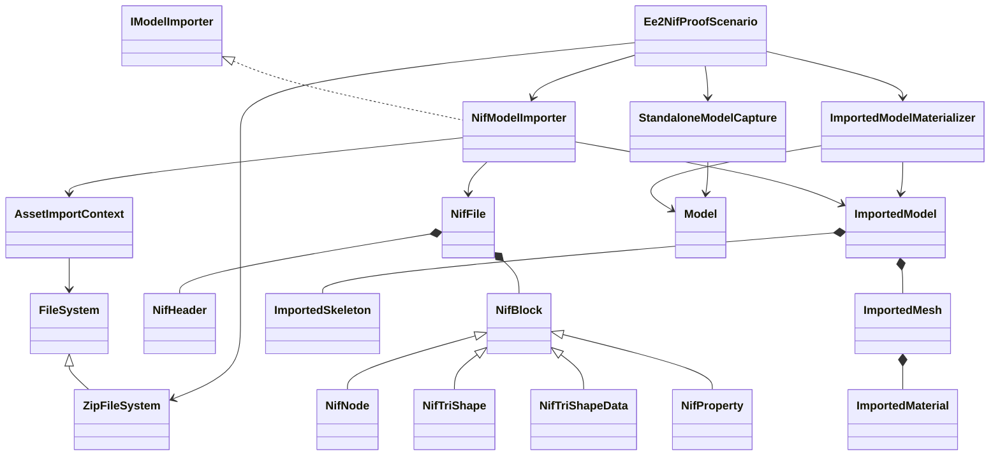
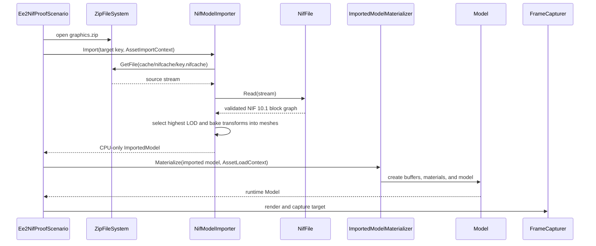

# Deep Dive: Empire Earth II Gamebryo models and NIF proof

> Audience: human. A survey of how Empire Earth II Gold stores, cooks, and binds unit models,
> animations, and textures, plus the bounded design for the
> [C4a NIF 10.1 proof](../track-c-external-assets.md). The corpus sanity-checks that the
> [C1 import seam](c1-import-abstraction.md) is format-agnostic beyond W3D and glTF. The original
> survey was performed 2026-09-14 against a local install.

## 1. Scope and method

Analyzed the retail Empire Earth II Gold install (GOG, with the community Unofficial Patch stack)
sibling to this repository. Tools: `unzip` listings, hex dumps, and a Python NIF header parser
written against the niftools [nif.xml](https://github.com/niftools/nifxml) `Header` spec. The
parser walked every model and animation file in the corpus and produced a block-type census; it
did not decode block bodies. Reproduction commands are in the appendix.

## 2. Packaging

All game assets ship in standard PKZIP archives under `zips/`, layered by version-suffixed
overrides loaded in ascending order: `graphics.zip`, `graphics_110.zip`, `graphics_120.zip`,
`Graphics_160.zip`; the same pattern for textures and for the `db_*.zip` database stack. There is
no proprietary container. Contents by archive:

| Archive | Contents |
|---|---|
| `graphics.zip` | 1638 `cache/nifcache/*.nifcache` models, 1371 `Graphics/` `*.kf` + 56 `*.KF` animations, one nested zip |
| `Graphics_160.zip` | 132 `.nifcache` override models (Unofficial Patch 1.6) |
| `textures.zip`, `Textures_160.zip` | `cache/texcache/*.texcache` textures, `cache/pcpcache/*.pcpatch` player-color patches |
| `db.zip` | 228 `.ddf` definitions, 70 `.csv`, 66 `.utf8` text, 10 `.cfg` |
| `hdrs.zip` | 74 `.h` headers enumerating database fields |

## 3. Models

`.nifcache` files are unmodified Gamebryo NIF files: header string `Gamebryo File Format, Version
10.1.0.0` (version word `0x0A010000`, user version 0). All 1638 model files share this version.
nif.xml attributes version 10.1.0.0 to Empire Earth II among other titles. The extension marks
them as cooked by the art pipeline (section 4); the runtime resolves the database's source name
(`nwg1_galley.nif`) to `cache/nifcache/nwg1_galley.nifcache`.

Header layout (version 10.1.0.0), verified across the corpus:

| Field | Type | Notes |
|---|---|---|
| Header string | text | ends with `\n`, not NUL-terminated |
| Version | u32 LE | `0x0A010000` |
| User version | u32 LE | 0 for all models |
| Num blocks | u32 LE | |
| Num block types | u16 LE | |
| Block types | sized strings | u32 LE length + ASCII |
| Block type index | u16 x num blocks | maps each block to a type |
| Num groups | u32 | 0 everywhere |

Block census over the 2610 files this layout parses (all 1638 models plus the 10.1-flavor
animations):

| Blocks | Count | Role |
|---|---|---|
| `NiNode` | 23161 | transform hierarchy (skeleton bones, attachment points) |
| `NiTriShape` / `NiTriShapeData` | 5529 / 5522 | triangle meshes (one shape per sub-mesh with its own transform) |
| `NiSkinInstance` / `NiSkinData` | 1457 / 1457 | per-vertex skinning (up to 4 bone influences) |
| `NiLODNode` / `NiRangeLODData` | 948 / 948 | distance-based LOD switches |
| `NiMaterialProperty` | 4475 | ambient/diffuse/specular/emissive colors |
| `NiTexturingProperty` / `NiSourceTexture` | 4296 / 2345 | texture stages, by-name texture refs |
| `NiAlphaProperty`, `NiZBufferProperty`, `NiStencilProperty`, `NiVertexColorProperty`, `NiSpecularProperty` | 1459-2649 each | fixed-function render state |
| `NiStringExtraData`, `NiIntegerExtraData`, `NiBooleanExtraData` | 11511 / 1514 / 1514 | engine metadata (e.g. `HOUSECOLOR`-style flags) |
| `NiKeyframeController` / `NiKeyframeData` | 28560 / 28560 | animation tracks (in `.kf`) |
| `NiControllerSequence`, `NiTextKeyExtraData` | 1018 / 1131 | animation clips and event markers |
| `NiParticles` family | ~1300 total | effects (`fx_*` models only) |

## 4. Cooking configuration

`db/Visuals/db_model_convert.csv` configures the asset pipeline per source folder: max vertex
count, mesh LOD count, bone LOD count, texture resize target, per-axis scale, light removal, and
a modulate-4x flag. Example row: the root `graphics/` folder is capped at 600 vertices, 0 mesh
LODs, 2 bone LODs, 256x256 textures. `db_texture_convert.csv` does the same for textures
(compression, mipmaps, alpha generation). Damage states are separate cooked models
(`NWG1_Galley_damage01..03.nifcache`) swapped by the engine, not vertex-level damage.

## 5. Animations

Animations are standard Gamebryo `.kf` files (clip = `NiControllerSequence`, one
`NiKeyframeController` + `NiKeyframeData` per animated node, `NiTextKeyExtraData` event markers).
The corpus spans three NIF vintages:

| Flavor | Files | Notes |
|---|---|---|
| 10.1.0.0, user version 0 | 972 | same layout as the models |
| 10.0.1.0 (`0x0A000100`), user versions 8-170 | 452 | older header layout; per-file Mad Doc user versions; the 10.1 parser does not fit them |
| NetImmerse 4.2.2.0 (`0x04020200`) | 3 | legacy |

Gameplay binding lives in `db/Units/*.ddf`. A `UnitModel` block names the model and maps visual
states to animations, with sound/FX event keys inline:

```ini
UnitModel WarGalley_01
{
    parent      = BaseShip
    DefaultModel = nwg1_galley.nif
    States = [
        { StateName = Idle  AnimName = NWG1_Galley_idle.kf }
        { StateName = Walk  AnimName = NWG1_Galley_walk.kf
            TextKeys = [{ Name = START_SOUND_UNTIL_ANIM_CHANGE Data = fx_move_boat_2 KeyTime = 0}] }
        { StateName = Attack1
            TextKeys = [{ Name = PLAY_SOUND Data = fx_bow_shoot KeyTime = 0.5 }] }
        { StateName = Death }
    ]
    ChildNames = [ WarGalleySail TheBoatWake2 ExplSelectorNaval Galley_FlyingParts ]
}
```

One unit type has one `UnitModel` per epoch (`WarGalley_01`, `_03`, `_05` with different models),
which is the same shape as Generals' `ModelConditionState` model swapping.

## 6. Textures

`cache/texcache/*.texcache` are also NIF 10.1.0.0 containers holding a single `NiPixelData`
block. Models reference textures by source name (`NiSourceTexture` -> `nwg1_galley.tga`) and the
runtime resolves the name to `<name>.texcache`, mirroring Generals' by-name texture lookup.
Player colors are applied through `cache/pcpcache/<name><A..K>.pcpatch` pixel patches (e.g.
`nwg1_galley_sailA..K`), one per player slot, patched onto the base texture at runtime.
C4b decodes the texcache containers; pixel patches stay out of scope.

## 7. Mapping onto the C1 interchange model

| EE2 / Gamebryo concept | C1 interchange type | Fit |
|---|---|---|
| `NiNode` tree | `ImportedSkeleton` / `ImportedBone` | NIF bones are named nodes linked by reference; C1 uses parent indices. Conversion is a tree flatten, and bone identity is by name (helps C2 remapping). |
| `NiTriShape` + data + shape transform | `ImportedMesh` / `ImportedSubObject` | One NiTriShape per sub-mesh, each with its own transform and properties; maps to sub-object + mesh. |
| `NiSkinInstance` / `NiSkinData` | `ImportedVertex` skin fields | NIF carries up to 4 influences per vertex against the runtime's two-bone limit; the C1 rule is no silent truncation. [C4d](c4d-ee2-skinned-animation.md#4-influence-policy) widens C1 and the runtime to four and rejects more. |
| `NiMaterialProperty` + texture/alpha/z/stencil properties | `ImportedMaterial` + texture-name properties | Fixed-function state maps to the fixed-function shading fields and render-state enums; textures stay by-name. |
| `NiLODNode` / `NiRangeLODData` | none | Runtime has no LOD-node concept in the C1 milestone; a decision for a later phase (drop, or bake the highest LOD). |
| `.kf` `NiControllerSequence` | `ImportedAnimation` / `ImportedAnimationChannel` | Per-node named tracks must be resolved to bone indices against a skeleton; channels are translation/rotation/quaternion keyframes, within the C1 channel set. |
| `NiTextKeyExtraData` + ddf `TextKeys` | none (INI-side) | Event markers sit both in the file and in the ddf state block; the gameplay-facing contract matches `AnimationState`. |
| ddf `UnitModel` state binding | `AnimationState` / `W3dModelDraw` selection | Importer-neutral in both engines; no interchange impact. |
| `.texcache` / `.pcpatch` | texture by-name lookup | Same contract as `AssetStore.Textures`; the patch system is EE2-specific and out of C1 scope. |
| `NiParticles` (`fx_*`) | none | Effects models are out of C1 scope. |

## 8. Implications for Track C

- The survey validates the C1 seam's shape: separate model and animation importers, a CPU-only
  interchange graph, by-name texture references, and gameplay-side state binding all exist in a
  second commercial engine with no forcing function from OpenSAGE's design.
- C4a uses NIF 10.1 as a static second-format proof after C1. C4's production glTF scope is
  unchanged.
- Known follow-up risks: three animation header vintages in one corpus (including 452 files of an
  older 10.0.1.0 layout with per-file user versions), 4-bone influences versus the two-bone
  runtime limit, cooked texture decoding, player-color patches, and DDF state binding.
- Follow-ups: C4b decodes cooked textures. [C4c](c4c-ee2-rigid-animation.md) imports the proof
  models' rigid KF clips. [C4d](c4d-ee2-skinned-animation.md) owns the four-influence skinning risk.
  [C4e](c4e-ee2-property-animation.md), [C4f](c4f-ee2-scale-animation.md),
  [C4g](c4g-ee2-morph-animation.md), [C4h](c4h-ee2-particle-effects.md), and
  [C4i](c4i-ee2-legacy-kf-formats.md) own property controllers, scale, morphs, particles, and
  the older animation vintages.

## 9. C4a proof-of-concept scope

### 9.1 Target assets

The proof uses two base-game entries from `zips/graphics.zip`. Their block inventories were
rechecked directly against the archive before defining the work items; `WI-C4a-01` recorded
the complete descriptors below with a temporary decoder kept outside the repository.

| Asset | Blocks | Required distinction |
|---|---:|---|
| `cache/nifcache/nwg1_galley.nifcache` | 74 | Static node hierarchy, triangle geometry, fixed-function material, texture references, and string metadata. |
| `cache/nifcache/ab11_TwinEngineBomber.nifcache` | 82 | The same base subset plus alpha and specular state and `NiLODNode` / `NiRangeLODData`. |

Neither target contains `NiSkinInstance` or `NiSkinData`. The proof therefore does not depend on
C2 and cannot be used to claim NIF skinning or animation support.

The supported block set is:

- `NiNode`, `NiLODNode`, and `NiRangeLODData` for the static hierarchy and highest-detail LOD.
- `NiTriShape` and `NiTriShapeData` for positions, normals, UVs, and triangle indices.
- `NiMaterialProperty`, `NiTexturingProperty`, `NiSourceTexture`, `NiAlphaProperty`,
  `NiSpecularProperty`, `NiZBufferProperty`, and `NiVertexColorProperty` for fixed-function
  material state.
- `NiStringExtraData` only where the target inventory identifies a passive metadata role.

Both targets use exactly this set: the Galley uses 9 block types, the Bomber 13 (adding
`NiAlphaProperty`, `NiSpecularProperty`, `NiLODNode`, and `NiRangeLODData`). No active block
outside the C4a subset appears in either file, so no target is blocked.

#### 9.1.1 EE2 10.1.0.0 wire layout (validated on both targets)

Byte-level facts the parser cards must honor, verified to exact end-of-file consumption on both
targets plus two minimal corpus files (`NULL.nifcache`, `road_15.nifcache`):

- Every block body begins with an unexplained leading `u32 0` before the first NIF field.
  The file ends with an 8-byte footer: `u32 1`, `u32 0`.
- `NiObjectNET` field order at 10.1.0.0: sized-string name, extra-data count (`u32`) plus
  block refs, then a single controller ref (`0xFFFFFFFF` = none in both targets).
- `NiAVObject`: flags (`u16`), translation (3x `f32`), rotation (3x3, 9x `f32`),
  scale (`f32`), property refs (`u32` count + refs), then a collision-object ref
  (`0xFFFFFFFF` = none in both targets).
- `NiNode` adds child refs then effect refs (`u32` count + refs each). Null refs (`0xFFFFFFFF`)
  are legal inside child lists: both targets' second-level `"ROOT"` node carries 15 null child
  slots before its single real child.
- `NiStringExtraData` carries no extra-data/controller fields: it is leading `u32 0`, name,
  then one payload sized string.
- `NiTriShapeData` order: vertex count (`u16`), keep flags (`u8`), compress flags (`u8`),
  has-vertices (`u8`), positions, data flags (`u16`; UV-set count is the low 6 bits, both
  targets use 1), has-normals (`u8`), normals, bound center (3x `f32`) and radius (`f32`),
  has-colors (`u8`, 0 for every target shape), UV sets, consistency (`u16`), triangle count
  (`u16`), triangle-point count (`u32`, always 3x triangle count), has-triangles (`u8`),
  triangles (`u16` indices), then match groups (`u16` count + per-group `u16` count + indices).
- Values observed but not mapped: geometry consistency is `0x4000` in every target data block
  and `NiVertexColorProperty` flags read `0xCDCD` (uninitialized writer bytes; mode fields are
  still valid). Both are recorded verbatim, never interpreted.
- `NiSourceTexture` is always external in both targets: use-external byte, file name sized
  string, pixel-data ref (`0xFFFFFFFF`), pixel layout / mipmap / alpha enums (`u32` each),
  is-static byte.
- `NiTexturingProperty` at 10.1 has no flags field: apply mode (`u32`), texture count (`u32`,
  7 in both targets), then per-slot enable byte plus descriptor (source ref, clamp `u32`,
  filter `u32`, UV set `u32`, PS2 L/K `i16`, texture-transform byte). Only the base slot is
  enabled in either target; both enable bytes for slots after base read 0. The trailing
  shader-texture count is `u32 0`.

#### 9.1.2 Complete target inventories

#### War Galley (`nwg1_galley.nifcache`, 74 blocks)

| Idx | Type | Name | Refs / values |
|---:|---|---|---|
| 0 | NiNode | nwg1_galley.nif | children=[3]; props=[2, 1] |
| 1 | NiZBufferProperty |  | flags=3 fn=3 |
| 2 | NiVertexColorProperty |  | flags=0xcdcd vm=0 lm=1 |
| 3 | NiNode | ROOT | children=[5] (+15 null); extra=[4] |
| 4 | NiStringExtraData | UserPropBuffer | data='KFAccumRoot = \r\n' |
| 5 | NiNode | ROOT NonAccum | children=[6,11,13,15,17,19,21,23,25,27,29,31,33,52,70,72] |
| 6 | NiTriShape | Galley1 | props=[9, 7, 2]; data=10; t=(-0.000,-0.000,2.477) |
| 7 | NiTexturingProperty |  | apply=4 count=7 base={'source': 8, 'clamp': 3, 'filter': 2, 'uv_set': 0, 'ps2_l': 0, 'ps2_k': -100} |
| 8 | NiSourceTexture |  | file=nwg1_galley.tga layout=3 mip=1 alpha=1 |
| 9 | NiMaterialProperty | 13 - Default | amb=[1.0, 1.0, 1.0] diff=[1.0, 1.0, 1.0] spec=[0.0, 0.0, 0.0] emis=[0.0, 0.0, 0.0] gloss=10.0 alpha=1.0 |
| 10 | NiTriShapeData |  | v=833 tri=774 pts=2322 uv=1 normals=1 colors=0 mg=833 cons=0x4000 |
| 11 | NiNode | tag_fire_front_1 | children=[]; extra=[12] |
| 12 | NiStringExtraData | UserPropBuffer | data='NiOptimizeKeep' |
| 13 | NiNode | tag_fire_front_2 | children=[]; extra=[14] |
| 14 | NiStringExtraData | UserPropBuffer | data='NiOptimizeKeep' |
| 15 | NiNode | tag_fire_front_3 | children=[]; extra=[16] |
| 16 | NiStringExtraData | UserPropBuffer | data='NiOptimizeKeep' |
| 17 | NiNode | tag_hit_1 | children=[]; extra=[18] |
| 18 | NiStringExtraData | UserPropBuffer | data='NiOptimizeKeep' |
| 19 | NiNode | tag_hit_2 | children=[]; extra=[20] |
| 20 | NiStringExtraData | UserPropBuffer | data='NiOptimizeKeep' |
| 21 | NiNode | tag_hit_3 | children=[]; extra=[22] |
| 22 | NiStringExtraData | UserPropBuffer | data='NiOptimizeKeep' |
| 23 | NiNode | tag_sail_1 | children=[]; extra=[24] |
| 24 | NiStringExtraData | UserPropBuffer | data='NiOptimizeKeep' |
| 25 | NiNode | tag_wake_1 | children=[]; extra=[26] |
| 26 | NiStringExtraData | UserPropBuffer | data='NiOptimizeKeep\r\n' |
| 27 | NiNode | tag_wake_2 | children=[]; extra=[28] |
| 28 | NiStringExtraData | UserPropBuffer | data='NiOptimizeKeep\r\n' |
| 29 | NiNode | tag_oar1_1 | children=[]; extra=[30] |
| 30 | NiStringExtraData | UserPropBuffer | data='NiOptimizeKeep\r\n' |
| 31 | NiNode | tag_muzzle_1 | children=[]; extra=[32] |
| 32 | NiStringExtraData | UserPropBuffer | data='NiOptimizeKeep' |
| 33 | NiNode | oars_left01 | children=[34,38,41,44,47,50] |
| 34 | NiNode | R_OAR14 | children=[35] |
| 35 | NiTriShape | Editable Mesh | props=[36, 7, 2]; data=37 |
| 36 | NiMaterialProperty | Material #0 | amb=[1.0, 1.0, 1.0] diff=[1.0, 1.0, 1.0] spec=[0.0, 0.0, 0.0] emis=[0.0, 0.0, 0.0] gloss=10.0 alpha=1.0 |
| 37 | NiTriShapeData |  | v=19 tri=34 pts=102 uv=1 normals=1 colors=0 mg=0 cons=0x4000 |
| 38 | NiNode | R_OAR15 | children=[39] |
| 39 | NiTriShape | Editable Mesh | props=[7, 2, 9]; data=40 |
| 40 | NiTriShapeData |  | v=19 tri=34 pts=102 uv=1 normals=1 colors=0 mg=0 cons=0x4000 |
| 41 | NiNode | R_OAR16 | children=[42] |
| 42 | NiTriShape | Editable Mesh | props=[7, 2, 36]; data=43 |
| 43 | NiTriShapeData |  | v=19 tri=34 pts=102 uv=1 normals=1 colors=0 mg=0 cons=0x4000 |
| 44 | NiNode | R_OAR17 | children=[45] |
| 45 | NiTriShape | Editable Mesh | props=[7, 2, 36]; data=46 |
| 46 | NiTriShapeData |  | v=19 tri=34 pts=102 uv=1 normals=1 colors=0 mg=0 cons=0x4000 |
| 47 | NiNode | R_OAR18 | children=[48] |
| 48 | NiTriShape | Editable Mesh | props=[7, 2, 36]; data=49 |
| 49 | NiTriShapeData |  | v=19 tri=34 pts=102 uv=1 normals=1 colors=0 mg=0 cons=0x4000 |
| 50 | NiNode | R_OAR19 | children=[51] |
| 51 | NiTriShape | Editable Mesh | props=[7, 2, 36]; data=37 |
| 52 | NiNode | oars_left | children=[53,56,59,62,65,68] |
| 53 | NiNode | R_OAR06 | children=[54] |
| 54 | NiTriShape | Editable Mesh | props=[7, 2, 9]; data=55 |
| 55 | NiTriShapeData |  | v=19 tri=34 pts=102 uv=1 normals=1 colors=0 mg=0 cons=0x4000 |
| 56 | NiNode | R_OAR05 | children=[57] |
| 57 | NiTriShape | Editable Mesh | props=[7, 2, 9]; data=58 |
| 58 | NiTriShapeData |  | v=19 tri=34 pts=102 uv=1 normals=1 colors=0 mg=0 cons=0x4000 |
| 59 | NiNode | R_OAR04 | children=[60] |
| 60 | NiTriShape | Editable Mesh | props=[7, 2, 9]; data=61 |
| 61 | NiTriShapeData |  | v=19 tri=34 pts=102 uv=1 normals=1 colors=0 mg=0 cons=0x4000 |
| 62 | NiNode | R_OAR03 | children=[63] |
| 63 | NiTriShape | Editable Mesh | props=[7, 2, 9]; data=64 |
| 64 | NiTriShapeData |  | v=19 tri=34 pts=102 uv=1 normals=1 colors=0 mg=0 cons=0x4000 |
| 65 | NiNode | R_OAR02 | children=[66] |
| 66 | NiTriShape | Editable Mesh | props=[7, 2, 9]; data=67 |
| 67 | NiTriShapeData |  | v=19 tri=34 pts=102 uv=1 normals=1 colors=0 mg=0 cons=0x4000 |
| 68 | NiNode | R_OAR13 | children=[69] |
| 69 | NiTriShape | Editable Mesh | props=[7, 2, 9]; data=67 |
| 70 | NiNode | tag_oar1_2 | children=[]; extra=[71] |
| 71 | NiStringExtraData | UserPropBuffer | data='NiOptimizeKeep\r\n' |
| 72 | NiNode | tag_garrison_pole | children=[]; extra=[73] |
| 73 | NiStringExtraData | UserPropBuffer | data='NiOptimizeKeep' |

#### Twin-Engine Bomber (`ab11_TwinEngineBomber.nifcache`, 82 blocks)

| Idx | Type | Name | Refs / values |
|---:|---|---|---|
| 0 | NiNode | ab11_TwinEngineBomber.nif | children=[3,76,78,80]; props=[2, 1] |
| 1 | NiZBufferProperty |  | flags=3 fn=3 |
| 2 | NiVertexColorProperty |  | flags=0xcdcd vm=0 lm=1 |
| 3 | NiNode | root | children=[5] (+16 null); extra=[4] |
| 4 | NiStringExtraData | UserPropBuffer | data='KFAccumRoot = \r\n' |
| 5 | NiNode | root NonAccum | children=[6,12,15,22,34,44,54,56,58,60,62,64,66,68,70,72,74] |
| 6 | NiNode | prop_01 | children=[7] |
| 7 | NiTriShape | Editable Poly | props=[10, 8]; data=11; t=(1.264,3.664,1.741) s=0.741591 |
| 8 | NiTexturingProperty |  | apply=4 count=7 base={'source': 9, 'clamp': 3, 'filter': 2, 'uv_set': 0, 'ps2_l': 0, 'ps2_k': -100} |
| 9 | NiSourceTexture |  | file=af11_biplane_prop.tga layout=3 mip=1 alpha=1 |
| 10 | NiMaterialProperty | 2 - Default | amb=[1.0, 1.0, 1.0] diff=[1.0, 1.0, 1.0] spec=[0.0, 0.0, 0.0] emis=[0.0, 0.0, 0.0] gloss=10.0 alpha=1.0 |
| 11 | NiTriShapeData |  | v=76 tri=68 pts=204 uv=1 normals=1 colors=0 mg=0 cons=0x4000 |
| 12 | NiNode | prop_02 | children=[13] |
| 13 | NiTriShape | Editable Poly | props=[8, 10]; data=14; t=(1.264,3.664,1.741) s=0.741591 |
| 14 | NiTriShapeData |  | v=76 tri=68 pts=204 uv=1 normals=1 colors=0 mg=0 cons=0x4000 |
| 15 | NiTriShape | wheels | props=[20, 19, 18, 16]; data=21; t=(-0.063,-1.471,2.090) rot!=I |
| 16 | NiTexturingProperty |  | apply=4 count=7 base={'source': 17, 'clamp': 3, 'filter': 2, 'uv_set': 0, 'ps2_l': 0, 'ps2_k': -115} |
| 17 | NiSourceTexture |  | file=ab11_TwinEngineBomber.tga layout=3 mip=1 alpha=2 |
| 18 | NiAlphaProperty |  | flags=4845 thr=100 |
| 19 | NiSpecularProperty |  | flags=1 |
| 20 | NiMaterialProperty | 20 - Default | amb=[1.0, 1.0, 1.0] diff=[1.0, 1.0, 1.0] spec=[0.15294118225574493, 0.15294118225574493, 0.15294118225574493] emis=[0.0, 0.0, 0.0] gloss=10.0 alpha=1.0 |
| 21 | NiTriShapeData |  | v=40 tri=24 pts=72 uv=1 normals=1 colors=0 mg=40 cons=0x4000 |
| 22 | NiLODNode | body | children=[23,26]; lodData=33 switchFlags=1 index=0 |
| 23 | NiTriShape | body_LOD0 | extra=[24]; props=[16, 18, 19, 20]; data=25; t=(-0.063,-1.471,2.090) rot!=I |
| 24 | NiStringExtraData | UserPropBuffer | data='LODGroup = true\r\n' |
| 25 | NiTriShapeData |  | v=738 tri=531 pts=1593 uv=1 normals=1 colors=0 mg=738 cons=0x4000 |
| 26 | NiTriShape | body_LOD1 | extra=[27]; props=[31, 30, 29, 28]; data=32; t=(-0.063,-1.471,2.090) rot!=I |
| 27 | NiStringExtraData | UserPropBuffer | data='LODGroup = true\r\n' |
| 28 | NiMaterialProperty | 20 - Default | amb=[1.0, 1.0, 1.0] diff=[1.0, 1.0, 1.0] spec=[0.15294118225574493, 0.15294118225574493, 0.15294118225574493] emis=[0.0, 0.0, 0.0] gloss=10.0 alpha=1.0 |
| 29 | NiSpecularProperty |  | flags=1 |
| 30 | NiAlphaProperty |  | flags=4845 thr=100 |
| 31 | NiTexturingProperty |  | apply=4 count=7 base={'source': 17, 'clamp': 3, 'filter': 2, 'uv_set': 0, 'ps2_l': 0, 'ps2_k': -115} |
| 32 | NiTriShapeData |  | v=634 tri=519 pts=1557 uv=1 normals=1 colors=0 mg=738 cons=0x4000 |
| 33 | NiRangeLODData |  | center=[0.0, 0.0, 0.0] ranges=[[0.0, 3.0], [3.0, 100000.0]] |
| 34 | NiLODNode | pilot | children=[35,38]; lodData=43 switchFlags=1 index=0 |
| 35 | NiTriShape | pilot_LOD0 | extra=[36]; props=[8, 10]; data=37; t=(-0.692,-5.438,4.227) rot!=I |
| 36 | NiStringExtraData | UserPropBuffer | data='LODGroup = true\r\n' |
| 37 | NiTriShapeData |  | v=335 tri=420 pts=1260 uv=1 normals=1 colors=0 mg=335 cons=0x4000 |
| 38 | NiTriShape | pilot_LOD1 | extra=[39]; props=[41, 40]; data=42; t=(-0.692,-5.438,4.227) rot!=I |
| 39 | NiStringExtraData | UserPropBuffer | data='LODGroup = true\r\n' |
| 40 | NiMaterialProperty | 2 - Default | amb=[1.0, 1.0, 1.0] diff=[1.0, 1.0, 1.0] spec=[0.0, 0.0, 0.0] emis=[0.0, 0.0, 0.0] gloss=10.0 alpha=1.0 |
| 41 | NiTexturingProperty |  | apply=4 count=7 base={'source': 9, 'clamp': 3, 'filter': 2, 'uv_set': 0, 'ps2_l': 0, 'ps2_k': -100} |
| 42 | NiTriShapeData |  | v=287 tri=380 pts=1140 uv=1 normals=1 colors=0 mg=335 cons=0x4000 |
| 43 | NiRangeLODData |  | center=[0.0, 0.0, 0.0] ranges=[[0.0, 3.0], [3.0, 100000.0]] |
| 44 | NiLODNode | pilot01 | children=[45,48]; lodData=53 switchFlags=1 index=0 |
| 45 | NiTriShape | pilot01_LOD0 | extra=[46]; props=[8, 10]; data=47; t=(-0.692,-4.657,4.227) rot!=I |
| 46 | NiStringExtraData | UserPropBuffer | data='LODGroup = true\r\n' |
| 47 | NiTriShapeData |  | v=335 tri=420 pts=1260 uv=1 normals=1 colors=0 mg=335 cons=0x4000 |
| 48 | NiTriShape | pilot01_LOD1 | extra=[49]; props=[51, 50]; data=52; t=(-0.692,-4.657,4.227) rot!=I |
| 49 | NiStringExtraData | UserPropBuffer | data='LODGroup = true\r\n' |
| 50 | NiMaterialProperty | 2 - Default | amb=[1.0, 1.0, 1.0] diff=[1.0, 1.0, 1.0] spec=[0.0, 0.0, 0.0] emis=[0.0, 0.0, 0.0] gloss=10.0 alpha=1.0 |
| 51 | NiTexturingProperty |  | apply=4 count=7 base={'source': 9, 'clamp': 3, 'filter': 2, 'uv_set': 0, 'ps2_l': 0, 'ps2_k': -100} |
| 52 | NiTriShapeData |  | v=287 tri=380 pts=1140 uv=1 normals=1 colors=0 mg=335 cons=0x4000 |
| 53 | NiRangeLODData |  | center=[0.0, 0.0, 0.0] ranges=[[0.0, 3.0], [3.0, 100000.0]] |
| 54 | NiNode | tag_damage_1 | children=[]; extra=[55] |
| 55 | NiStringExtraData | UserPropBuffer | data='NiOptimizeKeep' |
| 56 | NiNode | tag_damage_2 | children=[]; extra=[57] |
| 57 | NiStringExtraData | UserPropBuffer | data='NiOptimizeKeep' |
| 58 | NiNode | tag_damage_3 | children=[]; extra=[59] |
| 59 | NiStringExtraData | UserPropBuffer | data='NiOptimizeKeep' |
| 60 | NiNode | tag_trail_1_a | children=[]; extra=[61] |
| 61 | NiStringExtraData | UserPropBuffer | data='NiOptimizeKeep' |
| 62 | NiNode | tag_trail_1_b | children=[]; extra=[63] |
| 63 | NiStringExtraData | UserPropBuffer | data='NiOptimizeKeep' |
| 64 | NiNode | tag_trail_2_a | children=[]; extra=[65] |
| 65 | NiStringExtraData | UserPropBuffer | data='NiOptimizeKeep' |
| 66 | NiNode | tag_trail_2_b | children=[]; extra=[67] |
| 67 | NiStringExtraData | UserPropBuffer | data='NiOptimizeKeep' |
| 68 | NiNode | tag_trail_3_a | children=[]; extra=[69] |
| 69 | NiStringExtraData | UserPropBuffer | data='NiOptimizeKeep' |
| 70 | NiNode | tag_trail_3_b | children=[]; extra=[71] |
| 71 | NiStringExtraData | UserPropBuffer | data='NiOptimizeKeep' |
| 72 | NiNode | tag_trail_4_a | children=[]; extra=[73] |
| 73 | NiStringExtraData | UserPropBuffer | data='NiOptimizeKeep' |
| 74 | NiNode | tag_trail_4_b | children=[]; extra=[75] |
| 75 | NiStringExtraData | UserPropBuffer | data='NiOptimizeKeep' |
| 76 | NiNode | tag_ground_1 | children=[]; extra=[77] |
| 77 | NiStringExtraData | UserPropBuffer | data='NiOptimizeKeep' |
| 78 | NiNode | tag_ground_2 | children=[]; extra=[79] |
| 79 | NiStringExtraData | UserPropBuffer | data='NiOptimizeKeep' |
| 80 | NiNode | tag_ground_3 | children=[]; extra=[81] |
| 81 | NiStringExtraData | UserPropBuffer | data='NiOptimizeKeep' |


#### 9.1.3 Source convention and the import contract matrix

Derived from the accumulated transforms and geometry (all determinants positive, minimum
0.408 uniform prop-blade scale cubed; signed world-space volume positive for every mesh):

- Handedness: right-handed. Winding needs no reversal provided the engine target preserves
  the C4 glTF convention (the C4 `(x, y, z) -> (z, x, y)` mapping is an even permutation).
- Rotation layout: the stored 3x3 is the column-vector rotation map (`v' = M v`), the
  convention NifSkope renders. The engine composes row-vector (`v' = v R`), so every
  stored→engine rotation hand-off transposes the matrix. Anchored physically by the Galley
  oar rest poses: the transpose fans oars outboard at the gunwale, a positional copy
  rendered them under the keel (caught 2026-09-23 by reviewing the C4c animated captures;
  translations, identity rotations, determinants, and AABB magnitudes are transpose-blind,
  which is why C4a self-derived checks never caught it).
- Up axis: `+Z` (identity root rotations; masts and superstructure extend along `+Z`).
- Front axis: `-Y`. Bomber evidence: propellers (`y = -5.7`), both pilot meshes
  (`y = -5.4`), and the tail wheel at `y = +6.1` marks the rear of a WW1-style
  tail-dragger; the Galley's longer end is `-Y` (extent `-23.91` vs `+18.32`).
- Unit scale: meters. Baked world extents (source units, from the importer's unit-tested
  transform bake): the Galley spans 46.8 along the fore-aft axis, 38.9 across the oars, and
  33.2 mast-to-keel; the Bomber spans 19.1 wingspan, 14.2 fuselage, 5.4 gear-to-tail. The
  engine unit is feet per C4 (1 m renders 3.28084 units).
- Baked world AABBs in source units: Galley `x [-19.47, 19.41] y [-23.91, 22.86]
  z [-8.61, 24.61]`; Bomber `x [-9.57, 9.55] y [-8.09, 6.15] z [-0.21, 5.20]`. The
  interactive descriptor tests lock these after the engine conversion. Values re-derived
  2026-09-23 under the corrected (transposing) rotation hand-off; the oar beam widens and
  the Bomber pitch sign flips versus the original positional-copy bake.
- Winding and culling: EE2 triangle winding matches neither engine front-face
  orientation (each cull direction removes nearly the whole mesh), so NIF materials
  import with culling disabled and the C4a winding-reversal rule stays as the
  determinant-based mirror handling.
- Glossiness: NIF carries a 3ds Max 0-100 glossiness; the engine's fixed-function
  shininess multiplies the specular contribution directly, so the importer divides
  by 100 (a raw 10 bleeds highlights to full white across the mesh).

The single source-to-engine matrix C4a bakes into every shape (positions and normals, then
bounds recomputed):

```
e_x = -3.28084 * n_y
e_y =  3.28084 * n_x
e_z =  3.28084 * n_z
```

This is `Rz(+90 degrees)` times a uniform meters-to-feet scale, determinant +1: upright,
`+X`-forward, no winding flip.

Bomber LOD: all three `NiLODNode`s (`body`, `pilot`, `pilot01`) carry
`NiRangeLODData` ranges `[[0, 3], [3, 100000]]` with two children each. The minimum near
range (0.0) unambiguously selects child 0, the `*_LOD0` mesh with the higher vertex count
(`body_LOD0` 738 v / 531 t; `pilot_LOD0` / `pilot01_LOD0` 335 v / 420 t). `switch_index`
written by the cooker is 0 for all three, matching the range selection. `WI-C4a-06` selects
by minimum near range, never by block order.

Shared data blocks: Galley shapes 35 and 51 share data block 37, and shapes 66 and 69 share
data block 67. The two members of each pair hang under different parents with different
rotations, so the importer bakes each shape independently.

Every target shape carries normals and exactly one UV set; none carries vertex colors.
Both files have exactly one root (block 0, named after the file) and no disconnected blocks.

### 9.2 Import and rendering contract

- Input is an operator-owned EE2 installation selected by `EMPIRE_EARTH_II_PATH`. No fallback
  machine path is embedded in source.
- `ZipFileSystem` exposes `graphics.zip` through the existing `FileSystem` abstraction with
  case-insensitive normalized entry lookup. C4a does not implement EE2's patch-layer stack.
- `NifFile` accepts only `Gamebryo File Format, Version 10.1.0.0`, version `0x0A010000`, user
  version 0. Other versions throw `NotSupportedException` with asset context.
- `NifModelImporter` walks the selected NIF node graph and accumulates each shape's full source
  transform. It bakes that transform and one documented source-to-engine conversion into the
  static mesh positions and normals, reverses triangle winding when the conversion changes
  handedness, and attaches all meshes to one identity root bone. This avoids widening
  `ImportedBone`, which stores translation and rotation but not scale.
- Non-finite transforms and transforms that cannot be represented safely by position and
  inverse-transpose normal baking fail with `NotSupportedException`.
- The Bomber's `NiLODNode` is baked to the child whose range starts nearest the camera. Other LOD
  children are intentionally omitted because C1 has no LOD interchange type.
- Fixed-function colors and render state map to `ImportedMaterial`; by-name `.tga` references
  remain `TextureName` properties. The proof sets texture-stage count to zero and renders the
  fixed-function diffuse color without sampling an unresolved texture. `.texcache` and
  `.pcpatch` decoding are not part of C4a.
- Each mesh's axis-aligned bounding box and bounding sphere are recomputed from transformed
  positions. Source bounds remain parser diagnostics but are not copied after transform baking.
- Unsupported block types reachable from the selected graph throw `NotSupportedException`.
  Invalid references, counts, ranges, or malformed data throw contextual
  `InvalidDataException`. No data is silently truncated or discarded.
- Synthetic byte streams cover parser behavior in normal tests. Installed-asset tests and
  captures read the local archive only. Raw or extracted EE2 assets are never committed.

### 9.3 Completion boundary

C4a is complete when both target archive entries:

1. Import into deterministic `ImportedModel` descriptors whose counts, bounds, hierarchy,
   material values, and texture names match the inventory from `WI-C4a-01`.
2. Materialize through the C1 runtime materializer without a NIF-specific runtime type.
3. Produce recognizable frame captures with correct baked hierarchy placement, winding, normals,
   orientation, scale, and the Bomber's highest-detail LOD.

KF animation, skinning, older NIF versions, cooked textures, player color, patch archives, DDF
unit definitions, damage-state swapping, particles, and general EE2 game support remain separate
follow-up work. C4b covers cooked textures, [C4c](c4c-ee2-rigid-animation.md) covers the proof
models' rigid KF animation, and C4d covers skinning.

## 10. Architecture diagrams





## Appendix: reproduction

Install root (sibling of this repository): `Empire Earth II Gold/`.

```sh
# Archive contents and corpus
unzip -l "Empire Earth II Gold/zips/graphics.zip" | grep -c nifcache
unzip -l "Empire Earth II Gold/zips/graphics.zip" | grep -oE '\.[a-zA-Z0-9]+$' | sort | uniq -c

# Header of one model: "Gamebryo File Format, Version 10.1.0.0", version word 0x0A010000
unzip -p "Empire Earth II Gold/zips/graphics.zip" cache/nifcache/nwg1_galley.nifcache | xxd | head -6

# Gameplay binding
unzip -p "Empire Earth II Gold/zips/db.zip" db/Units/war_galley.ddf | sed -n '160,190p'
```

Header parsing reference: niftools nif.xml `Header` struct (spec fields: header string, version,
user version, num blocks, num block types (u16), block types, block type index, num groups; see
`Header` and `FileVersion` in [nifxml](https://github.com/niftools/nifxml)). The census parser
(~60 lines, stdlib only) and extracted samples were kept out of the repository; the block-type
counts above are its output over the full corpus.
