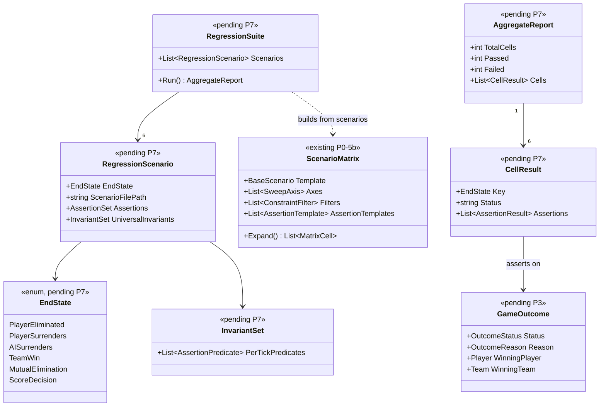
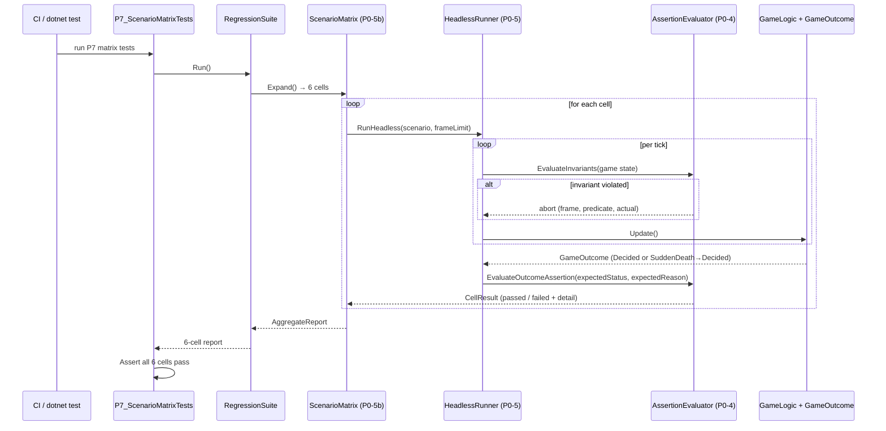
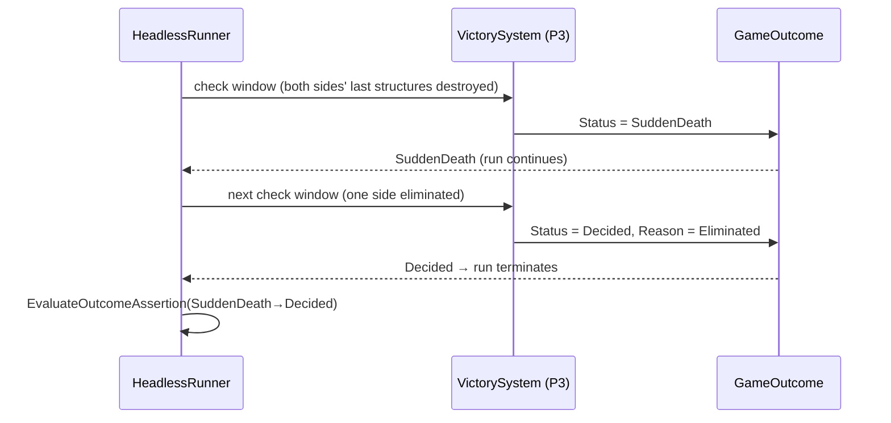

# Deep Dive: End-to-End Skirmish Regression Suite (P7)

> Expands phase P7 of [Track P — Playable Baseline](../track-p-playable-baseline.md). Part of
> the [Large-Scale Simulation Roadmap](../README.md).
>
> Audience: human overview of the P7 regression suite. Code references are in the agent-context appendix at the bottom.
>
> The agent-context section at the bottom ([Current code appendix](#appendix-current-code--agent-context)) contains file:line code references. Skip it if reading for design intent.

Purpose: lock the playable baseline with six headless end-state scenarios. The design assembles the
prior phases into one regression gate: economy, production, AI, combat, and victory detection must
terminate correctly for each supported end-state path.

---

## 1. Why P7

Every other Track P phase validates a subsystem in isolation. P1 checks setup, P3 checks victory
detection, and P6 checks combat paths. None confirm that all subsystems cooperate in a match that
runs to completion. P7 does that with minimal but realistic scenarios that exercise the full loop
and assert on the result.

A passing P7 suite is also the gate for Track A (A1 headless host) and Track B (B1 benchmarks).
Both assume a validated, terminating match loop, and P7 is the documented proof that it exists.

---

## 2. The six end-state scenarios

Each scenario is a `ReplayScenario` (authored programmatically, stored as a checked-in `.json`
scenario file) that is scripted to reach exactly one terminal `GameOutcome`. Each carries the
universal invariant set (§3) plus an end-state-specific outcome assertion.

| End state | `OutcomeStatus` | `OutcomeReason` | How the scenario reaches it |
|---|---|---|---|
| PlayerEliminated | `Decided` | `Eliminated` | Human player's last command/production structures are destroyed and no rebuild is possible |
| PlayerSurrenders | `Decided` | `Surrendered` | Human player issues `OrderType.EndGame` after brief play |
| AISurrenders | `Decided` | `Surrendered` | AI player issues `OrderType.EndGame` (forced via a scripted trigger) |
| TeamWin | `Decided` | `Eliminated` | Both players of the losing team are eliminated by the winning team |
| MutualElimination | `SuddenDeath` then `Decided` | `Eliminated` | Both sides' last structures fall in the same check window; play continues until one side is re-eliminated |
| ScoreDecision | `Decided` | `ScoreDecision` | Match runs to the configured frame limit; winner picked by score metric |

### Scripting approach

Each scenario uses a small number of P0 harness commands, such as build, produce, attack, and
`EndGame`, chosen to reach the target end state deterministically in the fewest ticks. Scenarios
are written once by a human or agent, stored in
`src/OpenSage.Tools.ReplaySketch.Core/Scenarios/Regression/`, and never re-generated. They use
fixed seeds, no random timing, and no optional branching. Any AI player that must make progress is
scripted with explicit `BuildObject` and `CreateUnit` orders rather than the live AI so the
scenario stays reproducible across builds.

---

## 3. Universal invariants

Every cell in the P7 matrix has the following invariant assertions attached (per-tick, checked
via the P0 harness `Game.Updating` hook):

| Invariant | Path / expression | Why |
|---|---|---|
| Money never negative | `player[*].bankAccount >= 0` | Economy should never permit overdraft |
| No unit duplication | `player[*].ownedUnitCount == distinct(player[*].ownedUnitIds).length` | Leaked / double-registered objects are a latent engine bug |
| AI made progress (AI cells) | `aiPlayer.orderCount >= 1` by frame N | AI that issues no orders has not played; scenario is broken or AI is broken |

A violation of any invariant causes the run to abort immediately and the cell to be marked failed,
with the offending frame number recorded in the aggregate report.

---

## 4. Scenario matrix

P7 formalizes the six scenarios as a single `ScenarioMatrix` with one axis — `endState` — and
universal invariants attached to all cells.

| Axis | Values |
|---|---|
| `endState` | `PlayerEliminated`, `PlayerSurrenders`, `AISurrenders`, `TeamWin`, `MutualElimination`, `ScoreDecision` |

The matrix runner (P0-5b) expands to six cells. Each cell substitutes `{endState}` into the
scenario file path and into its outcome assertion (the expected `GameOutcome.Status` and
`GameOutcome.Reason` values), so the full assertion set is authoring-time data, not code.

Output: a six-cell aggregate JSON report. All six cells must pass for P7 to be considered passing.

---

## 5. Regression locking

Locking means the six scenario files and their assertion sets are committed to source control in
`src/OpenSage.Tools.ReplaySketch.Core/Scenarios/Regression/`, and the corresponding tests in
`TrackPScenarioMatrixTests.cs` are unblocked. From that point:

- The `P7_ScenarioMatrixTests` xUnit tests run with every `dotnet test src --filter Category!=Interactive`
  invocation. They require no game files because the scenarios are headless and engine mock-based.
- A regression is a new test failure: a scenario that previously terminated correctly no longer
  does so. The phase-matrix report identifies the failing cell.
- Scenarios are static inputs, not regenerated on each test run. If one must change because a
  phase dependency changed the end-state scripting, that authored update is committed alongside the
  code change.

---

## 6. Sub-phases

| Sub-phase | Goal | Status |
|---|---|---|
| P7-1. PlayerEliminated scenario | Author and assert: human player's structures destroyed → `GameOutcome` `Decided/Eliminated`. Universal invariants attached. | Not started |
| P7-2. PlayerSurrenders scenario | Author and assert: human player issues `EndGame` → `Decided/Surrendered`. | Not started |
| P7-3. AISurrenders scenario | Author and assert: scripted AI `EndGame` order → `Decided/Surrendered`. | Not started |
| P7-4. TeamWin scenario | Author and assert: both losing-team players eliminated → `Decided/Eliminated`, `WinningTeam` set. | Not started |
| P7-5. MutualElimination scenario | Author and assert: simultaneous elimination → `SuddenDeath`, then next elimination → `Decided/Eliminated`. | Not started |
| P7-6. ScoreDecision scenario | Author and assert: frame limit expires → `Decided/ScoreDecision`, winner set by score metric. | Not started |
| P7-7. Universal invariants + matrix run | Attach the three universal invariants to all six scenarios; run all six through P0-5b; aggregate report passes. | Not started |
| P7-8. Regression lock | Commit scenario files; unblock `P7_ScenarioMatrixTests`; add CI filter note to README. | Not started |

---

## 7. Sequencing & dependencies

- P7 depends on all earlier Track P phases: P0, P1, P2, P3, P4, P5, P6, and P6b.
- P7 unblocks Track A because A1 headless host depends on a validated terminating loop, and Track
  B because B1 benchmarks need a scenario that runs to completion.
- P7's six scenario files also seed A2 strict-hash verification and B1 benchmarking.

---

## 8. Architecture Diagrams

### Class diagram

### Sequence diagram — suite execution

### Sequence diagram — MutualElimination cell

---

## 9. Related

- Track overview: [`../track-p-playable-baseline.md`](../track-p-playable-baseline.md)
- Harness (run-and-assert, matrix runner): [`playable-baseline-harness.md`](playable-baseline-harness.md) (P0)
- Victory detection & `GameOutcome`: [`victory-defeat.md`](victory-defeat.md) (P3)
- Unit-contract scenarios that feed P7: [`unit-contract-validation.md`](unit-contract-validation.md) (P6b)
- Headless host that depends on P7: [`headless-host.md`](headless-host.md) (A1)
- Architecture snapshot: [`../agent/current-state.md`](../agent/current-state.md)

---

## Appendix: Current code — agent context

> Agent context: this section contains file:line code references for agents
> implementing this phase. Human readers: the design intent above does not
> require reading this section.

### Scenario storage location
Regression scenario files will live in
`src/OpenSage.Tools.ReplaySketch.Core/Scenarios/Regression/` (directory to be created in P7-1).
Each scenario is a `ReplayScenario` serialized to JSON via `System.Text.Json`.

### Test class
`src/OpenSage.Game.Tests/Tools/ReplaySketch/TrackPScenarioMatrixTests.cs` → `P7_ScenarioMatrixTests`:
`Matrix_AllEndStateCells_PassWithInvariants` and `Matrix_InvariantViolation_AbortsRunAndReportsCell`.
Both currently throw `NotImplementedException`; P7-8 unblocks them.

### GameOutcome query path
`GameOutcome` is exposed on `GameLogic` / `IGame` (pending P3). P7's outcome assertion reads
`game.GameLogic.GameOutcome.Status` and `.Reason`.

### Universal invariant hook
Invariants subscribe to `Game.Updating` (the per-tick event on `Game.cs`). The `AssertionEvaluator`
(P0-4) checks each registered `PerTickPredicate` at the end of each tick and records the first
violation frame.

### OrderType.EndGame
`PlayerSurrenders` and `AISurrenders` scenarios emit `OrderType.EndGame` via the P0 harness
command model. The handler is added to `OrderProcessor.Process` as part of P3-4.

### Frame limit (ScoreDecision)
The `ScoreDecision` scenario configures `MatchConfig.FrameLimit` (pending P3-6) to a small value
so the scenario terminates without running the full skirmish to natural conclusion.
