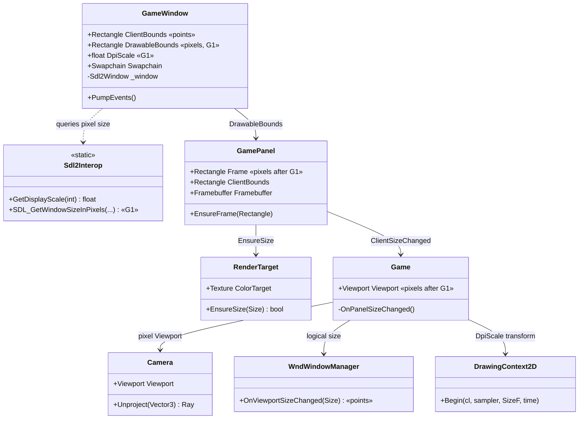
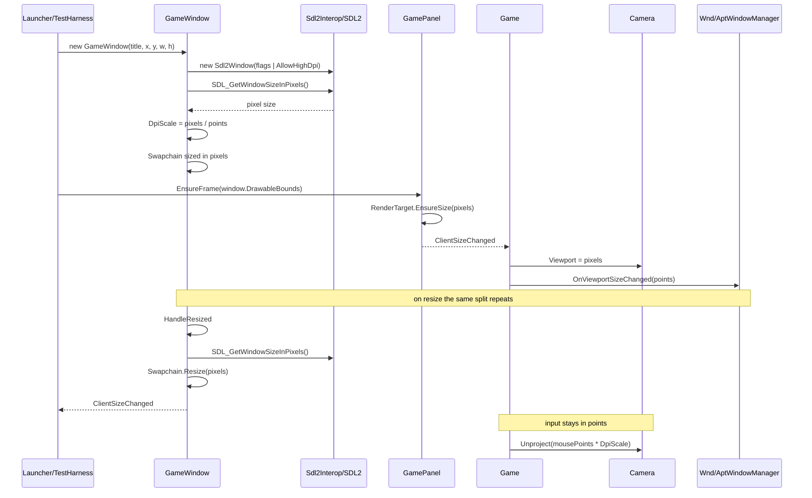

# Deep Dive: High-DPI Drawable & Resolution Correctness (G1)

> Expands phase G1 of [Track G: Rendering Clarity & Image Quality](../track-g-rendering-clarity.md).
> Part of the [Large-Scale Simulation Roadmap](../README.md).
>
> Audience: human overview of the high-DPI design. Code references are in the agent-context appendix at the bottom.
>
> The agent-context section at the bottom ([Current code appendix](#appendix-current-code-agent-context)) contains file:line code references. Skip it if reading for design intent.

Purpose: render at the display's native pixel resolution. Today one size value drives both the
render surfaces and the UI layout, and that value is in logical points, so on a scaled display the
whole frame is rendered below native resolution and resampled by the compositor.

---

## 1. Problem

`GameWindow` conflates two coordinate spaces that are only equal when the display scale is 1:

- Logical points: the coordinate space SDL reports window bounds and mouse events in, and the
  space the WND/APT GUI is laid out in.
- Physical pixels: the coordinate space the swapchain, render targets and 3D viewport must use.

`GameWindow.ClientBounds` returns `Sdl2Window.Bounds`, which is points. That single value flows to
the swapchain, the `GamePanel` render target, the 3D `Viewport`, and the GUI layout managers. The
window is also created without `SDL_WINDOW_ALLOW_HIGHDPI`, so SDL never gives the window a
high-resolution drawable in the first place, while the constructor separately pre-multiplies the
requested size by `WindowScale`. The result is a below-native render that the OS upscales, plus
two inconsistent scaling conventions in the same class.

## 2. Constraints from the Veldrid/SDL layer

These were verified against the pinned packages and are the reason the fix is not a one-line flag:

- `WindowCreateInfo` has no flags field, so `VeldridStartup.CreateWindow` cannot request
  `AllowHighDpi`. `Sdl2Window`'s public constructor does take `SDL_WindowFlags`, so window creation
  must bypass `VeldridStartup.CreateWindow` and replicate its flags.
- `Sdl2Window.ScaleFactor` is hardcoded to `Vector2.One` in Veldrid 4.9, so it cannot be used to
  discover the scale.
- Veldrid.SDL2 wraps no drawable-size entry point, so the pixel size must come from a P/Invoke
  through the existing `Sdl2Interop` pattern. `SDL_GetWindowSizeInPixels` (SDL 2.26+) is the
  backend-agnostic call and is present in the SDL2 the project runs against.

## 3. Design

Make the two spaces explicit and give each consumer the one it needs.

`GameWindow` exposes both, and no caller infers one from the other:

- `ClientBounds` keeps its current meaning: logical points. Input, cursor and GUI layout use it.
- `DrawableBounds` is new: physical pixels, from `SDL_GetWindowSizeInPixels`. The swapchain,
  `GamePanel`'s render target and the 3D `Viewport` use it.
- `DpiScale` is the ratio between them, replacing the display-DPI guess `WindowScale` currently
  derives from `SDL_GetDisplayDPI` on display 0.

Two consequences have to be handled together with the split, or the change trades a soft image for
a broken one:

- The 3D camera unprojects mouse positions through `Viewport`. Once the viewport is in pixels,
  mouse positions (points) must be scaled by `DpiScale` at the picking boundary, or selection and
  terrain picking drift by the scale factor.
- `DrawingContext2D` draws the GUI into the now larger pixel framebuffer while WND/APT layout stays
  in points. The 2D layer therefore needs a `DpiScale` transform, otherwise the HUD renders at
  `1/scale` size in the corner of the frame. Making the GUI genuinely resolution-independent is
  [G9](../track-g-rendering-clarity.md); G1 only preserves its current physical size.

Sub-phases, matching the card decomposition:

| Sub-phase | Scope |
|---|---|
| G1-1 | Audit and classify every window/panel size consumer as points or pixels. |
| G1-2 | `AllowHighDpi` window creation, `SDL_GetWindowSizeInPixels` interop, `DrawableBounds`/`DpiScale`, swapchain in pixels. |
| G1-3 | Route the render target and 3D viewport to pixels, keeping GUI layout on points. |
| G1-4 | Scale 2D drawing and mouse picking by `DpiScale` so UI size and selection stay correct. |

## 4. Validation

The scale factor is the whole point, so a test at scale 1 proves nothing. Validation is a
`DpiScale`-parameterised check that `DrawableBounds == ClientBounds * DpiScale`, that the panel
render target matches `DrawableBounds`, and that a mouse position at the centre of the window
unprojects to the same world ray at scale 1 and scale 2. The captured-frame dimension check
belongs to the phase milestone and runs through `FrameCapturer`.

---

## 5. Architecture Diagrams

Coordinate-space ownership after G1. Types shown are the existing ones; `DrawableBounds`,
`DpiScale` and the pixel-space routing are what G1 adds.

Startup and resize flow, showing where the two spaces separate.

---

## Appendix: current code (agent context)

- `src/OpenSage.Game/GameWindow.cs:73-107`: constructor. Reads `Sdl2Interop.GetDisplayScale(0)` into
  `WindowScale`, pre-multiplies `x`/`y`/`width`/`height` by it, and calls
  `VeldridStartup.CreateWindow`, which cannot pass `AllowHighDpi`.
- `src/OpenSage.Game/GameWindow.cs:36-43`: `ClientBounds`, returning `_window.Bounds` (points).
- `src/OpenSage.Game/GameWindow.cs:110-115`: `CreateGraphicsDevice`, which assigns
  `graphicsDevice.MainSwapchain`.
- `src/OpenSage.Game/GameWindow.cs:120-129`: `HandleResized`, which calls `Swapchain.Resize` with
  `_window.Bounds` (points).
- `src/OpenSage.Game/Utilities/Sdl2Interop.cs:56-80`: the `Sdl2Native.LoadFunction` P/Invoke pattern
  to replicate, plus `GetDisplayScale`.
- `src/OpenSage.Game/GamePanel.cs:18-39`: `Frame`, `ClientBounds`, `EnsureFrame` and the
  `ClientSizeChanged` event.
- `src/OpenSage.Game/Graphics/RenderTarget.cs:26-54`: `EnsureSize`, which allocates the colour target.
- `src/OpenSage.Game/Game.cs:639`: `Panel.EnsureFrame(window?.ClientBounds ?? ...)`.
- `src/OpenSage.Game/Game.cs:666-683`: `OnPanelSizeChanged`, the single place where the 3D
  `Viewport` and the GUI managers are both fed `Panel.ClientBounds.Size`.
- `src/OpenSage.Game/Graphics/Cameras/Camera.cs:145-161`: `Unproject`, the picking path that
  consumes `Viewport`.
- `src/OpenSage.Game/Gui/Wnd/WndWindowManager.cs:36` and
  `src/OpenSage.Game/Gui/Apt/AptWindowManager.cs:30`: GUI layout sizing from `Panel.ClientBounds`.
- `src/OpenSage.Game/Graphics/Rendering/RenderPipeline.cs:136-141`: `DrawingContext2D.Begin`, which
  takes the render-target size, where the G1-4 scale transform belongs.
- `src/OpenSage.Launcher/Program.cs:345`, `src/OpenSage.Tools.TestHarness/Program.cs:402,457`:
  the `Panel.EnsureFrame(window.ClientBounds)` call sites.
- `src/OpenSage.Game/Input/Cursors/CursorManager.cs:70`: `CursorScale` consumer, which stays on the
  logical/DPI-scale value.
