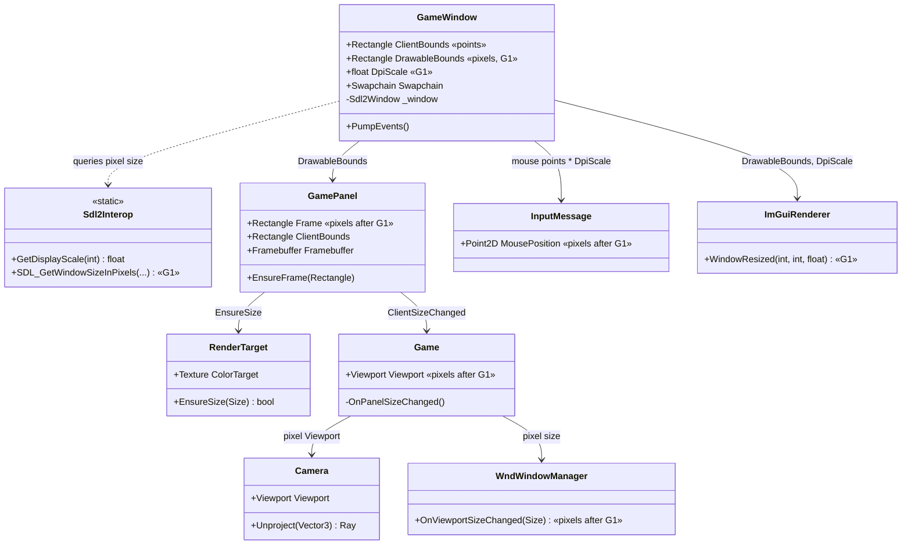
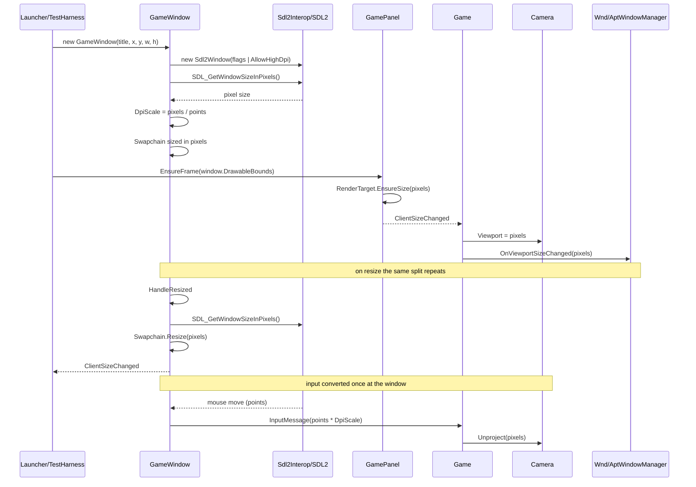

# Deep Dive: High-DPI Drawable & Resolution Correctness (G1)

> Expands phase G1 of [Track G: Rendering Clarity & Image Quality](../track-g-rendering-clarity.md).
> Part of the [Large-Scale Simulation Roadmap](../README.md).
>
> Audience: human overview of the high-DPI design. Code references are in the agent-context appendix at the bottom.
>
> The agent-context section at the bottom ([Current code appendix](#appendix-current-code-agent-context)) contains file:line code references. Skip it if reading for design intent.

Purpose: render at the display's native pixel resolution. Before G1 one size value drove both the
render surfaces and the UI layout, and that value was in logical points, so on a scaled display the
whole frame was rendered below native resolution and resampled by the compositor.

---

## 1. Problem

`GameWindow` conflates two coordinate spaces that are only equal when the display scale is 1:

- Logical points: the coordinate space SDL reports window bounds and mouse events in, and the
  space the WND/APT GUI is laid out in.
- Physical pixels: the coordinate space the swapchain, render targets and 3D viewport must use.

`GameWindow.ClientBounds` returns `Sdl2Window.Bounds`, which is points. That single value flows to
the swapchain, the `GamePanel` render target, the 3D `Viewport`, and the GUI layout managers. The
window is also created without `SDL_WINDOW_ALLOW_HIGHDPI`, so SDL never gives the window a
high-resolution drawable in the first place, while the constructor separately pre-multiplies the
requested size by `WindowScale`. The result is a below-native render that the OS upscales, plus
two inconsistent scaling conventions in the same class.

## 2. Constraints from the Veldrid/SDL layer

These were verified against the pinned packages and are the reason the fix is not a one-line flag:

- `WindowCreateInfo` has no flags field, so `VeldridStartup.CreateWindow` cannot request
  `AllowHighDpi`. `Sdl2Window`'s public constructor does take `SDL_WindowFlags`, so window creation
  must bypass `VeldridStartup.CreateWindow` and replicate its flags.
- `Sdl2Window.ScaleFactor` is hardcoded to `Vector2.One` in Veldrid 4.9, so it cannot be used to
  discover the scale.
- Veldrid.SDL2 wraps no drawable-size entry point, so the pixel size must come from a P/Invoke
  through the existing `Sdl2Interop` pattern. `SDL_GetWindowSizeInPixels` (SDL 2.26+) is the
  backend-agnostic call and is present in the SDL2 the project runs against.

## 3. Design

Make the two spaces explicit, then run the whole engine in one of them.

`GameWindow` exposes both, and no caller infers one from the other:

- `ClientBounds` keeps its current meaning: logical points. Window creation, the OS cursor and
  ImGui layout use it.
- `DrawableBounds` is new: physical pixels, from `SDL_GetWindowSizeInPixels` (falling back to
  `SDL_GL_GetDrawableSize` on SDL builds older than 2.26). The swapchain, `GamePanel`'s render
  target, the 3D `Viewport` and the WND/APT GUI use it.
- `DpiScale` is the ratio between them. `WindowScale` stays for `CursorScale` and for enlarging the
  window on platforms that never scale the drawable (X11), where `DpiScale` is 1.

The original design kept the GUI on points and scaled 2D drawing and mouse picking separately. The
`WI-G1-01` audit changed that:

- WND layout is already resolution-proportional. A WND window fits its 800x600 creation resolution
  to whatever size it is given, and `DrawingContext2D` rasterises fonts at the scaled size. Handing
  the GUI the pixel size keeps every element at the same fraction of the screen, drawn at native
  resolution, with no extra 2D transform.
- Mouse positions are consumed in about fifteen places next to pixel-space values (selection
  frustum, tactical view, order generators, WND/APT hit testing). There is no single picking
  boundary to scale at.

So `GameWindow` converts SDL mouse positions from points to pixels once, as input messages are
created. Everything downstream of `InputMessage` is pixel space, `Camera` stays a pure pixel type,
and the GUI and 3D view agree on one coordinate space. ImGui is the one in-engine exception: it
lays out in points and renders into the pixel framebuffer through its framebuffer scale. Making the
GUI genuinely resolution-independent (higher-resolution art, a virtual layout space) is
[G9](../track-g-rendering-clarity.md).

Sub-phases, matching the card decomposition:

| Sub-phase | Scope |
|---|---|
| G1-1 | Audit and classify every window/panel size consumer as points or pixels. |
| G1-2 | `AllowHighDpi` window creation, pixel-size interop, `DrawableBounds`/`DpiScale`, swapchain in pixels. |
| G1-3 | Route the render target, 3D viewport and GUI layout to pixels; ImGui gets its framebuffer scale. |
| G1-4 | Convert mouse input from points to pixels at the `GameWindow` boundary so picking and GUI hit testing stay correct. |

## 4. Validation

The scale factor is the whole point, so a test at scale 1 proves nothing. Validation is a
`DpiScale`-parameterised check that the points-to-pixels conversion preserves normalised position,
that a centre mouse position maps through the WND root transform to the same client point at scale
1 and 2, and that `DpiScale` guards zero sizes. The captured-frame dimension check belongs to the
phase milestone and runs through `FrameCapturer`.

---

## 5. Architecture Diagrams

Coordinate-space ownership after G1. Types shown are the existing ones; `DrawableBounds`,
`DpiScale` and the pixel-space routing are what G1 adds.

Startup and resize flow, showing where the two spaces separate.

---

## Appendix: current code (agent context)

- `src/Panopticon.Simulation/GameWindow.cs:73-107`: constructor. Reads `Sdl2Interop.GetDisplayScale(0)` into
  `WindowScale`, pre-multiplies `x`/`y`/`width`/`height` by it, and calls
  `VeldridStartup.CreateWindow`, which cannot pass `AllowHighDpi`.
- `src/Panopticon.Simulation/GameWindow.cs:36-43`: `ClientBounds`, returning `_window.Bounds` (points).
- `src/Panopticon.Simulation/GameWindow.cs:110-115`: `CreateGraphicsDevice`, which assigns
  `graphicsDevice.MainSwapchain`.
- `src/Panopticon.Simulation/GameWindow.cs:120-129`: `HandleResized`, which calls `Swapchain.Resize` with
  `_window.Bounds` (points).
- `src/Panopticon.Simulation/Utilities/Sdl2Interop.cs:56-80`: the `Sdl2Native.LoadFunction` P/Invoke pattern
  to replicate, plus `GetDisplayScale`.
- `src/Panopticon.Simulation/GamePanel.cs:18-39`: `Frame`, `ClientBounds`, `EnsureFrame` and the
  `ClientSizeChanged` event.
- `src/Panopticon.Simulation/Graphics/RenderTarget.cs:26-54`: `EnsureSize`, which allocates the colour target.
- `src/Panopticon.Simulation/Game.cs:639`: `Panel.EnsureFrame(window?.ClientBounds ?? ...)`.
- `src/Panopticon.Simulation/Game.cs:666-683`: `OnPanelSizeChanged`, the single place where the 3D
  `Viewport` and the GUI managers are both fed `Panel.ClientBounds.Size`.
- `src/Panopticon.Simulation/Graphics/Cameras/Camera.cs:145-161`: `Unproject`, the picking path that
  consumes `Viewport`.
- `src/Panopticon.Simulation/Gui/Wnd/WndWindowManager.cs:36` and
  `src/Panopticon.Simulation/Gui/Apt/AptWindowManager.cs:30`: GUI layout sizing from `Panel.ClientBounds`.
- `src/Panopticon.Simulation/Graphics/Rendering/RenderPipeline.cs:136-141`: `DrawingContext2D.Begin`, which
  takes the render-target size (pixels after G1).
- `src/Panopticon.Simulation/Gui/Wnd/Controls/Window.cs:61-69`: `OnSizeChanged`, the proportional
  fit from creation resolution to panel size.
- `src/Panopticon.Simulation/GameWindow.cs`: `HandleMouseMove`, the points-to-pixels input boundary.
- `src/Veldrid.ImGui/ImGuiRenderer.cs`: `WindowResized(int, int, float)`, the ImGui framebuffer scale.
- `src/Panopticon.Launcher/Program.cs:345`, `src/Panopticon.Tools.TestHarness/ReplayScenarioRunner.cs:82`,
  `ValidationGroundRunner.cs:398` and `MassBattleDeploymentRunner.cs:688`: the
  `Panel.EnsureFrame(window.DrawableBounds)` call sites.
- `src/Panopticon.Simulation/Input/Cursors/CursorManager.cs:70`: `CursorScale` consumer, which stays on the
  logical/DPI-scale value.
