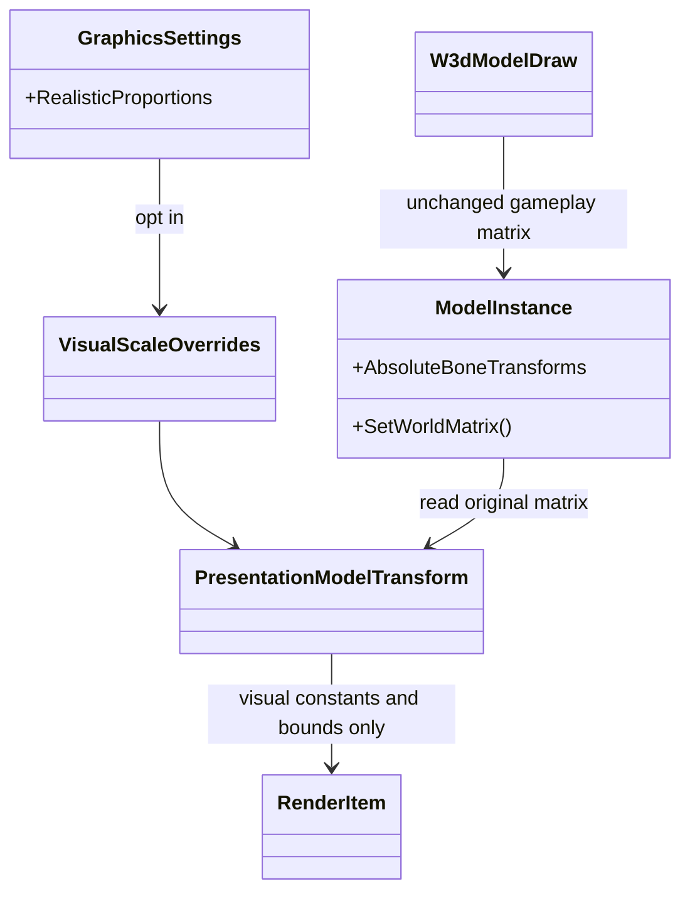
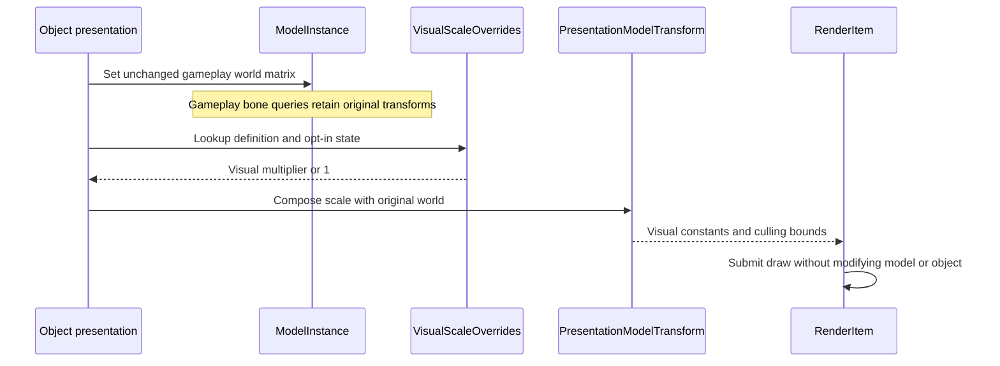

# Deep Dive: Realistic Proportions (G10)

> Part of [Track G](../track-g-rendering-clarity.md).
>
> Audience: human + agent. Asset measurements and presentation-only scale overrides.

## 1. Purpose and current problem

The [proportions decision](../open-questions.md) permits optional aircraft visual correction,
not gameplay range or collision changes. The track's approximately five world units per meter
and aircraft ratios are hypotheses to reproduce from installed assets in G10-1, not universal
constants to apply blindly.

`W3dModelDraw.SetWorldMatrix` updates active model state. `ModelInstance.SetWorldMatrix` also
updates `AbsoluteBoneTransforms`; its comments explicitly identify weapon-launch bone queries
as headless consumers. Applying visual scale there would risk changing simulation state.

## 2. Constraints

- G2 owns the opt-in flag; it defaults off in both presets.
- Original INI `Geometry`, model assets, gameplay transforms, weapon bones, pathing, ranges and
  simulation-facing bounds remain unchanged.
- Shared models require per-definition scale lookup; never mutate shared model data.
- Visual culling and presentation annotations may use enlarged bounds. Selection/pathing hit
  geometry remains the gameplay geometry, and this difference must be documented.

## 3. Design

### Reference data

G10-1 records definition, condition-state model, visible mesh names, axis convention, INI scale,
measured bind-pose length, geometry dimensions, real reference length/source, units-per-meter
and derived multiplier. Exclude FX-only meshes with an explicit reviewed list, not a loose name
heuristic. Include infantry, a Crusader, buildings, Comanche and MiG; state tolerances and source
uncertainty. Resolve game assets through `GameInstallation.CreateFileSystem()` so loose/patch
overrides match runtime loading.

A checked-in manifest includes asset hashes and measurement method. An install-dependent data
test recalculates the numbers and reports changed assets; pure tests verify arithmetic without
the install. Never regenerate expected data automatically on mismatch.

### Render-only transform

Introduce proposed `VisualScaleOverrides` keyed by object definition and an immutable
`PresentationModelTransform`. Default multiplier is 1. Preserve `W3dModelDraw` and
`ModelInstance`'s simulation-facing world/bone matrices. Compose the override only when
constructing render-item world constants: local uniform scale about the documented model origin,
then the unchanged gameplay transform. Row-vector conventions require scale before world.

Visual bounds for frustum/shadow culling are derived separately from the render transform.
GPU attachments, muzzle-flash visuals and selection-ring rendering use the presentation
transform where appropriate; weapon launch positions and target/selection queries keep their
existing data. If a shared code path cannot distinguish these roles, G10-2 must add an explicit
presentation accessor before enabling the option, rather than scaling the shared bone array.

G10-3 wires explicit opt-in and G3 comparison profiles. Capture parked aircraft with a Crusader
using a fixed near-top-down camera and world-space measurement overlays; perspective pixels
alone are insufficient to prove length ratios. Toggling should recreate neither asset data nor
simulation objects.

| Sub-phase | Card | Deliverable |
|---|---|---|
| G10-1 | WI-G10-01 | Reference manifest, deviation table and reproducible measurement tests. |
| G10-2 | WI-G10-02 | Per-definition render-only transform and separate visual bounds. |
| G10-3 | WI-G10-03 | Opt-in settings application and proportion-mode golden captures. |

## 4. Validation

- Installed-asset test re-derives the table within its stated tolerances and detects changed hashes.
- Scale 1 leaves render matrices unchanged; only manifest-listed aircraft change at opt-in.
- Shared asset instances under different definitions retain independent visual multipliers.
- Weapon-bone positions, geometry, selection query results and scenario outputs remain identical
  on/off. A determinism assertion failure stops work under the repository's artifact policy.
- Corrected aircraft lengths match references within the manifest tolerance; Legacy/off matches
  pre-G10 goldens. Deliberately changed override data triggers the proportion-mode gate.

## 5. Architecture Diagrams

Target design; override and presentation-transform types are proposed.

## Appendix: current code (agent context)

- `src/Panopticon.Simulation/Logic/Object/Draw/W3dModelDraw.cs`: active condition state and world-matrix propagation.
- `src/Panopticon.Simulation/Graphics/ModelInstance.cs`: shared simulation-facing world/bone transforms.
- `src/Panopticon.Simulation/Graphics/ModelMesh.cs`: render-item construction and shadow submission.
- `src/Panopticon.Simulation/Scene25D.cs`: geometry-driven queries, not visual-scale ownership.
- `GameInstallation.CreateFileSystem()`: installation-resolved archive/loose file access for measurements.
