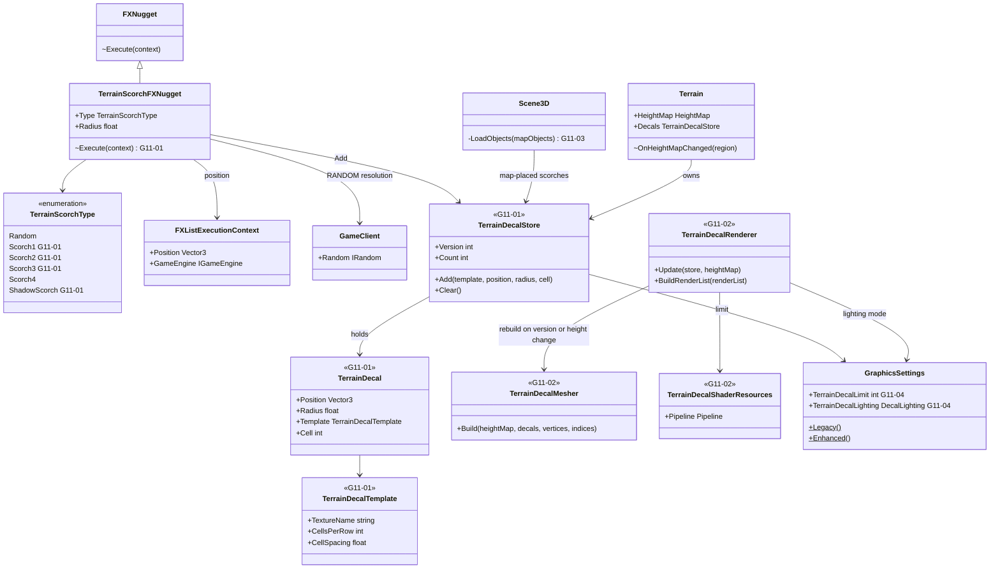
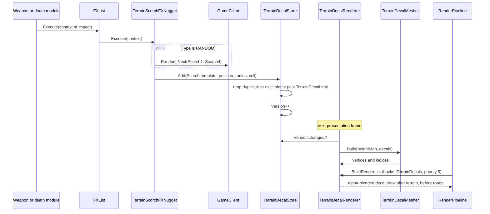

# Deep Dive: Terrain Impact Decals (G11)

> Part of the [roadmap](../README.md) and [Track G](../track-g-rendering-clarity.md).
> Audience: human.

## 1. Purpose and current problem

Explosions in Generals and Zero Hour leave scorch marks on the ground. Panopticon parses the data
for them and draws nothing.

| Source | Finding |
|---|---|
| `INI.big` / `INIZH.big` | `TerrainScorch` appears 33 times in Generals and 50 times in Zero Hour FX data (raw archive scan; `WI-G11-01` pins exact nugget counts). The Generals entries use `Type = RANDOM`. |
| `Textures.big` | `Art\Textures\exscorch01.dds`, 256x256 RGBA: a 3-per-row atlas with four scorch marks, a soft shadow blot, and a crack pattern. |
| `TerrainScorchFXNugget` | Parses `Type`, `Radius` (as `int`), and BFME's `RandomRange`. No `Execute` override, so the nugget is a no-op. |
| `TerrainScorchType` | Holds only `RANDOM` and `SCORCH_4`. `SCORCH_1`..`SCORCH_3` and `SHADOW_SCORCH` are missing. |
| Other scorch producers | `NeutronMissileSlowDeathBehavior.ScorchMarkSize`, `ParticleUplinkCannonUpdate` scorch fields, and `FirestormDynamicGeometryInfoUpdate.ScorchSize` are parsed and unused. Map objects flagged as scorches are not recognised. |
| Terrain decal paths | `RadiusCursorDecals` is the only projected decal: 8 entries, 512x512 square textures, evaluated per pixel in `Terrain.frag` and `Road.frag`. It is sized for cursors, not hundreds of persistent marks. |

Short-lived ground effects already work: particle systems with `IsGroundAligned` render flat
through `Particle.vert`. G11 adds the persistent marks they leave behind.

### Original behaviour

From the GPL-3.0 EA source release (the same licence as Panopticon, see `LICENSE-EA.md`):

- `TerrainScorchFXNugget::doFXPos` resolves `RANDOM` to `SCORCH_1`..`SCORCH_4` with the game client
  random and calls `GameClient::addScorch(position, radius, type)`. Three logic modules call the
  same entry point: the neutron missile death, the particle uplink cannon, and the firestorm.
- `BaseHeightMapRenderObjClass::addScorch` keeps at most 500 marks, dropping the oldest. A new
  mark within `radius / 4` of an existing mark of the same type and radius is discarded as a
  duplicate.
- `updateScorches` builds one mesh for all marks: for each mark, every height-map vertex inside
  its square (`MAP_XY_FACTOR` 10 spacing) at terrain height plus `MAP_HEIGHT_SCALE / 10`, with
  triangle splits following the terrain's flip state. UVs map the mark's square into atlas cell
  `type` (3 per row, cells spaced 1.5 of 4 units). Vertex colour is a constant tint: terrain
  ambient plus half the terrain diffuse of the first light.
- `drawScorches` draws that mesh with the preset alpha-blend shader inside the terrain render,
  before roads. Runtime scorches are not saved; map-placed scorches are re-added on load.

## 2. Constraints

- Presentation only. Scorches are game-client state: they use `GameClient.Random`, never logic
  random, and no simulation assertion may change with decals on or off.
- `Legacy` reproduces the original look (cap, duplicate rule, tint, blend, draw order).
  `Enhanced` may change lighting, sampling, and cap, through the G2 settings layer.
- Track F owns geometric craters and heightmap deformation. G11 rebuilds decal meshes on height
  changes and does not modify terrain.
- The store is generic over atlas textures, so later consumers (BFME `DynamicDecal`, imported
  weapon impacts, Track F crater textures) add templates rather than new passes.

## 3. Design

### Decal store

- `TerrainDecalStore`, owned by `Terrain`, holds `TerrainDecal` records (position, radius, template,
  atlas cell, add order) up to `GraphicsSettings.TerrainDecalLimit`. Adding past the limit evicts
  the oldest. The original duplicate rule applies per template.
- `TerrainDecalTemplate` names the atlas texture, cells per row, cell spacing, and blend. The
  built-in `Scorch` template is `EXScorch01.tga` (resolves to the `.dds`), 3 per row, spacing 1.5.
- `TerrainScorchType` gains `SCORCH_1`..`SCORCH_3` and `SHADOW_SCORCH`; `Radius` parses as a float.
  `TerrainScorchFXNugget.Execute` resolves `RANDOM` with `GameClient.Random` and adds a decal at
  the FX position.
- Logic producers reach the store through the client (`IGameObjectClient` or `GameClient`), never
  directly from logic state.

### Mesh and pass

- `TerrainDecalMesher` follows the original vertex grid, height offset, flip-state triangulation,
  and atlas UV formula, over `HeightMap` vertex heights. It rebuilds when the store changes or when
  `Terrain.OnHeightMapChanged` reports a region that overlaps a decal.
- A `TerrainDecals` render bucket at priority 5 sits between `Terrain` (0) and `Roads` (10), so
  roads cover scorches as in the original. Pipeline: alpha blend, depth test less-equal, no depth
  write, no cull, matching the road precedent in `RoadShaderResources`. No depth bias: the
  vertical offset matches the original.
- `TerrainDecal.vert/.frag`: `Legacy` uses the original constant tint from the map's terrain
  lighting. `Enhanced` lights decals with the terrain's per-pixel sun, cloud, and shadow terms
  so marks do not glow in shadow, and samples through the terrain sampler (G7 anisotropy when
  present).

### Map-placed scorches

`Scene3D.LoadObjects` recognises map objects carrying the original scorch flag and its
`scorchType` and `objectRadius` properties and adds them to the store on map load. Runtime
scorches are not persisted, matching the original; map scorches return on load because the map
reloads them.

## 4. Validation

- Install-free tests: eviction order, duplicate rule, `RANDOM` resolution uses client random only,
  mesher vertex counts and UVs against hand-computed cases, rebuild on overlapping height change.
- Data test: every `TerrainScorch` nugget in the installed Generals and Zero Hour INI parses with a
  supported type; the test records exact per-game nugget counts.
- G3 golden scenes `vr-terrain-scorch` under `faithful` and `enhanced`: a fixed set of scorches of
  every type on flat and sloped terrain, one under a road and one under a shadow.
- Determinism: P0/P9 scenario assertions and `SeededRunTests` pass identically with decals on.

## 5. Architecture Diagrams

New types and members are marked with their card.

### Class diagram

### Sequence: impact to drawn scorch

## Appendix: grounding

| Fact | Location |
|---|---|
| Nugget parse, no `Execute` | `src/Panopticon.Simulation/FX/FXNuggets/TerrainScorchFXNugget.cs:6`-`:22` |
| Incomplete scorch enum | `src/Panopticon.Simulation/FX/TerrainScorchType.cs:5` |
| Nugget registration | `src/Panopticon.Simulation/FX/FXList.cs:29` |
| FX context and execution | `src/Panopticon.Simulation/FX/FXListExecutionContext.cs:5`; `FXList.cs:55` |
| Ground-height precedent in a nugget | `src/Panopticon.Simulation/FX/FXNuggets/ParticleSystemFXNugget.cs:79` |
| Client random | `src/Panopticon.Simulation/Client/GameClient.cs:19` |
| Terrain bucket and pipeline | `src/Panopticon.Simulation/Terrain/Terrain.cs:81`; `Graphics/Shaders/TerrainShaderResources.cs:18` |
| Road overlay precedent | `src/Panopticon.Simulation/Terrain/Roads/RoadCollection.cs:45`; `Graphics/Shaders/RoadShaderResources.cs:26` |
| Height queries and cell size | `src/Panopticon.Simulation/Terrain/HeightMap.cs:12`, `:31`, `:66` |
| Height change hooks | `src/Panopticon.Simulation/Terrain/Terrain.cs:302`, `:324` |
| Cursor decals (not reused) | `src/Panopticon.Simulation/Terrain/RadiusCursorDecals.cs:13` |
| Map object loading | `src/Panopticon.Simulation/Scene3D.cs:177` |
| Unused scorch fields | `Logic/Object/Behaviors/NeutronMissileSlowDeathBehavior.cs:12`; `ParticleUplinkCannonUpdate`; `FirestormDynamicGeometryInfoUpdate` |
| Graphics presets | `src/Panopticon.Simulation/Graphics/GraphicsSettings.cs:37`, `:56` |
| Visual regression runner and scenes | `src/Panopticon.Tools.TestHarness/VisualRegressionRunner.cs:31`; `src/Panopticon.Tools.ReplaySketch.Core/Profiles/visual-regression-scenes.json` |
| Original store, mesh, draw | EA release `GeneralsMD/Code/GameEngineDevice/Source/W3DDevice/GameClient/BaseHeightMap.cpp` (`addScorch`, `updateScorches`, `drawScorches`); limits in `Include/W3DDevice/GameClient/BaseHeightMap.h:245` |
| Original callers | EA release `GameEngine/Source/GameClient/FXList.cpp:441`; `GameLogic/Object/Update/NeutronMissileSlowDeathUpdate.cpp:372`, `ParticleUplinkCannonUpdate.cpp:628`, `FirestormDynamicGeometryInfoUpdate.cpp:209` |
| Original map scorches | EA release `W3DTerrainVisual.cpp:696`; `Include/Common/MapObject.h:93` (`MO_SCORCH`) |
