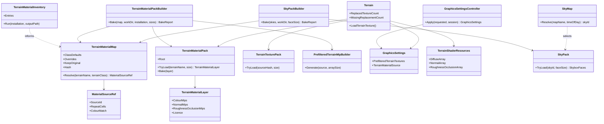
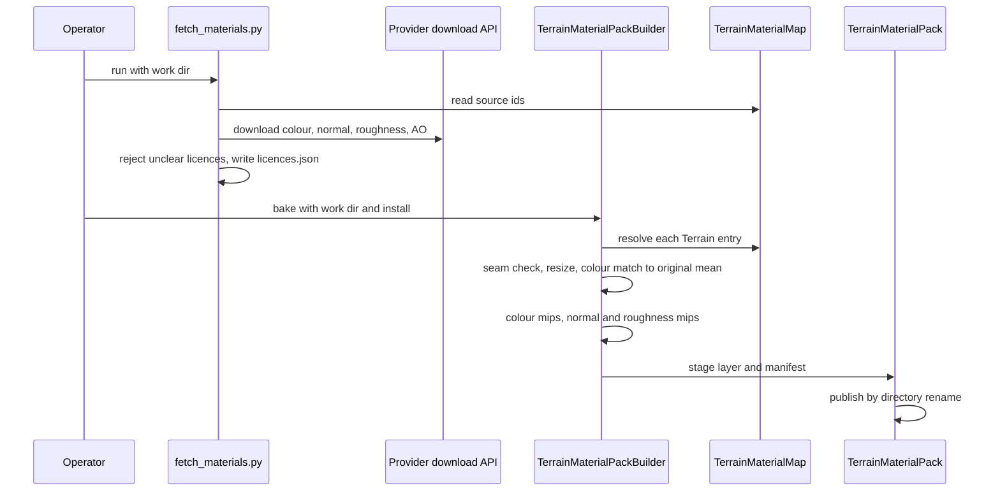
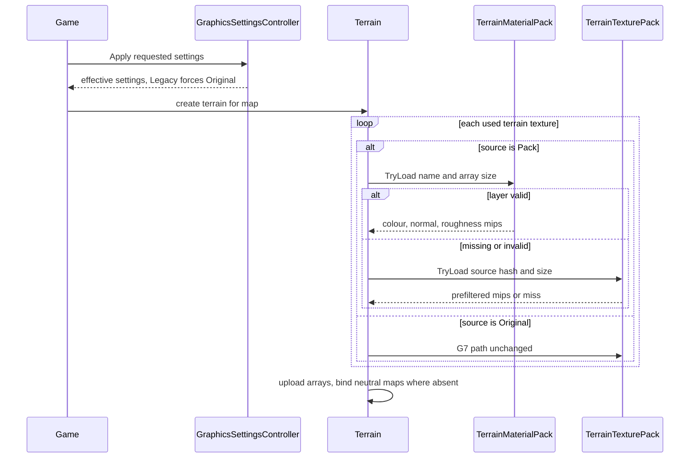

# Deep Dive: Open Material Packs (G12)

> Part of the [roadmap](../README.md) and [Track G](../track-g-rendering-clarity.md).
> Audience: human.

## 1. Purpose and current problem

The original terrain and model textures are low-resolution diffuse images: grass, rock, sand,
asphalt, concrete, snow, and painted metal. G7 re-filters their mips but keeps their content.
G12 lets an operator replace them with higher-resolution, openly licensed materials, starting with
terrain, then adding normal and roughness detail to terrain lighting, then model textures. Sky
packs (G12-5) supply openly licensed skies to the [G13](g13-first-person-ground-view.md#341-skybox-and-distance-fog-g13-4)
sky renderer.

| Source | Finding |
|---|---|
| `INI.big` `Data\INI\Terrain.ini` (Generals) | 236 `Terrain` entries, 15 `Class` values: `Desert_1` 42, `ROCK` 40, `GRASS` 30, `Desert_2` 28, `SAND` 20, `SNOW_1` 19, `DIRT` 12, `Eastern_Europe_1` 9, `ASPHALT` 8, `CONCRETE` 8, `Swiss_1` 6, `Desert_3` 6, `TRANSITION` 3, `WOOD` 3, `Rock` 2. |
| `Terrain.big` `Art\Terrain\` | 232 distinct images; 225 resolve. Sizes: 256x256 (145), 128x128 (46), 384x384 (29), 640x640 (2), 64x64 (3); nearly all 24-bit TGA. 7 names resolve only through patch or loose files. |
| `TerrainTexture` | Parses `Texture`, `Class`, `BlendEdges`, `RestrictConstruction`, `TerrainObject`. Class is unused at runtime. |
| `Terrain.CreateTextures` | One `Texture2D` array per map at the largest used size; non-square images throw. Per-layer `CellSize` from the map's `BlendTileTexture` sets repeat length in cells (one cell = 10 world units). |
| `Terrain.frag` | Three diffuse-array samples blended per tile, macro noise, caustics, clouds, cursor decals, shadows. Per-pixel Lambert on the interpolated vertex normal, zero specular. No normal or roughness maps. |
| G7 `TerrainTexturePack` | Offline mip packs outside the repo, keyed by builder version, source SHA-256, and array size; staged then published by directory rename; Enhanced-only; fallback with a warning. |
| C3 `PbrMetallicRoughness` | Imported models already support base colour, metallic-roughness, normal, occlusion, and emissive maps. W3D meshes use the `FixedFunction` and shader-material families. |
| Loose-file override | Disk files win over `.big` entries, so a same-named `.dds` already replaces a texture, unvalidated and for both presets. |

## 2. Constraints

- `Legacy` reproduces the original look and never reads a material pack. The material source is
  a separate setting, `Original` by default in both presets, so `faithful` and `enhanced` goldens
  are unchanged.
- Original game files stay untouched. Downloaded materials and baked packs live outside the
  repository and the install; only the mapping table, licence records, and a synthetic test pack
  are committed.
- Licences: CC0 by default (ambientCG, Poly Haven). CC-BY sources are allowed only with attribution
  recorded in the pack manifest. Unclear or non-commercial licences are rejected by the fetch step.
- Gameplay readability: replacements keep each terrain type's class identity (cliffs read as
  cliffs, roads as roads) and are colour-matched toward the original's mean colour so map
  authors' blends and minimap colours stay meaningful.
- Presentation only; no simulation input changes.

## 3. Design

### 3.1 Inventory and mapping (G12-1)

`TerrainMaterialInventory` (TestHarness runner) reports every `Terrain` entry: name, class,
texture, resolved path, size, bit depth, linear mean and standard deviation, and the `CellSize`
values used by shipped maps. The committed mapping table
`src/Panopticon.Tools.TestHarness/terrain-material-map.json` assigns material sources:

| Field | Meaning |
|---|---|
| `classDefaults` | Class to material source id, for example `GRASS` to an ambientCG grass set |
| `overrides` | Terrain name to source id, for entries whose image differs from its class |
| `repeatCells` | Material repeat length in cells; default keeps the original `CellSize` |
| `colourMatch` | `mean` (default), `meanAndContrast`, or `none` |
| `keepOriginal` | Terrain names left untouched (for example painted markings, transitions) |

Unmapped entries keep the original image.

### 3.2 Fetch and bake (G12-2)

- `scripts/textures/fetch_materials.py <work dir>` reads the mapping table and downloads each
  source id from its provider's public download API without accounts or keys, extracts the
  colour, normal (OpenGL convention), roughness, and ambient occlusion maps, and writes
  `licences.json` (source id, provider, licence, attribution, URL, retrieval date). It never runs
  in CI.
- `TerrainMaterialPackBuilder` bakes, per mapped terrain entry and target array size: tile-seam
  check, resize, colour match, linear mips through the G7 `PrefilteredTerrainMipBuilder`, and
  normal and roughness levels (normals renormalized per mip, roughness widened by normal variance).
- `TerrainMaterialPack` stores packs like G7: `<root>/<builder version>/<mapping hash>/<terrain
  name>/<size>/` with `manifest.json` (source hashes, licence record, map kinds, mip checksums),
  staged then published by rename. Root: `PANOPTICON_MATERIAL_PACK`, else
  `LocalApplicationData/Panopticon/MaterialPacks`.

### 3.3 Runtime selection (G12-2)

- `GraphicsSettings.TerrainMaterialSource` (`Original` or `Pack`), session-pinned like
  `PrefilteredTerrainTextures`; `Legacy` forces `Original` through the controller with a
  `Fallbacks` entry.
- `Terrain.LoadTerrainTexture` asks `TerrainMaterialPack` first when the source is `Pack`; a
  missing or invalid layer falls back to the G7 pack, then to generation, with one warning.
  `Terrain.ReplacedTextureCount` and `MissingReplacementCount` expose coverage.

### 3.4 Terrain PBR (G12-3)

- Two more arrays parallel to the diffuse array: normal (RG, reconstructed Z) and
  roughness-occlusion (RG). Layers without maps bind neutral values (flat normal, roughness 1,
  occlusion 1), so mixed packs work.
- `Terrain.frag` blends the three layers' normals and roughness with the same weights as colour,
  builds a tangent frame from the terrain normal and the world-aligned UV axes (cliff tiles use
  the `CliffInfo` UV axes), and adds GGX specular with the same light and shadow terms as
  `PbrMetallicRoughness.frag`. Terrain stays dielectric (metallic 0).
- Enabled only when the source is `Pack` and the pack carries the maps; otherwise the shader path
  is the current one.

### 3.5 Model textures (G12-4)

Model replacements need a different key (W3D texture name rather than terrain entry), team-colour
(house colour) handling, alpha cutouts, and a choice between replacing `FixedFunction` textures in
place and converting matched meshes to the C3 PBR family. `WI-G12-07` decides; implementation
cards follow its recommendation.

### 3.6 Sky packs (G12-5)

- Sources: CC0 equirectangular HDRIs from Poly Haven, listed in a `skies` section of the mapping
  table with a `timeOfDay` tag (morning, afternoon, evening, night) and licence record.
  `fetch_materials.py --skies` downloads them under the same licence filter.
- `SkyPackBuilder` converts each HDRI to six cube faces (N, E, S, W, top, bottom) at a target
  face size (default 1024), tone-maps to sRGB 8-bit with a fixed exposure recorded in the
  manifest, and records `SkyHorizonColour` from the horizon band.
- `SkyPack` stores faces like `TerrainMaterialPack`: `<root>/sky/<builder version>/<source
  SHA-256>/<face size>/` with `manifest.json`, staged then published by rename.
- Selection: `sky-map.json` maps a map name to a sky id; unmapped maps take the sky whose
  `timeOfDay` matches the map's lighting. `GraphicsSettings.SkySource` (`Original`, `Pack`)
  defaults to `Original` in both presets; `Legacy` forces `Original`. A missing or invalid pack
  falls back to G13's source order with one warning.

## 4. Validation

- Unit tests: mapping parse and validation, colour match, seam check, normal mip
  renormalization, pack manifest round-trip, settings clamping.
- A committed synthetic pack (generated checkerboard and noise materials, CC0 by construction)
  drives load, fallback, and golden tests with no download.
- G3: `faithful` and `enhanced` goldens unchanged; new `enhanced-materials` captures of
  `terrain-default` and `terrain-grazing` with the synthetic pack, plus a PBR variant; an injected
  regression fails.
- Operator evidence: real-pack captures of Alpine Assault and a desert map beside the original,
  TerrainZoomProof grazing views, and B1 terrain pass cost with PBR on and off.
- Sky packs: equirectangular-to-cube face orientation and seam tests on a synthetic HDRI, a
  committed synthetic 64x64 sky pack, and first-person captures with the original and a real sky
  pack.

## 5. Architecture Diagrams

### Class diagram

### Sequence: fetch and bake

### Sequence: map load with a material pack

## Appendix: grounding

- `src/Panopticon.Simulation/Terrain/TerrainTexture.cs:6-29`: `Terrain` INI fields.
- `src/Panopticon.Simulation/Terrain/Terrain.cs:513-622`: texture array creation, square-size rule,
  `CellSize * 2` metadata, sRGB format when linear; `:624-670` `LoadTerrainTexture` with the G7
  pack first, then linear or Lanczos generation.
- `src/Panopticon.Simulation/Terrain/TerrainPatch.cs:83` and `HeightMap.cs:12`: UV is the cell
  index; one cell is 10 world units.
- `src/Panopticon.Simulation/Assets/Shaders/Terrain.frag:59-262` and `TerrainLighting.h:7-11`:
  samples and lighting; zero specular.
- `src/Panopticon.Simulation/Graphics/Shaders/TerrainShaderResources.cs:27-64`: 8 bindings and
  material constants.
- `src/Panopticon.Simulation/Content/TerrainTexturePack.cs:18-153`: G7 root, key, manifest, staging.
- `src/Veldrid.ImageSharp/PrefilteredTerrainMipBuilder.cs:11`: builder version.
- `src/Panopticon.Simulation/Graphics/GraphicsSettings.cs:10-139` and
  `GraphicsSettingsController.cs:37-107`: presets, `With*` copies, session-pinned prefilter flag.
- `src/Panopticon.Simulation/Assets/Shaders/PbrMetallicRoughness.frag:45-55`,
  `Graphics/Shaders/PbrMetallicRoughnessShaderResources.cs:31-35, 241`: C3 maps and neutral
  defaults.
- `src/Panopticon.Simulation/Content/Importing/W3d/W3dMaterialConverter.cs:189`,
  `Graphics/ModelMesh.Imported.cs:141-213`: W3D material families.
- `src/Panopticon.IO/CompositeFileSystem.cs:17-29`: loose files win over archives.
- `src/Panopticon.Tools.TestHarness/VisualRegressionRunner.cs:33-38`,
  `src/Panopticon.Tools.ReplaySketch.Core/Profiles/visual-regression-scenes.json:9-23`: G3 presets
  and terrain scenes.
- Terrain counts from a direct read of the Generals install's `INI.big` and `Terrain.big`.
