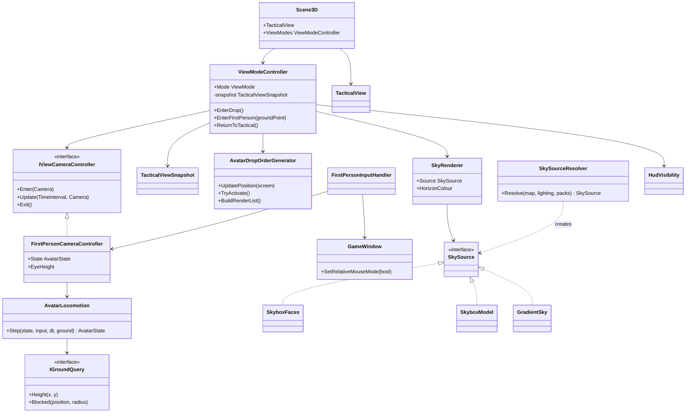
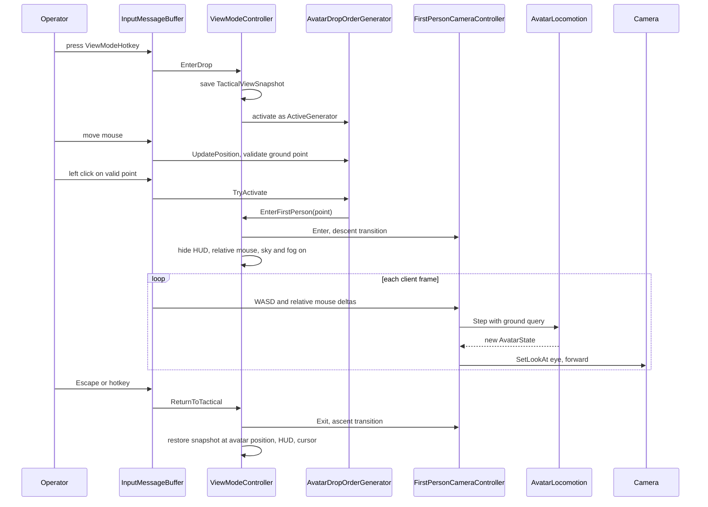

# Deep Dive: First-Person Ground View (G13)

> Part of the [roadmap](../README.md) and [Track G](../track-g-rendering-clarity.md).
> Audience: human.

## 1. Purpose and current problem

An alternate way to view the world: from the RTS camera, a hotkey enters a drop mode with a
map-pin style avatar marker on the cursor; clicking a ground point descends the camera to eye
height there, and the operator then walks the terrain in first person with mouse look. Leaving
the mode restores the RTS camera above the avatar's last position. The simulation keeps running;
the view is presentation only.

| Area | Finding |
|---|---|
| Camera | `TacticalView` (port of `W3DView`) always orbits a ground target: pitch clamped to ±π/5, zoom 0.2 to 1.3, height between `GameData.MinCameraHeight` and `MaxCameraHeight`, X/Y inside `_cameraConstraint`. No free-eye or fly mode exists. |
| Camera seam | No runtime camera-controller interface. `IEditorCameraController` (arcball) serves tools only; its `Scene3D` hookup is commented out. `Camera.SetLookAt` places the camera directly. |
| Projection | FOV 50°, vertical FOV computed as FOV ÷ aspect; near plane 10 world units (one height-map cell), far 12000. A 10-unit near plane clips everything within a step of the eye. |
| Input | `InputMessageBuffer` dispatches by `HandlingPriority` (Camera < BoxSelection < MoveCamera < Selection < OrderGenerator < UI < Debug < Engine < Window). Hotkeys are hard-coded (`LookAtTranslator`, Debug F2 to F5, Engine F9/F10, Pause); `CommandMap.ini` is parsed but not dispatched. |
| Mouse | Only absolute positions and cursor visibility. Veldrid.SDL2 exposes `SDL_SetRelativeMouseMode` and `SDL_WarpMouseInWindow`, unused; `Sdl2Interop` holds extra interop. |
| Placement | `OrderGeneratorSystem.ActiveGenerator` with `IOrderGenerator` (`UpdatePosition`, `TryActivate`, `GetCursor`, `BuildRenderList`); building placement renders an unregistered preview `GameObject` at 0.7 opacity. |
| Ground queries | `HeightMap.GetHeight`/`GetNormal`, `Terrain.ImpassableAt`, `Navigation.IsPassable`, `PartitionCellManager.QueryObjects`, `RoughCollider` ray and shape tests. Bridge layers are stubbed (ground only). |
| Ground-level rendering | No skybox (clear colour grey 105), no distance fog (`Weather` fog fields parsed only), object frustum culling off by default, one shadow cascade at distance 1200, terrain drawn in full 17x17 patches with patch culling. |
| Skybox data | Generals `WaterTransparency` parses five-face skybox names (`SkyboxTextureN/E/S/W/T`, commented out in shipped `Water.ini`; the original drew them only in water reflections). `Textures.big` ships `TSDusky_*` and `TSNightSky_*` face sets. BFME parses `SkyboxTextureSet` (11 in `Environment.ini`: `DefaultSky`, `Morning`, `MountDoom`, `DesertSun`, ...) and the map's `SkyboxSettings` (position, scale, rotation, texture scheme) and ships skybox W3D models (`skyboxnoon.w3d`, `mrdrskybox.w3d`). Nothing draws any of them. |
| HUD | No hide flag; captures pop every WND window. `Scene3D` has `ShowTerrain`/`ShowObjects`/`ShowWater`/`ShowRoads`. |

## 2. Constraints

- Presentation only. The avatar is not a `GameObject`, issues no orders, uses no logic random,
  and no simulation assertion changes with the view on or off. Selection and orders are
  unavailable while in first person.
- `TacticalView` state (target, yaw, pitch, zoom, height, lock) is saved on entry and restored on
  exit; first person never mutates its constraints.
- Both presets support the mode; it is entered only by the operator. No golden changes when the
  mode is never entered.
- Local to one client: replays, multiplayer peers, and saves are unaffected; the view is not
  persisted.
- Scale: eye height and walk speed derive from the [G10](g10-realistic-proportions.md) reference
  scale (infantry model height), not from hand-picked world units, so they stay correct after the
  [H2b](h2b-metric-core.md) metre switch.

## 3. Design

### 3.1 View mode seam (G13-1)

- `ViewMode` (`Tactical`, `AvatarDrop`, `FirstPerson`) owned by a `ViewModeController` on
  `Scene3D`. `Tactical` is today's path. The controller saves a `TacticalViewSnapshot` on leaving
  `Tactical` and restores it on return.
- `IViewCameraController` (`Update(in TimeInterval, Camera)`, `Enter`, `Exit`) with
  `FirstPersonCameraController` as the second implementation; in `FirstPerson` the controller,
  not `TacticalView`, writes `Camera.SetLookAt`.
- `FirstPersonInputHandler` at `HandlingPriority.UI` minus one consumes keyboard and mouse while
  in `FirstPerson`, so `LookAtTranslator`, selection, and order generators see nothing.
- Relative mouse: `GameWindow.SetRelativeMouseMode(bool)` through `Sdl2Interop`; relative
  deltas arrive as a new `InputMessageType.MouseRelativeMove`. Focus loss releases it.
- Hotkey: `ViewModeHotkey` (default `F7`, checked against the hard-coded handlers and
  `CommandMap.ini`), toggling `Tactical` to `AvatarDrop`, and `FirstPerson` back to `Tactical`.
  `Escape` cancels drop or exits first person.

### 3.2 Avatar drop (G13-2)

- `AvatarDropOrderGenerator : IOrderGenerator`. `UpdatePosition` ray-casts the cursor to terrain;
  the marker is a client-only pin mesh (head disc over a stem, standing at the point, oriented to
  the camera) tinted green when the point is valid and red otherwise.
- Valid: inside the playable area, passable (`Navigation.IsPassable`), not water, slope within
  `MaxWalkSlope`, and outside every structure `RoughCollider` expanded by the avatar radius.
- `TryActivate` on a valid point switches to `FirstPerson` through a descent transition (3.5);
  right click or `Escape` cancels to `Tactical`.

### 3.3 Ground locomotion (G13-3)

- `AvatarState` (position, yaw, pitch, vertical velocity), stepped by `AvatarLocomotion.Step(state,
  input, dt, IGroundQuery)` with a fixed client substep; pure and headless-testable.
- `IGroundQuery` adapts `HeightMap`, `Terrain.ImpassableAt`, and structure colliders from
  `PartitionCellManager.QueryObjects`.
- Movement: WASD walk, `Shift` run, mouse look with pitch clamped to ±85°. The eye follows terrain
  height plus `EyeHeight`, smoothed over `StepSmoothing`; slopes above `MaxWalkSlope` and
  impassable cells block, sliding along the blocking edge; structures block as cylinders against
  their colliders; units do not block and are not pushed. The playable-area border clamps.
- Gravity applies when terrain drops faster than `MaxStepDown` per substep, so walking off a
  cliff falls instead of snapping. No jumping, crouching, or swimming.

### 3.4 Ground-level rendering (G13-4)

- While in `FirstPerson` only: near plane `FirstPersonNearPlane` (default 0.25 of `EyeHeight`)
  with far plane reduced to `FirstPersonFarPlane` and fog hiding the cut; vertical FOV computed
  from a horizontal FOV correctly (`2·atan(tan(h/2)/aspect)`); object frustum culling on; four
  shadow cascades with a shorter `ShadowDistance`.
- Sky and fog: see 3.4.1.
- HUD: a `HudVisibility` flag on the game client hides WND/APT layers, selection UI, and the
  debug overlay without popping windows, restoring them on exit; a minimal crosshair and compass
  draw in the 2D layer.

### 3.4.1 Skybox and distance fog (G13-4)

- `SkyRenderer` draws before terrain at depth far, camera-centred, from a `SkySource`:
  - `SkyboxFaces`: five or six face textures (N, E, S, W, top, optional bottom) on a cube; a
    missing bottom face repeats the horizon row.
  - `SkyboxModel`: a W3D sky model placed by `SkyboxSettings` (BFME), drawn camera-relative with
    depth write off.
  - `GradientSky`: zenith, horizon, and ground colours from the map's time-of-day lighting; the
    fallback when no other source resolves.
- Source resolution, first match wins: a sky pack chosen for the map ([G12-5](g12-open-material-packs.md#36-sky-packs-g12-5)),
  the map's BFME `SkyboxSettings`, the Generals `WaterTransparency` faces, a built-in default
  face set per time of day (`TSDusky_*` for evening, `TSNightSky_*` for night), then the gradient.
- `SkyHorizonColour` is the mean colour of the sky's horizon band, computed once per source.
- Distance fog: `Weather.HardwareFogStart/End` when set, else defaults scaled to the far plane,
  coloured by `SkyHorizonColour`, applied in terrain, road, object, particle, and water shaders
  through a shared fog include gated by `FogEnabled`.
- Where the sky draws:
  - `FirstPerson`: always, with fog.
  - `Tactical`: only when `GraphicsSettings.TacticalSky` is on (`Enhanced` true, `Legacy` false)
    and the view frustum reaches above the horizon; no fog. `Legacy` keeps the grey clear colour,
    so `faithful` goldens are unchanged.

### 3.5 Transitions and evidence (G13-5)

- Descent: the camera interpolates from the tactical eye to the avatar eye over 0.8 s (ease
  in-out, pitch toward level). Ascent on exit reverses to the saved snapshot re-targeted at the
  avatar's last ground position.
- A TestHarness scenario `FirstPersonView` scripts drop, a walk path, and exit, capturing
  first-person frames as G3 goldens (`faithful` and `enhanced`), plus a GIF for operator review.

## 4. Validation

- Unit tests: locomotion (flat walk speed, slope block, cliff fall, impassable slide, structure
  cylinder, border clamp), drop validity, snapshot save/restore, projection maths.
- Headless test: entering and leaving the mode leaves `TacticalView` state bit-identical and
  simulation assertions unchanged.
- G3: `faithful` goldens unchanged; `enhanced` goldens change only where `TacticalSky` reaches a
  visible horizon, re-recorded with the change listed; `first-person` goldens for two eye positions
  on Alpine Assault (open ground facing a structure, and toward the horizon) plus one BFME map with
  `SkyboxSettings`; injected near-plane, fog, and sky-face orientation regressions fail.
- B1: frame time at the first-person view against the default tactical view.

## 5. Architecture Diagrams

### Class diagram

### Sequence: drop and walk

## Appendix: grounding

- `src/Panopticon.Simulation/TacticalView.cs:41-58` pitch and zoom limits, `:221-222` height
  limits, `:299-320` terrain clamp, `:1440-1505` constraint, `:1507-1569`
  `BuildCameraTransform`, `:323` `LookAt`, `:172` `CameraLock`.
- `src/Panopticon.Simulation/Graphics/Cameras/Camera.cs:19` FOV, `:93-94` near/far, `:109`
  `SetLookAt`, `:142` vertical FOV.
- `src/Panopticon.Simulation/LookAtTranslator.cs:142-182, 215, 257, 381` RTS keys and mouse.
- `src/Panopticon.Simulation/Input/HandlingPriority.cs`, `Input/InputMessageBuffer.cs`,
  `GameWindow.cs:65, 81, 199-260`, `Utilities/Sdl2Interop.cs`.
- `src/Panopticon.Simulation/Game.cs:566-589` engine hotkeys;
  `Gui/DebugUI/DebugMessageHandler.cs:27-36` debug hotkeys; `Input/CommandMap.cs` parse only.
- `src/Panopticon.Simulation/Logic/OrderGeneratorSystem.cs:16, 98-112`,
  `Logic/OrderGenerators/IOrderGenerator.cs`, `ConstructBuildingOrderGenerator.cs:47-71`.
- `src/Panopticon.Simulation/Terrain/HeightMap.cs:12, 49, 67, 101`, `Terrain/Terrain.cs:62, 260,
  349-390`, `Terrain/TerrainLogic.cs:44-97`, `Navigation/Navigation.cs:85`,
  `Logic/PartitionCellManager.cs:347`, `Logic/Object/Colliders.cs`.
- `src/Panopticon.Simulation/Graphics/Rendering/RenderPipeline.cs:40` clear colour, `:538`
  culling; `Scene3D.cs:71-95, 90, 421-465`; `Graphics/Rendering/Shadows/ShadowSettings.cs`;
  `Terrain/Weather.cs:49-50`.
- `src/Panopticon.Tools.TestHarness/ScenarioCaptureRunner.cs:148-155` HUD hiding by popping windows.
- `src/Panopticon.Simulation/Terrain/WaterTransparency.cs:16-39` Generals skybox face fields;
  `Terrain/SkyboxTextureSet.cs` BFME face sets; `Data/Map/SkyboxSettings.cs` map placement;
  `Data/Ini/IniParser.BlockParsers.cs:151`, `Content/AssetStore.cs:158` registration. Face sets
  and sky models from direct reads of the Generals and BFME `.big` archives.
