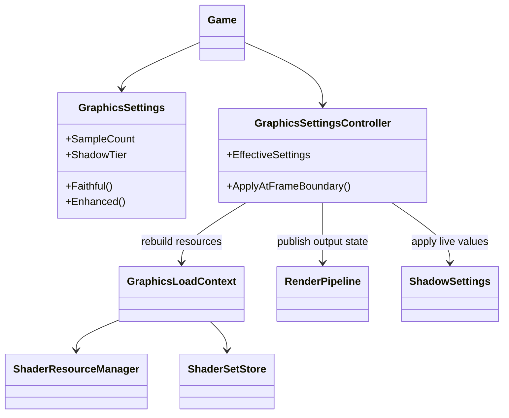
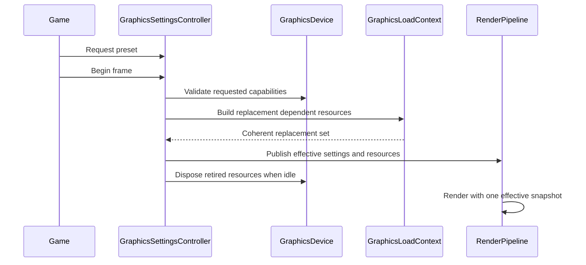

# Deep Dive: Graphics Settings and Fidelity Presets (G2)

> Part of [Track G](../track-g-rendering-clarity.md).
>
> Audience: human + agent. Settings ownership, application and compatibility contract.

## 1. Purpose and current problem

G2 supplies the settings layer used by G3 through G10, not an experiment seam.
`RenderPipeline.GameOutputDescription` is static; samplers, shader resources and terrain textures
are created before rendering. Mutating a settings object alone cannot change those resources.
`StaticGameLod` is parsed asset data, not the runtime graphics-settings owner.

## 2. Constraints

- `Faithful` describes existing rendering after G1's resolution correction. G1 correctness is not
  reverted by a fidelity preset.
- Settings belong to the game/presentation host, never global state or simulation configuration.
- Unsupported device features require a reported effective setting, not an unreported fallback.
- Later phases own their visual changes. G2 must not enable unfinished rendering paths.

## 3. Design

### Settings contract

Introduce an immutable `GraphicsSettings` value and a separate effective snapshot. Proposed
members below are fixed by the G2-1 audit before source-edit work starts.

| Member | Faithful | Enhanced when owning phase is implemented | Owner |
|---|---|---|---|
| SampleCount | 1 | 4, bounded by device format support | G4 |
| AlphaTestMode | LegacyCutoff | CoveragePreserving | G5 |
| ColourSpaceMode | LegacyGamma | Linear | G6 |
| Anisotropy | 4 | Up to 16, bounded by device support | G7 |
| MipLodBias | 0 | 0 initially; explicit override available | G7 |
| ShadowTier | Original | High: four cascades, 2048 | G8 |
| UiMode | LegacyArt | DynamicHud | G9 |
| RealisticProportions | false | false, explicit opt-in | G10 |

Preset factories retain Faithful values for unimplemented members. G2's initial Enhanced preset
may select the existing four-cascade shadow path without adding G8's slope term. If the audit
does not establish a safe switchable knob, G2-3 remains blocked on that decision rather than
claiming that identical preset objects demonstrate runtime application.

### Application and lifetime

`Game` owns the requested settings; a proposed `GraphicsSettingsController` validates device
capabilities and applies an effective snapshot at a frame boundary. No mid-command-list updates.
Classify changes into live constants (shadow bias), sampler/resource-set rebuilds, pipeline and
framebuffer rebuilds (sample count), and texture-content rebuilds (mips/colour space).

`GraphicsLoadContext`, `ShaderResourceManager` and `ShaderSetStore` must receive the effective
description before creating pipelines. Settings-dependent cache keys include all relevant fields.
Replacement resources are built before publication; retired resources use device-idle disposal.
Failed application retains the old coherent resource set. Apply settings on scene creation as
well as runtime switching, including TestHarness and ReplaySketch preview processes.

| Sub-phase | Card | Deliverable |
|---|---|---|
| G2-1 | WI-G2-01 | Knob table with defaults, owners, rebuild classes and capability limits. |
| G2-2 | WI-G2-02 | Settings value, presets, ownership and pure tests. |
| G2-3 | WI-G2-03 | Frame-boundary application, cache invalidation and capture proof. |

## 4. Validation

- Member-by-member Faithful defaults match the audit; invalid values fail before resource creation.
- A supported preset switch changes effective shadow/pipeline state and switching back restores it.
- Repeated switches and resizes do not leave mismatched output descriptions or stale resource sets.
- Fixed-scene Faithful captures match the post-G1 reference on the same backend and driver.
- Unsupported settings are reported with requested/effective values and fallback reason.

## 5. Architecture Diagrams

Target design. Controller and settings are proposed; the other types already exist.

## Appendix: current code (agent context)

- `src/Panopticon.Simulation/Game.cs`: shader-store creation and game resource lifetime.
- `src/Panopticon.Simulation/Content/GraphicsLoadContext.cs`: shared load-time resources.
- `src/Panopticon.Simulation/Graphics/StandardGraphicsResources.cs`: fixed sampler creation.
- `src/Panopticon.Simulation/Graphics/Shaders/ShaderResourceManager.cs`: shader-resource ownership.
- `src/Panopticon.Simulation/Graphics/Rendering/RenderPipeline.cs`: static output description and intermediate targets.
- `src/Panopticon.Simulation/Graphics/Rendering/Shadows/ShadowSettings.cs`: mutable per-scene shadow values.
- `src/Panopticon.Simulation/Lod/StaticGameLod.cs`: parsed LOD fields, audit input only.
