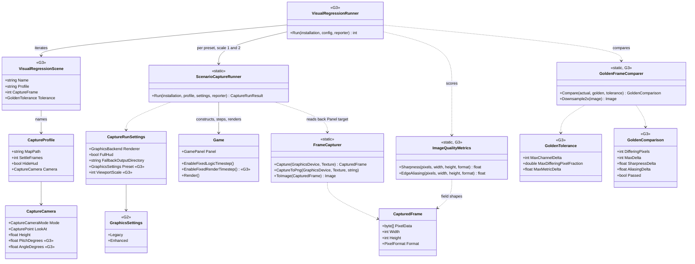
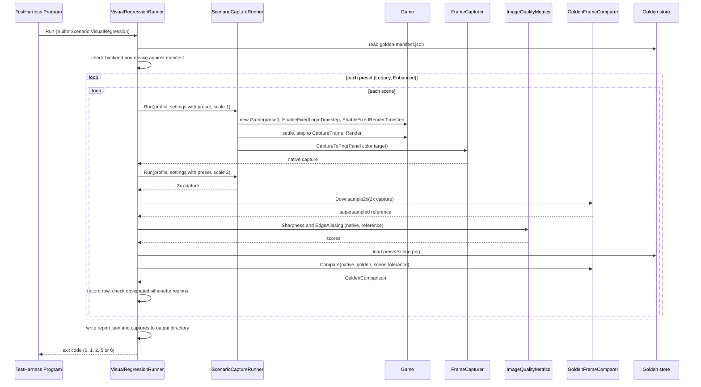

# Deep Dive: Visual Regression Harness (G3)

> Expands phase G3 of [Track G: Rendering Clarity & Image Quality](../track-g-rendering-clarity.md).
> Part of the [Large-Scale Simulation Roadmap](../README.md).
>
> Audience: human overview of the golden-frame harness design. Code references are in the agent-context appendix at the bottom.
>
> The agent-context section at the bottom ([Current code appendix](#appendix-current-code-agent-context)) contains file:line code references. Skip it if reading for design intent.

Purpose: give every later Track G phase an objective, automated pass or fail on a captured frame.
G3 renders a fixed scene set headlessly under each G2 preset, compares each frame against a
stored golden, and reports a sharpness score and an edge-aliasing score per frame. The rationale
for golden frames per preset is in the
[original-look Decision](../open-questions.md); the dependency of G4 to G10 on G3 is in the
[phase table](../track-g-rendering-clarity.md#phases).

---

## 1. Problem

The engine can read a frame back, but nothing compares one frame with another or scores it.

- `FrameCapturer.Capture` copies a GPU texture into a tightly packed `CapturedFrame`
  (`PixelData`, `Width`, `Height`, `Format`), and `ToImage` normalizes BGRA to RGBA. Every engine
  capture in the repository goes through it.
- `FrameCaptureService` wraps it for agent inspection: PNGs under `$TMPDIR/panopticon_captures`,
  a `[CAPTURE] <path> | <hint>` stdout line, and deletion of every file it wrote on `Dispose`. That
  contract is the opposite of a persistent golden store.
- The closest thing to a fixed scene set is the TestHarness `ScenarioCapture` runner: a JSON
  `CaptureProfile` (map, actors, `Explicit` camera with `LookAt` and `Height`, `SettleFrames`,
  `HideHud`) renders headlessly into `frame_NNNN.png` at a fixed 1024x768. The profiles live in
  the ReplaySketch profile store (`ReplaySketch.Core/Profiles/capture-*.json`).
- Logic stepping is already deterministic (`Game.EnableFixedLogicTimestep`), but render time is
  not. `Game.Render` passes `RenderTime` from a wall-clock `DeltaTimer` to the render pipeline, so
  time-driven effects (cloud-shadow scroll, water, particles) differ between two runs of the same
  profile. `StandaloneModelCapture` avoids this only by rendering with `TimeInterval.Zero`.
- Byte-identical repeat captures are already proven on this host for model-level scenes
  (`PbrMaterialProof` and `GltfRuntimeProof`, after discarded warm-up frames), but only within one
  run. No path loads a stored PNG and compares against it.
- No sharpness or aliasing metric exists. The only pixel assertion on a full-map frame is
  `ValidationGroundCameraTests`, which counts clear-colour pixels (105,105,105).

Corrections to the phase row:

- ReplaySketch screenshot mode does not capture engine frames. `REPLAYSKETCH_SCREENSHOT_PATH`
  renders the Avalonia window through `RenderTargetBitmap`, and `--screenshot` renders the
  validation-ground editor through SkiaSharp (`ScreenshotCapture`). Neither touches
  `FrameCapturer`. The ReplaySketch Model tab shows engine renders only because
  `TestHarnessPreviewClient` launches a TestHarness process that captures through
  `StandaloneModelCapture`. G3 therefore extends `FrameCapturer` and the `ScenarioCapture` runner,
  not the ReplaySketch screenshot path, and does not extend `FrameCaptureService`.
- `src/Panopticon.Tools.TestHarness/AGENTS.md` describes a `FrameCaptureSession` type, a
  `DefaultScenario_CapturesFrames_ForVisualValidation` test and a `$TMPDIR/panopticon_frames`
  layout. None of them exist in `src/` or `test/`.

## 2. Constraints

- No new tool, per the [C5 no-dedicated-viewer Decision](../open-questions.md). The gate is a
  TestHarness built-in scenario, the same form as the existing pixel gates (`PbrMaterialProof`,
  the Unit Validation Ground baseline).
- Headless only. Offscreen Vulkan capture works on the Linux dev host; windowed runs do not
  (see [`docs/screenshots.md`](../../screenshots.md)). CI has no game install and no GPU, so the
  gate cannot run in CI; pure metric and comparison code must still be unit-tested there.
- Every scene renders from the real install, since the scene content (terrain, foliage, HUD) is
  the subject of later phases. Goldens may not be redistributable outside the repo's existing
  practice of committed proof PNGs (`artifacts/proofs/pbr-material-proof/`, `artifacts/proofs/gltf-runtime-proof/`). Golden commits
  require a licensing/storage review; if unsuitable, keep the reviewed store externally with a
  checked-in manifest.
- Output must be identical between two runs on the same host and driver. Exact match across GPUs
  and drivers is not achievable, so goldens are pinned to a reference host.
- Presentation only: G3 changes no simulation behaviour and adds nothing to the headless
  simulation host (the [A3 seam](../track-a-foundations.md)).

## 3. Design

### 3.1 Scene set as data

A `visual-regression-scenes.json` file in the ReplaySketch profile store lists the scenes in
order. Each entry names a `CaptureProfile` (`vr-<scene>.json`, same store), the frame index to
capture after settle, and the comparison tolerance. Adding a scene is a data edit. VR profiles
must use `Explicit` camera mode, so framing is independent of the capture resolution.

Initial scene set, each chosen for the later phase that must not regress it:

| Scene | Content | Guards |
|---|---|---|
| `terrain-default` | Default RTS camera over textured terrain, roads, water edge | G6, G7 |
| `terrain-grazing` | Low pitch across open terrain | G7 |
| `foliage-distance` | Trees and fences minified at distance | G5 |
| `unit-silhouettes` | Vehicles and buildings against terrain | G4, G10 |
| `shadow-casters` | Buildings casting shadows at default zoom | G8 |
| `hud` | Same as `terrain-default` with `HideHud: false` | G9 |

`terrain-grazing` needs a camera pitch override: `CaptureCamera` has none, and `Explicit` mode
calls `TacticalView.SetAngleAndPitchToDefault`. G3 adds optional `PitchDegrees` and
`AngleDegrees` to `CaptureCamera`, applied through `TacticalView.SetPitch` and the existing
angle setter.

### 3.2 Deterministic capture

- `Game.EnableFixedRenderTimestep` sets the render `DeltaTimer.FixedDelta`, the counterpart of
  `EnableFixedLogicTimestep`. The `ScenarioCapture` runner enables both for VR profiles.
- `CaptureRunSettings` gains the active graphics preset (the G2 settings type) and a viewport
  scale. The runner constructs `Game` with the preset and renders at `1024x768 * scale`.
- Repeat-run identity is a precondition, not an assumption: `WI-G3-01` runs each candidate scene
  twice and records whether the captures are byte-identical. A scene that is not is fixed or
  dropped before it gets a golden.

### 3.3 Metrics

`ImageQualityMetrics` is a static type over the `CapturedFrame` field shapes (pixel bytes, width,
height, `PixelFormat`), so stored PNGs and live captures use the same code. Both scores are in
`[0, 1]`:

- Sharpness: mean Sobel gradient magnitude of luminance, normalized by the maximum possible
  magnitude. Comparable only between frames of equal dimensions.
- Edge aliasing: over pixels whose luminance gradient exceeds a fixed threshold, the fraction
  that take one of the two plateau values on either side of the edge rather than an intermediate
  value. A hard staircase scores near 1, a ramped edge near 0. A frame with no edges scores 0.
  Fix edge orientation, plateau sampling distance and threshold in synthetic diagonal-edge tests;
  report the metric as a scene-specific heuristic, not a universal image-quality score.

### 3.4 Antialiased reference without G4

The milestone requires the metrics to separate an aliased frame from an antialiased one, but
MSAA arrives in G4, which depends on G3. G3 produces its own antialiased reference: the same
scene rendered at viewport scale 2 and box-downsampled 2x2 on the CPU (supersampling). The gate
asserts `EdgeAliasing(native) > EdgeAliasing(supersampled)` in designated static silhouette
regions. HUD and texture-heavy scenes are not required to satisfy that relation. G4 later
asserts the same relation between 1x and 4x MSAA in those regions.

### 3.5 Golden store and comparison

- Goldens are PNGs committed at `visual-regression/<preset>/<scene>.png`, the repo-root layout
  the existing proof scenarios use, plus `visual-regression/golden-manifest.json` recording the
  backend, device name, resolution and the metric scores of each golden. No Git LFS; the store is
  budgeted at 12 PNGs (6 scenes x 2 presets) of one frame each.
- `GoldenFrameComparer` compares two RGBA images of equal size and returns the count of pixels
  whose largest channel difference exceeds `MaxChannelDelta`, the largest delta seen, and the
  metric deltas. A frame fails when the differing-pixel fraction exceeds
  `MaxDifferingPixelFraction`, or when either metric moves by more than `MaxMetricDelta`.
- Initial tolerance: `MaxChannelDelta` 2, `MaxDifferingPixelFraction` 0.001, `MaxMetricDelta`
  0.02. Overridable per scene in the scene set. `Legacy` goldens for G9 scenes use 0 and 0,
  since G9 requires pixel identity.
- Goldens are pinned to the measured host/backend/driver recorded by G3-1, not a hardware identity
  assumed by this design. When the
  running backend or device differs from the manifest, the run still captures and scores, skips
  the pixel comparison, and exits with a distinct code rather than passing or failing.

### 3.6 Runner and update mode

`VisualRegression` is a new `BuiltInScenario`. For each preset, then each scene, it runs the
scene's profile through `ScenarioCaptureRunner` at scale 1 and scale 2, scores both, compares the
native capture against its golden, and prints one result row per scene and preset. Captures and a
`report.json` go to an output directory outside the golden store, so a failing run leaves its
artifacts for inspection.

`TESTHARNESS_VR_UPDATE_GOLDENS=1` writes the native captures and a new manifest into the golden
store instead of comparing. The runner never updates goldens on failure. A golden mismatch
follows the repository's determinism-failure rule: preserve the artifacts, report, and wait for a
decision before regenerating.

Exit codes follow the TestHarness convention: 0 pass, 1 setup error (missing profile, missing
golden outside update mode), 2 regression, 5 the supersampled reference did not score lower on
edge aliasing, 6 golden host mismatch.

### 3.7 Sub-phases

| Sub-phase | Card | Scope |
|---|---|---|
| G3-1 | [`WI-G3-01`](../agent/cards/WI-G3-01-audit-frame-capture-paths.md) | Audit capture paths, gaps, and repeat-run determinism of candidate scenes. |
| G3-2 | [`WI-G3-02`](../agent/cards/WI-G3-02-image-quality-metrics.md) | `ImageQualityMetrics` with synthetic-image unit tests. |
| G3-3 | [`WI-G3-03`](../agent/cards/WI-G3-03-golden-frame-comparison.md) | Fixed render clock, preset and scale in `CaptureRunSettings`, camera pitch override, scene set, `VisualRegression` capture pass, supersampled-reference check. |
| G3-4 | [`WI-G3-04`](../agent/cards/WI-G3-04-golden-store-and-gate.md) | `GoldenFrameComparer`, golden store and manifest, update mode, exit codes. |

## 4. Validation

- Unit tests without GPU or install (`Category!=Interactive`): metric ordering on synthetic
  images (`WI-G3-02`), and comparer behaviour on synthetic pairs: identical passes, a perturbed
  block fails, a sub-threshold delta passes (`WI-G3-04`).
- Determinism: two consecutive `VisualRegression` runs on the reference host produce
  byte-identical captures for every scene.
- Gate sensitivity: a deliberate perturbation (for example a changed `RenderPipeline.ClearColor`
  in a scratch build) fails the affected scenes with exit code 2; reverting passes.
- Milestone: designated silhouette regions score lower on edge aliasing in the supersampled
  reference than the native capture, under both presets.

---

## 5. Architecture Diagrams

Types after G3. `FrameCapturer`, `CapturedFrame`, `CaptureProfile`, `CaptureCamera`,
`ScenarioCaptureRunner`, `CaptureRunSettings` and `Game` exist today; members marked G3 and the
types marked G3 are added. The G2 settings type name follows the G2 deep dive.

One `VisualRegression` run, compare mode. Update mode replaces the compare step with a write to
the golden store.

---

## Appendix: current code (agent context)

- `src/Panopticon.Simulation/Graphics/FrameCapturer.cs:17-56`: `Capture`, the staging-texture
  readback with row-pitch repacking. `:61-66` `CaptureToPng`. `:71-92` `ToImage`, BGRA to RGBA.
  `:94-101` supported formats: RGBA8 and BGRA8, UNorm and sRGB.
- `src/Panopticon.Simulation/Graphics/FrameCapturer.cs:108-122`: `CapturedFrame`, internal
  constructor, so a golden loaded from PNG cannot be wrapped in one from outside the assembly.
- `src/Panopticon.Simulation/Graphics/FrameCaptureService.cs:52-53`: `CaptureDirectory`
  (`$TMPDIR/panopticon_captures`). `:95-104` `Capture` and the `[CAPTURE]` line. `:110-119`
  `DeleteCaptures`, called from `Dispose`.
- `src/Panopticon.Simulation/Graphics/Rendering/RenderPipeline.cs:22`: `ClearColor`
  (105,105,105). `:24-26` `GameOutputDescription` (D32S8 + BGRA8 UNorm). `:104-170` `Execute`: 3D
  and 2D draw into an intermediate texture, then `TextureCopier` blits it to the panel target, so a
  capture of `Panel.Framebuffer.ColorTargets[0].Target` includes the HUD.
- `src/Panopticon.Simulation/Graphics/RenderTarget.cs:8-10,41-48`: the panel colour target,
  `B8_G8_R8_A8_UNorm`.
- `src/Panopticon.Simulation/Game.cs:364-386,951-955`: `_mapTimer`, `_renderTimer`, `RenderTime`.
  `:1002-1005` `EnableFixedLogicTimestep` sets `_mapTimer.FixedDelta`. `:1007-1011` `Render`
  passes `RenderTime` to `Graphics.Draw`.
- `src/Panopticon.Tools.TestHarness/ScenarioCaptureRunner.cs:35-36`: fixed 1024x768 viewport.
  `:48-62` `Run`. `:105-109` `new Game(...)` per profile. `:129` `EnableFixedLogicTimestep`.
  `:136` `HideHud`. `:325-327` per-frame `CaptureToPng` into `frame_NNNN.png`. `:487`
  `SetAngleAndPitchToDefault`. `:495-511` `Explicit` camera and its safe-viewport check.
  `:1174-1178` `RenderFrame`. `:1211-1214` `CaptureRunSettings`.
- `src/Panopticon.Tools.ReplaySketch.Core/Model/Capture/CaptureProfile.cs:12-217`:
  `CaptureProfile`, `CaptureCamera` (`Mode`, `LookAt`, `Height`; no pitch or angle).
- `src/Panopticon.Tools.ReplaySketch.Core/Panopticon.Tools.ReplaySketch.Core.csproj:9`:
  `Profiles\*.json` embedded, the store for the scene set and VR profiles.
- `src/Panopticon.Simulation/Graphics/Cameras/TacticalView.cs:257,360`:
  `SetAngleAndPitchToDefault`, `SetPitch`.
- `src/Panopticon.Tools.TestHarness/BuiltInScenario.cs`: the enum gaining `VisualRegression`.
  `Program.cs:213-240`: dispatch pattern (`Environment.ExitCode = Runner.Run(...)`).
- `src/Panopticon.Tools.TestHarness/PbrMaterialProofScenario.cs:62,230-233`: the existing
  byte-identical repeat-capture check.
- `src/Panopticon.Tools.TestHarness/StandaloneModelCapture.cs:156-166`: rendering with
  `GameTime = TimeInterval.Zero` for determinism. `:180-197` `FlushMeshWorldConstants`, the RADV
  constant-buffer race workaround.
- `src/Panopticon.Tools.TestHarness/ValidationGroundRunner.cs:337-361`: `TESTHARNESS_VG_CAPTURE`
  offscreen capture through `FrameCaptureService`.
- `test/Panopticon.Simulation.Tests/Tools/ReplaySketch/ValidationGroundCameraTests.cs:95-104`: a
  `[GameFact]` that renders a map frame and reads it with `FrameCapturer.Capture`.
- `test/Panopticon.Simulation.Tests/Graphics/FrameCaptureServiceTests.cs`: existing capture tests,
  the placement for metric and comparer tests.
- `src/Panopticon.Tools.ReplaySketch.Avalonia/MainWindow.cs:43-47`: `REPLAYSKETCH_SCREENSHOT_PATH`
  via `RenderTargetBitmap`. `ScreenshotCapture.cs`: SkiaSharp `--screenshot` render.
- `src/Panopticon.Tools.ReplaySketch.Core/Services/TestHarnessPreviewClient.cs`: Model-tab
  renders through a TestHarness subprocess.
