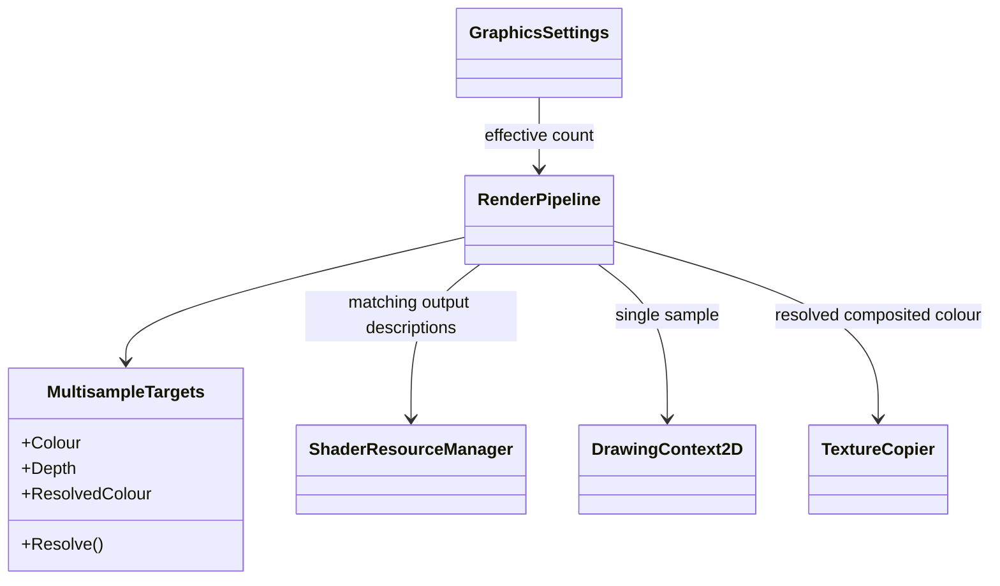
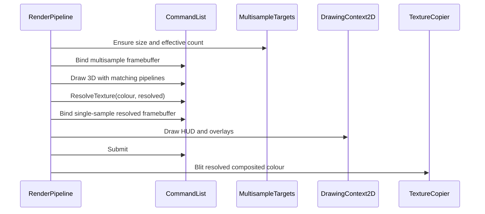

# Deep Dive: Multisample Antialiasing (G4)

> Part of [Track G](../track-g-rendering-clarity.md).
>
> Audience: human + agent. Sample-count propagation and resolve ordering.

## 1. Purpose and current problem

`RenderPipeline` creates single-sample intermediate colour/depth textures and exposes a static
`GameOutputDescription`. Terrain, particles, tracers, water and model pipelines depend on that
description. `TextureCopier` samples the intermediate texture through `SpriteBatch`; it cannot
sample an unresolved multisample target as an ordinary 2D texture.

## 2. Constraints

- G2 owns requested/effective sample counts; G3 supplies visual comparisons.
- Faithful remains 1x with the existing path and output.
- Colour and depth attachments and all pipelines bound to their framebuffer must agree.
- Shadow, reflection and refraction passes have separate output contracts. Do not blindly apply
  the main framebuffer's count to auxiliary passes.
- Resize/reconfiguration checks include sample count, not only dimensions.

## 3. Design

Replace main-output static assumptions with the effective output description from G2. Support
1/2/4/8 where the backend supports both selected colour and depth formats. Select the largest
supported count no greater than requested and report it; fail clearly if even the base formats
are unsupported.

At 1x retain the existing framebuffer. At greater counts allocate multisample colour/depth plus
a single-sample resolved colour texture. Render the 3D pass, resolve colour with
`CommandList.ResolveTexture`, bind a single-sample framebuffer for 2D, then draw WND/APT and
overlays and execute the final `TextureCopier` blit. Native-resolution HUD work must not depend
on multisample shading. Main 3D and 2D pipeline descriptions are consequently distinct.

Audit model forward/depth pipelines, terrain, roads, water, particles, tracers, sprite batches,
camera fade and auxiliary passes. Existing shader-store and pipeline cache keys must distinguish
output descriptions. Rebuild all dependent resources transactionally through G2; dispose the old
targets after queued work completes. G5 adds cutout-specific coverage state later.

| Sub-phase | Card | Deliverable |
|---|---|---|
| G4-1 | WI-G4-01 | Inventory of attachment/pipeline descriptions, including auxiliary passes. |
| G4-2 | WI-G4-02 | Count propagation, separate 2D target, resolve, capability and capture tests. |

## 4. Validation

- Pure tests cover count selection and invalid/mismatched output descriptions.
- Capture 1/2/4/8 where supported, including terrain, roads, water, opaque units and particles.
- 4x silhouette regions score less aliased than 1x using G3. HUD pixels remain unchanged.
- Repeated 1x/4x switches and resizes have no validation errors or unresolved texture reads.
- Faithful 1x matches the pre-G4 reference on the pinned backend.

## 5. Architecture Diagrams

Target resource flow; `MultisampleTargets` denotes proposed owned framebuffer resources.

## Appendix: current code (agent context)

- `src/Panopticon.Simulation/Graphics/Rendering/RenderPipeline.cs`: intermediate framebuffer, 3D/2D order and final blit.
- `src/Panopticon.Simulation/Graphics/TextureCopier.cs`: sampled final blit.
- `src/Panopticon.Simulation/Graphics/Shaders/ShaderResourceManager.cs`: shader resources.
- `src/Panopticon.Simulation/Graphics/Shaders/TerrainShaderResources.cs`: static main output consumer.
- `src/Panopticon.Simulation/Graphics/Shaders/ParticleShaderResources.cs`: static main output consumer.
- `src/Panopticon.Simulation/Graphics/Shaders/WaterShaderResources.cs`: water main pass.
- `src/Panopticon.Simulation/Graphics/Rendering/Water/WaterMapRenderer.cs`: auxiliary water passes.
- `src/Panopticon.Simulation/Scripting/CameraFadeOverlay.cs`: 2D output consumer.
