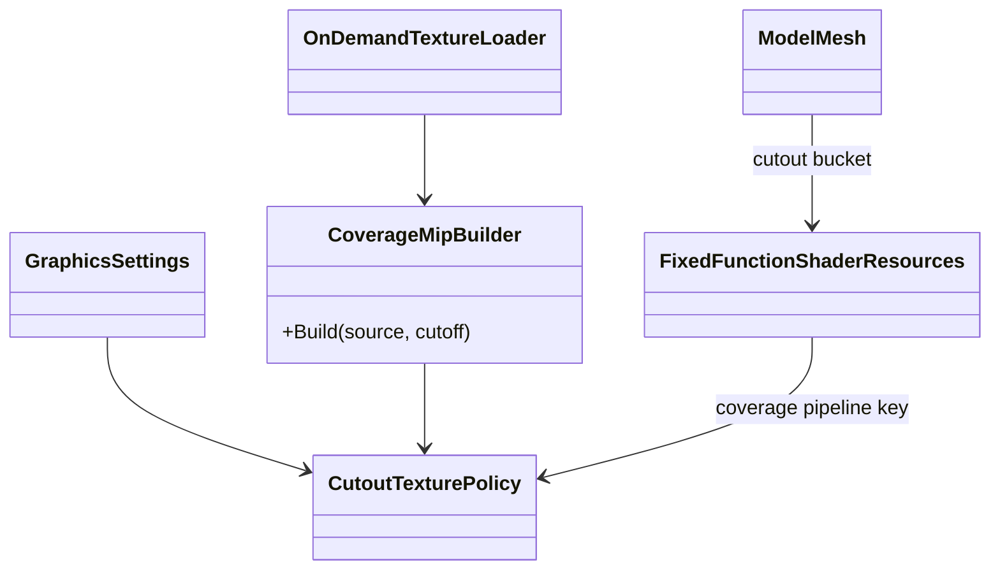
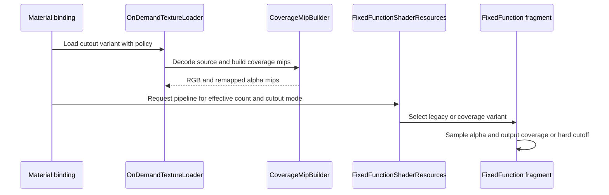

# Deep Dive: Cutout and Alpha-Test Clarity (G5)

> Part of [Track G](../track-g-rendering-clarity.md).
>
> Audience: human + agent. Material-specific cutout sampling and mip coverage.

## 1. Purpose and current problem

`Common.h.FailsAlphaTest` rejects alpha below `0.37647`. `FixedFunction.frag` applies it when the
material's `AlphaTest` flag is set. `OnDemandTextureLoader` uploads DDS mip chains unchanged;
TGA/JPG paths use `ImageSharpTexture`. `MipmapHelper` uses Lanczos3, not a box filter, but does
not explicitly preserve cutout coverage. The suspected minification defect needs the G5-1 audit
and G3 crops before its cause is treated as established.

## 2. Constraints

- Legacy retains the existing cutoff, authored DDS mips and shader path.
- Only alpha-tested materials receive this treatment. Blended particles, HUD art and opaque
  maps must not acquire coverage remapping.
- Texture names alone are insufficient cache keys when one image has several material roles.
- G4's effective count, not the requested count, determines availability of alpha-to-coverage.

## 3. Design

Classify texture use at material binding: opaque, cutout or blended. Introduce proposed
`CutoutTexturePolicy` metadata (base cutoff, mip policy, effective coverage mode) and include it
in texture/material pipeline cache keys. Keep the legacy variant alongside enhanced variants.

For Enhanced, generate cutout mip alpha from decoded source data. At each mip, solve a bounded
alpha rescale so the fraction above the base cutoff approximates the source coverage. Record
achieved coverage; tiny mips have quantised coverage and cannot promise exact equality. RGB
filtering follows G6's colour-space mode, while alpha remains linear. Authored DDS mip chains
are retained under Legacy; enhanced compressed cutouts require a tested decode/rebuild path,
not silently skipped correction.

The per-mip rescale is baked into alpha. Do not apply a second threshold correction at sampling
time. If the audit requires threshold metadata instead, replace the baked strategy explicitly
and test fractional LOD transitions before implementing it.

With effective MSAA greater than 1, use a cutout-only pipeline with alpha-to-coverage enabled
and a shader variant that outputs coverage alpha instead of the legacy hard discard. Reject
fully transparent samples. At 1x use coverage-preserving mips plus the base cutoff. Do not
enable coverage on blended render buckets. Confirm that the final fragment alpha carries the
cutout value rather than unrelated vertex/override opacity.

| Sub-phase | Card | Deliverable |
|---|---|---|
| G5-1 | WI-G5-01 | Material/texture-role inventory, DDS handling and minification evidence. |
| G5-2 | WI-G5-02 | Coverage mip variants, cutout pipeline state and G3 comparisons. |

## 4. Validation

- Synthetic binary masks preserve achievable coverage within one texel at each mip; empty/full
  masks stay empty/full. Fractional LOD transitions remain bounded.
- Shared image use creates distinct cutout and blended variants without cache contamination.
- Foliage/fence crops retain coverage at multiple distances at 1x and 4x Enhanced.
- Transparent particles and HUD captures remain unchanged; Legacy matches its golden.
- Report exceptions for compressed formats or backend coverage support, never silently pass.

## 5. Architecture Diagrams

Target design; policy and mip builder are proposed.

## Appendix: current code (agent context)

- `src/Panopticon.Simulation/Assets/Shaders/Common.h`: `FailsAlphaTest`.
- `src/Panopticon.Simulation/Assets/Shaders/FixedFunction.frag`: material flag and diffuse-alpha discard.
- `src/Panopticon.Simulation/Graphics/Shaders/FixedFunctionShaderResources.cs`: pipeline key and material constants.
- `src/Panopticon.Simulation/Content/Loaders/OnDemandTextureLoader.cs`: DDS/TGA/JPG loading paths.
- `src/Veldrid.ImageSharp/MipmapHelper.cs`: mip count and Lanczos3 generation.
- `src/Panopticon.Simulation/Graphics/ModelMesh.cs`: blended and shadow bucket classification.
