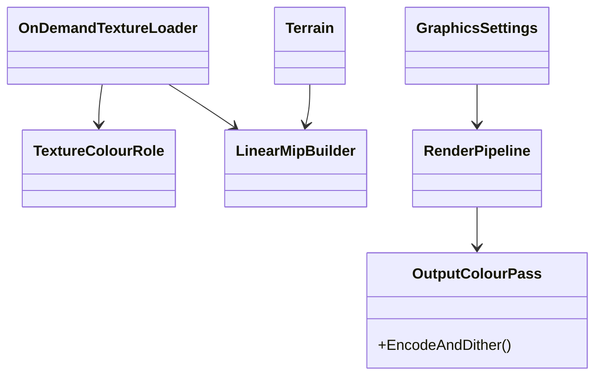
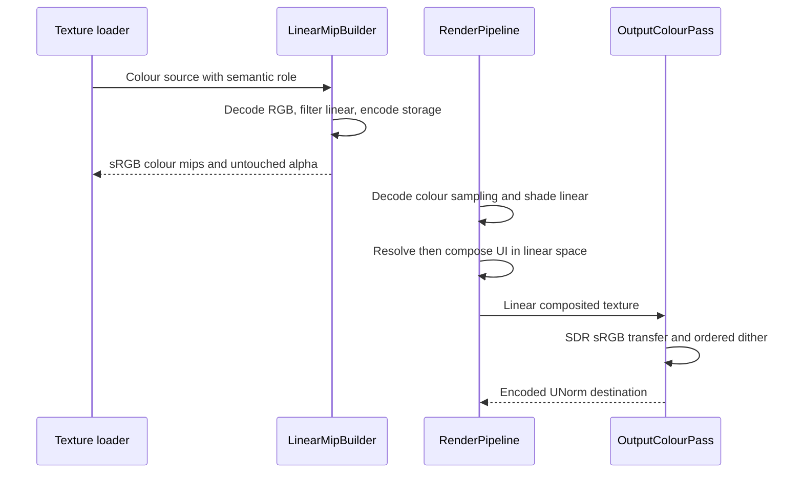

# Deep Dive: Gamma-Correct Rendering (G6)

> Part of [Track G](../track-g-rendering-clarity.md).
>
> Audience: human + agent. Colour roles, linear filtering and output encoding.

## 1. Purpose and current problem

The main output uses `B8_G8_R8_A8_UNorm`; texture loading generally follows stored format without
a semantic colour role. `MipmapHelper` resizes encoded `Rgba32` data with Lanczos3 without
explicit linear-light conversion. `Terrain.CreateTextures` also resamples TGA images into an
UNorm texture array. Changing only the final output format would not correct those operations.

## 2. Constraints

- Legacy retains existing texture formats, mip arithmetic and output encoding.
- Normal maps, masks, alpha, tile indices and other data textures remain linear data.
- G5 owns cutout alpha coverage; G6 owns RGB colour transfer. Both policies belong in cache keys.
- G4 resolve operates in linear space in Enhanced. UI composition must not encode output twice.
- Tone mapping is not required for this SDR phase; preserve the game's art and lighting intent.

## 3. Design

Introduce a proposed `TextureColourRole` at loading/binding, not an extension-based heuristic.
Colour maps use sRGB sampling where supported, including compatible compressed DDS formats;
data maps retain UNorm/float views. If a backend cannot provide a compatible view, use a tested
converted texture variant and report the fallback. Decode/encode RGB only, never alpha.

Enhanced mip/resample generation converts colour to linear light, filters, and encodes back for
sRGB storage. Include terrain-array creation, source mip chains and JPG alpha-sidecar ordering
in the audit. Existing authored DDS mips are not assumed linear-filtered; enhanced rebuilding
must have a supported decode path or an explicitly recorded limitation.

Shade into a linear intermediate, preferably a supported floating-point format to avoid losing
gradient precision before the final pass. Main lighting, fog and cloud modulation need a
documented interpretation of asset constants; convert authored encoded colours at their input
boundary rather than scattering gamma functions through shaders. Reflection/refraction targets
follow the same linear contract. G6 also decodes UI colour art and treats live colours consistently
before composition so the output pass is correct before G9. G9 retains this contract when changing
sampling and chrome. No reinterpretation of data textures.

Replace the Enhanced final blit with a proposed `OutputColourPass`: clamp SDR linear colour,
apply the exact sRGB transfer, add a zero-mean ordered dither of at most one output code step,
then write to an UNorm destination. Screen-coordinate ordered dither has no wall-clock phase.
If hardware sRGB output is chosen instead, use linear output and do not also encode in the
shader; the audit fixes one path. Legacy retains `TextureCopier` unchanged.

| Sub-phase | Card | Deliverable |
|---|---|---|
| G6-1 | WI-G6-01 | Colour/data role table and every transfer/filtering/output boundary. |
| G6-2 | WI-G6-02 | Role-aware texture variants, linear intermediates, output transfer and dither. |

## 4. Validation

- A black/white colour mip averages to approximately sRGB 188, not encoded-space 128; data
  maps still average to 128. Alpha values are unchanged by transfer functions.
- Synthetic transfer tests cover endpoints, round trips and no double encoding.
- Gradient crops show bounded zero-mean dither and lower banding without temporal flicker.
- G3 terrain/fog captures and auxiliary water passes use the same linear contract.
- Legacy matches its pre-G6 golden on the reference host.

## 5. Architecture Diagrams

Target design; colour roles, linear mip builder and output pass are proposed.

## Appendix: current code (agent context)

- `src/Panopticon.Simulation/Content/Loaders/OnDemandTextureLoader.cs`: format selection and JPG alpha sidecar.
- `src/Veldrid.ImageSharp/MipmapHelper.cs`: generated encoded-space mips.
- `src/Panopticon.Simulation/Terrain/Terrain.cs`: terrain-array resample and staging upload.
- `src/Panopticon.Simulation/Graphics/Rendering/RenderPipeline.cs`: intermediate targets and 2D composition.
- `src/Panopticon.Simulation/Graphics/TextureCopier.cs`: current final pass.
- `src/Panopticon.Simulation/Assets/Shaders/FixedFunction.frag`: colour sampling and lighting.
- `src/Panopticon.Simulation/Assets/Shaders/Terrain.frag`: terrain colour and fog.
