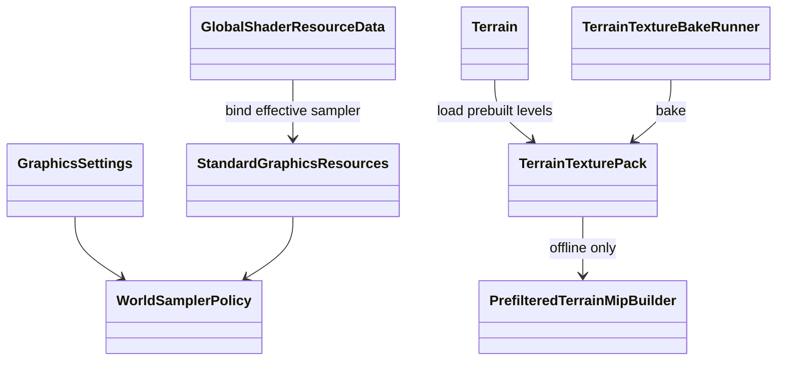
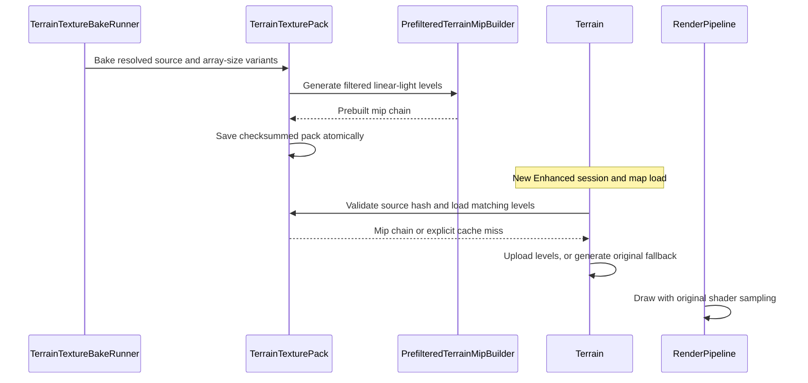

# Deep Dive: Texture Filtering and Mip Quality (G7)

> Part of [Track G](../track-g-rendering-clarity.md).
>
> Audience: human + agent. Configurable world samplers and terrain mip policy.

## 1. Purpose and current problem

`StandardGraphicsResources.Aniso4xClampSampler` uses `SamplerDescription.Aniso4x` and clamp
addressing. `GlobalShaderResourceData` binds it in the forward resource set; radius cursor
resources also consume it. `Terrain.CreateTextures` expands smaller TGAs to the largest square
size with Lanczos3, then generates mips through `ImageSharpTexture`. `MipmapHelper` already uses
Lanczos3, so changing from a claimed box filter is not the phase's deliverable.

## 2. Constraints

- Legacy keeps 4x, zero bias and the existing resample/mip path.
- G6 owns colour-space-aware filtering. G7 must compose with it without requiring G6 to land first.
- Shadow comparison samplers, tile-data point sampling and UI samplers are separate roles.
- Negative bias cannot substitute for antialiasing; image sharpness alone is not a quality gate.
- Enhanced prefers offline-prefiltered terrain data, not runtime supersampling. Legacy keeps its
  original mip path. Pack policy: [offline terrain texture packs](../implementation/track-g-g7-texture-filtering.md#offline-terrain-texture-packs).

## 3. Design

Replace the world sampler's fixed name with a proposed configurable world-sampler binding.
G2 stores requested/effective anisotropy and mip LOD bias. Accept 1/2/4/8/16; choose the device's
supported maximum no higher than requested and report the effective value. Reject non-finite
bias and constrain the initial public override to [-1, 1]. Enhanced starts at zero bias; tuning
requires temporal evidence, not a single sharp frame.

Sampler keys include address mode, filter, anisotropy and bias. On switching, rebuild every
resource set that captured the old sampler, including the global forward set and radius cursor
resources; retire the old sampler only after queued commands complete.

`TerrainTextureBake` generates versioned sidecar packs through `PrefilteredTerrainMipBuilder`.
Enhanced loads matching precomputed levels; Legacy retains the original generator. Preserve
texture-array layer order, cell size, wrap semantics and cliff/blend metadata. The installation
is never rewritten. Algorithm, integrity rules and load-time fallback are owned by the
[implementation policy](../implementation/track-g-g7-texture-filtering.md#offline-terrain-texture-packs).

| Sub-phase | Card | Deliverable |
|---|---|---|
| G7-1 | WI-G7-01 | Sampler consumers, device limits and terrain filtering inventory. |
| G7-2 | WI-G7-02 | Configurable sampler, binding invalidation and explicit terrain mip policy. |

## 4. Validation

- Pure tests cover anisotropy fallback, finite bias limits and complete sampler cache keys.
- Legacy generated terrain mips match the existing builder's bytes.
- G3 grazing-angle captures compare 4x and effective 16x over identical camera positions.
- `TerrainZoomProof` compares matching zoom sequences against supersampled references. The
  screen-space temporal sampling-error proxy, regression tolerance and mask-review requirements
  are defined in the [capture recipe](../../screenshots.md#recipe-terrain-zoom-temporal-comparison).
  It does not establish zero shimmer or replace world-space reprojection. Sharpness scores
  accompany temporal scores to expose blur tradeoffs.
- Switching presets updates global and cursor resource sets without stale disposed samplers.

## 5. Architecture Diagrams

World sampler bindings and offline terrain data flow:

## Appendix: current code (agent context)

- `src/Panopticon.Simulation/Graphics/StandardGraphicsResources.cs`: fixed sampler descriptions.
- `src/Panopticon.Simulation/Graphics/Shaders/GlobalShaderResourceData.cs`: forward sampler binding.
- `src/Panopticon.Simulation/Graphics/Shaders/ShaderResourceManager.cs`: radius cursor sampler consumer.
- `src/Panopticon.Simulation/Terrain/Terrain.cs`: largest-size array, resampling and staging copies.
- `src/Veldrid.ImageSharp/MipmapHelper.cs`: current Lanczos3 mip generator.
