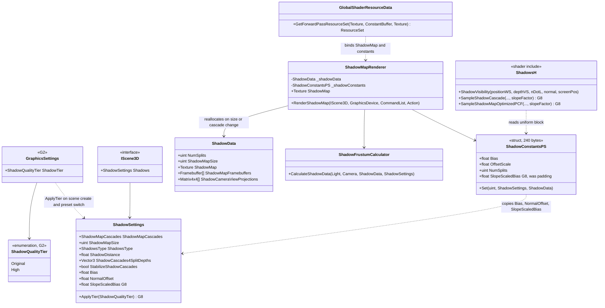
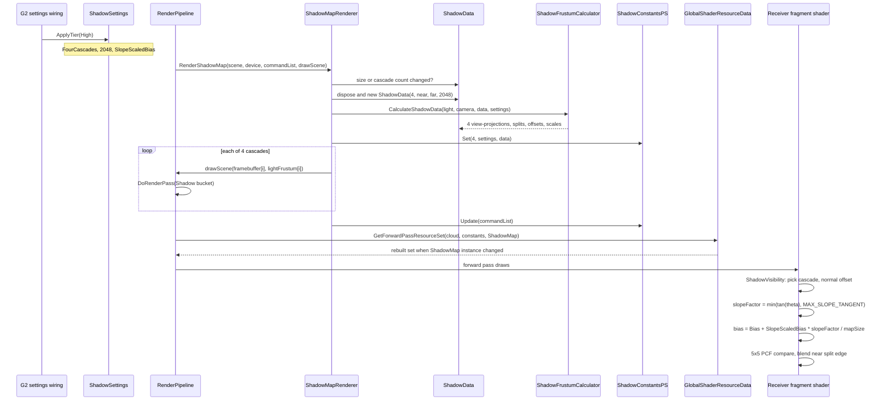

# Deep Dive: Shadow Quality Tier (G8)

> Expands phase G8 of [Track G: Rendering Clarity & Image Quality](../track-g-rendering-clarity.md).
> Part of the [Large-Scale Simulation Roadmap](../README.md).
>
> Audience: human overview of the shadow quality tier design. Code references are in the agent-context appendix at the bottom.
>
> The agent-context section at the bottom ([Current code appendix](#appendix-current-code-agent-context)) contains file:line code references. Skip it if reading for design intent.

Purpose: remove acne speckle and cascade blockiness from the existing cascaded shadow map under
`Enhanced`, by selecting four cascades at 2048x2048 and adding a slope-scaled term to the depth
bias, while `Faithful` keeps the current single-cascade output. The rationale for the track and
the preset split lives in the [track doc](../track-g-rendering-clarity.md).

---

## 1. Problem

The shadow system is a port of a standard stabilised cascaded shadow map with optimised PCF. Most
of the machinery for a higher tier already exists; the defaults and the bias form are what hold
quality back.

- `ShadowSettings` defaults to `ShadowMapCascades.OneCascade`, a 1024x1024 map, `ShadowsType.Soft`
  (5x5 optimised PCF), a 1200-unit `ShadowDistance`, and stabilised cascades. One 1024 texel map
  stretched over a 1200-unit view slice gives large texels near the camera: blocky edges.
- The depth bias is a single constant, `Bias = 0.002`, subtracted from the receiver's light-space
  depth in `SampleShadowMapOptimizedPCF`. It is in normalised cascade depth, so it does not grow
  with surface slope. Surfaces at a grazing angle to the light self-shadow in a speckle pattern
  (acne) unless the constant is raised far enough to detach shadows on flat ground.
- A normal offset already exists and is applied. `NormalOffset = 0.4` is copied into
  `ShadowConstantsPS.OffsetScale`, and `ShadowVisibility` offsets the sample position along the
  surface normal by `texelSize * OffsetScale * (1 - nDotL)` before projecting into shadow space.
  The phase row's premise of "a constant depth bias" only is incomplete: G8 keeps this offset and
  adds a slope-scaled term rather than introducing normal offset.

The four-cascade path is not new code. It is already selectable in the developer-mode render
settings view, and every layer is sized for up to four:

| Layer | Four-cascade support today |
|---|---|
| `ShadowFrustumCalculator` | `switch` over all three `ShadowMapCascades` values; per-cascade split, stabilised sphere fit, texel snapping. |
| `ShadowData` | Allocates a `Texture2D` array with one layer and one framebuffer per cascade. |
| `ShadowMapRenderer` | Reallocates `ShadowData` when map size or cascade count change; one depth pass per cascade, culled by that cascade's light frustum. |
| `GlobalShaderResourceData` | Rebuilds the forward-pass resource set when the shadow map texture instance changes. |
| `ShadowConstantsPS` / `Shadows.h` | Fixed four-slot arrays (`NUM_CASCADES 4`), cascade selection by view depth over `NumSplits`, and blending across the last 10% of each split (`FilterAcrossCascades` hardcoded to 1). |

No code path found hard-assumes one cascade. What is missing is a preset-driven way to select the
tier, and a bias that scales with slope. `WI-G8-01` confirms this list against the code before
`WI-G8-02` changes anything.

Out of the phase: `ModelMesh` excludes blended parts from the shadow bucket, while
`MeshDepth.frag` has no alpha test. Cutout caster coverage is therefore not reproduced by the
depth shader. G8 does not change caster classification or add alpha-tested shadow casting.

## 2. Constraints

- Veldrid 4.9 has no rasterizer depth bias. `RasterizerStateDescription` exposes only `CullMode`,
  `FillMode`, `FrontFace`, `DepthClipEnabled` and `ScissorTestEnabled`, so hardware slope-scaled
  depth bias in the depth pass is unavailable. The slope term must be computed receiver-side in
  the fragment stage.
- The fragment stage already has what a slope term needs. Every receiver shader (`FixedFunction`,
  `Terrain`, `Road`, `Water`) computes `nDotL` from its world normal and the first light direction
  and passes both into `ShadowVisibility`.
- `ShadowConstantsPS` is a `std140` uniform block mirrored by a C# `StructLayout.Sequential`
  struct. Its last 16-byte row ends in an unused padding float, so one new float fits without
  changing the buffer size or any other offset.
- `Faithful` must reproduce the pre-track capture. The tier change must reduce to the current
  values and current arithmetic when the tier is the original one.
- The tier is a G2 knob. G2 owns the settings type and the member name; G8 supplies the tier's
  values and its application to `ShadowSettings`.
- Shadow map texels are `D32_Float_S8_UInt`, the only 32-bit float depth format Veldrid 4.9
  offers. Four 2048x2048 layers are 16.8 M texels, up to 128 MiB on drivers that store the format
  at 8 bytes per texel. Acceptable for the `Enhanced` tier; changing the format is out of scope.

## 3. Design

### Decisions

- Tier selection, not new cascade code. The G2 shadow tier maps to three `ShadowSettings` members:

  | Tier | `ShadowMapCascades` | `ShadowMapSize` | `SlopeScaledBias` |
  |---|---|---|---|
  | Original (`Faithful`) | `OneCascade` | 1024 | 0 |
  | High (`Enhanced`) | `FourCascades` | 2048 | tuned, see below |

  Every other member (`Bias`, `NormalOffset`, `ShadowDistance`, split depths, `ShadowsType`,
  `StabilizeShadowCascades`) keeps its default in both tiers, so a visual change is attributable to
  cascade count, resolution and the slope term only.
- Application through the existing reallocation path. Applying a tier writes those members onto
  the scene's `ShadowSettings` (`IScene3D.Shadows`). `ShadowMapRenderer.RenderShadowMap` already
  compares the live map size and cascade count against `ShadowData` every frame and reallocates on
  change, and `GlobalShaderResourceData.GetForwardPassResourceSet` already rebinds a new shadow map
  texture. A runtime preset switch therefore needs no new resource-lifetime code. `Scene3D`
  constructs its `ShadowSettings` with defaults, so the G2 wiring applies the tier when a scene is
  created as well as on a preset switch.
- Slope-scaled bias computed in `ShadowVisibility`. The receiver bias becomes:

  ```glsl
  float cosTheta = clamp(nDotL, 0.0, 1.0);
  float tanTheta = min(sqrt(max(0.0, 1.0 - cosTheta * cosTheta)) / max(cosTheta, 1e-4), MAX_SLOPE_TANGENT);
  float bias = Bias + SlopeScaledBias * tanTheta * shadowMapSizeInv.x;
  ```

  The slope factor is computed once in `ShadowVisibility` from the `nDotL` it already receives,
  then threaded through `SampleShadowCascade` into `SampleShadowMapOptimizedPCF`, which already
  holds `shadowMapSizeInv`. Scaling by one texel keeps the term in the same normalised cascade
  depth units as `Bias`: with stabilised cascades each cascade's projection is a cube (depth
  extent equals width), so one texel in depth is `1 / ShadowMapSize` of the range in every
  cascade. `MAX_SLOPE_TANGENT` is a shader constant that bounds the term at grazing angles and keeps
  it finite at `nDotL = 0`.
- Bit-identical `Faithful`. `SlopeScaledBias = 0` multiplies a bounded finite value, so the bias is
  exactly `Bias` and the comparison arithmetic is unchanged. No shader branch on the tier.
- Constant-buffer layout. `SlopeScaledBias` replaces the trailing `_Padding` float in both
  `ShadowConstantsPSType` (`Shadows.h`) and `GlobalShaderResources.ShadowConstantsPS`, keeping the
  struct at 240 bytes.
- Starting value. `SlopeScaledBias` for the High tier starts at 2 (one texel per unit tangent,
  doubled for the 5x5 PCF footprint) and is tuned against the G3 capture within 0.5 to 4.
  `MAX_SLOPE_TANGENT` starts at 4. The chosen values are recorded in the implementation plan.
- No change to normal offset. It already scales with `1 - nDotL` and cascade scale. Raising the
  slope term is preferred over raising the offset, because a larger offset peter-pans thin casters.
- Not in scope: split depths, `ShadowDistance`, filter kernel, receiver-plane depth bias (the
  `shadowPosDX`/`shadowPosDY` derivatives are computed and threaded but unused; using them is a
  filtering change, not a tier change), caster alpha test, and the depth format.

### Sub-phases

| Sub-phase | Card | Scope |
|---|---|---|
| G8-1 | [`WI-G8-01`](../agent/cards/WI-G8-01-audit-shadow-settings-flow.md) | Audit: trace every `ShadowSettings` member to its endpoint, confirm the four-cascade path and normal offset, name the bias insertion point. |
| G8-2 | [`WI-G8-02`](../agent/cards/WI-G8-02-four-cascade-tier-and-slope-scaled-bias.md) | `SlopeScaledBias` member and constant, slope term in `Shadows.h`, tier-to-settings mapping consumed by the G2 wiring, G3 captures under both presets. |

## 4. Validation

- Unit tests (non-interactive): `Marshal.SizeOf<GlobalShaderResources.ShadowConstantsPS>()` stays
  240; applying the Original tier leaves a default `ShadowSettings` unchanged member by member;
  applying the High tier yields `FourCascades`, 2048 and the chosen `SlopeScaledBias`.
- G3 golden frames: a `Faithful` capture matches its golden byte for byte. An `Enhanced` capture of
  a scene with flat ground, sloped terrain and unit casters at the default camera zoom is the new
  golden, reviewed for no acne, no visible cascade seam and no peter-panning.
- Four-cascade coverage: an `Enhanced` capture with `VisualizeCascades` on shows four cascade
  colours, proving the path does not fall back to one.
- The existing `ShadowFrustumCalculatorTests` is `Interactive` (needs a graphics device) and stays
  so.

---

## 5. Architecture Diagrams

Target types after G8. Existing types are shown with the members G8 reads or changes;
`SlopeScaledBias`, the tier mapping and the slope term are what G8 adds. The tier enum name is
provisional until the G2 deep dive fixes it.



Per-frame flow with the High tier active, from the preset switch to the receiver's depth compare.



---

## Appendix: current code (agent context)

Line numbers are against `track-g-g1-3-phase-docs` at `568c28a96`.

- `src/Panopticon.Simulation/Graphics/Rendering/Shadows/ShadowSettings.cs:9-78`: defaults
  (`_shadowMapSize = 1024` at 9, `OneCascade` at 14, `Soft` at 19, split depths `(0.06, 0.20, 0.50)`
  at 46, `ShadowDistance = 1200` at 51, `StabilizeShadowCascades = true` at 58, `Bias = 0.002` at 69,
  `NormalOffset = 0.4` at 78); `ShadowMapSize` setter rounds up to a power of two. The
  `ShadowMapCascades` and `ShadowsType` enums share the file.
- `src/Panopticon.Simulation/Scene3D.cs:101`: `Shadows`, a per-scene `new ShadowSettings()`.
  `src/Panopticon.Simulation/IScene3D.cs:55` exposes it.
- `src/Panopticon.Simulation/Graphics/Rendering/Shadows/ShadowMapRenderer.cs:35-95`:
  `RenderShadowMap`. Reallocation check at 48-56, `_shadowConstants.Set` at 76, per-cascade draw
  loop at 79-86. `DrawDebugOverlay` has a four-entry `CascadeColors` at 97.
- `src/Panopticon.Simulation/Graphics/Rendering/Shadows/ShadowData.cs:31-66`: map allocation, a
  `Texture2D` array of `numCascades` layers in `D32_Float_S8_UInt`, one framebuffer per layer.
- `src/Panopticon.Simulation/Graphics/Rendering/Shadows/ShadowFrustumCalculator.cs:22-228`:
  `CalculateShadowData`. Split selection `switch` at 44, stabilised sphere fit and texel snapping
  at 109 and 168; `_cascadeSplits` is a fixed `float[4]` at 12.
- `src/Panopticon.Simulation/Graphics/Shaders/GlobalShaderResources.cs:122-196`:
  `ShadowConstantsPS`. `_padding` at 145 (the slot `SlopeScaledBias` takes), `Set` at 148,
  `Bias`/`OffsetScale` copies at 176-177, `FilterAcrossCascades = 1u` hardcoded at 179.
  `ShadowSampler` (comparison `LessEqual`, linear) at 40-52.
- `src/Panopticon.Simulation/Graphics/Shaders/GlobalShaderResourceData.cs:81-106`:
  `GetForwardPassResourceSet`, rebuilt when the shadow map instance changes.
- `src/Panopticon.Simulation/Graphics/Rendering/RenderPipeline.cs:188-210`: shadow pass in
  `Render3DScene`, then `GetForwardPassResourceSet` at 216.
- `src/Panopticon.Simulation/Assets/Shaders/Shadows.h`: `ShadowConstantsPSType` at 11-25 (`_Padding`
  at 24); `SampleShadowMapOptimizedPCF` at 52-198 with the constant bias at 61-63; `SampleShadowCascade`
  at 200-233; `GetShadowPosOffset` (normal offset) at 235-244; `ShadowVisibility` at 246-308.
- Receiver call sites passing `nDotL` and the normal to `ShadowVisibility`:
  `Assets/Shaders/FixedFunction.frag:257-258`, `Terrain.frag:245-246`, `Road.frag:22-23`,
  `Water.frag:72-73`. `Water.frag` derives its normal from the raw bump texture sample, so its
  `nDotL` is not a geometric normal; `MAX_SLOPE_TANGENT` bounds the slope term there.
- `src/Panopticon.Simulation/Graphics/Shaders/MeshDepthShaderResources.cs:19-32`: depth-pass
  pipeline. `DepthClipEnabled = false`; no depth-bias state exists to set.
- `src/Panopticon.Simulation/Graphics/ModelMesh.cs:139-152`: shadow-bucket population, excluding
  blended parts.
- `src/Panopticon.Simulation/Diagnostics/RenderSettingsView.cs:30,60-130`: developer-mode shadow
  controls (type, map size 256 to 2048, cascades, distance, stabilise, visualise).
- `src/Panopticon.Simulation/Lod/StaticGameLod.cs:28-50` and `GameData.cs:53`: `UseShadowVolumes`,
  `UseShadowDecals`, `UseShadowMapping`, `ShadowLOD` are parsed with no shadow-map consumer; G2 owns
  whether they feed the tier.
- `test/Panopticon.Simulation.Tests/Graphics/Rendering/Shadows/ShadowFrustumCalculatorTests.cs`:
  the only shadow test, `Interactive`.
