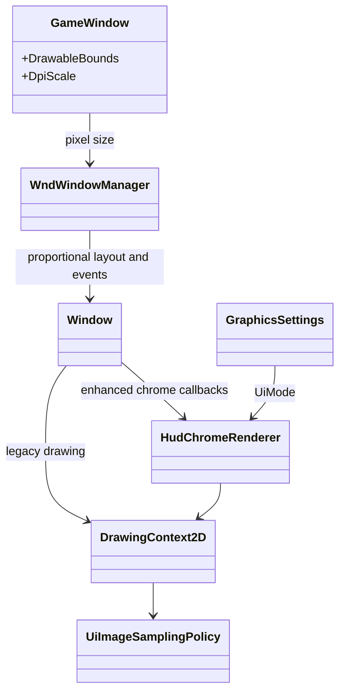
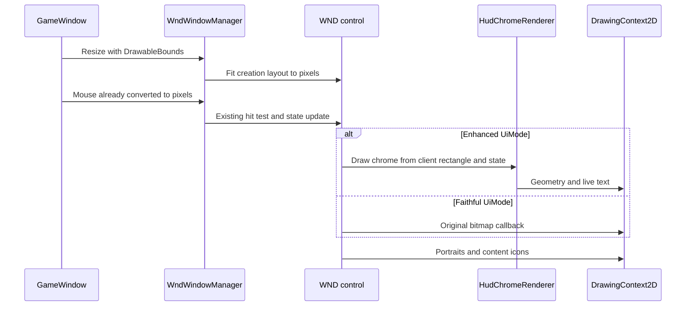

# Deep Dive: Resolution-Independent 2D and UI (G9)

> Part of [Track G](../track-g-rendering-clarity.md).
>
> Audience: human + agent. Native-pixel drawing, legacy-art compatibility and dynamic HUD.

## 1. Purpose and current problem

[G1](g1-high-dpi-resolution.md) already supplies physical-pixel panel sizes to WND/APT and
converts mouse input once at the window boundary. `Window.OnSizeChanged` fits the creation
resolution proportionally to the panel. `DrawingContext2D` rasterizes text at the current scale.
The remaining defect is scaled bitmap art, not a missing DPI transform.

`RenderPipeline` begins 2D drawing with a linear clamp sampler. A sharper sampler alone cannot
turn the pre-rendered control bar into resolution-independent art. The dynamic-HUD scope is
fixed by the [HUD decision](../open-questions.md).

## 2. Constraints

- Preserve pixel-space layout, aspect fitting, WND/APT events, focus, shortcuts and hit testing.
- No second DpiScale multiplication in drawing or input. Logical points remain only at G1's OS boundary.
- Faithful preserves the bitmap draw list and output after G1, not pre-G1 low-resolution output.
- Procedural chrome must retain control identity; gameplay callbacks and order generation are unchanged.
- Unit portraits, minimap and content icons remain raster assets. The no-bitmap rule concerns
  control-bar chrome (panels, frames and button backgrounds), not all HUD content.

## 3. Design

G9-1 inventories the actual controls, bitmap roles, draw callbacks, fonts and hit rectangles.
Store a chrome-role manifest identifying precisely which image draws G9-3 replaces. Audit APT
movie roles separately; a WND replacement is not permission to rewrite arbitrary APT content.

G9-2 keeps the existing proportional layout but improves presentation: rasterize live text at
the effective pixel size, cache fonts by family/style/pixel size, snap borders in final pixel
space, and add a proposed role-aware `UiImageSamplingPolicy` for legacy image upscaling.
Do not change world samplers. Evaluate higher-quality upscaling on fixed crops before choosing
it; keep Faithful's linear path. G4 draws UI after the 3D resolve, and G6 fixes colour composition.

G9-3 introduces proposed `HudChromeRenderer`, selected by G2's `UiMode`. Existing WND controls
remain the layout and input owners; rendering callbacks delegate only chrome drawing to the
renderer. Draw panels, borders and button state geometry from client rectangles; render labels
as live text. Hover, pressed, disabled, selected and faction variants must be defined in the
manifest. Excluded raster content is drawn through the existing callbacks.

Preserve original client rectangles at each aspect ratio. Screenshot evidence pairs each state
with draw-role diagnostics proving no legacy chrome image was submitted under Enhanced.
Faithful continues calling the original rendering callbacks with no procedural interception.

| Sub-phase | Card | Deliverable |
|---|---|---|
| G9-1 | WI-G9-01 | Control/bitmap/font/hit-region inventory and chrome-role manifest. |
| G9-2 | WI-G9-02 | Native-pixel text/border quality and role-aware legacy upscaling. |
| G9-3 | WI-G9-03 | Preset-gated dynamic chrome and state-complete golden captures. |

## 4. Validation

- Scale-1/2 tests map the same normalized mouse point to the same WND control; no double conversion.
- At 1024x768, 2048x1536 and a widescreen aspect, layout and hit-region bounds match the legacy path.
- Enhanced draw-role diagnostics contain zero legacy chrome bitmap draws, with portraits/icons exempt.
- G3 crops cover text and every button state; Faithful is exact on the pinned backend.
- Verify both ReplaySketch map and model tabs with screenshot mode when its UI is affected,
  following [`docs/screenshots.md`](../../screenshots.md).

## 5. Architecture Diagrams

Target design; image policy and chrome renderer are proposed.

## Appendix: current code (agent context)

- `src/Panopticon.Simulation/GameWindow.cs`: drawable size and input conversion boundary.
- `src/Panopticon.Simulation/Gui/Wnd/Controls/Window.cs`: resolution-proportional layout.
- `src/Panopticon.Simulation/Gui/DrawingContext2D.cs`: scaled text, transforms and sprite drawing.
- `src/Panopticon.Simulation/Graphics/Rendering/RenderPipeline.cs`: linear-clamp 2D pass.
- `src/Panopticon.Mods.Generals/Gui/ControlBarCallbacks.cs`: inspect callbacks during G9-1.
