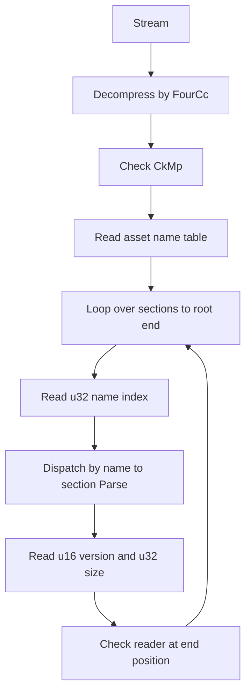
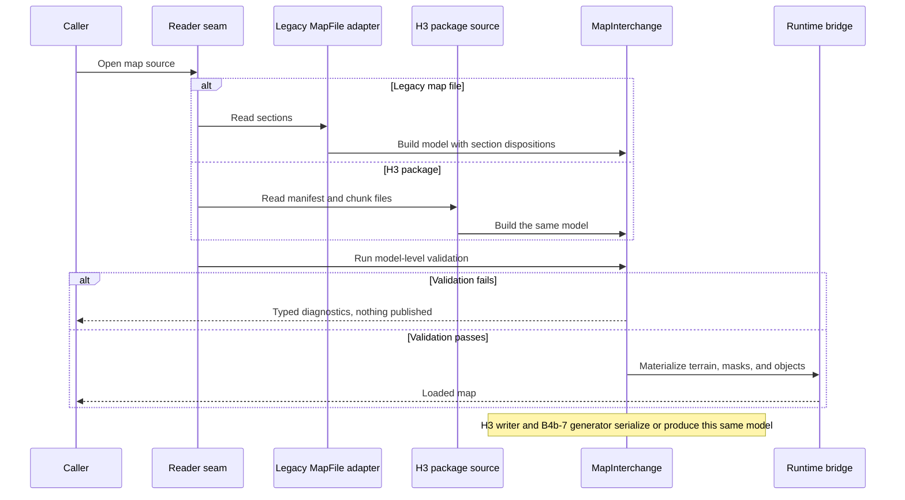
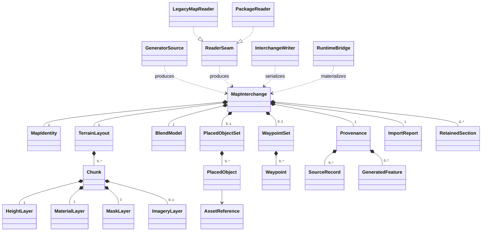

# H1-H2: Map storage audit

> Part of [Track H](../track-h-storage-formats.md), phase H1 (format audit). Implementation plan: [track-h-h1-h3-map-storage.md](../implementation/track-h-h1-h3-map-storage.md).
>
> Audience: human + agent.

## Scope and ownership

This audit records the legacy `.map` container, its 29 top-level sections, and the code that reads and writes them. It states current behavior with file:line citations at base commit `bc908cf`. It makes no format decision. Options are tracked in [WI-H1-02](../agent/cards/WI-H1-02-format-decision-options.md).

Code location: `src/Panopticon.Simulation/Data/Map/`, plus `SidesList` (`Logic/Map/SidesList.cs`) and the Scb reader (`Data/Scb/`). In tables, a bare file name is relative to `src/Panopticon.Simulation/Data/Map/`. Other paths are relative to `src/Panopticon.Simulation/`. Line numbers refer to base `bc908cf`.

## Legacy container

| Element | Behavior | Citation |
|---|---|---|
| Uncompressed FourCc | `CkMp`. The reader backs up 4 bytes so `Parse` reads it again. | MapFile.cs:20, :115-118 |
| RefPack FourCc | `EAR\0`. Reads a u32 size, then wraps the stream in `RefPackStream`. | MapFile.cs:121-125 |
| Zlib FourCc | `ZL5\0`. Reads a u32 size and checks header bytes `0x78 0x9C`. Decompresses fully into a `MemoryStream`. | MapFile.cs:129-150 |
| Other FourCc | Throws `NotSupportedException`. | MapFile.cs:152-153 |
| Post-decompress check | `Parse` requires `CkMp` after decompression and throws `InvalidDataException` otherwise. | MapFile.cs:157-167 |
| Name table | u32 count, then `count` pairs of length-prefixed string and u32 index. Indices run from count down to 1. Each index must equal its expected value. | AssetNameCollection.cs:19-38 (check :29-31) |
| Name lookup | Section headers reference names by u32 index. An unknown index throws `ArgumentException`. | AssetNameCollection.cs:46-52 |
| Parse context | Stack of end positions. The root `MapFile` entry pushes the stream length. | MapParseContext.cs:5-27; MapFile.cs:281 |
| Section header | u16 version, u32 data size, payload. End position is the payload start plus the size. | Asset.cs:14-23 |
| Section end check | Reader position must equal the end position after parsing. Otherwise throws `InvalidDataException`. | Asset.cs:33-36 |
| Section loop | Reads until the current end position. Reads a u32 index per section and dispatches by name. | Asset.cs:41-51 |
| Unknown section name | Throws `NotImplementedException`. | MapFile.cs:403-404 |
| Write container | Always uncompressed. Writes `CkMp`, then the name table, then sections. | MapFile.cs:413-421 (comment :416) |
| Write passes | Pass one writes to `BinaryWriter.Null` to collect names. Indices are assigned on first use. Pass two writes the name table and the sections. | MapFile.cs:423-436; AssetNameCollection.cs:54-63 |
| Name table write | Written with indices in descending order. | AssetNameCollection.cs:65-76 |
| Section write | `WriteAssetTo` writes the version, a placeholder size, the payload, then back-patches the size. | Asset.cs:59-79 |
| Section write order | Fixed order in `WriteMapDataTo`, independent of read order. | MapFile.cs:438-592 |

## Dataflow

Load path, from stream to parsed `MapFile`. The write path is the reverse of the table rows under "Write" in the container table, with two passes and back-patched section sizes.

## Section inventory

All 29 top-level section classes call `ParseAsset` and `WriteAssetTo`. The Gate column is the `[AddedIn]` attribute on the `MapFile` property (MapFile.cs:22-98). 21 properties carry the attribute and 8 do not. Version handling lists the version comparisons in the section file and its nested types under `Data/Map/`. "None found" means no numeric version comparison in those files. Rows are in dispatch order.

| # | Section | File | Parse | WriteTo | Gate | Version handling |
|---|---|---|---|---|---|---|
| 1 | AssetList | AssetList.cs | :12 | :31 | Cnc3 | None found |
| 2 | GlobalVersion | GlobalVersion.cs | :10 | :15 | Ra3 | None found |
| 3 | HeightMapData | HeightMapData.cs | :78 | :128 | none | 16-bit elevations when version >= 5 (:112; WriteTo :150). Border Parse and WriteTo branch on version >= 6 (:184, :208). |
| 4 | BlendTileData | BlendTileData.cs | :170 | :356 | none | Thresholds 6, 7, 10, 11, 14, 15, 16, 17, 24, 25 in Parse (:174-253) and WriteTo (:369-412). |
| 5 | WorldInfo | WorldInfo.cs | :18 | :29 | none | None found |
| 6 | MPPositionList | MPPositionList.cs | :12 | :35 | Bfme | Element MPPositionInfo: version > 0 (MPPositionInfo.cs:27, :35, :55, :62) |
| 7 | SidesList | Logic/Map/SidesList.cs | :86 | :171 | none | Parse :93 (>= 6), :106 (>= 5), :118 (>= 2). WriteTo :175 (>= 6), :187 (>= 5). Writes version 3 (:61). |
| 8 | LibraryMapLists | LibraryMapLists.cs | :12 | :35 | Bfme | None found |
| 9 | Teams | Teams.cs | :12 | :31 | Bfme | None found |
| 10 | PlayerScriptsList | PlayerScriptsList.cs | :13 | :36 | Bfme | None found |
| 11 | BuildLists | BuildLists.cs | :12 | :31 | Bfme | Nested BuildList field set chosen by (version, mapHasAssetList) at BuildList.cs:66-74 |
| 12 | ObjectsList | ObjectsList.cs | :29 | :52 | none | None found |
| 13 | PolygonTriggers | PolygonTriggers.cs | :16 | :49 | none | Parse branch version == 1 at :36. Element PolygonTrigger takes version (Logic/Map/PolygonTrigger.cs:86, :203). |
| 14 | TriggerAreas | TriggerAreas.cs | :12 | :31 | Bfme2 | None found |
| 15 | GlobalWaterSettings | GlobalWaterSettings.cs | :15 | :27 | Cnc3 | None found |
| 16 | FogSettings | FogSettings.cs | :13 | :26 | Cnc3 | None found |
| 17 | MissionHotSpots | MissionHotSpots.cs | :12 | :31 | Ra3 | None found |
| 18 | MissionObjectives | MissionObjectives.cs | :12 | :31 | Ra3 | None found |
| 19 | StandingWaterAreas | StandingWaterAreas.cs | :12 | :31 | Bfme2 | None found |
| 20 | RiverAreas | RiverAreas.cs | :12 | :31 | Bfme2 | Element RiverArea: version >= 3 (RiverArea.cs:58, :92) |
| 21 | StandingWaveAreas | StandingWaveAreas.cs | :12 | :31 | Bfme2 | Element StandingWaveArea: thresholds 2, 3, 4 (StandingWaveArea.cs:61, :74, :80; WriteTo :104, :117, :123) |
| 22 | GlobalLighting | GlobalLighting.cs | :84 | :133 | none | Parse branches at :101, :108, :115 (band 7 to 10, 12, 8). WriteTo at :146, :151, :157. Version 6 assigned at :44 and :72. |
| 23 | PostEffectsChunk | PostEffectsChunk.cs | :12 | :34 | Bfme2 | Version >= 2 at :16 and :38. Element PostEffect: >= 2 (PostEffect.cs:30, :52). |
| 24 | EnvironmentData | EnvironmentData.cs | :24 | :59 | Bfme | Parse :30 (>= 3), :36 (< 5), :44 (>= 4), :50 (>= 6, and position before end). WriteTo :63, :69, :77, :82. |
| 25 | NamedCameras | NamedCameras.cs | :11 | :30 | Bfme | None found |
| 26 | CameraAnimationList | CameraAnimationList.cs | :12 | :31 | Bfme2 | None found |
| 27 | CastleTemplates | CastleTemplates.cs | :16 | :45 | Bfme | None at section level. Element CastleTemplate: >= 4 (CastleTemplate.cs:28, :44) |
| 28 | WaypointsList | WaypointsList.cs | :17 | :36 | none | None found |
| 29 | SkyboxSettings | SkyboxSettings.cs | :16 | :27 | Bfme | None found |

Sections written without a null check (MapFile.cs:452-459, :467-468, :494-495, :551-552, :584-585) are HeightMapData, BlendTileData, WorldInfo, SidesList, ObjectsList, GlobalLighting, and WaypointsList. Every other section is written only when its property is non-null.

### Composition

Relations use cardinality 0..1 because the write path null-guards most section properties (MapFile.cs:438-592).

```mermaid
classDiagram
    MapFile *-- "0..1" AssetList
    MapFile *-- "0..1" GlobalVersion
    MapFile *-- "0..1" HeightMapData
    MapFile *-- "0..1" BlendTileData
    MapFile *-- "0..1" WorldInfo
    MapFile *-- "0..1" MPPositionList
    MapFile *-- "0..1" SidesList
    MapFile *-- "0..1" LibraryMapLists
    MapFile *-- "0..1" Teams
    MapFile *-- "0..1" PlayerScriptsList
    MapFile *-- "0..1" BuildLists
    MapFile *-- "0..1" ObjectsList
    MapFile *-- "0..1" PolygonTriggers
    MapFile *-- "0..1" TriggerAreas
    MapFile *-- "0..1" GlobalWaterSettings
    MapFile *-- "0..1" FogSettings
    MapFile *-- "0..1" MissionHotSpots
    MapFile *-- "0..1" MissionObjectives
    MapFile *-- "0..1" StandingWaterAreas
    MapFile *-- "0..1" RiverAreas
    MapFile *-- "0..1" StandingWaveAreas
    MapFile *-- "0..1" GlobalLighting
    MapFile *-- "0..1" PostEffectsChunk
    MapFile *-- "0..1" EnvironmentData
    MapFile *-- "0..1" NamedCameras
    MapFile *-- "0..1" CameraAnimationList
    MapFile *-- "0..1" CastleTemplates
    MapFile *-- "0..1" WaypointsList
    MapFile *-- "0..1" SkyboxSettings
```

## Nested types

| Type | File | Parse | WriteTo | Version handling |
|---|---|---|---|---|
| AssetListItem | AssetList.cs | :51 | :60 | None found |
| BlendDescription | BlendDescription.cs | :30 | :105 | One active throw at :56. Commented-out throws at :50 and :79. |
| BlendTileTexture | BlendTileTexture.cs | :43 | :72 | None found |
| CameraAnimation | CameraAnimation.cs | :15 | :46 (abstract :59) | None found |
| CameraAnimationFrame | CameraAnimationFrame.cs | :13 (generic), :48, :77, :104 | :33 (generic), :60, :89, :112 | None found |
| CastlePerimeter | CastlePerimeter.cs | :12 | :33 | Takes version. No branch found. |
| CastlePerimeterPoint | CastlePerimeterPoint.cs | :11 | :33 | Takes version. No branch found. |
| CastleTemplate | CastleTemplate.cs | :18 | :37 | >= 4 at :28, :44 |
| CliffTextureMapping | CliffTextureMapping.cs | :19 | :34 | None found |
| BuildList | BuildList.cs | :18 | :45 | Field set by GetBuildListInfoFields at :66-74 |
| GlobalLight | GlobalLight.cs | :21 | :31 | None found |
| GlobalLightingConfiguration | GlobalLightingConfiguration.cs | :52 | :95 | Thresholds 7 and 10 at :58-62, :70-74, :82-86, :99-103, :111-115 |
| HeightMapBorder | HeightMapData.cs | :182 | :206 | >= 6 at :184, :208 |
| LibraryMaps | LibraryMaps.cs | :12 | :29 | None found |
| MapColorArgb | MapColorArgb.cs | :21 | :33 | None found |
| MapObject | MapObject.cs | :38 | :53 | None found |
| MissionHotSpot | MissionHotSpot.cs | :14 | :24 | None found |
| MissionObjective | MissionObjective.cs | :16 | :28 | None found |
| MPPositionInfo | MPPositionInfo.cs | :17 | :48 | > 0 at :27, :35, :55, :62 |
| NamedCamera | NamedCamera.cs | :19 | :34 | None found |
| PostEffect | PostEffect.cs | :20 | :48 | >= 2 at :30, :52 |
| PostEffectParameter | PostEffect.cs | :75 | :108 | None found |
| Player | Player.cs | :148 | :165 | Field set by GetBuildListInfoFields at :181-185 |
| RiverArea | RiverArea.cs | :33 | :76 | >= 3 at :58, :92 |
| ScriptList | Scripting/ScriptList.cs | :63 | :100 | Not audited |
| ScriptTeams | Data/Scb/ScriptTeams.cs | :13 | :31 | Not audited. Scb format. |
| StandingWaterArea | StandingWaterArea.cs | :26 | :54 | None found |
| StandingWaveArea | StandingWaveArea.cs | :36 | :88 | < 3, == 2, >= 4 at :61, :74, :80. WriteTo :104, :117, :123. |
| Team | Team.cs | :404 | :409 | None found |
| TriggerArea | TriggerArea.cs | :14 | :45 | None found |
| WaypointPath | WaypointPath.cs | :10 | :19 | None found |

## Readers, writers, and consumers

### Readers and writers

| Caller | Location | Operation |
|---|---|---|
| WorldBuilder startup | src/Panopticon.Tools.WorldBuilder.Avalonia/Program.cs:60 | Read: `MapFile.FromStream` |
| WorldBuilder main window | src/Panopticon.Tools.WorldBuilder.Avalonia/MainWindow.cs:608 | Read: `MapFile.FromStream` |
| WorldBuilder save | src/Panopticon.Tools.WorldBuilder.Core/EditorMap.cs:61-63 | Write: `MapFile.WriteTo` |
| New map | src/Panopticon.Tools.WorldBuilder.Core/NewMapFactory.cs:41 | Create: `MapFile.CreateEmpty` |
| Generated preview | src/Panopticon.Geospatial.Preview/GeneratedMapPreviewBuilder.cs:115 | Create: `MapFile.CreateFromHeights` |
| Geo import preview | src/Panopticon.Tools.GeoImport/PreviewMapTransaction.cs:198 | Write: `WriteTo` |
| User map cache | src/Panopticon.Simulation/Data/Map/UserMapCache.cs:123-130 | Read: `FromFileSystemEntry`, then HeightMapData and ObjectsList |
| Game setup | src/Panopticon.Simulation/Game.cs:797, :808 | Read: `FromFileSystemEntry`. HeightMapData passed to TerrainLogic at :808. |
| Castle behavior | src/Panopticon.Simulation/Logic/Object/Behaviors/CastleBehavior.cs:53-56 | Read: `FromFileSystemEntry`, then ObjectsList and CastleTemplates |
| Replay metadata | src/Panopticon.Tools.ReplaySketch.Core/Services/MapMetadataService.cs:114 | Read: `FromFileSystemEntry` |
| Texture bake | src/Panopticon.Tools.TestHarness/TerrainTextureBakeRunner.cs:41 | Read: `FromFileSystemEntry` |
| Scb file | src/Panopticon.Simulation/Data/Scb/ScbFile.cs:22, :89-95 | Read: `MapFile.Parse` with a separate Scb root. Write: `CkMp` header, then its own map data. |
| Round-trip test | test/Panopticon.Simulation.Tests/Data/Map/MapFileTests.cs:61-68 | Decompress, `FromStream`, `WriteTo` |

The geospatial preview and GeoImport callers belong to [B4b](r-real-world-terrain.md).

### Consumers of parsed fields

| Consumer | Location | Fields used |
|---|---|---|
| Scene3D | src/Panopticon.Simulation/Scene3D.cs:313-318 | PolygonTriggers, StandingWaterAreas, StandingWaveAreas, BlendTileData |
| Terrain | src/Panopticon.Simulation/Terrain/Terrain.cs:64, :79 | Holds the `MapFile` reference |
| TerrainVisual | src/Panopticon.Simulation/Terrain/TerrainVisual.cs:42-51 | HeightMapData Area, Width, Height, Elevations |
| PartitionCellManager | src/Panopticon.Simulation/Logic/PartitionCellManager.cs:92 | HeightMapData Borders[0] |
| GameLogic | src/Panopticon.Simulation/Logic/GameLogic.cs:545-546 | PolygonTriggers Triggers, persisted in game state |

## Limitations

- Writes are uncompressed only (MapFile.cs:416-418).
- The reader decodes strings as ASCII (MapFile.cs:161). The writer uses the default `BinaryWriter` encoding (MapFile.cs:415, AssetNameCollection.cs:73).
- An unknown section name throws `NotImplementedException` on load (MapFile.cs:403-404).
- A section whose parsed size does not match its header throws `InvalidDataException` (Asset.cs:33-36).
- A name index that does not match its position throws `InvalidDataException` (AssetNameCollection.cs:29-31).
- The writer emits sections in a fixed order that does not follow the read order (MapFile.cs:438-592).
- `GlobalLighting` reads an opaque block whose size depends on version: 4 bytes when version >= 9, otherwise 44 (GlobalLighting.cs:101-103).
- `SidesList` states that versions below 2 cannot round-trip (SidesList.cs:58-60).
- `PolygonTriggers` and `TriggerAreas` are alternatives for different game families (MapFile.cs:51).
- The round-trip test skips listed maps (MapFileTests.cs:25-57). The comment at :29-30 attributes the skips to passability bytes beyond the map width.
- `AddedInAttribute` is not read by reflection in `src` or `test`. The gate is metadata only.
- `ScriptList` and `ScriptTeams` version handling is not audited in this document.

## Not a decision

This document records current behavior only. It does not compare storage formats, choose one, or recommend changes. Follow-up: [WI-H1-02](../agent/cards/WI-H1-02-format-decision-options.md).

## Settled choices confirmed

Checked 2026-11-06 against this audit at base `bc908cf`: the choices settled in the [implementation plan](../implementation/track-h-h1-h3-map-storage.md) and the [Map storage format Decision](../open-questions.md) are confirmed against the audit tables by [WI-H1-02](../agent/cards/WI-H1-02-format-decision-options.md).

| Settled choice | Consumer | Requirement | Audit evidence | Verdict |
|---|---|---|---|---|
| B4a owns runtime chunk residency and paging; H3 owns the on-disk chunk encoding it adopts | B4a (B4a-5 chunk store) | Residency and paging consume the on-disk chunk encoding reserved by H3 | Runtime consumers read whole resident sections today: `TerrainVisual.cs:42-51`, `PartitionCellManager.cs:92`, `Game.cs:797, :808` | Confirmed |
| One file per chunk per layer, mirroring the B4b payload shape | B4b (B4b-7 writes generated packages) | Generated packages write the B4b payload shape through H2 and H3 | The geospatial preview and GeoImport callers are the B4b readers: `GeneratedMapPreviewBuilder.cs:115`, `PreviewMapTransaction.cs:198` ([B4b](r-real-world-terrain.md)) | Confirmed |
| Directory package container with `manifest.json` at the package root | H2 (map interchange) | Every payload value has a format-neutral interchange home | 29 heterogeneous sections dispatched by name-index indirection: loop `Asset.cs:41-51`, lookup `AssetNameCollection.cs:46-52`, payloads per the section inventory | Confirmed |
| Raw little-endian arrays with JSON metadata; H3 owns manifest, schema, versioning, and chunk bytes | H3 (manifest schema, chunk reader and writer) | `manifest.json` names versions, chunk layout, layers, metadata, provenance, and hashes | Section-level ad hoc version integers per the inventory table (u16 per section, `Asset.cs:14-23`); no container version on Generals-era maps because `GlobalVersion` is Ra3-gated (`MapFile.cs:25`, `GlobalVersion.cs:10-15`) | Confirmed |
| H3 owns the new format; H6 wires the WorldBuilder lifecycle to it | H6 (WorldBuilder authoring) | WorldBuilder authors, saves, and reloads a map in the new format | Today's write path `EditorMap.cs:61-63` calls `MapFile.WriteTo`, uncompressed only (`MapFile.cs:416-418`) in a fixed section order (`MapFile.cs:438-592`); ASCII read decode (`MapFile.cs:161`) against default write encoding (`MapFile.cs:415`); round-trip test skips listed maps (`MapFileTests.cs:25-57`) | Confirmed |

The choices above answer the three format-design questions recorded for H1 on [Track H](../track-h-storage-formats.md); each answer is traced to where it was recorded, none is newly decided. Read/write scope: the new format is read and written, per the H6 milestone on [Track H](../track-h-storage-formats.md), the plan's H3 round-trip acceptance, and the plan's coordination note that H6 wires the WorldBuilder read and write lifecycle to H3 ([implementation plan](../implementation/track-h-h1-h3-map-storage.md)); the audit's Writers rows show the existing write path it replaces. Human-editable vs binary: hybrid, JSON manifest and JSON metadata beside raw little-endian binary chunk payloads ([implementation plan](../implementation/track-h-h1-h3-map-storage.md), [Decision](../open-questions.md)). Shared vs separate containers: map packages stay separate from object/unit-definition storage; H4 owns a separate format over H2a's shared representation ([Track H](../track-h-storage-formats.md), [Decision](../open-questions.md)).

## H2 map interchange design

This section designs the format-neutral interchange for [WI-H2-01](../agent/cards/WI-H2-01-map-interchange-design.md). It is design only. Implementation follows in the cards listed under Implementation cards.

### Scope and ownership

One common interchange model, `MapInterchange`, serves four roles: the legacy adapter reference read, B4b-7 generated content, the runtime bridge, and H3 read and write serialization. H6 consumes the model through H3. H3 is not the only write consumer: B4b-7 generated packages and H6 saves write the same model.

Ownership follows [`r-real-world-terrain.md`](r-real-world-terrain.md) section 6:

- B4b owns source parsing, coordinate normalization, generation policy, and diagnostics.
- B4a owns chunked runtime terrain and streaming.
- H2 owns the format-neutral interchange model and the reader-source seam.
- H3 owns the versioned on-disk package and its serialization. Format-specific parsing never writes H3 bytes directly.
- H6 supplies the WorldBuilder read and write lifecycle.

Every source enters through the reader-source seam and produces a `MapInterchange`. Writers serialize only from `MapInterchange`. The sequence below shows the load path with its two sources.

Failed imports publish no partial content, per the policy in [`h2a-unit-content-import.md`](h2a-unit-content-import.md).

### Units, frames, and quantities

Every coordinate, height, spacing, and scale value declares its unit and frame. Source values are preserved as read. A checked conversion runs only in a runtime or legacy adapter and is never implied by the contract. The contract assumes no physical unit for `GameUnit`. No metric cutover is part of this design.

| Quantity kind | Declared unit | Frame | Interchange home | Source |
|---|---|---|---|---|
| Horizontal sample spacing (lattice) | `GameUnit` | Map local XY, origin at southwest corner | `TerrainLayout.SampleSpacing` | [`r-real-world-terrain.md`](r-real-world-terrain.md) section 4, section 5.1a |
| Vertical height samples | `GameUnit` as float32 | Map local Z, rebased to vertical origin | `HeightLayer` | section 4 elevation formula, section 5.1a |
| Vertical scale and datum | `Meter` with datum label, plus dimensionless exaggeration | Source vertical | `TerrainLayout.GeospatialTransform` | section 4 |
| Source horizontal coordinates | Source CRS unit (degree for EPSG:4326, meter for UTM) | Source CRS | `Provenance.SourceRecord` | section 4 |
| Source vertical elevations | `Meter` | Source vertical with declared datum | `Provenance.SourceRecord` | section 4 |
| Legacy engine XY and Z | `GameUnit` | Legacy engine XY and Z | Typed section homes in the preservation table | section 6.1 |

Adapter behavior, not contract:

- Legacy engine XY and Z are read as `GameUnit` without conversion. Section 6.1 states that stored waypoint coordinates use engine XY, not indices.
- Legacy elevations are 16-bit with vertical scale `0.0390625` when `ElevationsAre16Bit` is set, otherwise 8-bit with scale `0.625` (`HeightMapData.cs:15-17`). The legacy preview writes `gameZ / 0.0390625` with clamping and reported loss ([`r-real-world-terrain.md`](r-real-world-terrain.md) section 6.1).
- Ten game units per sample is the lattice spacing in section 4 and section 5.1a. The legacy preview maps index `(i, j)` to engine XY `((i - border) * 10, (j - border) * 10)` (section 6.1).
- The physical length of one engine unit is not a contract property. An existing feet-like reading is an adapter convention: the C4a animation notes apply the meters-to-feet factor `3.28084` to translation only ([`c4f-ee2-scale-animation.md`](c4f-ee2-scale-animation.md)).

### Interchange document model

The model has one root. Terrain, objects, and waypoints are components of the root, and provenance and the import report sit beside them. The interchange schema version is independent of the source payload version (see Validation and error behavior).

| Component | Contents | Notes |
|---|---|---|
| `MapIdentity` | Map name, source kind, legacy `GlobalVersion` value when present | Source version is provenance, not the interchange schema version |
| `TerrainLayout` | `SampleSpacing`, core and apron dimensions, chunk grid, `GeospatialTransform`, border, nodata policy | Chunk geometry in the chunk section below |
| `Chunk` | Chunk key `(cx, cy)` and its layers | Layers exist per chunk; `ImageryLayer` is optional |
| `HeightLayer` | Float32 game-unit heights including apron | Finite values only in the model |
| `MaterialLayer` | Palette indices, core only | Index space in the masks and palette section |
| `MaskLayer` | Known mask flags, core only | Unknown bits fail validation |
| `ImageryLayer` | RGBA8 pixels, chunk aligned | Asset-level reference; not gameplay data |
| `BlendModel` | `MaterialPalette` entries with texture references | Palette is the material vocabulary |
| `PlacedObjectSet` | Objects with stable IDs, positions, orientation, and `AssetReference` type | Legacy object dictionaries are preserved per object |
| `AssetReference` | Scope and name | Resolved through AssetStore scopes at the runtime bridge |
| `WaypointSet` | Waypoints with stable IDs and game-unit positions | Player-start Z handling per section 6.1 |
| `Provenance` | `SourceRecord` entries with SHA-256 digests, source schema or payload version, `GeneratedFeature` entries | Byte digests of layer files are written by H3 |
| `ImportReport` | Diagnostics, fill counts, outside-footprint counts, control-point results, kernel and sample-distance ratios | Import result, not package content |
| `RetainedSection` | Section name, section version, and original bytes with SHA-256 digest | Used only for retained opaque sections |

Roles in the class diagram: `LegacyMapReader` and `PackageReader` implement the reader seam; `GeneratorSource` is the B4b-7 generator; `InterchangeWriter` is the H3 writer; `RuntimeBridge` materializes resident terrain for B4a and the game.

### Payload mapping

Every item in the B4b payload ([`r-real-world-terrain.md`](r-real-world-terrain.md) section 6.1) has an interchange home. The payload version is source-schema provenance and is not the H2 interchange schema version. `report.json` is not package content; it maps to `ImportReport`, the import-result home, so diagnostics are kept without entering the package.

| Payload item | Interchange home | Unit and frame | Notes |
|---|---|---|---|
| `payload.json` payload version | `Provenance` source schema or payload version | none | Source provenance only |
| `payload.json` `GeospatialMapTransform`, transform fields | `TerrainLayout.GeospatialTransform` and `Provenance.SourceRecord` | Per section 4 field units | Coordinate systems go to `SourceRecord`; metersPerGameUnit, origin, vertical fields stay in the transform |
| `payload.json` chunk layout | `TerrainLayout` core, apron, and chunk grid | `GameUnit` per section 5.1a | Chunk geometry section below |
| `payload.json` material palette | `BlendModel.MaterialPalette` | Palette indices | Index semantics in the masks and palette section |
| `payload.json` generated features | `Provenance.GeneratedFeature` | Source coordinates and attributes | Stable IDs retained per section 5.3 |
| `payload.json` provenance with SHA-256 hashes | `Provenance.SourceRecord` | none | Source-level digests; per-file digests are written by H3 |
| `terrain/<cx>_<cy>.bin`, 131 x 131 `float32` | `Chunk.HeightLayer` | `GameUnit`, chunk-local Z | Apron included |
| `imagery/<cx>_<cy>.png`, RGBA8 | `Chunk.ImageryLayer` | Pixels, chunk aligned | Optional; consistency rules in Validation and error behavior |
| `materials/<cx>_<cy>.bin`, 129 x 129 `byte` | `Chunk.MaterialLayer` | Palette index | Core only |
| `masks/<cx>_<cy>.bin`, 129 x 129 bit flags | `Chunk.MaskLayer` | Known flag bits | Core only |
| `report.json` diagnostics, kernel and sample-distance ratios, fill counts, control-point results | `ImportReport` | Per report field | Import result, not package content |

### Chunk geometry, ordering, and nodata

Geometry follows section 5.1a:

- Lattice spacing is 10 game units. A chunk spans 128 sample intervals, 1280 game units, per axis.
- The core has 129 lattice points per axis. Edge points are shared with the neighbouring chunk.
- `HeightLayer` stores 131 x 131 values: the core plus one read-only apron sample per side, used for normals.
- `MaterialLayer` and `MaskLayer` store 129 x 129 core values only.

Addressing and ordering:

- Chunk key `(cx, cy)` counts from the southwest origin. `+X` is east and `+Y` is north.
- The grid covers the extent rounded outward to whole chunks. The chunk inventory must match that grid exactly: every position present, none extra.
- Projected easting maps to `+X` and northing to `+Y`. Raster row order comes from the affine transform, so samples are stored in game order (section 4). The model indexes `(x, y)` with `x` increasing east and `y` increasing north. Serialized order is owned by [WI-H3-02](../agent/cards/WI-H3-02-chunk-layer-reader-writer.md).

Seam rules:

- A shared core edge point must be equal in both neighbouring chunks. Seam validation compares every shared edge point on both axes.
- Where a neighbour exists, each apron sample must equal the neighbour's core sample at the same lattice point. This is a design rule for the model, not a section 5.1a statement.

Nodata and edge policy:

- The model has no nodata sentinel. Source nodata resolves before the model is built, using the manifest policy `fail`, `nearest-valid`, or `constant` (section 4). Silent zero fill is not allowed.
- Coverage outside a source footprint uses the separate `edgePolicy` (`fail`, bounded nearest-edge, or constant) and is counted apart from in-raster nodata (section 4).
- Fill counts and affected bounds go to `ImportReport`. Heights in the model are finite.

Adapter rules for legacy maps, implemented behind the reader seam:

- The layout declares whole-map lattice dimensions; chunks tile that lattice, and edge chunks carry partial cores of `min(129, lattice - chunk * 128)` points per axis.
- A chunk stores its core plus one apron sample per side.
- Apron samples are compared by lattice point between real neighbours; map-edge aprons are the adapter's clamp policy and are not compared.
- Legacy maps carry heights-only chunks: materials and masks are absent from every chunk or from none.

### Masks and palette semantics

Palette index space:

- `MaterialLayer` stores `byte` palette indices. A valid index is less than the entry count of `BlendModel.MaterialPalette`. The count is at most 256.
- Every core cell carries a palette index. A source that leaves cells unmapped resolves them through its own rules before import; the model never contains an out-of-palette index.
- Palette entries keep their assigned indices across export and import.

Mask flags:

- The `Impassable` flag blocks movement. Legacy `Impassability = true` is blocked (section 6.1).
- The `Unbuildable` flag is the authoritative payload bit (section 6.1).
- Water sets both flags. Passability and buildability rules change only their own flag (section 5.3).
- Any bit outside the known set fails validation. Bit positions are copied from the B4b writer in [WI-H2-02](../agent/cards/WI-H2-02-interchange-types.md).

Buildability polarity gate:

- The later-format `BlendTileData.Buildability` field has unverified polarity and no runtime consumer. Generals version 8 does not serialize it (section 6.1).
- Legacy adapters never derive `Unbuildable` from that field. A source that carries it fails the import with a typed diagnostic, or defers the mapping, until its polarity is verified. Generals version 8 yields no buildability values, and the preview reports unrepresented buildability cells (section 6.1).

### Preservation per legacy section

Each audited section takes exactly one disposition:

- Typed: the section maps to interchange components.
- Retained opaque: the section name, section version, and original bytes are kept in `RetainedSection` and round-trip byte-exact. Import accepts this only for a known section version.
- Rejected: conversion would lose required semantics, so import fails with a typed diagnostic.

Rows follow the Section inventory in this document, in dispatch order.

| Section | Disposition | Home or handling | Rationale |
|---|---|---|---|
| AssetList | Retained opaque | `RetainedSection` | Cnc3 asset name index with no interchange home; object type references use `AssetReference` |
| GlobalVersion | Typed | `MapIdentity` source version | Single version integer, Ra3 gated |
| HeightMapData | Typed | `TerrainLayout` border and `HeightLayer` | Elevations and borders become `GameUnit` values through the adapter scale (`HeightMapData.cs:15-17`) |
| BlendTileData | Retained opaque | `RetainedSection` | Version-gated texture records with no palette mapping; generated maps write `MaterialLayer` and `BlendModel` |
| WorldInfo | Retained opaque | `RetainedSection` | No format-neutral home defined |
| MPPositionList | Retained opaque | `RetainedSection` | Multiplayer position records with no interchange home |
| SidesList | Rejected below version 2; retained opaque from version 2 | `RetainedSection`, import diagnostic below 2 | Round-trip cannot hold below version 2 (`SidesList.cs:58-60`) |
| LibraryMapLists | Retained opaque | `RetainedSection` | Library references with no interchange home |
| Teams | Retained opaque | `RetainedSection` | Team definitions referenced by sides and objects; owner IDs are mapped in WI-H2-03 |
| PlayerScriptsList | Retained opaque | `RetainedSection` | Nested `ScriptList` version handling is not audited, so bytes and section version are kept |
| BuildLists | Retained opaque | `RetainedSection` | Nested field set depends on version and asset-list presence (`BuildList.cs:66-74`) |
| ObjectsList | Typed | `PlacedObjectSet` | Stable IDs, positions, orientation, and type references; unmapped per-object fields stay on `PlacedObject` |
| PolygonTriggers | Retained opaque | `RetainedSection` | Trigger logic consumed by `GameLogic`; no interchange home |
| TriggerAreas | Retained opaque | `RetainedSection` | Alternative to `PolygonTriggers` per game family (`MapFile.cs:51`) |
| GlobalWaterSettings | Retained opaque | `RetainedSection` | Rendering settings with no interchange home |
| FogSettings | Retained opaque | `RetainedSection` | Rendering settings with no interchange home |
| MissionHotSpots | Retained opaque | `RetainedSection` | Mission data with no interchange home |
| MissionObjectives | Retained opaque | `RetainedSection` | Mission data with no interchange home |
| StandingWaterAreas | Retained opaque | `RetainedSection` | Read by Scene3D; generated water is carried in `MaskLayer` |
| RiverAreas | Retained opaque | `RetainedSection` | Element version 3 and above; no interchange home |
| StandingWaveAreas | Retained opaque | `RetainedSection` | Element versions 2 to 4; no interchange home |
| GlobalLighting | Retained opaque | `RetainedSection` | Opaque block sized 4 or 44 bytes by version (`GlobalLighting.cs:101-103`), kept byte-exact |
| PostEffectsChunk | Retained opaque | `RetainedSection` | Rendering settings with no interchange home |
| EnvironmentData | Retained opaque | `RetainedSection` | Environment settings with no interchange home |
| NamedCameras | Retained opaque | `RetainedSection` | Camera data with no interchange home |
| CameraAnimationList | Retained opaque | `RetainedSection` | Camera data with no interchange home |
| CastleTemplates | Retained opaque | `RetainedSection` | Read by `CastleBehavior`; no interchange home for castle templates |
| WaypointsList | Typed | `WaypointSet` | Named waypoints with engine XY positions; path records are mapped in WI-H2-03 |
| SkyboxSettings | Retained opaque | `RetainedSection` | Rendering settings with no interchange home |

### Validation and error behavior

Versioning:

- `MapInterchange` carries an interchange schema version that is independent of the source payload version and of every legacy section version.
- An unknown interchange schema version fails. An unknown source payload version fails with a typed diagnostic, because its field mapping is unknown.

Model-level checks, run before any runtime materialization:

- Exact chunk inventory for the rounded extent, with 131 x 131 heights and 129 x 129 core arrays. Byte lengths, safe paths, and per-file digests are H3 serialization checks.
- Finite height values.
- Seam equality for shared core edge points, and apron agreement with neighbouring core samples.
- Palette indices below the palette count, with the count at most 256.
- Known mask flags only.
- Imagery consistency: either every chunk carries imagery or none does, and each chunk's pixel dimensions match its declared pixels per sample.
- Unique stable IDs across placed objects, waypoints, and generated features.
- Each retained section carries a known version for its disposition.

Source digests are verified by the reader before the model is built, as part of source reading.

Failure policy: any failed check returns typed diagnostics and publishes no model content. Failed imports publish no partial content, per [`h2a-unit-content-import.md`](h2a-unit-content-import.md).

### Implementation cards

Each card is Draft and follow-on scope from this design:

- [WI-H2-02](../agent/cards/WI-H2-02-interchange-types.md): engine-owned interchange types and model-level validation, with no `MapFile` dependency.
- [WI-H2-03](../agent/cards/WI-H2-03-legacy-reader-seam.md): reader-source seam and legacy `MapFile` adapter, with no behavior change.
- [WI-H2-04](../agent/cards/WI-H2-04-runtime-bridge.md): runtime bridge from `MapInterchange` to resident terrain, with parity against the legacy load path.
