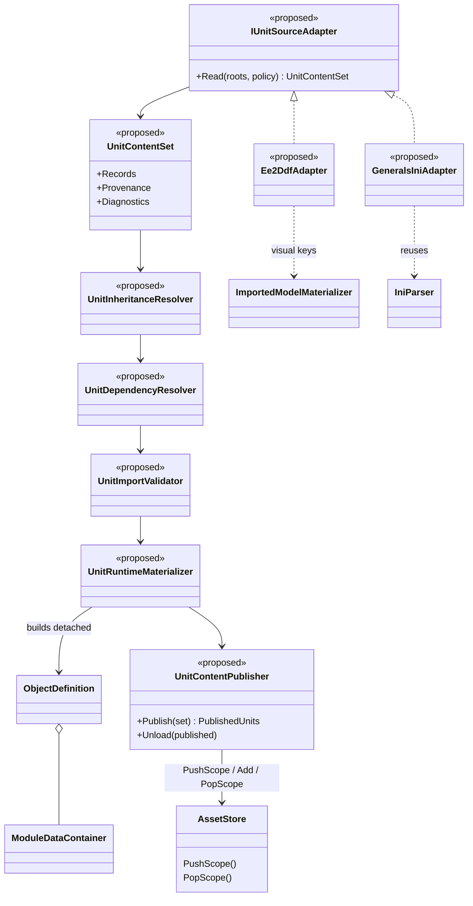
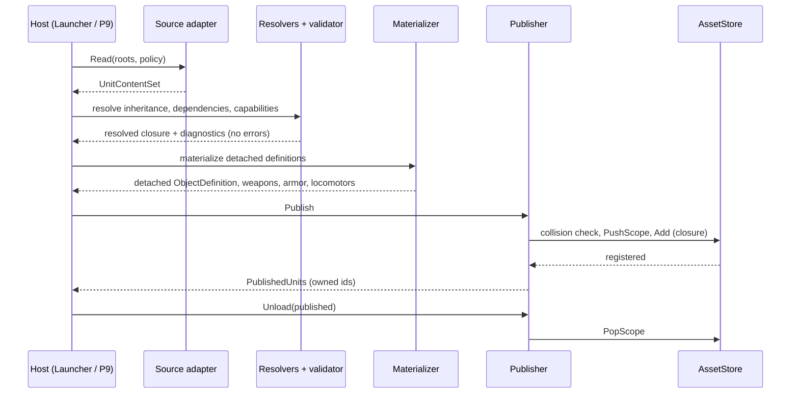
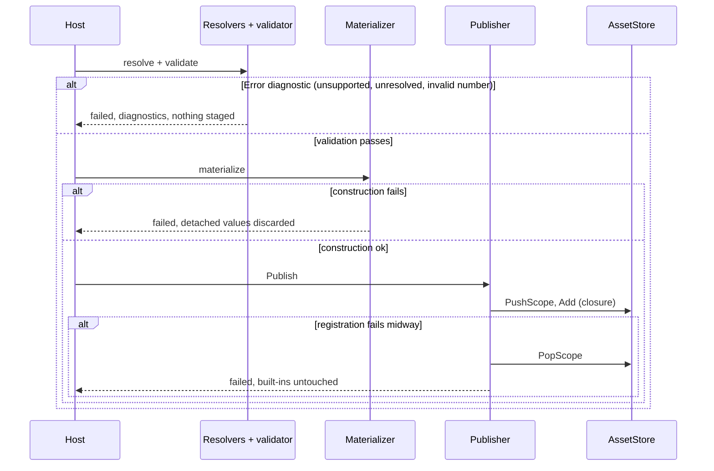

# H2a: Unit-content import layer

> Part of [Track H](../track-h-storage-formats.md). Design scaffold for the shared unit-content
> import prerequisite to M2. The contract below is proposed by `WI-H2a-02` and settles on operator review.
>
> Audience: human + agent.

## Scope and ownership

Source adapters emit engine-owned unit-content definitions. A shared resolver applies inheritance,
resolves dependencies, validates capabilities, and materializes native runtime definitions.
Generals INI is the reference adapter; a bounded real EE2 ground-combat slice proves the second source.
The pipeline must not implement an independent simulation or require INI text generation.

H2a runs next before M2. It does not depend on H1's storage audit, H2's map interchange, or H3's
container. P9 supplies gameplay validation and C4d supplies the EE2 visual path. M2 expands the
EE2 roster and aircraft behavior. M3 owns cross-game balance and points. H4 adds storage over the
same representation. Track D owns new tech-tree/era mechanics, not implicit importer fallbacks.

## Required contract

- Gameplay: body/health, geometry, movement, weapons, armor, targeting, abilities, costs,
  production, prerequisites, and upgrades.
- Presentation: model, material, animation/state, attachment, effect, and sound references.
- Resolution: source-qualified typed identities, provenance, inheritance, cross-file references,
  declared dependencies, explicit overrides, capability requirements, and diagnostics.
- Conversion: declared coordinate, distance, speed, time, and resource semantics. Source values
  and applied conversions remain inspectable; no implicit cross-game rebalance.
- Publication: validate the complete required dependency closure before registering content;
  errors leave no partial content. Unload preserves built-in definitions and reference validity.

Source syntax and live runtime instances must not leak into interchange. Existing native module
coverage must remain intact for Generals, including defaults, child/reskin objects, and map overrides.
The design audit must decide how engine-owned module data preserves that coverage without exposing
source-specific parser objects or hiding unsupported mechanics in opaque payloads.

Unknown metadata can produce warnings only when classified as non-gameplay. Unsupported required
mechanics, unresolved references, invalid numeric values, and collisions block publication. Optional
visual omissions require an explicit policy and a diagnostic. Import acceptance is not a claim that
every source game's mechanics are supported.

## Evidence and design gate

`WI-H2a-01` added the file:line [loading audit](#loading-audit). `WI-H2a-02` specifies the contract, capability
matrix, merge rules, numeric validation, namespacing, override/lifetime rules, and test roster.
Both retain native runtime definitions as the materialization target.

The Generals reference roster must cover the existing six archetypes and supported abilities,
production, upgrades, inherited defaults, and scoped overrides. The EE2 proof selects one real
ground combat unit with resolvable inherited stats and idle/move/attack/death visual states.
If no unit satisfies the available Track C importer capabilities, report the missing capability
and add a reviewed follow-up; do not substitute a different game's gameplay values.

All names and new file destinations in Draft cards are provisional. Before promotion to Ready,
reconcile them with the reviewed design and landed prerequisites. Split any card whose audited
module coverage exceeds a small bounded change. Publish the execution grouping in the existing
staging-branch model; leave every PR open for operator merge.

## Card sequence

| Card | Deliverable | Prerequisites | Initial status |
|---|---|---|---|
| [WI-H2a-01](../agent/cards/WI-H2a-01-unit-loading-audit.md) | Focused loading audit | None | Done |
| [WI-H2a-02](../agent/cards/WI-H2a-02-unit-import-design.md) | Contract and grounded architecture | 01 | Done |
| [WI-H2a-03](../agent/cards/WI-H2a-03-interchange-contracts.md) | Engine-owned interchange | 02 | Done |
| [WI-H2a-04](../agent/cards/WI-H2a-04-inheritance-resolution.md) | Inheritance resolution | 03 | Done |
| [WI-H2a-05](../agent/cards/WI-H2a-05-dependency-resolution.md) | Typed dependency resolution | 04 | Done |
| [WI-H2a-06](../agent/cards/WI-H2a-06-capability-validation.md) | Capability validation | 05 | Done |
| [WI-H2a-07](../agent/cards/WI-H2a-07-body-movement-materialization.md) | Body and movement | 06 | Done |
| [WI-H2a-08](../agent/cards/WI-H2a-08-weapon-armor-materialization.md) | Weapons and armor | 07 | Done |
| [WI-H2a-09](../agent/cards/WI-H2a-09-ability-materialization.md) | Selected native abilities | 08 | Done |
| [WI-H2a-10](../agent/cards/WI-H2a-10-production-upgrade-materialization.md) | Production and upgrades | 09 | Done |
| [WI-H2a-11](../agent/cards/WI-H2a-11-visual-state-binding.md) | Track C visual-state binding | 08 | Done |
| [WI-H2a-12](../agent/cards/WI-H2a-12-scoped-content-publication.md) | Validated scoped publication | 10, 11 | Done |
| [WI-H2a-13](../agent/cards/WI-H2a-13-generals-reference-adapter.md) | Generals reference adapter | 12 | Ready |
| [WI-H2a-14](../agent/cards/WI-H2a-14-generals-behavior-parity.md) | Generals parity evidence | 13 | Draft |
| [WI-H2a-18](../agent/cards/WI-H2a-18-ee2-ground-unit-selection.md) | EE2 ground-unit selection probe | 02 | Ready |
| [WI-H2a-15](../agent/cards/WI-H2a-15-ee2-ddf-reader.md) | Bounded EE2 reader | 03, 18 | Draft |
| [WI-H2a-16](../agent/cards/WI-H2a-16-ee2-source-adapter.md) | EE2 interchange adapter | 12, 15 | Draft |
| [WI-H2a-17](../agent/cards/WI-H2a-17-multi-source-validation.md) | Mixed-source P9 proof and handoff | 14, 16 | Draft |

## Loading audit

Result of `WI-H2a-01`. Paths are relative to `src/Panopticon.Simulation/` unless noted; line ranges cite the checkout at the time of the audit.

### Evidence table

| Stage | Behavior | Citation | Obligation for H2a |
|---|---|---|---|
| Entry | `ContentManager` constructor loads subsystems in a fixed order: Core, Audio, Players, ParticleSystems, ObjectCreation, Locomotors, Sciences, Armor, Weapons, FXList, and others. Object parsing runs before locomotors, armor, and weapons, so object references are lazy. | `Content/ContentManager.cs:75-94` | Materialization must not assume dependency order; resolution is by name after all inputs are known. |
| Entry | `UpgradeManager.Initialize` runs after all subsystems load. | `Content/ContentManager.cs:117` | Upgrade materialization needs an explicit post-load step. |
| INI file load | One `IniParser` per file; failures throw out of the constructor and abort the whole load. | `Content/ContentManager.cs:137-144` | Publication must be transactional; the legacy path has no rollback. |
| Subsystem legend | Generals ships no `subsystemlegend.ini`; a retro-fitted legend string supplies `TheThingFactory` (`Default\Object.ini` plus `Data\INI\Object`), `TheUpgradeCenter`, `TheLocomotorStore`, `TheArmorStore`, `TheWeaponStore`. | `Content/SubsystemLoader.cs:13-63`, `:148-154` | The Generals reference adapter reuses this file set and order. |
| Subsystem files | `InitFile` and `InitPath` entries resolve through the composite file system; `InitPath` recurses `*.ini` with an exclusion set. Only `InitFile` and `InitPath` entry kinds are handled. | `Content/SubsystemLoader.cs:369-402` | File ordering is part of override precedence and must be preserved. |
| Defaults | An `Object` block starts from a clone of `DefaultThingTemplate` unless it is that template. | `Logic/Object/ObjectDefinition.cs:18-30`, `Data/Ini/IniParser.cs:676-679` | Interchange must express omitted values distinctly from explicit values so defaults apply at resolution. |
| Child and reskin | `ChildObject` and `ObjectReskin` clone the referenced parent (resolved at parse time via `.Value`) and parse the block over the clone. | `Logic/Object/ObjectDefinition.cs:32-52`, `Data/Ini/IniParser.BlockParsers.cs:59`, `:132-133` | Inheritance needs an explicit parent edge; parse-time forced resolution of a lazy reference means file order matters today. |
| Clone depth | `Clone` is a `MemberwiseClone` plus copies of the kind set, geometry, contact points, module dictionaries, weapon/armor/locomotor sets. The source carries `// TODO: Clone any other lists`. | `Logic/Object/ObjectDefinition.cs:1252-1297` | Resolution must deep-copy every mutable collection; shallow sharing is a known risk. |
| Field dispatch | `IniParseTable` lookups by field name; an unknown field throws `IniParseException`. | `Data/Ini/IniParser.cs:1013-1028` | Today there is no warn-only path; H2a classification of non-gameplay metadata is new behavior. |
| Block dispatch | Top-level block names map to store `Add` calls (`Object`, `ChildObject`, `ObjectReskin`, `Armor`, `Weapon`, `Locomotor`, `Upgrade`). | `Data/Ini/IniParser.BlockParsers.cs:38`, `:59`, `:115`, `:132-133`, `:158`, `:164` | Adapter output kinds map one-to-one to these stores. |
| References | Typed parse helpers return `LazyAssetReference<T>` keyed by name (weapon, armor, locomotor, upgrade, object, FX, and others); resolution is deferred to first `Value` access. | `Data/Ini/IniParser.cs:510-516`, `:541-544`, `:571-580`, `:681-688`; `Content/LazyAssetReference.cs:187-190` | Dependency resolution replaces lazy by-name lookups with a validated closure. |
| Units | Parsers convert at parse time: ms and seconds to logic frames, per-second velocity and acceleration to per-frame values, degrees to radians. | `Data/Ini/IniParser.cs:463-484` | Conversions and source values must stay inspectable; the interchange cannot carry already-converted frames only. |
| Behavior modules | Behavior, Body, Draw, ClientUpdate, and ClientBehavior blocks parse into `ModuleDataContainer` (tag, `ModuleData`, inheritance mode, inherited flag). `ModuleData` has 408 concrete subclasses. | `Logic/Object/ObjectDefinition.cs:283-294`, `Logic/Object/Module.cs:9-64` | Module data is the largest preservation risk; see the unknowns list. |
| Module inheritance | Default-inherited modules are dropped when the child declares a module of overlapping `ModuleKinds`; `AlwaysInherit` and `OverrideableByLikeKind` modes differ; `RemoveModule`, `ReplaceModule`, and `AddModule` edit by tag. | `Logic/Object/ObjectDefinition.cs:441-486`, `:1340-1375`; `Logic/Object/Module.cs:66-76` | The resolver must reproduce these rules for Generals parity. |
| Scopes | `AssetStore` pushes and pops scopes across every collection and singleton; `Game` pushes one root scope before content loads. | `Content/AssetStore.cs:350-373`, `Game.cs:588` | Publication scope is `AssetStore` scope. |
| Identity | Names hash case-insensitively to a `uint` instance id. | `Content/AssetHash.cs:7-9` | Resolved by D2: per-source collection sets, so cross-source hash collisions cannot occur. |
| Add semantics | `Add` ignores a later definition when the instance id already exists in the top scope (first wins); a new asset gets a monotonically increasing internal id. | `Content/ScopedAssetCollection.cs:134-150` | Collision detection is silent today; H2a must report collisions as errors. |
| Lookup | `GetByName` searches scopes top-down, then calls the on-demand loader if one exists and caches into the top scope. | `Content/ScopedAssetCollection.cs:62-104` | Lookups from a pushed scope see built-ins beneath it. |
| Pop | `PopScope` disposes every asset in the scope, removes it from the list and id map; references held elsewhere are not invalidated. | `Content/ScopedAssetCollection.cs:47-60`; `Content/LazyAssetReference.cs:187-190` | Unload must not leave dangling lazy references; the lazy reference does not cache by design. |
| Map overrides | The only per-map or per-user scope pushes are the temporary `UserMapCache` scope. No Simulation code path loading `map.ini`-style object overrides was found. | `Data/Map/UserMapCache.cs:31`, `:79` | Scoped override coverage for Generals is unverified; see unknowns. |
| Object creation | `GameLogic.CreateObject` builds a `GameObject` from an `ObjectDefinition`, which constructs live modules from stored module data. | `Logic/GameLogic.cs:94-103` | Materialization target is `ObjectDefinition` with its module data. |
| In-memory definitions | `TransportGraphDomainModel` already registers code-built `ObjectDefinition`s with `ObjectDefinitions.Add`. | `Simulation/Transport/TransportGraphDomainModel.cs:104`, `:146` | Precedent for non-INI definition registration. |
| P9 spawning | `ValidationGroundHost` resolves a definition by name and calls `CreateObject` for each placement. | `Panopticon.Tools.TestHarness/ValidationGroundHost.cs:29-33`, `:395-403` | Mixed-source proof reuses this spawn path. |

### Traced example

An `Object` block resolves in this order: file open (`ContentManager.cs:137`), block dispatch (`IniParser.cs:1128`), `DefaultThingTemplate` clone (`ObjectDefinition.cs:20-22`), field parse with lazy weapon, armor, and locomotor references (`IniParser.cs:571-580`, `:541-544`), `Add` into the top scope (`ScopedAssetCollection.cs:134`), and later `GetByName` at spawn (`ValidationGroundHost.cs:395`). Weapon, armor, and locomotor templates parse through their own named blocks (`WeaponTemplate.cs:15-22`, `ArmorTemplate.cs:15-22`, `LocomotorTemplate.cs:11-22`) and are never merged into the object.

### Native data that must survive a source-neutral representation

- Module data: 408 `ModuleData` subclasses carry body, update, die, contain, upgrade, special-power, and draw behavior. The neutral form must hold each family's authored fields or fail explicitly.
- Module identity: tag, `ModuleKinds`, and `ModuleInheritanceMode` drive inheritance and override.
- Weapon sets keyed by condition bits, armor sets in a list, locomotor sets keyed by set type.
- Geometry shapes and contact points; kind-of flags; build cost, time, prerequisites, and upgrade references.
- Lazy references by name, with the first-wins collision behavior of `Add`.

### Unknowns and risks

- Whether every one of the 408 module families is required for the six reference archetypes; the card 02 coverage map decides.
- Map-level object overrides for Generals: no loading path was found in `Panopticon.Simulation`; the owner of any such path is unconfirmed.
- Name hashing is case-insensitive and global per collection; source qualification has no place to live in the current key.
- Shallow clone paths flagged by the in-source TODO may share mutable state between parent and child objects today.
- `LazyAssetReference` does not cache across scope pops; stale references after unload are not yet characterized.
- Unknown-field handling throws; a warn-only mode for non-gameplay metadata does not exist.

### Candidates

Generals archetypes for the reference roster (known support, via P0 six-archetype validation): infantry, vehicle, aircraft, builder, support, superweapon, with USA reference units. Abilities, production, and upgrade cases are selected in card 02.

EE2 ground-combat candidate: not selected. The install holds `db.zip` with ground-unit files such as `heavy_infantry1.ddf` and `heavy_infantry2.ddf`, and C4d proved the skinned British Druid with five bound clips ([C4d](../track-c-external-assets.md)). Unverified: whether any combat unit has resolvable inherited stats and all of idle, move, attack, and death states bound through the available importer capabilities. Source record relationships are in [`EE2_UNIT_VISUAL_PIPELINE.md`](../../system-investigations/EE2_UNIT_VISUAL_PIPELINE.md).

## Reviewed contract

Result of `WI-H2a-02`. Status: approved by the operator. D1 to D4 were reviewed and approved by the operator (D2 amended to per-source collections). Cards that depend only on approved decisions are promoted.

### Decisions requiring review

| ID | Decision | Proposal | Alternative |
|---|---|---|---|
| D1 (approved) | Representation of native module data that has no typed interchange record | Closed module-family registry: each family is either a typed interchange record (capability matrix below) or an explicit `Unsupported` diagnostic. The Generals adapter keeps legacy-only families through a Generals-owned `LegacyModuleBinding` (family id, tag, `ModuleKinds`, inheritance mode, reference into an adapter-owned table of already-built native `ModuleData`). The binding is not an opaque payload: it is accepted only for families on the registry's legacy allowlist, and is rejected from any non-Generals source. | Type all 408 families into interchange now (large, blocks M2), or pass any module through (violates the no-opaque rule). |
| D2 (approved) | Runtime naming and storage for non-Generals content | Per-source collection sets: each non-Generals source publishes into its own `AssetStore` collection set (a source-keyed `SourceContent` view over the same scoped collection types). Names stay unmodified inside a source, so the instance-id hash cannot collide across sources. Generals keeps the existing store. Lookups that must reach any source take a `(Source, Name)` pair; P9 spawning gains a source argument. | `<source>:<name>` prefix in the shared store (rejected by operator: collision checks and shared-hash coupling). |
| D3 (approved) | Publication boundary | One `AssetStore.PushScope` per publication, registered only after staging succeeds. Rollback is `PopScope`. Scopes unload in reverse push order. | A new per-collection transaction API (new surface in every collection). |
| D4 (approved) | EE2 ground-combat unit | Not selected; see the EE2 feasibility finding. New card `WI-H2a-18` selects and probes the unit before `WI-H2a-15` becomes Ready. | Substitute Generals-derived values (forbidden by the scaffold). |

### Adapter contract

- Input: a source handle (file system plus root identifiers), a requested root set (unit names), and a `ConversionPolicy` naming source units.
- Output: `UnitContentSet`, an immutable value holding `SourceRecord`s of kind Unit, Weapon, Armor, Locomotor, Projectile, Ability, Upgrade, and VisualState, plus `ProvenanceEntry` and `ImportDiagnostic` lists. No parser node, token, or live runtime instance crosses this boundary.
- Identity: `ContentId(Source, Kind, Name)`. `Source` and `Kind` compare ordinally. `Name` keeps source case for display; equality uses the source's rule (`Generals`: case-insensitive; `Ee2`: ordinal, declared by the adapter).
- Authored values: `Authored<T>` is `Omitted` or `Present(value, SourceValue, Conversion?)`. Explicit zero and empty collections are `Present`, never `Omitted`.
- Quantities: `Quantity(Value, Unit)` with `Unit` from a closed set (`Meters`, `GameDistance`, `Seconds`, `Milliseconds`, `LogicFrames`, `PerSecond`, `HitPoints`, `Currency`, `Degrees`, `Radians`). Applied conversions are recorded next to the source value and are never rebalancing.
- Provenance: source id, file path, line, and archive layer for every record and field.
- Collections: lists replace by default; `Add` and `Remove` are explicit list operations. Named modules and abilities merge by tag.

### Resolution rules

| Rule | Behavior |
|---|---|
| Parent edge | Zero or one parent per unit. Missing parent, wrong-kind parent, or a cycle is an error. Depth limit 16. |
| Field merge | A present child field replaces the parent field; an omitted child field inherits. Source records are never mutated. |
| Module and ability merge | By tag. For Generals, the `ModuleInheritanceMode` rules (`Default`, `AlwaysInherit`, `OverrideableByLikeKind`) and `RemoveModule`, `ReplaceModule`, `AddModule` operations reproduce the behavior at `ObjectDefinition.cs:441-486` and `:1340-1375`. |
| Defaults | `DefaultThingTemplate` is a source-declared implicit root, resolved like any parent. |
| Attribution | Each resolved field records the record that supplied it. |
| Dependency kinds | `Parent`, `Weapon`, `Armor`, `Locomotor`, `Projectile`, `Ability`, `Upgrade`, `Production`, `Prerequisite`, `Visual`, `Presentation` (sound and FX). |
| Cycles | Forbidden for `Parent`. Allowed for `Production` and `Prerequisite` between units (a builder can produce a builder). Any other kind: error. |
| Required vs optional | `Presentation` dependencies are optional: a missing target yields a warning. All other kinds are required. Visual states `Idle`, `Move`, `Attack`, `Death` are required for any unit published with a visual binding; a unit declared without a visual binding is allowed and flagged. |
| Missing or ambiguous target | Error before materialization. Cross-source references must name the source explicitly; an unqualified reference resolves only within the referencing record's own source. |

### Capability matrix

| Family | Native target | Generals | EE2 slice | Owner card |
|---|---|---|---|---|
| Body (health, armor set link) | `BodyModuleData` family (`ActiveBody` first) | Typed | Typed | 07 |
| Geometry | `Geometry` shapes and contact points | Typed | Typed | 07 |
| Locomotor and movement | `LocomotorTemplate`, `LocomotorSetTemplate` | Typed | Typed (ground only) | 07 |
| Weapon (direct, projectile) | `WeaponTemplate`, weapon sets by condition | Typed | Typed | 08 |
| Armor and damage types | `ArmorTemplate` | Typed | Typed | 08 |
| Selected abilities | Native behavior modules and special powers named by the six archetype cases | Legacy module binding (D1) | Typed `Attack` only (binds the ability weapon into the default weapon set); other families `Unsupported` | 09 |
| Production, cost, prerequisites | `ObjectDefinition` build fields, `ProductionUpdate`, `UpgradeTemplate` | Typed | Single-resource cost only; era and multi-resource are `Unsupported` | 10 |
| Visual states | Draw module data plus Track C `Model` and animation | Legacy binding for W3D draw modules | Typed (NIF/KF through C4a to C4d importers) | 11 |
| All other native modules | Remaining `ModuleData` families | Legacy allowlist binding (D1) | `Unsupported`, blocks publication | 12, 13 |

### Implementation notes (G3)

- D1 extension: `LegacyBinding` also applies to whole records. A Generals weapon, armor, locomotor, upgrade, or object record may carry a binding to the native template the INI parser built; materialization reuses that template and the typed fields remain the validated, inspectable description. Native weapon nuggets, FX, and projectile objects therefore keep full Generals coverage without typed records for every nugget family.
- Legacy module data and legacy templates are never mutated by materialization; the adapter may share them between definitions.
- Typed projectile weapons materialize as direct-damage weapons whose travel time follows the projectile speed; projectile objects are not created for typed sources.
- Typed production links, unit upgrade lists, and upgrade prerequisites need a native command-set mapping and fail at materialization rather than being dropped. Generals keeps them through legacy bindings.
- Native construction seams: selected `private set` accessors on `ObjectDefinition`, `WeaponTemplate`, `LocomotorTemplate`, `UpgradeTemplate`, `WeaponTemplateSet`, and `ArmorTemplateSet` became `internal set`; `BaseAsset.AssignImportedName` names materialized assets.

### Numeric validation

All numbers must be finite. Health greater than zero. Damage, range, speed, and cost at least zero. Reload and cooldown greater than zero when a weapon or ability is used. Time and distance conversions must declare a unit pair; a missing or mismatched pair is an error.

### Diagnostics

`ImportDiagnostic(Severity, Stage, Code, ContentId?, Provenance, Message)`. Stages: `Read`, `Resolve`, `Validate`, `Materialize`, `Publish`. Any `Error` blocks publication. `Warning` is limited to classified non-gameplay metadata and optional presentation. Conventions follow `Content/Importing/ExternalAssetInspectionDiagnostic.cs`.

### Publication and lifetime

1. Stage: construct every detached runtime definition for the full closure; no registration.
2. Check collisions against the target source's collection set (name collisions inside one source, and explicit-override rules). Other sources cannot collide by construction.
3. `PushScope`, register all definitions into the source's collection set, record the owned ids.
4. On any failure in steps 1 to 3: pop the pushed scope (if pushed) and drop staged definitions. Other sources' content and Generals built-ins remain untouched because registration occurs only in the new scope of the target source.
5. Unload: no live `GameObject` of an owned definition may exist (checked, else refuse); `PopScope`. Scopes unload in reverse push order. `LazyAssetReference` does not cache across pops (`LazyAssetReference.cs:187-190`), so retained references fail lookup rather than dangle.
6. Generals built-ins stay in the root scope loaded by `ContentManager`; the Generals reference adapter publishes into that root scope as the startup load, with the same atomic rules.

### Audited-module coverage map

| Audited family (evidence table) | Disposition |
|---|---|
| Object fields, geometry, kind-of, build fields | Typed unit record fields (07, 10) |
| Weapon, armor, locomotor sets | Typed (07, 08) |
| Behavior, Body modules | Typed for the matrix families, legacy binding otherwise (07, 09, 13) |
| Draw modules | Typed visual-state records for the proof, legacy binding for W3D draw (11, 13) |
| ClientUpdate, ClientBehavior | Legacy allowlist binding for Generals; `Unsupported` for others (13) |
| Upgrades and prerequisites | Typed (10) |
| Map object overrides | Blocked: no loading path found in `Panopticon.Simulation` (see audit unknowns). Card 13 records the real owner or removes the step; it is not assumed supported. |
| Unknown fields | Generals keeps the throwing behavior; warn-only classification applies to new sources only. |

### Reference roster

Generals (P6b archetypes, `p6b-unit-contract-validation.md` section 2.1): Infantry USA Ranger, Vehicle USA Crusader Tank, Aircraft USA Comanche, Builder USA Dozer, Support USA Ambulance, Superweapon USA Particle Cannon. Selected cases: Ranger garrison, Crusader weapon-mode upgrade, Dozer construct and repair, Ambulance heal, Particle Cannon charge and fire, one produce and one apply-upgrade contract, and a child or reskin object plus an inherited default.

Failure fixtures (synthetic): unsupported required ability, unresolved reference, wrong-kind reference, NaN health, parent cycle, name collision within one source, duplicate record across sources, mid-publication injected failure.

### EE2 feasibility finding

- Source model: `UnitType` and `UnitModel` records in `zips/db.zip` and `zips_ee2x/EE2X_db.zip` share a name (`EE2_UNIT_VISUAL_PIPELINE.md` section 3). Inheritance is by `parent`; example `UniqueUnitEnglish1` has `parent = Priest` and `HitPoints = 0` (value inherited or computed elsewhere).
- Visual capability: the British Druid (`UniqueUnitEnglish1` model) binds Idle, Walk, Run, Attack1, and Death through C4d ([deep dive](c4d-ee2-skinned-animation.md)), so the Track C visual path covers all four required states for that model.
- Combat gap: the Druid has `ConvertAttack` (conversion, no damage) and no weapon damage, so it cannot prove health, damage, range, reload, and armor.
- Verdict: the EE2 slice is feasible for visuals and unproven for combat. No ground combat unit with both resolvable stats and a C4d-importable skinned model is confirmed. Blocker recorded; `WI-H2a-18` probes candidates (for example `heavy_infantry1.ddf` units) against the C4d importer limits (at most four skin influences, weight sums near 1) and the stat closure. Cards 15 to 17 stay Draft until it reports. Cards 03 to 14 do not depend on the result.

### Staging and PR grouping

Staging branch: `staging/track-h-h2a`. Each group is one stacked PR into staging, left open for operator merge. One final staging-to-main PR runs CI.

| Group | Cards | Content |
|---|---|---|
| G0 | 01 | Loading audit (docs) |
| G1 | 02 | Contract and design (docs) |
| G2 | 03, 04, 05, 06 | Interchange, inheritance, dependency, validation (pure engine code and synthetic tests) |
| G3 | 07, 08, 09, 10 | Materializers and native construction seams |
| G4 | 11, 12 | Visual binding and scoped publication |
| G5 | 13, 14 | Generals reference adapter and parity |
| G6 | 18, 15, 16 | EE2 unit selection probe, DDF reader, EE2 adapter |
| G7 | 17 | Mixed-source P9 proof and M2 handoff |

Implementation plan: [`implementation/track-h-h2a-unit-content-import.md`](../implementation/track-h-h2a-unit-content-import.md).

## Architecture diagrams

Proposed types are suffixed `(proposed)` in the class diagram. Existing classes carry file:line citations in the evidence table.

## Validation

Synthetic contract/resolver/adapter tests require no proprietary content. Real-install tests declare
their prerequisites explicitly; missing installations never count as successful proof. Use existing
P0/P9 hosts rather than a new harness. Compare authored values and behavioral invariants, not
same-seed simulation identity. Preserve and report determinism-test deviations under repository policy.

Source-edit cards run the standard build/test/format checks and the brace-newline check. ReplaySketch
changes require screenshot-mode verification of both the affected panel and the map panel. Evidence
captures follow `docs/screenshots.md`; no proprietary source assets are committed.
