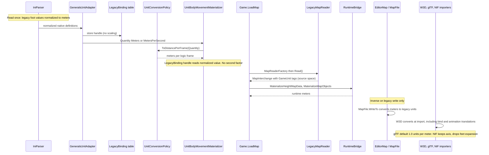

# H2b: Metric core units

> Audience: human + agent.
> Design for the internal metric conversion. Planning base `2e5d3770` (H2 group 4, PR #326). H2a (WI-H2a-01..19) and H2 (WI-H2-01..04) are merged.

## Contract

Runtime positions, lengths, bounds, and translations use meters. Authored rates use meters per second; tick-based code uses meters per logic frame and meters per logic frame squared. Cadence, angles, health, damage, costs, ratios, and dimensionless animation scales remain unchanged. This is a numeric rescale, not a balance or physics redesign.

The Generals distance convention is one foot: `s = 0.3048` meters per legacy unit. Length, velocity, and acceleration scale by `s`; area and squared-distance thresholds by `s^2`; volume by `s^3`; inverse-length quantities by `1/s`. Gravity preserves the converted source value, not an assumed terrestrial value. Mass and force fields require evidence of physical dimensions and source units; gameplay weights are not kilograms.

Raw format readers retain source-space values. Normalization happens once, at the source-to-engine boundary, and the inverse is applied on legacy write. Map cells, sample indices, pixels, UVs, normals, rotations, and ratios are not lengths. Runtime interchange is metric unless a quantity explicitly carries a source unit tag.

## Current state on main

Facts below are verified at `2e5d3770`. Each is a gap the cutover closes.

| Seam | Current behavior |
|---|---|
| `src/Panopticon.Simulation/Content/Importing/Units/Generals/GeneralsUnitAdapter.cs:89-95, 193-195` | Generals distances tagged `QuantityUnit.GameDistance` (feet-scale game units). |
| `GeneralsUnitAdapter.cs:127-129` | Speed, acceleration tagged unqualified `DistancePerSecond` and `DistancePerSecondSquared`. |
| `src/Panopticon.Simulation/Content/Importing/Units/Materialization/UnitConversionPolicy.cs:47` | `GameDistance` passes through unchanged. `Meters` requires `GameUnitsPerMeter`, which `GeneralsUnitImport.cs:29` never supplies. |
| `UnitConversionPolicy.cs:49` | `SourceDistance` uses `GameUnitsPerSourceDistance`, supplied by `src/Panopticon.Tools.TestHarness/UnitContentImportRunner.cs:61`. |
| `src/Panopticon.Simulation/Data/Ini/IniParser.cs:483-487` | Rate helpers already divide by logic frames (`ParseVelocityToLogicFrames`, `ParseAccelerationToLogicFrames`), with no length factor. |
| `src/Panopticon.Simulation/GameData.cs:161` | `Gravity` parsed through `ParseAccelerationToLogicFrames`. |
| `src/Panopticon.Simulation/Content/Importing/Gltf/GltfImportOptions.cs:51` | Default `unitsPerMeter = 1f / 0.3048f`. glTF output is currently in feet-scale game units, not meters. |
| `src/Panopticon.Simulation/Content/Importing/Nif/NifTransformConverter.cs:16-28` | Source-to-engine matrix includes a meters-to-feet factor (`FeetPerMeter`). |
| `src/Panopticon.Simulation/Content/Importing/Nif/NifParticleEffectConverter.cs:80` | `Translation *= MetersPerFoot`. Direction is unresolved against the NIF feet output (AQ-14). |
| `src/Panopticon.Simulation/Content/Importing/W3d/W3dModelImporter.cs:182` | Bone pivot translations passed through raw. No unit conversion found in the W3d importers. |
| `src/Panopticon.Simulation/Content/Importing/Units/Materialization/ImportedVisualInstaller.cs:34, 88` | `modelScale` (default `1f`) is a presentation multiplier, separate from unit conversion. |
| `src/Panopticon.Simulation/Content/Importing/Maps/Types/MapQuantityUnit.cs:8-11` | Interchange already distinguishes `GameUnit` (legacy, "not feet or meters by definition") from `Meters`. |
| `src/Panopticon.Simulation/Content/Importing/MapSources/LegacyMapReader.cs:41, 71` | `LegacyMapReader : IMapReader`, `Read()` returns `MapInterchange`. |
| `src/Panopticon.Simulation/Content/Importing/MapSources/RuntimeBridge.cs:25, 117, 195` | `MaterializeHeightMapData`, `MaterializeMapObjects`, `TryGetMaskFeed`. |
| `src/Panopticon.Simulation/Game.cs:793-808` | `MapReaderFactory` defaults to `LegacyMapReader`; `LoadMap` calls the bridge. |
| `src/Panopticon.Simulation/Data/Map/MapFile.cs:266-267` | Map positions use `HeightMap.HorizontalScale` (game units per sample). |
| `src/Panopticon.Tools.WorldBuilder.Core/EditorMap.cs:11, 63` | `EditorMap` wraps `MapFile` and saves through `MapFile.WriteTo`. |
| `src/Panopticon.Tools.ReplaySketch.Core/Model/ExternalModels/ExternalModelImportOptions.cs:27` | ReplaySketch default `1f / 0.3048f` units per meter. Serialized at `ExternalModelReportJson.cs:155`. |
| `src/Panopticon.Physics/PhysicsUnitConversion.cs` | Per-frame and per-second conversions. Unit-neutral; the values passed in change meaning. |
| `src/Panopticon.Simulation/Recording/EngineCheckpoint.cs:52, 104-106` | `FormatVersion = 1`; unknown versions rejected. |
| `src/Panopticon.Simulation/Recording/WorldStateArtifact.cs:74-77` | Region schema version checked; unknown versions rejected. |
| `src/Panopticon.Simulation/Recording/RunRecording.cs:182` | Records `DomainStateSchemaVersion`. |
| `src/Panopticon.Simulation/Data/Rep/ReplayHeader.cs:22-26` | Replay header carries `Version`, `VersionMajor`, `VersionMinor`. |

## Release model

WI-H2b-03 through WI-H2b-18 (OpenProject wp642 through wp657) ship as one atomic PR to `main`, with one internal commit per ticket. There is no partially mergeable stack and no staging branch. The audit and design work (WI-H2b-01 and WI-H2b-02, this document) may ship as a separate docs PR.

Intermediate commits are not supported releases. Runtime sharing is not permitted: no long-lived dual-unit runtime exists, and no flag selects between legacy and metric units after cutover.

No source ticket is startable until the Architect reviews this design. The gate is recorded in OpenProject; this document does not record ticket status.

## Audit inventory

Each row names the source unit, the runtime unit after cutover, the conversion owner, the inverse writer, the dimensional exponent (`L` length, `T` time), and the test home. Rows marked AQ are audit questions: the unit is not established, and no source ticket may guess it. Each AQ names the evidence required to close it.

Dimensionless and non-length rows (health, damage, cost, currency, ratios, angles, UVs, cells, pixels) are unchanged and are not repeated per row.

### INI gameplay

| Source site | Source unit | Runtime unit after cutover | Conversion owner | Inverse writer | Exponent | Test home |
|---|---|---|---|---|---|---|
| `IniParser.cs:485` `ParseVelocityToLogicFrames` | legacy foot per second | m per logic frame | `IniParser` boundary (WI-H2b-03 primitive) | none (INI is read-only at runtime) | `L T^-1` | `test/Panopticon.Simulation.Tests/Data/Ini/IniFileTests.cs` |
| `IniParser.cs:487` `ParseAccelerationToLogicFrames` | legacy foot per second squared | m per logic frame squared | `IniParser` boundary | none | `L T^-2` | `IniFileTests.cs` |
| `GameData.cs:161` `Gravity` | legacy foot per second squared | m per logic frame squared (converted value, not terrestrial) | `IniParser` boundary | none | `L T^-2` | `IniFileTests.cs`, `GameData` tests (WI-H2b-05) |
| `IniParser.cs:483` `ParseAngularVelocityToLogicFrames` | degrees per second | unchanged | none | none | `T^-1` | `IniFileTests.cs` |
| Distance-named INI fields in `Logic/` and `GameData.cs` (about 312 parse sites matching Range, Radius, Distance, Speed, Height, Vision, Offset, Width, Length, Depth, Accel, Gravity, Spacing, Scale, Lifetime, Size) | legacy foot | m | `IniParser` boundary, per field | none | `L` (per field) | `IniFileTests.cs` plus per-object tests |
| BFME variants in `src/Panopticon.Mods.Bfme2/Bfme2Definition.cs` and `Bfme2RotwkDefinition.cs` | AQ-1 | AQ-1 | AQ-1 | none | AQ-1 | none established |

AQ-1: The BFME unit convention is not established by the contract, which covers Generals only. BFME rows get no source ticket until a fixture with known dimensions establishes the unit. Dormant or unsupported BFME paths are recorded here and are not given importers.

The full per-field list is produced by the WI-H2b-05 scope step (see the per-ticket table). The grep recipe is the gate: every matching site is either converted, classified as non-length, or listed as AQ before WI-H2b-05 starts.

### H2a quantities and legacy bindings

| Source site | Source unit | Runtime unit after cutover | Conversion owner | Inverse writer | Exponent | Test home |
|---|---|---|---|---|---|---|
| `GeneralsUnitAdapter.cs:89, 90, 95, 193-195` distance `Quantity` tagged `GameDistance` | legacy foot (native values already parsed) | `Meters`, tag written by adapter with no multiplication | `IniParser` normalization (WI-H2b-05); adapter performs no scaling | none | `L` | `test/Panopticon.Simulation.Tests/Content/Importing/Units/GeneralsUnitAdapterTests.cs` |
| `GeneralsUnitAdapter.cs:127` speed tagged `DistancePerSecond` | legacy foot per second | `MetersPerSecond` (new explicit unit) | `IniParser` normalization; policy `ToDistancePerFrame` | none | `L T^-1` | `GeneralsUnitAdapterTests.cs`, `UnitBodyMovementMaterializerTests.cs` |
| `GeneralsUnitAdapter.cs:129` acceleration tagged `DistancePerSecondSquared` | legacy foot per second squared | `MetersPerSecondSquared` (new explicit unit) | `IniParser` normalization; policy | none | `L T^-2` | `UnitBodyMovementMaterializerTests.cs` |
| `GeneralsUnitAdapter.cs:128` turn rate `DegreesPerSecond` | degrees per second | unchanged | none | none | `T^-1` | `UnitBodyMovementMaterializerTests.cs` |
| `UnitBodyMovementMaterializer.cs:32, 42, 53` speed, acceleration, braking | per-second rates | per-frame values | `UnitConversionPolicy.ToDistancePerFrame`, `ToDistancePerFrameSquared` | none | `L T^-1`, `L T^-2` | `UnitBodyMovementMaterializerTests.cs` |
| `UnitBodyMovementMaterializer.cs:354` `ToGameDistance` for game-distance fields | `GameDistance` (retired at cutover) | `Meters` | `UnitConversionPolicy` | none | `L` | `UnitBodyMovementMaterializerTests.cs` |
| `UnitCombatMaterializer.cs:85` projectile speed via `ToDistancePerFrame` | `SourceDistancePerSecond` or `DistancePerSecond` | m per logic frame | `UnitConversionPolicy` | none | `L T^-1` | `test/Panopticon.Simulation.Tests/Content/Importing/Units/UnitCombatMaterializerTests.cs` (new in WI-H2b-04) |
| `LegacyBinding.cs:9`, `LegacyModuleBinding.cs:9` handles | native values from the Generals table, already normalized | unchanged handle; values already metric | adapter table built after normalization | none | per referenced field | `GeneralsUnitAdapterTests.cs` (double-scale negative test) |

Legacy binding rule: a `LegacyBinding` or `LegacyModuleBinding` handle resolves to native data that has already passed INI normalization. The policy never applies a factor to a value reached through a handle. The negative test loads one module through a handle and asserts the metric value equals the normalized native value, not its square.

### EE2 source (WI-H2a-15, 16, 18)

| Source site | Source unit | Runtime unit after cutover | Conversion owner | Inverse writer | Exponent | Test home |
|---|---|---|---|---|---|---|
| `Ee2UnitAdapter.cs:255, 293, 314, 321, 419, 435, 533, 534` `SourceDistance` | EE2 tile | `Meters` via declared meters per source distance | `UnitConversionPolicy` (declared scale from `UnitContentImportRunner.cs:61`) | none (EE2 read-only) | `L` | `test/Panopticon.Simulation.Tests/Content/Importing/Units/Ee2UnitAdapterTests.cs`, `Ee2TypedMaterializationTests.cs`, `Ee2RealUnitImportTests.cs` |
| `Ee2UnitAdapter.cs:291, 401, 558` `SourceDistancePerSecond` | EE2 tile per second | m per logic frame | `UnitConversionPolicy.ToDistancePerFrame` | none | `L T^-1` | `Ee2TypedMaterializationTests.cs` |
| `Ee2UnitAdapter.cs:322, 420, 436, 531` `Seconds` | seconds | unchanged | none | none | `T` | `Ee2TypedMaterializationTests.cs` |
| EE2 model scale (`src/Panopticon.Tools.TestHarness/Ee2ReferenceScale.cs`) | AQ-2: unit of the reference scale not declared | AQ-2 | AQ-2 | none | AQ-2 | `test/Panopticon.Simulation.Tests/Content/Importing/Units/Ee2ModelScaleTests.cs` |

AQ-2: The reference scale's unit is not declared in the file. Closing it requires a derivation that names the unit and its source. EE2 tiles are never inferred as meters, and model scales are never reused as gameplay scales.

### Terrain, maps, and WorldBuilder

| Source site | Source unit | Runtime unit after cutover | Conversion owner | Inverse writer | Exponent | Test home |
|---|---|---|---|---|---|---|
| `MapFile.cs:266-267` and `HeightMap.HorizontalScale` (terrain spacing, `HeightMapData.cs:50`) | `GameUnit` | `Meters` | `RuntimeBridge.MaterializeHeightMapData` (`RuntimeBridge.cs:25`) | `MapFile.WriteTo` via `EditorMap` (`EditorMap.cs:63`) | `L` | `test/Panopticon.Simulation.Tests/Content/Importing/MapSources/LegacyMapReaderTests.cs`, `RuntimeBridgeParityTests.cs` |
| Height samples and vertical scale | AQ-3: vertical scale unit not established in `MapFile`/`HeightMapData` | AQ-3 | AQ-3 | AQ-3 | AQ-3 | `RuntimeBridgeParityTests.cs` |
| Map object positions (`RuntimeBridge.MaterializeMapObjects`, `RuntimeBridge.cs:117`) | `GameUnit` (from `LegacyMapReader`) | `Meters` | `RuntimeBridge` | `MapFile.WriteTo` | `L` | `RuntimeBridgeParityTests.cs` |
| Waypoints (`Data/Map/Waypoint*`, `Scripting/Waypoints.cs`) | `GameUnit` | `Meters` | `RuntimeBridge` | `MapFile.WriteTo` | `L` | `LegacyMapReaderTests.cs` |
| Mask feed (`RuntimeBridge.TryGetMaskFeed`, `RuntimeBridge.cs:195`) | cells, dimensionless | unchanged | none | none | `L^0` | `RuntimeBridgeParityTests.cs` |
| Polygon triggers (`Logic/Map/PolygonTrigger.cs`) | AQ-4: not confirmed to pass through `MapInterchange` | AQ-4 | AQ-4 | AQ-4 | `L` | none established |
| WorldBuilder new-map defaults (`NewMapFactory`) | `GameUnit` defaults | `Meters` when constructed | `EditorMap.CreateNew` (`EditorMap.cs:34`) | `MapFile.WriteTo` | `L` | `test/Panopticon.Tools.WorldBuilder.Core.Tests/NewMapFactoryTests.cs`, `MapCompanionTests.cs` |
| Geospatial import (`MapQuantityUnit.Meters` and `Degrees` CRS, `MapInterchangeValidator.cs:835-836`) | `Meters` for CRS, `GameUnit` for derived spacing | `Meters` | `RuntimeBridge` for spacing | `MapFile.WriteTo` | `L` | `test/Panopticon.Geospatial.Tests/Interchange/SourceProvenanceAndMapTransformTests.cs` |

Map rule: `LegacyMapReader` keeps source-space values and their `GameUnit` tags. `RuntimeBridge` is the only converter on read. `MapFile.WriteTo` applies the inverse on write. `GameUnit` is never reinterpreted as meters.

### W3D, glTF, and NIF importers

| Source site | Source unit | Runtime unit after cutover | Conversion owner | Inverse writer | Exponent | Test home |
|---|---|---|---|---|---|---|
| `W3dModelImporter.cs:182` bone pivot translations | AQ-5: W3D file unit not established in-tree | `Meters` | W3D importer, at import, including bind translations | none (no W3D writer) | `L` | `test/Panopticon.Simulation.Tests/Content/Importing/W3dModelImporterTests.cs`, `W3dImportParityTests.cs` |
| `W3dAnimationImporter.cs:286-288` translation channels | AQ-5 | `Meters` | W3D importer, at import | none | `L` | `W3dAnimationImporterTests.cs` |
| `W3dMeshConverter` vertex positions | AQ-5 | `Meters` | W3D importer | none | `L` | `W3dMeshConverterTests.cs` |
| `ImportedVisualInstaller.cs:34, 88` `modelScale` | dimensionless multiplier | unchanged; kept separate from unit conversion | caller (presentation sizing) | none | dimensionless | `test/Panopticon.Simulation.Tests/Content/Importing/ImportedModelMaterializerTests.cs`, `Units/UnitVisualMaterializerTests.cs` |
| `GltfImportOptions.cs:51` default `1f / 0.3048f`, `GltfTransformConverter.cs:14-19` `CreateBasis` | glTF meters (glTF specification) | `Meters`, default `1.0` units per meter | `GltfImportOptions` default and `CreateBasis` | none | `L` | `test/Panopticon.Simulation.Tests/Content/Importing/GltfImporterTests.cs`, `GltfSceneConverterTests.cs`, `GltfSkinConverterTests.cs`, `GltfAnimationImporterTests.cs`, `GltfPrimitiveConverterTests.cs` |
| `NifTransformConverter.cs:16-28` `FeetPerMeter` expansion | NIF in meters (converter comment) | `Meters`; axis conversion kept, feet expansion removed | `NifTransformConverter` | none | `L` | `test/Panopticon.Simulation.Tests/Content/Importing/NifModelImporterTests.cs`, `NifSkinConverterTests.cs`, `NifAnimationImporterTests.cs` |
| `NifParticleEffectConverter.cs:80` `Translation *= MetersPerFoot` | AQ-14: direction unresolved | AQ-14 | AQ-14 | none | `L` | none established (create in WI-H2b-10) |
| ReplaySketch `ExternalModelImportOptions.cs:27` default and `ExternalModelReportJson.cs:155` | feet-scale game units per meter | `1.0` units per meter; report payload versioned | `ExternalModelImportOptions` | report reader | dimensionless scale | `test/Panopticon.Tools.ReplaySketch.Tests/ExternalModelProtocolTests.cs`, `ExternalModelSessionTests.cs` |

Importer rule: each importer converts at import. The inverse exists only where a writer exists, and no W3D writer exists.

### Physics and locomotion

| Source site | Source unit | Runtime unit after cutover | Conversion owner | Inverse writer | Exponent | Test home |
|---|---|---|---|---|---|---|
| `src/Panopticon.Physics/PhysicsUnitConversion.cs` per-frame and per-second | unit-neutral | unchanged function; inputs now metric | caller | none | `T^-1` | `test/Panopticon.Simulation.Tests/Physics/LegacyPhysicsBodyTests.cs` |
| `src/Panopticon.Physics/Legacy/LegacyPhysicsBody.cs`, `Bepu/BepuPhysicsBody.cs` world units | AQ-6: backend world unit not declared | `Meters` | physics adapter | none | `L` | `LegacyPhysicsBodyTests.cs`, `test/Panopticon.Simulation.Tests/Logic/Object/Behaviors/PhysicsBehaviorTests.cs` |
| Terrain physics chunks (`src/Panopticon.Tools.TestHarness/TerrainPhysicsChunks.cs`) | `Meters` after `RuntimeBridge` | `Meters` | `RuntimeBridge` | none | `L` | `test/Panopticon.Simulation.Tests/Logic/PartitionCounterTests.cs` (adjacent; create physics test in WI-H2b-11) |

### Navigation, partitioning, and scripts

| Source site | Source unit | Runtime unit after cutover | Conversion owner | Inverse writer | Exponent | Test home |
|---|---|---|---|---|---|---|
| Navigation cell size (`src/Panopticon.Simulation/Navigation/`) | legacy foot per cell (contract example: 10-unit cell) | `Meters` (3.048 m per 10-unit cell) | `RuntimeBridge` spacing | none | `L` | `test/Panopticon.Simulation.Tests/Navigation/GraphTest.cs`, `PathEqualityCorpusTests.cs` |
| Path distance thresholds | squared thresholds in legacy foot | `s^2` scaled meters | owner of the constant at the call site | none | `L^2` | `test/Panopticon.Simulation.Tests/Navigation/MovementProgressTests.cs`, `DestinationSlotsTests.cs` |
| Partition cell size | AQ-7: partition cell unit not established | AQ-7 | AQ-7 | none | AQ-7 | `test/Panopticon.Simulation.Tests/Logic/PartitionCounterTests.cs` |
| Scripting waypoints and areas (`src/Panopticon.Simulation/Scripting/`) | `GameUnit` | `Meters` | `RuntimeBridge` for map-sourced values | none | `L` | `test/Panopticon.Simulation.Tests/Navigation/FollowerLandingTests.cs` (adjacent; scripting test home AQ-7) |

### Cameras, rendering, and audio

| Source site | Source unit | Runtime unit after cutover | Conversion owner | Inverse writer | Exponent | Test home |
|---|---|---|---|---|---|---|
| Camera distances and heights (`src/Panopticon.Simulation/Graphics/Cameras/Camera.cs`, `TacticalView.cs`) | AQ-8: legacy foot per constant, to be confirmed per constant | `Meters` | camera constant owner | none | `L` | `test/Panopticon.Simulation.Tests/Graphics/Cameras/TacticalViewConstraintTests.cs`, `TacticalViewZoomSettleTests.cs` |
| Shader world-space uniforms (`src/Panopticon.Simulation/Assets/Shaders`) | AQ-9: per uniform | AQ-9 | AQ-9 | none | AQ-9 | none established; ReplaySketch screenshot proof |
| Audio attenuation (`src/Panopticon.Simulation/Audio/AudioSettings.cs:67-71`) | legacy foot (`MicrophoneMinDistanceToCamera`, `ZoomMinDistance`, and similar) | `Meters` | `AudioSettings` parse boundary | none | `L` | none established (create in WI-H2b-13) |
| Frame captures (`FrameCaptureServiceTests.cs`) | pixels | unchanged | none | none | `L^0` | `test/Panopticon.Simulation.Tests/Graphics/FrameCaptureServiceTests.cs` |

### Orders, network, and replays

| Source site | Source unit | Runtime unit after cutover | Conversion owner | Inverse writer | Exponent | Test home |
|---|---|---|---|---|---|---|
| Order target positions (`src/Panopticon.Simulation/Logic/Orders/Order.cs`, `OrderArgumentValue.cs`, `SpecialPowerAtLocationApplicator.cs`) | runtime meters after cutover | `Meters` | order creation (input) at runtime boundary | none | `L` | `test/Panopticon.Simulation.Tests/Logic/Orders/` tests (WI-H2b-14) |
| Network messages (`src/Panopticon.Simulation/Network/NetworkConnection.cs`) | AQ-10: wire protocol version not established | AQ-10 | AQ-10 | AQ-10 | AQ-10 | `test/Panopticon.Simulation.Tests/Network/SkirmishSlotTests.cs` (adjacent) |
| Replay files (`src/Panopticon.Simulation/Data/Rep/ReplayFile.cs`, `ReplayHeader.cs:22-26`) | legacy game units in position fields | `Meters` after read | replay reader boundary | replay writer | `L` | `test/Panopticon.Simulation.Tests` replay tests (WI-H2b-14) |

### Saves, checkpoints, and recordings

| Source site | Source unit | Runtime unit after cutover | Conversion owner | Inverse writer | Exponent | Test home |
|---|---|---|---|---|---|---|
| Legacy saves (`src/Panopticon.Simulation/Data/Sav/SaveFile.cs`, `GameState.cs`) | legacy game units; AQ-11: save version field not established | `Meters` after read | save reader boundary | save writer | `L` | new test in WI-H2b-15 (name in table below) |
| Engine checkpoints (`EngineCheckpoint.cs:52, 104-106`) | runtime meters after cutover | `Meters`; `FormatVersion` bumped to 2, version 1 rejected | `EngineCheckpoint` writer | n/a | `L` | `test/Panopticon.Simulation.Tests/Recording/EngineCheckpointVersionTests.cs` (new in WI-H2b-15) |
| Region-indexed world-state artifacts (`WorldStateArtifact.cs:74-77`, `RegionSchemaHeader.cs`) | runtime meters | `Meters`; `CurrentSchemaVersion` bumped, old rejected | artifact writer | n/a | `L` | `test/Panopticon.Simulation.Tests/Recording/WorldStateArtifactSchemaTests.cs` (new in WI-H2b-15) |
| Operational recordings (`RunRecording.cs:182` `DomainStateSchemaVersion`) | runtime meters | `Meters`; schema bumped, old rejected | recorder | n/a | `L` | `test/Panopticon.Simulation.Tests/Simulation/DomainStateRecorderTests.cs` |

### Tools, scenarios, and geospatial

| Source site | Source unit | Runtime unit after cutover | Conversion owner | Inverse writer | Exponent | Test home |
|---|---|---|---|---|---|---|
| ReplaySketch scenario parameters (`src/Panopticon.Tools.ReplaySketch.Core/Scenarios/`) | AQ-12: parameter unit per field | AQ-12 | AQ-12 | none | AQ-12 | `test/Panopticon.Tools.ReplaySketch.Tests/ScenarioMatrixLoaderTests.cs` |
| Geospatial export (`src/Panopticon.Geospatial/`) | AQ-13: export unit per output | AQ-13 | AQ-13 | AQ-13 | AQ-13 | `test/Panopticon.Geospatial.Tests/Cli/GeoImportCliTests.cs` |
| Inspectors and captures (`src/Panopticon.Tools.TestHarness`) | pixels, derived lengths | per field | per field | none | per field | `test/Panopticon.Tools.ReplaySketch.Tests/ResultsExportTests.cs` |

### Audit questions

| ID | Question | Evidence required |
|---|---|---|
| AQ-1 | BFME INI unit convention | Fixture with known dimensions and a documented source |
| AQ-2 | Unit of EE2 model reference scale | Derivation naming unit and source |
| AQ-3 | Vertical height sample scale | Map fixture with measured elevation |
| AQ-4 | Whether polygon triggers pass through `MapInterchange` | Trace of the load path |
| AQ-5 | W3D file unit | Model with known bounds in a fixture |
| AQ-6 | Physics backend world unit | Declared unit in backend constructors |
| AQ-7 | Partition cell and scripting area units | Trace of constructors and INI fields |
| AQ-8 | Per-constant camera units | Per-constant derivation |
| AQ-9 | Per-uniform shader units | Shader source audit |
| AQ-10 | Network wire version | Protocol version field |
| AQ-11 | Save file version field | `SaveFile` header audit |
| AQ-12 | Scenario parameter units | Scenario schema per field |
| AQ-13 | Geospatial export units | Export writer audit |
| AQ-14 | NIF particle translation direction | Comparison against NIF feet output in a fixture |

Each AQ closes before the source ticket that depends on it starts. Open AQs narrow scope in the per-ticket table below.

## Cutover design

### Conversion primitives

WI-H2b-03 owns the primitives. The contract constants are `GeneralsFeetToMeters = 0.3048` and the inverse. Primitives live in one place and are not duplicated in importers.

Quantity tags after cutover:

| Tag | Status | Meaning |
|---|---|---|
| `Meters` | kept, now the runtime distance unit | metric length |
| `MetersPerSecond` | new | explicit metric speed |
| `MetersPerSecondSquared` | new | explicit metric acceleration |
| `SourceDistance` | kept | EE2 tile; converted by declared meters per source distance |
| `SourceDistancePerSecond` | kept | EE2 tile per second |
| `GameDistance` | retired at materialization | legacy foot; no runtime value keeps this tag after normalization |
| `DistancePerSecond` | retired | unqualified; replaced by `MetersPerSecond` |
| `DistancePerSecondSquared` | retired | unqualified; replaced by `MetersPerSecondSquared` |

`UnitConversionPolicy` changes: `GameUnitsPerMeter` is removed because runtime distance is meters. `GameUnitsPerSourceDistance` is renamed to `MetersPerSourceDistance`, declared by the import, and never inferred. `UnitContentImportRunner.cs:61` and `GeneralsUnitImport.cs:29` update to the new constructor.

### Quantity migration table

| Current tag | Source site | Cutover tag | Value rule |
|---|---|---|---|
| `GameDistance` | `GeneralsUnitAdapter.cs:89, 90, 95, 193-195`; `UnitBodyMovementMaterializer.cs:354` | `Meters` | Value normalized at INI boundary; no multiplication in adapter |
| `DistancePerSecond` | `GeneralsUnitAdapter.cs:127` | `MetersPerSecond` | Normalized at INI boundary |
| `DistancePerSecondSquared` | `GeneralsUnitAdapter.cs:129` | `MetersPerSecondSquared` | Normalized at INI boundary |
| `SourceDistance` | `Ee2UnitAdapter.cs` (listed in audit) | `SourceDistance`, converted with `MetersPerSourceDistance` | Declared scale only |
| `Seconds`, `LogicFrames`, `DegreesPerSecond`, `HitPoints`, `Currency`, `Ratio` | various | unchanged | none |

### Schema compatibility matrix

Positions move from legacy units to meters, so every persisted position is affected. An unversioned payload is never reinterpreted as meters.

| Payload | Version field today | Read | Migrate | Reject |
|---|---|---|---|---|
| Legacy replay (`ReplayHeader.cs:22-26`) | `Version`, `VersionMajor`, `VersionMinor` | read as legacy units, convert on read | no rewrite of source files | none within supported legacy versions |
| Legacy save (`SaveFile.cs`) | AQ-11 | read as legacy units only when AQ-11 establishes the version | no rewrite of source files | unversioned payloads rejected until AQ-11 closes |
| Engine checkpoint (`EngineCheckpoint.cs:52`) | `FormatVersion = 1` | not read after cutover | none; regenerate | version 1 rejected with explicit message |
| Region-indexed artifact (`WorldStateArtifact.cs:74-77`) | `SchemaVersion` | not read after cutover | none; regenerate | older schema rejected |
| Operational recording (`RunRecording.cs:182`) | `DomainStateSchemaVersion` | not read after cutover | none; regenerate | older schema rejected |
| ReplaySketch report (`ExternalModelReportJson.cs:155`) | no version field established | read with `UnitsPerMeter` as recorded | none | reports without declared scale rejected |

Recorded files that predate cutover are documented with their outcome (read, migrate, or reject) in WI-H2b-15's release notes section of its PR description. No recorded file is silently reinterpreted.

### Numeric fixtures and tolerances

Explicit expectations (exact, metric):

| Legacy input | Metric output |
|---|---|
| 10 legacy units (one cell) | 3.048 m |
| 100 legacy units (range) | 30.48 m |
| 30 legacy units per second | 9.144 m/s |
| 30 legacy units per second at 30 Hz | 0.3048 m per logic frame |
| 1 m model | 1 m (metric source is idempotent) |

Coverage: negative coordinates, map-scale precision, squared thresholds (`s^2`), bind and animation alignment, inverse writes, metric-source idempotence, and native-binding paths (no double scale).

Tolerances: comparisons use `s` times old values with an absolute tolerance of `1e-4` m for lengths and `1e-6` m per frame for rates, justified by single-precision rounding in `IniParser` and `UnitConversionPolicy.ToLogicFrames`. Seconds, damage, order meaning, and visual framing remain equivalent. Floating-point rescaling can change branch outcomes, and a tolerance does not excuse a systematic behavior change.

## Architecture Diagrams

Both diagrams describe main at `2e5d3770` plus the target boundaries from this design.

```mermaid
classDiagram
    class IniParser {
        +ParseVelocityToLogicFrames() float
        +ParseAccelerationToLogicFrames() float
        +ParseAngularVelocityToLogicFrames() float
    }
    class Quantity {
        +double Value
        +QuantityUnit Unit
    }
    class QuantityUnit {
        <<enumeration>>
        Meters
        SourceDistance
        SourceDistancePerSecond
        LogicFrames
    }
    class IUnitSourceAdapter
    class GeneralsUnitAdapter {
        +Adapt() UnitRecord
    }
    class LegacyBinding {
        +ContentSource Owner
        +int Handle
    }
    class LegacyModuleBinding {
        +ContentSource Owner
        +int Handle
    }
    class UnitConversionPolicy {
        +ToDistancePerFrame(Quantity) double
        +ToDistancePerFrameSquared(Quantity) double
        +ToRadiansPerFrame(Quantity) double
        +ToLogicFrames(Quantity) uint
    }
    class UnitMaterializationContext {
        +UnitConversionPolicy Policy
    }
    class UnitBodyMovementMaterializer
    class UnitCombatMaterializer
    class LegacyMapReader {
        +Read() MapInterchange
    }
    class RuntimeBridge {
        +MaterializeHeightMapData(MapInterchange)
        +MaterializeMapObjects(MapInterchange)
    }
    class MapFile {
        +WriteTo(Stream)
    }
    class EditorMap {
        +MapFile MapFile
    }
    class GltfImportOptions {
        +float UnitsPerMeter
    }
    class NifTransformConverter {
        +MetersPerFoot float
    }
    class W3dModelImporter
    class GltfModelImporter
    class NifModelImporter
    class ImportedVisualInstaller {
        +float modelScale
    }
    class PhysicsUnitConversion {
        +PerFrameToPerSecond(float, float) float
    }

    IUnitSourceAdapter <|.. GeneralsUnitAdapter
    GeneralsUnitAdapter ..> Quantity : tags
    GeneralsUnitAdapter ..> LegacyBinding : issues
    GeneralsUnitAdapter ..> LegacyModuleBinding : issues
    Quantity --> QuantityUnit
    UnitMaterializationContext --> UnitConversionPolicy
    UnitBodyMovementMaterializer ..> UnitConversionPolicy : converts via
    UnitCombatMaterializer ..> UnitConversionPolicy : converts via
    IniParser ..> GeneralsUnitAdapter : normalized natives
    LegacyMapReader ..> RuntimeBridge : MapInterchange
    RuntimeBridge ..> MapFile : inverse on write
    EditorMap --> MapFile
    GltfModelImporter ..> GltfImportOptions : scale basis
    NifModelImporter ..> NifTransformConverter : axis basis
    note for W3dModelImporter "Converts independently of the glTF and NIF importers"
    note for ImportedVisualInstaller "Applies presentation scale separately from importer conversion"
    UnitConversionPolicy ..> PhysicsUnitConversion : per-frame inputs
```





Diagram notes: `IUnitSourceAdapter` and `GeneralsUnitAdapter` are verified at `src/Panopticon.Simulation/Content/Importing/Units/Generals/GeneralsUnitAdapter.cs:20`. Relationships to W3D importers are the target boundaries, not present code, and the W3D unit is open (AQ-5).

## Card sequence

| Card | OpenProject | Scope | Prerequisites |
|---|---|---|---|
| [WI-H2b-01](https://projects.reid-corp.com/work_packages/640) | wp640 | this audit inventory; design-only | H2a merged |
| [WI-H2b-02](https://projects.reid-corp.com/work_packages/641) | wp641 | this design; design-only | 01 |
| [WI-H2b-03](https://projects.reid-corp.com/work_packages/642) | wp642 | conversion primitives and tags | 02 |
| [WI-H2b-04](https://projects.reid-corp.com/work_packages/643) | wp643 | H2a adapters and materializers | 03 |
| [WI-H2b-05](https://projects.reid-corp.com/work_packages/644) | wp644 | gameplay INI lengths and rates | 03, 04 |
| [WI-H2b-06](https://projects.reid-corp.com/work_packages/645) | wp645 | presentation INI and globals | 05 |
| [WI-H2b-07](https://projects.reid-corp.com/work_packages/646) | wp646 | terrain spacing and elevation | 03 |
| [WI-H2b-08](https://projects.reid-corp.com/work_packages/647) | wp647 | placement and WorldBuilder | 07 |
| [WI-H2b-09](https://projects.reid-corp.com/work_packages/648) | wp648 | W3D models and animation | 03 |
| [WI-H2b-10](https://projects.reid-corp.com/work_packages/649) | wp649 | metric-native importers | 09 |
| [WI-H2b-11](https://projects.reid-corp.com/work_packages/650) | wp650 | physics and locomotion | 05, 07, 09 |
| [WI-H2b-12](https://projects.reid-corp.com/work_packages/651) | wp651 | navigation and scripts | 08, 11 |
| [WI-H2b-13](https://projects.reid-corp.com/work_packages/652) | wp652 | cameras, rendering, audio | 06, 08, 10 |
| [WI-H2b-14](https://projects.reid-corp.com/work_packages/653) | wp653 | orders, network, replays | 08, 12 |
| [WI-H2b-15](https://projects.reid-corp.com/work_packages/654) | wp654 | saves and recording versions | 11, 14 |
| [WI-H2b-16](https://projects.reid-corp.com/work_packages/655) | wp655 | tools and scenarios | 04, 12, 13, 14, 15 |
| [WI-H2b-17](https://projects.reid-corp.com/work_packages/656) | wp656 | compatibility tests | 16 |
| [WI-H2b-18](https://projects.reid-corp.com/work_packages/657) | wp657 | real-content release proof | 17 |

Numbers denote `WI-H2b` cards. Intermediate commits are not complete metric gameplay builds.

OpenProject IDs come from the brief. This document does not record or change ticket status; see [ticket workflow](../agent/README.md#ticket-workflow).

## Per-ticket scope

No source ticket (WI-H2b-03 through 18) is startable until the Architect reviews this design. Each ticket lands as one commit in the single atomic PR. Oversized tickets are split into named sub-scopes; each sub-scope is a commit, not a separate PR.

| Ticket | Sub-scopes | Source files or directories | Test files or project | Prerequisites | Blocking AQs |
|---|---|---|---|---|---|
| WI-H2b-03 (wp642) | 03a primitives, 03b tags | `src/Panopticon.Simulation/Content/Importing/Units/Materialization/UnitConversionPolicy.cs`, `Units/Types/QuantityUnit.cs`, `Units/Quantity.cs` | `test/Panopticon.Simulation.Tests/Content/Importing/Units/MaterializationFixtures.cs` | 02 | none |
| WI-H2b-04 (wp643) | 04a Generals tags, 04b materializers | `Units/Generals/GeneralsUnitAdapter.cs`, `Units/Materialization/UnitBodyMovementMaterializer.cs`, `UnitCombatMaterializer.cs`, `Units/Generals/GeneralsUnitImport.cs`, `src/Panopticon.Tools.TestHarness/UnitContentImportRunner.cs` | `GeneralsUnitAdapterTests.cs`, `UnitBodyMovementMaterializerTests.cs`, new `UnitCombatMaterializerTests.cs` | 03 | none |
| WI-H2b-05 (wp644) | 05a INI helpers, 05b gameplay field enumeration | `src/Panopticon.Simulation/Data/Ini/IniParser.cs`, `GameData.cs`, `Logic/Object/` distance fields | `test/Panopticon.Simulation.Tests/Data/Ini/IniFileTests.cs`, per-object tests | 03, 04 | AQ-1 (BFME excluded) |
| WI-H2b-06 (wp645) | 06a presentation INI, 06b globals | `Logic/Object/Draw/`, `Audio/AudioSettings.cs` (presentation distances only) | `ImportedModelMaterializerTests.cs`, `UnitVisualMaterializerTests.cs` | 05 | AQ-9 |
| WI-H2b-07 (wp646) | 07a terrain spacing, 07b elevation | `src/Panopticon.Simulation/Data/Map/MapFile.cs`, `HeightMapData.cs`, `Content/Importing/MapSources/RuntimeBridge.cs` | `LegacyMapReaderTests.cs`, `RuntimeBridgeParityTests.cs` | 03 | AQ-3 |
| WI-H2b-08 (wp647) | 08a placement, 08b WorldBuilder | `Data/Map/MapObject.cs`, `ObjectsList.cs`, `src/Panopticon.Tools.WorldBuilder.Core/EditorMap.cs`, `NewMapFactory` | `test/Panopticon.Tools.WorldBuilder.Core.Tests/NewMapFactoryTests.cs`, `MapCompanionTests.cs` | 07 | AQ-4 |
| WI-H2b-09 (wp648) | 09a W3d mesh, 09b W3d animation | `src/Panopticon.Simulation/Content/Importing/W3d/` | `W3dModelImporterTests.cs`, `W3dAnimationImporterTests.cs`, `W3dMeshConverterTests.cs`, `W3dImportParityTests.cs` | 03 | AQ-5 |
| WI-H2b-10 (wp649) | 10a glTF default and basis, 10b NIF expansion removal, 10c NIF particle translation | `Content/Importing/Gltf/GltfImportOptions.cs`, `GltfTransformConverter.cs`, `Content/Importing/Nif/NifTransformConverter.cs`, `NifParticleEffectConverter.cs`, ReplaySketch `ExternalModelImportOptions.cs` | `GltfImporterTests.cs`, `GltfSceneConverterTests.cs`, `NifModelImporterTests.cs`, `NifSkinConverterTests.cs`, ReplaySketch `ExternalModelProtocolTests.cs` | 09 | AQ-14 |
| WI-H2b-11 (wp650) | 11a physics adapters, 11b terrain physics | `src/Panopticon.Physics/`, `src/Panopticon.Tools.TestHarness/TerrainPhysicsChunks.cs` | `LegacyPhysicsBodyTests.cs`, `PhysicsBehaviorTests.cs` | 05, 07, 09 | AQ-6 |
| WI-H2b-12 (wp651) | 12a navigation, 12b partition and scripts | `src/Panopticon.Simulation/Navigation/`, `Scripting/`, partition code | `GraphTest.cs`, `PathEqualityCorpusTests.cs`, `MovementProgressTests.cs`, `PartitionCounterTests.cs` | 08, 11 | AQ-7 |
| WI-H2b-13 (wp652) | 13a cameras, 13b shaders and audio | `Graphics/Cameras/`, `Assets/Shaders`, `Audio/AudioSettings.cs` | `TacticalViewConstraintTests.cs`, `TacticalViewZoomSettleTests.cs`, `FrameCaptureServiceTests.cs`, new audio test | 06, 08, 10 | AQ-8, AQ-9 |
| WI-H2b-14 (wp653) | 14a orders, 14b network, 14c replays | `Logic/Orders/`, `Network/NetworkConnection.cs`, `Data/Rep/` | `SkirmishSlotTests.cs`, new orders and replay tests | 08, 12 | AQ-10 |
| WI-H2b-15 (wp654) | 15a saves, 15b checkpoints and artifacts | `Data/Sav/SaveFile.cs`, `GameState.cs`, `Recording/EngineCheckpoint.cs`, `WorldStateArtifact.cs`, `RunRecording.cs` | new `Recording/EngineCheckpointVersionTests.cs`, `WorldStateArtifactSchemaTests.cs`, `Simulation/DomainStateRecorderTests.cs` | 11, 14 | AQ-11 |
| WI-H2b-16 (wp655) | 16a scenarios, 16b geospatial, 16c tools | `src/Panopticon.Tools.ReplaySketch.Core/Scenarios/`, `src/Panopticon.Geospatial/`, `src/Panopticon.Tools.TestHarness/` | `ScenarioMatrixLoaderTests.cs`, `GeoImportCliTests.cs`, `ResultsExportTests.cs` | 04, 12, 13, 14, 15 | AQ-12, AQ-13 |
| WI-H2b-17 (wp656) | 17a boundary conformance | `test/Panopticon.Simulation.Tests/` and `test/Panopticon.Tools.ReplaySketch.Tests/` | cross-boundary tests named in tickets 03 to 16 | 16 | none |
| WI-H2b-18 (wp657) | 18a real-content proof | Generals install via `CNC_GENERALS_PATH`, EE2 P9 content | ReplaySketch map and model screenshot proof (see Validation) | 17 | none |

Split rule: any ticket whose scope lists more than one converter family is split into the named sub-scopes above before implementation.

## Validation contract

Numeric expectations are the fixtures and tolerances above. The standard gates run for every source ticket:

```sh
dotnet build src
CNC_GENERALS_PATH="/home/rmessinger/dev/Command and Conquer Generals" dotnet test src --filter "Category!=Interactive"
dotnet format src --verify-no-changes
python3 scripts/check_brace_newline.py
```

ReplaySketch proof: each ticket that touches a ReplaySketch-visible path captures screenshot-mode evidence of both the map and model panels, per `docs/screenshots.md`. Commands follow the Validation section of the agent guidelines. Evidence files are saved under `/mnt/pit2/Network Storage/temp/` with versioned names. WI-H2b-18 captures before-and-after pairs for the Generals and EE2 P9 content.

Before cutover, final-H2a Generals and EE2 P9 evidence is captured: paths, shots, durations, outcomes, and map and model screenshots. Metric positions are compared against old positions multiplied by `s`, within the tolerances above. Seconds, damage, order meaning, and visual framing are checked for equivalence.

Determinism stop rule: determinism-enforcing tests (same-seed equality, golden-baseline byte identity, run-output and replay byte identity) are suspected deviations. On failure, work stops, artifacts are preserved (run outputs, baselines, diffs), and the failing assertion and most likely cause are reported. The run waits for the user's determination before any baseline update or fix. Same-seed determinism is not a new migration requirement. Approved metric baselines are versioned and explained, and old artifacts remain identifiable.

Planning changes (this document) require link resolution and Mermaid checks only.
