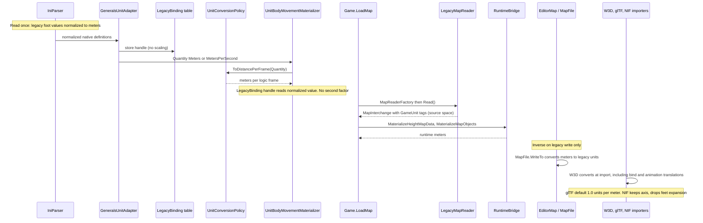

# H2b: Metric core units

> Audience: human + agent.
> Design for the internal metric conversion. Planning base `2e5d3770` (H2 group 4, PR #326). H2a (WI-H2a-01..19) and H2 (WI-H2-01..04) are merged.

## Contract

Runtime positions, lengths, bounds, and translations use meters. Authored rates use meters per second; tick-based code uses meters per logic frame and meters per logic frame squared. Cadence, angles, health, damage, costs, ratios, and dimensionless animation scales remain unchanged. This is a numeric rescale, not a balance or physics redesign.

The Generals distance convention is one foot: `s = 0.3048` meters per legacy unit. Length, velocity, and acceleration scale by `s`; area and squared-distance thresholds by `s^2`; volume by `s^3`; inverse-length quantities by `1/s`. Gravity preserves the converted source value, not an assumed terrestrial value. Mass and force fields require evidence of physical dimensions and source units; gameplay weights are not kilograms.

Each supported game declares a source unit policy at its source boundaries: a per-game `SourceUnitPolicy` giving the meters-per-source-unit scale, never a parser-global assumed physical truth. Generals declares the established 0.3048 meters per legacy unit. The BFME family (BFME, BFME2, RotWK) declares 0.3048 as a provisional compatibility scale: a uniform similarity transform that preserves existing numerical behavior, documented as unverified physical calibration and never claimed as a measured unit. The policy is centralized with a per-game override point, so a later measured value replaces one declaration. Every supported game declares its policy explicitly, with no default fallthrough, and tests enforce that no value is scaled twice.

Raw format readers retain source-space values. Normalization happens once, at the source-to-engine boundary, and the inverse is applied on legacy write. Map cells, sample indices, pixels, UVs, normals, rotations, and ratios are not lengths. Runtime interchange is metric unless a quantity explicitly carries a source unit tag.

## Current state on main

Facts below are verified at `2e5d3770`. Each is a gap the cutover closes.

| Seam | Current behavior |
|---|---|
| `src/Panopticon.Simulation/Content/Importing/Units/Generals/GeneralsUnitAdapter.cs:89-95, 193-195` | Generals distances tagged `QuantityUnit.GameDistance` (feet-scale game units). |
| `GeneralsUnitAdapter.cs:127-129` | Speed, acceleration tagged unqualified `DistancePerSecond` and `DistancePerSecondSquared`. |
| `src/Panopticon.Simulation/Content/Importing/Units/Materialization/UnitConversionPolicy.cs:47` | `GameDistance` passes through unchanged. `Meters` requires `GameUnitsPerMeter`, which `GeneralsUnitImport.cs:29` never supplies. |
| `UnitConversionPolicy.cs:49` | `SourceDistance` uses `GameUnitsPerSourceDistance`, supplied by `src/Panopticon.Tools.TestHarness/UnitContentImportRunner.cs:61`. |
| `src/Panopticon.Simulation/Data/Ini/IniParser.cs:483-487` | Rate helpers already divide by logic frames (`ParseVelocityToLogicFrames`, `ParseAccelerationToLogicFrames`), with no length factor. |
| `src/Panopticon.Simulation/GameData.cs:161` | `Gravity` parsed through `ParseAccelerationToLogicFrames`. |
| `src/Panopticon.Simulation/Content/Importing/Gltf/GltfImportOptions.cs:51` | Default `unitsPerMeter = 1f / 0.3048f`. glTF output is currently in feet-scale game units, not meters. |
| `src/Panopticon.Simulation/Content/Importing/Nif/NifTransformConverter.cs:16-28` | Source-to-engine matrix includes a meters-to-feet factor (`FeetPerMeter`). |
| `src/Panopticon.Simulation/Content/Importing/Nif/NifParticleEffectConverter.cs:80` | `Translation *= MetersPerFoot` undoes the importer's feet expansion; removed together with it in WI-H2b-10 (AQ-14 resolved). |
| `src/Panopticon.Simulation/Content/Importing/W3d/W3dModelImporter.cs:182` | Bone pivot translations passed through raw. No unit conversion found in the W3d importers. |
| `src/Panopticon.Simulation/Content/Importing/Units/Materialization/ImportedVisualInstaller.cs:34, 88` | `modelScale` (default `1f`) is a presentation multiplier, separate from unit conversion. |
| `src/Panopticon.Simulation/Content/Importing/Maps/Types/MapQuantityUnit.cs:8-11` | Interchange already distinguishes `GameUnit` (legacy, "not feet or meters by definition") from `Meters`. |
| `src/Panopticon.Simulation/Content/Importing/MapSources/LegacyMapReader.cs:41, 71` | `LegacyMapReader : IMapReader`, `Read()` returns `MapInterchange`. |
| `src/Panopticon.Simulation/Content/Importing/MapSources/RuntimeBridge.cs:25, 117, 195` | `MaterializeHeightMapData`, `MaterializeMapObjects`, `TryGetMaskFeed`. |
| `src/Panopticon.Simulation/Game.cs:793-808` | `MapReaderFactory` defaults to `LegacyMapReader`; `LoadMap` calls the bridge. |
| `src/Panopticon.Simulation/Data/Map/MapFile.cs:266-267` | Map positions use `HeightMap.HorizontalScale` (game units per sample). |
| `src/Panopticon.Tools.WorldBuilder.Core/EditorMap.cs:11, 63` | `EditorMap` wraps `MapFile` and saves through `MapFile.WriteTo`. |
| `src/Panopticon.Tools.ReplaySketch.Core/Model/ExternalModels/ExternalModelImportOptions.cs:27` | ReplaySketch default `1f / 0.3048f` units per meter. Serialized at `ExternalModelReportJson.cs:155`. |
| `src/Panopticon.Physics/PhysicsUnitConversion.cs` | Per-frame and per-second conversions. Unit-neutral; the values passed in change meaning. |
| `src/Panopticon.Simulation/Recording/EngineCheckpoint.cs:52, 104-106` | `FormatVersion = 1`; unknown versions rejected. |
| `src/Panopticon.Simulation/Recording/WorldStateArtifact.cs:74-77` | Region schema version checked; unknown versions rejected. |
| `src/Panopticon.Simulation/Recording/RunRecording.cs:182` | Records `DomainStateSchemaVersion`. |
| `src/Panopticon.Simulation/Data/Rep/ReplayHeader.cs:22-26` | Replay header carries `Version`, `VersionMajor`, `VersionMinor`. |

## Release model

WI-H2b-03 through WI-H2b-18 (OpenProject wp642 through wp657) ship as one atomic PR to `main`, with one internal commit per ticket. There is no partially mergeable stack and no staging branch. The audit and design work (WI-H2b-01 and WI-H2b-02, this document) may ship as a separate docs PR.

Intermediate commits are not supported releases. Runtime sharing is not permitted: no long-lived dual-unit runtime exists, and no flag selects between legacy and metric units after cutover.

No source ticket is startable until the Architect reviews this design. The gate is recorded in OpenProject; this document does not record ticket status.

Ownership note: this design task is docs-only. `src/Panopticon.Simulation/Content/Importing/Units/` is concurrently owned (GLM workstream); no source in that area is touched by this task.

## Audit inventory

Each row names the source unit, the runtime unit after cutover, the conversion owner, the inverse writer, the dimensional exponent (`L` length, `T` time), and the test home. Rows marked AQ are audit questions: the dispositions in the Audit questions section resolve AQ-1 through AQ-14, and an open AQ blocks its ticket. No source ticket guesses a unit.

Dimensionless and non-length rows (health, damage, cost, currency, ratios, angles, UVs, cells, pixels) are unchanged and are not repeated per row.

### INI gameplay

| Source site | Source unit | Runtime unit after cutover | Conversion owner | Inverse writer | Exponent | Test home |
|---|---|---|---|---|---|---|
| `IniParser.cs:485` `ParseVelocityToLogicFrames` | legacy foot per second | m per logic frame | `IniParser` boundary (WI-H2b-03 primitive) | none (INI is read-only at runtime) | `L T^-1` | `test/Panopticon.Simulation.Tests/Data/Ini/IniFileTests.cs` |
| `IniParser.cs:487` `ParseAccelerationToLogicFrames` | legacy foot per second squared | m per logic frame squared | `IniParser` boundary | none | `L T^-2` | `IniFileTests.cs` |
| `GameData.cs:161` `Gravity` | legacy foot per second squared | m per logic frame squared (converted value, not terrestrial) | `IniParser` boundary | none | `L T^-2` | `IniFileTests.cs`, `GameData` tests (WI-H2b-05) |
| `IniParser.cs:483` `ParseAngularVelocityToLogicFrames` | degrees per second | unchanged | none | none | `T^-1` | `IniFileTests.cs` |
| Distance-named INI fields in `Logic/` and `GameData.cs` (about 312 parse sites matching Range, Radius, Distance, Speed, Height, Vision, Offset, Width, Length, Depth, Accel, Gravity, Spacing, Scale, Lifetime, Size) | legacy foot | m | `IniParser` boundary, per field | none | `L` (per field) | `IniFileTests.cs` plus per-object tests |
| BFME variants in `src/Panopticon.Mods.Bfme2/Bfme2Definition.cs` and `Bfme2RotwkDefinition.cs` | BFME-family legacy unit; provisional 0.3048 compatibility scale (AQ-1 decided) | m | `IniParser` boundary, per-game policy | none | `L` | `IniFileTests.cs` (policy-explicitness and no-double-scale tests) |

AQ-1 (decided): the BFME rows convert under the provisional compatibility scale declared per game; see the AQ-1 subsection under Audit questions. The provisional scale is a similarity transform, not a measured BFME calibration; the missing BFME physical fixture stays a known limitation recorded in WI-H2b-18.

The full per-field list is produced by the WI-H2b-05 scope step (see the per-ticket table). The grep recipe is the gate: every matching site is either converted, classified as non-length, or listed as AQ before WI-H2b-05 starts.

### H2a quantities and legacy bindings

| Source site | Source unit | Runtime unit after cutover | Conversion owner | Inverse writer | Exponent | Test home |
|---|---|---|---|---|---|---|
| `GeneralsUnitAdapter.cs:89, 90, 95, 193-195` distance `Quantity` tagged `GameDistance` | legacy foot (native values already parsed) | `Meters`, tag written by adapter with no multiplication | `IniParser` normalization (WI-H2b-05); adapter performs no scaling | none | `L` | `test/Panopticon.Simulation.Tests/Content/Importing/Units/GeneralsUnitAdapterTests.cs` |
| `GeneralsUnitAdapter.cs:127` speed tagged `DistancePerSecond` | legacy foot per second | `MetersPerSecond` (new explicit unit) | `IniParser` normalization; policy `ToDistancePerFrame` | none | `L T^-1` | `GeneralsUnitAdapterTests.cs`, `UnitBodyMovementMaterializerTests.cs` |
| `GeneralsUnitAdapter.cs:129` acceleration tagged `DistancePerSecondSquared` | legacy foot per second squared | `MetersPerSecondSquared` (new explicit unit) | `IniParser` normalization; policy | none | `L T^-2` | `UnitBodyMovementMaterializerTests.cs` |
| `GeneralsUnitAdapter.cs:128` turn rate `DegreesPerSecond` | degrees per second | unchanged | none | none | `T^-1` | `UnitBodyMovementMaterializerTests.cs` |
| `UnitBodyMovementMaterializer.cs:32, 42, 53` speed, acceleration, braking | per-second rates | per-frame values | `UnitConversionPolicy.ToDistancePerFrame`, `ToDistancePerFrameSquared` | none | `L T^-1`, `L T^-2` | `UnitBodyMovementMaterializerTests.cs` |
| `UnitBodyMovementMaterializer.cs:354` `ToGameDistance` for game-distance fields | `GameDistance` (retired at cutover) | `Meters` | `UnitConversionPolicy` | none | `L` | `UnitBodyMovementMaterializerTests.cs` |
| `UnitCombatMaterializer.cs:85` projectile speed via `ToDistancePerFrame` | `SourceDistancePerSecond` or `DistancePerSecond` | m per logic frame | `UnitConversionPolicy` | none | `L T^-1` | `test/Panopticon.Simulation.Tests/Content/Importing/Units/UnitCombatMaterializerTests.cs` (new in WI-H2b-04) |
| `LegacyBinding.cs:9`, `LegacyModuleBinding.cs:9` handles | native values from the Generals table, already normalized | unchanged handle; values already metric | adapter table built after normalization | none | per referenced field | `GeneralsUnitAdapterTests.cs` (double-scale negative test) |

Legacy binding rule: a `LegacyBinding` or `LegacyModuleBinding` handle resolves to native data that has already passed INI normalization. The policy never applies a factor to a value reached through a handle. The negative test loads one module through a handle and asserts the metric value equals the normalized native value, not its square.

### EE2 source (WI-H2a-15, 16, 18)

| Source site | Source unit | Runtime unit after cutover | Conversion owner | Inverse writer | Exponent | Test home |
|---|---|---|---|---|---|---|
| `Ee2UnitAdapter.cs:255, 293, 314, 321, 419, 435, 533, 534` `SourceDistance` | EE2 tile | `Meters` via declared meters per source distance | `UnitConversionPolicy` (declared scale from `UnitContentImportRunner.cs:61`) | none (EE2 read-only) | `L` | `test/Panopticon.Simulation.Tests/Content/Importing/Units/Ee2UnitAdapterTests.cs`, `Ee2TypedMaterializationTests.cs`, `Ee2RealUnitImportTests.cs` |
| `Ee2UnitAdapter.cs:291, 401, 558` `SourceDistancePerSecond` | EE2 tile per second | m per logic frame | `UnitConversionPolicy.ToDistancePerFrame` | none | `L T^-1` | `Ee2TypedMaterializationTests.cs` |
| `Ee2UnitAdapter.cs:322, 420, 436, 531` `Seconds` | seconds | unchanged | none | none | `T` | `Ee2TypedMaterializationTests.cs` |
| EE2 model scale (`src/Panopticon.Tools.TestHarness/Ee2ReferenceScale.cs`) | decimeter (EE2 NIF models; one tile = 50 model units = 5 m, AQ-2 closed) | `Meters` via declared scale converted by similarity (5.5627524 m per source distance, 0.111255048 m per model unit) | `UnitConversionPolicy` (declared scale from the import) | none (EE2 read-only) | `L` | `test/Panopticon.Simulation.Tests/Content/Importing/Units/Ee2ModelScaleTests.cs` |

AQ-2 (resolved): the derivation in the `Ee2ReferenceScale.cs` doc comment names the unit. EE2 NIF models are authored in decimeters, one EE2 tile spans 50 model units = 5 m, giving `GameUnitsPerSourceDistance` 18.2505 and `GameUnitsPerSourceModelUnit` 0.36501. After cutover the declared values convert by the similarity rule in conversion primitives (18.2505 x 0.3048 = 5.5627524 m per source distance, 0.36501 x 0.3048 = 0.111255048 m per model unit for pose compatibility); adopting the physical 5 m per tile or 0.1 m per model unit in an existing profile is a recalibration, not part of the cutover. The 3.6501 Generals presentation anchor stays separate and is never a gameplay scale, and no equality between 3.6501 and 3.28084 (feet per meter) is claimed. EE2 tiles are never inferred as meters, and model scales are never reused as gameplay scales.

### Terrain, maps, and WorldBuilder

| Source site | Source unit | Runtime unit after cutover | Conversion owner | Inverse writer | Exponent | Test home |
|---|---|---|---|---|---|---|
| `MapFile.cs:266-267` and `HeightMap.HorizontalScale` (terrain spacing, `HeightMapData.cs:50`) | `GameUnit` | `Meters` | `RuntimeBridge.MaterializeHeightMapData` (`RuntimeBridge.cs:25`) | `MapFile.WriteTo` via `EditorMap` (`EditorMap.cs:63`) | `L` | `test/Panopticon.Simulation.Tests/Content/Importing/MapSources/LegacyMapReaderTests.cs`, `RuntimeBridgeParityTests.cs` |
| Height samples and vertical scale (`HeightMapData.cs:17` `VerticalScale`) | `GameUnit` (elevation is a world length by construction, AQ-3 closed) | `Meters` | `RuntimeBridge.MaterializeHeightMapData` | `MapFile.WriteTo` | `L` | `RuntimeBridgeParityTests.cs` (raw elevation integers round-trip unchanged) |
| Map object positions (`RuntimeBridge.MaterializeMapObjects`, `RuntimeBridge.cs:117`) | `GameUnit` (from `LegacyMapReader`) | `Meters` | `RuntimeBridge` | `MapFile.WriteTo` | `L` | `RuntimeBridgeParityTests.cs` |
| Waypoints (`Data/Map/Waypoint*`, `Scripting/Waypoints.cs`) | `GameUnit` | `Meters` | `RuntimeBridge` | `MapFile.WriteTo` | `L` | `LegacyMapReaderTests.cs` |
| Mask feed (`RuntimeBridge.TryGetMaskFeed`, `RuntimeBridge.cs:195`) | cells, dimensionless | unchanged | none | none | `L^0` | `RuntimeBridgeParityTests.cs` |
| Polygon triggers (`Logic/Map/PolygonTrigger.cs`) and other retained map-sourced fields read directly by `Scene3D` (AQ-4 corrected) | `GameUnit`, retained opaque (not a typed `MapInterchange` component) | `Meters` before runtime | `Game`/`Scene3D` load boundary or the section readers; inventory owned by WI-H2b-07/08 | `MapFile.WriteTo`; stored source bytes unchanged | `L` | inventory and tests named in WI-H2b-07/08 |
| WorldBuilder new-map defaults (`NewMapFactory`) | `GameUnit` defaults | `Meters` when constructed | `EditorMap.CreateNew` (`EditorMap.cs:34`) | `MapFile.WriteTo` | `L` | `test/Panopticon.Tools.WorldBuilder.Core.Tests/NewMapFactoryTests.cs`, `MapCompanionTests.cs` |
| Geospatial import (`MapQuantityUnit.Meters` and `Degrees` CRS, `MapInterchangeValidator.cs:835-836`) | `Meters` for CRS, `GameUnit` for derived spacing | `Meters` | `RuntimeBridge` for spacing | `MapFile.WriteTo` | `L` | `test/Panopticon.Geospatial.Tests/Interchange/SourceProvenanceAndMapTransformTests.cs` |

Map rule: `LegacyMapReader` keeps source-space values and their `GameUnit` tags. `RuntimeBridge` is the only converter on read for typed `MapInterchange` components. `MapFile.WriteTo` applies the inverse on write. `GameUnit` is never reinterpreted as meters.

Retained-backend rule (AQ-4, corrected): retained-opaque storage is not a reason to defer runtime quantity conversion. `Scene3D` and other consumers read `MapFile` directly after the bridge: water from `PolygonTriggers` (`Scene3D.cs:321`), plus cameras, lighting, waypoint paths, sides and team positions, and MP positions. Every load-bearing dimensionful field in the retained legacy backend normalizes before runtime under H2b, with the inverse applied on legacy write and the stored source bytes unchanged; no silent mixture of metric terrain with legacy-unit water, triggers, cameras, or paths. The retained-backend dimensionful inventory (sections consumed at runtime, their coordinate fields, the conversion owner at the `Game`/`Scene3D` load boundary or the section readers, and the inverse writer) is a required audit deliverable, assigned in the per-ticket table: WI-H2b-07 and WI-H2b-08 own the map-sourced retained fields and WI-H2b-14 owns replay and order paths if any. Coordination with H5: H2b converts values at the legacy backend boundary without changing section storage, and H5 may later replace the backend without re-converting.

### Retained-backend runtime dimension inventory

This section is the required AQ-4 inventory deliverable named in the retained-backend rule, verified at `7d9468677`. Ownership boundary: H2b owns value conversion at the metric boundary. Legacy `MapFile` sections are parsed once, and the parsed section objects are the runtime copies, so conversion normalizes the dimensionful fields of the in-memory parse result at the section reader on the `Game`/`Scene3D` load path. Stored source bytes and section storage never change; the inverse runs in `MapFile.WriteTo` and the per-section writers, which either invert from separate source data or apply the conversion symmetrically on write. H5 owns replacing the backend (typed interchange homes and materializers) and must consume the already-metric runtime values without re-converting. Each value keeps one source of truth: a runtime copy is converted exactly once.

No double scale through save and replay persistence. `GameState.cs:11,23` persists only the map file name, and saves reload the map through the same load boundary, so map bytes convert once. Replays record orders, not section state. Two save chunks carry retained-backend runtime values and follow the same rule: `PolygonTrigger.Persist` (`PolygonTrigger.cs:316-337`, reached from `GameLogic.cs:545-563`) persists trigger points, bounds, and radius, and `BuildListInfo` persists `Location` and `RallyPointOffset` (`BuildListInfo.cs:101-102`). These payloads are written after conversion and read back as runtime values in the same build; legacy save versions convert at the save reader boundary (WI-H2b-15). A value reached through persistence is never re-converted.

Classification rules for this inventory. A name-evident length converts even with no consumer today: the section reader is the conversion point, so a later consumer cannot see legacy units. A field with no established unit is an explicit diagnostic at the reader and never converts; a blanket float or `Vector3` conversion of an unclassified field is a defect. `UvScrollSpeed` fields are texture-space rates and take no world factor. `WaterHeight`, wave `FinalWidth` and `FinalHeight`, and trigger point Z are integer-sourced world Z lengths: the reader converts through `s`, and the section writer restores the integer source form.

#### Section coverage

Every section in `MapSectionNames.cs` is listed with its disposition. Converted sections have field tables below; the remainder carry no dimensionful field or are covered by an existing audit row.

| Section | Disposition |
|---|---|
| `AssetList` | no dimensionful field: asset name strings |
| `BlendTileData` | no dimensionful field: cells, texture indices, and the mask feed are dimensionless |
| `CameraAnimationList` | converted at the section reader; parsed-but-unconsumed, table below |
| `CastleTemplates` | converted, table below |
| `EnvironmentData` | converted, table below |
| `FogSettings` | no dimensionful field classified: 24 unknown bytes, never converted |
| `GlobalLighting` | no position converts; unknowns are diagnostics, table below |
| `GlobalVersion` | no dimensionful field: version integers |
| `GlobalWaterSettings` | converted, table below |
| `HeightMapData` | converted; terrain spacing and elevation (audit table above, WI-H2b-07) |
| `LibraryMapLists` | no dimensionful field: map and asset name references |
| `MissionHotSpots` | no dimensionful field: ID, title, and description text |
| `MissionObjectives` | no dimensionful field: text, boolean, and objective enum |
| `MPPositionList` | no dimensionful field: flags, team index, and side names only |
| `NamedCameras` | converted, table below |
| `ObjectsList` | converted; typed placement (audit table above, WI-H2b-08) |
| `PlayerScriptsList` | dimensionful payloads are the `ScriptArgument` rows in the sides table |
| `PolygonTriggers` | converted, table below |
| `PostEffectsChunk` | no dimensionful field found: blend factors and shader parameter vectors, unconsumed at runtime |
| `RiverAreas` | converted, table below |
| `SidesList` | converted, table below (players, build lists, scripts) |
| `SkyboxSettings` | converted, table below |
| `StandingWaterAreas` | converted, table below |
| `StandingWaveAreas` | converted, table below |
| `Teams` | no dimensionful field: team templates carry IDs, names, flags, and waypoint references |
| `TriggerAreas` | converted, table below |
| `WaypointsList` | positions converted through the waypoints audit row; `WaypointPath.cs:7-8` is waypoint IDs only, dimensionless |
| `WorldInfo` | no dimensionful field found: asset property bag of text and settings values |

#### Converted fields

Exponent `L` marks world lengths converting by `s`. The conversion owner is the section reader at the `Game`/`Scene3D` load path; the inverse writer is the section's `WriteTo` reached through `MapFile.WriteTo`, and stored source bytes stay unchanged. Consumers are cited as of `7d9468677`.

Water and triggers:

| Source site | Field | Class | Runtime consumer |
|---|---|---|---|
| `PolygonTrigger.cs:55` | `Point3D[] Points` | `L` (footprint XY and water level Z) | water geometry and level at `WaterArea.cs:156-160`; containment at `PolygonTrigger.cs:258`; save persist at `GameLogic.cs:546` |
| `PolygonTrigger.cs:27` | `RiverStart` | point index, dimensionless | none |
| `PolygonTrigger.cs:33` | `UvScrollSpeed` | texture-space rate | shader sampling; no world factor |
| `StandingWaterArea.cs:19` | `Vector2[] Points` | `L` | `WaterArea.cs:147` |
| `StandingWaterArea.cs:21` | `WaterHeight` (`uint`) | `L` | passed as geometry height at `WaterArea.cs:147`: a world Z length from an integer source |
| `StandingWaterArea.cs:13` | `UvScrollSpeed` | texture-space rate | no world factor |
| `RiverArea.cs:24` | `WaterHeight` (`uint`) | `L` | integer-sourced world Z; the river polygon is referenced by name through `PolygonTriggers`, no points stored |
| `RiverArea.cs:31` | `Line2D[] Lines` | `L` (centerline endpoints) | no runtime consumer found today |
| `RiverArea.cs:15` | `UvScrollSpeed` | texture-space rate | no world factor |
| `StandingWaveArea.cs:19` | `Vector2[] Points` | `L` | `WaterArea.cs:139` |
| `StandingWaveArea.cs:21-22` | `FinalWidth`, `FinalHeight` (`uint`) | `L` | `FinalHeight` at `WaterArea.cs:139`; `FinalWidth` unconsumed |
| `StandingWaveArea.cs:23-24` | `InitialWidthFraction`, `InitialHeightFraction` | ratio, dimensionless | none |
| `StandingWaveArea.cs:25-28` | `InitialVelocity`, `TimeToFade`, `TimeToCompress`, `TimeOffset2ndWave` | unclassified | none today; explicit diagnostic, do not convert |
| `StandingWaveArea.cs:29` | `DistanceFromShore` (`uint`) | `L` by name | none today |
| `StandingWaveArea.cs:16` | `UvScrollSpeed` | texture-space rate | no world factor |
| `TriggerArea.cs:12` | `Vector2[] Points` | `L` | no runtime consumer found today; convert at the section reader |
| `GlobalWaterSettings.cs:13` | `ReflectionPlaneZ` | `L` (world Z) | no runtime consumer found today |
| `EnvironmentData.cs:10` | `WaterMaxAlphaDepth` | `L` (depth) | unconsumed today; `Terrain.cs:120-158` reads texture names and `IsMacroTextureStretched` only |
| `EnvironmentData.cs:11` | `DeepWaterAlpha` | ratio, dimensionless | none |

Trigger bounds and `Radius` (`PolygonTrigger.cs:57-84`) recompute from points and convert transitively; `PolygonTrigger.Persist` writes them into saves as runtime values. River and water texture names, colors, and alphas are dimensionless.

Cameras and lighting:

| Source site | Field | Class | Runtime consumer |
|---|---|---|---|
| `NamedCamera.cs:9` | `LookAtPoint` (`Vector3`) | `L` | collected at `Scene3D.cs:276`; the sole consumer is a commented script action (`ScriptActions.Camera.cs:74-93`), dormant |
| `NamedCamera.cs:12-14` | `Pitch`, `Roll`, `Yaw` | angle | unchanged |
| `NamedCamera.cs:16` | `FieldOfView` | ratio | unchanged |
| `NamedCamera.cs:15` | `Zoom` | unclassified | no active runtime consumer; do not convert |
| `NamedCamera.cs:17` | `Unknown` (`float`) | unclassified | explicit diagnostic, never convert |
| `CameraAnimationFrame.cs:44` | `FreeCameraAnimationCameraFrame.Position` | `L` | parsed-but-unconsumed |
| `CameraAnimationFrame.cs:73` | `LookAtCameraAnimationCameraFrame.Position` | `L` | parsed-but-unconsumed |
| `CameraAnimationFrame.cs:102` | `LookAtCameraAnimationLookAtFrame.LookAt` | `L` | parsed-but-unconsumed |
| `CameraAnimationFrame.cs:45, 74, 76` | `Rotation`, `Roll`, `FieldOfView` | angle or ratio | unchanged |
| `GlobalLight.cs:10-12` | `Ambient`, `Color`, `Direction` | RGB triples and a unit direction | none are positions; none convert |
| `GlobalLighting.cs:19` | `Time` | `TimeOfDay` enum | unchanged |
| `GlobalLighting.cs:23` | `ShadowColor` | RGB | unchanged |
| `GlobalLighting.cs:33` | `NoCloudFactor` | ratio | unchanged |
| `GlobalLighting.cs:25` | `Unknown` byte block | unclassified | never converted |
| `GlobalLighting.cs:28` | `Unknown2` (`Vector3?`) | unclassified | explicit diagnostic; never blanket-convert an unknown `Vector3` |
| `GlobalLighting.cs:31` | `Unknown3` | unclassified | never converted |

`CameraAnimationList` has no `Scene3D` consumer found today; it is inventoried as parsed-but-unconsumed, with conversion at its section reader if a consumer appears.

Sides, players, scripts, castles, and skybox:

| Source site | Field | Class | Runtime consumer |
|---|---|---|---|
| `Player.cs:78` | `MultiplayerStartIndex` | waypoint index, dimensionless | the start position rides the `Player_N_Start` waypoint through `ObjectsList`, already typed; no stored player position exists |
| `Player.cs:63` | `StartMoney` | currency, dimensionless | none |
| `Player.cs:68, 73` | `Color`, `NightColor` | RGB integers, dimensionless | none |
| `Player.cs:107` | `SkirmishDifficulty` | enum integer, dimensionless | none |
| `BuildListInfo.cs:22` | `Location` (`Vector3`) | `L` | AI build position; persisted to saves at `BuildListInfo.cs:101-102` |
| `BuildListInfo.cs:25` | `RallyPointOffset` (`Vector2`) | `L` | AI rally placement; same persistence |
| `ScriptArgument.cs:17` | `PositionValue` (`Vector3`) | `L` | converts at script load (`ScriptContent.cs:54`); map `SidesList` scripts and skirmish `.scb` scripts share this parse boundary |
| `ScriptArgument.cs:13` | `FloatValue` | per `ScriptArgumentType` | semantics depend on the argument type: distance, angle, percent, or time; classified per argument type at the script boundary, and an argument type with no established dimension gets an explicit diagnostic, never a blanket float conversion |
| `MPPositionInfo.cs:11-15` | flags, `Team`, `SideRestrictions` | dimensionless | no coordinates; multiplayer start positions also ride waypoints |
| `SidesListUtility.cs:332, 390` | `PlayerTemplates.GetByName` | name reference | asset reference, no quantity |
| `WaypointPath.cs:7-8` | `StartWaypointID`, `EndWaypointID` | dimensionless | path geometry rides the typed waypoint objects |
| `CastleTemplate.cs:12` | `Offset` (`Vector3`) | `L` | `CastleBehavior.cs:56-65` adds it to a runtime map object position |
| `CastleTemplate.cs:13` | `Angle` | angle | unchanged |
| `CastleTemplate.cs:15-16` | `Priority`, `Phase` | dimensionless | none |
| `CastlePerimeterPoint.cs:9` | `Position` (`Vector3`) | `L` | consumed through `CastleBehavior` |
| `SkyboxSettings.cs:11` | `Position` (`Vector3`) | `L` | no runtime consumer found today; convert at the section reader |
| `SkyboxSettings.cs:12` | `Scale` | dimensionless presentation multiplier | same treatment as `ImportedVisualInstaller.cs:34, 88` |
| `SkyboxSettings.cs:13` | `Rotation` | angle | unchanged |

Runtime asset references that bypass unit materialization: road templates resolved by name (`Scene3D.cs:260-261`), object definitions by `TypeName` (`GameObject.cs:45`), and polygon trigger state resolved by name in saves (`GameObject.cs:2116`) are name references with no stored quantity, so no conversion applies. Geometry radii arrive through the INI boundary already covered by WI-H2b-05/06, not through the map sections. Road segment endpoints are `MapObject` positions, already typed.

#### Boundary test plan

Home: new `RetainedBackendMetricTests.cs` under `test/Panopticon.Simulation.Tests/Content/Importing/MapSources/`; `RuntimeBridgeParityTests.cs` keeps the bridge-typed components (terrain spacing, elevation, placement). Each converted field class gets a legacy-load test asserting runtime values equal legacy values times `s`:

| Converted field class | Mixed-unit failure mode caught |
|---|---|
| Water polygons and levels (`PolygonTrigger.Points`, `StandingWaterArea.Points` and `WaterHeight`, `RiverArea.Lines` and `WaterHeight`, `StandingWaveArea.Points` and `FinalHeight`, `GlobalWaterSettings.ReflectionPlaneZ`) | water plane offset from terrain by `1/s` |
| Trigger and area points (`TriggerArea.Points`) | trigger regions misaligned with terrain by `1/s` |
| Cameras (`NamedCamera.LookAtPoint`, animation frame `Position` and `LookAt`) | scripted camera framing lands `1/s` from its target |
| Castles (`CastleTemplate.Offset`, `CastlePerimeterPoint.Position`) | a legacy offset added to a meter position at the `CastleBehavior.cs:62-65` add site displaces the footprint |
| Skybox (`SkyboxSettings.Position`) | skybox anchored `1/s` from its terrain anchor |
| Sides and scripts (`BuildListInfo.Location` and `RallyPointOffset`, `ScriptArgument.PositionValue`) | AI build, rally, and script-at-location effects offset by `1/s` |

Proofs, in the same test home:

| Proof | Asserts |
|---|---|
| Inverse | `MapFile.WriteTo` output bytes stay identical to the source after a load-and-write round trip with no runtime mutation, across the full retained set: stored source bytes unchanged, the runtime copy the only converted value |
| No second scale through persistence | persist, reload, positions unchanged after first load; the polygon trigger and build list chunks reload as the same meters, not meters times `s` |
| Unclassified negative | `GlobalLighting.Unknown2`, wave `InitialVelocity`, camera `Zoom` produce the named diagnostic and no conversion |
| Terrain-relative alignment | water and trigger vertices compared against terrain-relative positions (vertex against the ground height below it, polygon center against its terrain cell), not absolute constants alone: a mixed-unit failure presents as water or triggers offset by `1/s` from terrain |

Tolerances follow the numeric fixtures section: `s` times legacy values with the stated absolute tolerances.

### W3D, glTF, and NIF importers

| Source site | Source unit | Runtime unit after cutover | Conversion owner | Inverse writer | Exponent | Test home |
|---|---|---|---|---|---|---|
| `W3dModelImporter.cs:182` bone pivot translations | legacy game unit by compatibility scale (AQ-5; compatibility proof in WI-H2b-09) | `Meters` | W3D importer, at import, including bind translations | none (no W3D writer) | `L` | `test/Panopticon.Simulation.Tests/Content/Importing/W3dModelImporterTests.cs`, `W3dImportParityTests.cs` |
| `W3dAnimationImporter.cs:286-288` translation channels | legacy game unit (AQ-5) | `Meters` | W3D importer, at import | none | `L` | `W3dAnimationImporterTests.cs` |
| `W3dMeshConverter` vertex positions | legacy game unit (AQ-5) | `Meters` | W3D importer | none | `L` | `W3dMeshConverterTests.cs` |
| `ImportedVisualInstaller.cs:34, 88` `modelScale` | dimensionless multiplier | unchanged; kept separate from unit conversion | caller (presentation sizing) | none | dimensionless | `test/Panopticon.Simulation.Tests/Content/Importing/ImportedModelMaterializerTests.cs`, `Units/UnitVisualMaterializerTests.cs` |
| `GltfImportOptions.cs:51` default `1f / 0.3048f`, `GltfTransformConverter.cs:14-19` `CreateBasis` | glTF meters (glTF specification) | `Meters`, default `1.0` units per meter | `GltfImportOptions` default and `CreateBasis` | none | `L` | `test/Panopticon.Simulation.Tests/Content/Importing/GltfImporterTests.cs`, `GltfSceneConverterTests.cs`, `GltfSkinConverterTests.cs`, `GltfAnimationImporterTests.cs`, `GltfPrimitiveConverterTests.cs` |
| `NifTransformConverter.cs:16-28` `FeetPerMeter` expansion | NIF in meters (converter comment) | `Meters`; axis conversion kept, feet expansion removed | `NifTransformConverter` | none | `L` | `test/Panopticon.Simulation.Tests/Content/Importing/NifModelImporterTests.cs`, `NifSkinConverterTests.cs`, `NifAnimationImporterTests.cs` |
| `NifParticleEffectConverter.cs:80` `Translation *= MetersPerFoot` | meters after conjugation to feet; the interchange carries source units (AQ-14 closed) | `Meters`; the multiplication is removed with the feet expansion | `NifParticleEffectConverter` (same ticket as the expansion removal, WI-H2b-10) | none | `L` | created in WI-H2b-10 |
| ReplaySketch `ExternalModelImportOptions.cs:27` default and `ExternalModelReportJson.cs:155` | feet-scale game units per meter | `1.0` units per meter; report payload versioned | `ExternalModelImportOptions` | report reader | dimensionless scale | `test/Panopticon.Tools.ReplaySketch.Tests/ExternalModelProtocolTests.cs`, `ExternalModelSessionTests.cs` |

Importer rule: each importer converts at import. The inverse exists only where a writer exists, and no W3D writer exists.

### Physics and locomotion

| Source site | Source unit | Runtime unit after cutover | Conversion owner | Inverse writer | Exponent | Test home |
|---|---|---|---|---|---|---|
| `src/Panopticon.Physics/PhysicsUnitConversion.cs` per-frame and per-second | unit-neutral | unchanged function; inputs now metric | caller | none | `T^-1` | `test/Panopticon.Simulation.Tests/Physics/LegacyPhysicsBodyTests.cs` |
| `src/Panopticon.Physics/Legacy/LegacyPhysicsBody.cs`, `Bepu/BepuPhysicsBody.cs` world units | runtime unit; no backend declares an independent world unit (AQ-6 closed) | `Meters` | `GameData` boundary (WI-H2b-05) | none | `L` | `LegacyPhysicsBodyTests.cs`, `test/Panopticon.Simulation.Tests/Logic/Object/Behaviors/PhysicsBehaviorTests.cs` |
| Terrain physics chunks (`src/Panopticon.Tools.TestHarness/TerrainPhysicsChunks.cs`) | `Meters` after `RuntimeBridge` | `Meters` | `RuntimeBridge` | none | `L` | `test/Panopticon.Simulation.Tests/Logic/PartitionCounterTests.cs` (adjacent; create physics test in WI-H2b-11) |

### Navigation, partitioning, and scripts

| Source site | Source unit | Runtime unit after cutover | Conversion owner | Inverse writer | Exponent | Test home |
|---|---|---|---|---|---|---|
| Navigation cell size (`src/Panopticon.Simulation/Navigation/`) | legacy foot per cell (contract example: 10-unit cell) | `Meters` (3.048 m per 10-unit cell) | `RuntimeBridge` spacing | none | `L` | `test/Panopticon.Simulation.Tests/Navigation/GraphTest.cs`, `PathEqualityCorpusTests.cs` |
| Path distance thresholds | squared thresholds in legacy foot | `s^2` scaled meters | owner of the constant at the call site | none | `L^2` | `test/Panopticon.Simulation.Tests/Navigation/MovementProgressTests.cs`, `DestinationSlotsTests.cs` |
| Partition cell size (`GameData.cs:163` `PartitionCellSize`) | legacy foot per cell (GameData INI length, AQ-7 closed) | `Meters` | `IniParser` boundary (WI-H2b-05) | none | `L` | `test/Panopticon.Simulation.Tests/Logic/PartitionCounterTests.cs` |
| Scripting waypoints and areas (`src/Panopticon.Simulation/Scripting/`) | `GameUnit` | `Meters` | `RuntimeBridge` for map-sourced values | none | `L` | `test/Panopticon.Simulation.Tests/Navigation/FollowerLandingTests.cs` (adjacent; scripting test home named in WI-H2b-12) |

### Cameras, rendering, and audio

| Source site | Source unit | Runtime unit after cutover | Conversion owner | Inverse writer | Exponent | Test home |
|---|---|---|---|---|---|---|
| Camera distances and heights (`src/Panopticon.Simulation/Graphics/Cameras/Camera.cs`, `TacticalView.cs`) | legacy foot (`GameData.cs:149-151` INI presentation lengths, AQ-8 closed) | `Meters` | INI fields in WI-H2b-06; `TacticalView` derived constants in WI-H2b-13 | none | `L` | `test/Panopticon.Simulation.Tests/Graphics/Cameras/TacticalViewConstraintTests.cs`, `TacticalViewZoomSettleTests.cs` |
| Shader world-space uniforms (`src/Panopticon.Simulation/Assets/Shaders`) | runtime world-space values fed from C#; no independent shader unit (AQ-9 closed in principle) | `Meters` | WI-H2b-13 enumerates each uniform's C# source | none | `L` | none established; ReplaySketch screenshot proof |
| Audio attenuation (`src/Panopticon.Simulation/Audio/AudioSettings.cs:67-71`) | legacy foot (`MicrophoneMinDistanceToCamera`, `ZoomMinDistance`, and similar) | `Meters` | `AudioSettings` parse boundary | none | `L` | none established (create in WI-H2b-13) |
| Frame captures (`FrameCaptureServiceTests.cs`) | pixels | unchanged | none | none | `L^0` | `test/Panopticon.Simulation.Tests/Graphics/FrameCaptureServiceTests.cs` |

### Orders, network, and replays

| Source site | Source unit | Runtime unit after cutover | Conversion owner | Inverse writer | Exponent | Test home |
|---|---|---|---|---|---|---|
| Order target positions (`src/Panopticon.Simulation/Logic/Orders/Order.cs`, `OrderArgumentValue.cs`, `SpecialPowerAtLocationApplicator.cs`) | runtime meters after cutover | `Meters` | order creation (input) at runtime boundary | none | `L` | `test/Panopticon.Simulation.Tests/Logic/Orders/` tests (WI-H2b-14) |
| Network messages (`src/Panopticon.Simulation/Network/NetworkConnection.cs`) | no wire protocol version; same-build peers (AQ-10 closed) | runtime meters at both ends after cutover | none (no wire migration exists) | none | `L` | `test/Panopticon.Simulation.Tests/Network/SkirmishSlotTests.cs` (adjacent) |
| Replay files (`src/Panopticon.Simulation/Data/Rep/ReplayFile.cs`, `ReplayHeader.cs:22-26`) | legacy game units in position fields | `Meters` after read | replay reader boundary | replay writer | `L` | `test/Panopticon.Simulation.Tests` replay tests (WI-H2b-14) |

### Saves, checkpoints, and recordings

| Source site | Source unit | Runtime unit after cutover | Conversion owner | Inverse writer | Exponent | Test home |
|---|---|---|---|---|---|---|
| Legacy saves (`src/Panopticon.Simulation/Data/Sav/SaveFile.cs`, `GameState.cs`) | legacy game units; chunk version `PersistVersion(2)` (`GameState.cs:17`, AQ-11 closed) | `Meters` after read | save reader boundary (version 2 converts on read; cutover writes version 3) | save writer | `L` | new test in WI-H2b-15 (name in table below) |
| Engine checkpoints (`EngineCheckpoint.cs:52, 104-106`) | runtime meters after cutover | `Meters`; `FormatVersion` bumped to 2, version 1 rejected | `EngineCheckpoint` writer | n/a | `L` | `test/Panopticon.Simulation.Tests/Recording/EngineCheckpointVersionTests.cs` (new in WI-H2b-15) |
| Region-indexed world-state artifacts (`WorldStateArtifact.cs:74-77`, `RegionSchemaHeader.cs`) | runtime meters | `Meters`; `CurrentSchemaVersion` bumped, old rejected | artifact writer | n/a | `L` | `test/Panopticon.Simulation.Tests/Recording/WorldStateArtifactSchemaTests.cs` (new in WI-H2b-15) |
| Operational recordings (`RunRecording.cs:182` `DomainStateSchemaVersion`) | runtime meters | `Meters`; schema bumped, old rejected | recorder | n/a | `L` | `test/Panopticon.Simulation.Tests/Simulation/DomainStateRecorderTests.cs` |

### Tools, scenarios, and geospatial

| Source site | Source unit | Runtime unit after cutover | Conversion owner | Inverse writer | Exponent | Test home |
|---|---|---|---|---|---|---|
| ReplaySketch scenario parameters (`src/Panopticon.Tools.ReplaySketch.Core/Scenarios/`) | unit-free (landmark-relative or normalized, `Model/PositionSpec.cs`); absolute numeric descriptor parameters are runtime-unit values (AQ-12 closed) | unit-free parameters unchanged; descriptor parameters in meters | WI-H2b-16 descriptor inventory | none | `L` (descriptor parameters only) | `test/Panopticon.Tools.ReplaySketch.Tests/ScenarioMatrixLoaderTests.cs` |
| Geospatial export (`src/Panopticon.Geospatial/`) | unit-explicit (`MetersPerGameUnit` declared per manifest, AQ-13 closed) | `Meters` with `metersPerGameUnit` re-declared for metric spacing | WI-H2b-16 manifest re-declaration | manifest writer | `L` | `test/Panopticon.Geospatial.Tests/Cli/GeoImportCliTests.cs` |
| Inspectors and captures (`src/Panopticon.Tools.TestHarness`) | pixels, derived lengths | per field | per field | none | per field | `test/Panopticon.Tools.ReplaySketch.Tests/ResultsExportTests.cs` |

### Audit questions

Dispositions are evidence-based and verified at `7b7b9585f`; citations are file:line at that commit. AQ-1 is decided by the Architect and recorded in the subsection below; AQ-2 through AQ-14 are resolved. Proofs that remain inside resolved tickets (the AQ-5 compatibility fixture, the AQ-9 uniform enumeration, and similar) are named in the per-ticket table.

| ID | Question | Disposition | Evidence |
|---|---|---|---|
| AQ-1 | BFME INI unit convention | decided; per-game declared source unit policy (option 2) | subsection below |
| AQ-2 | Unit of EE2 model reference scale | resolved | The `Ee2ReferenceScale.cs` doc comment derives the unit: EE2 NIF models authored in decimeters, one tile = 50 model units = 5 m, `GameUnitsPerSourceDistance` 18.2505, `GameUnitsPerSourceModelUnit` 0.36501. After cutover the declared values convert by similarity (18.2505 x 0.3048 = 5.5627524 m per source distance, 0.36501 x 0.3048 = 0.111255048 m per model unit for pose compatibility); adopting the physical 5 m per tile is a recalibration, not part of the cutover; the 3.6501 Generals presentation anchor stays separate and is never a gameplay scale |
| AQ-3 | Vertical height sample scale | resolved by construction | `HeightMapData.cs:17` `VerticalScale` converts elevation steps to world Z; `HeightMap.cs:12` `HorizontalScale` is 10 and world positions combine Z with XY everywhere, so elevation is a world length in the same `GameUnit`. It converts by `s` like other lengths; raw elevation integers round-trip unchanged (proof in WI-H2b-07) |
| AQ-4 | Whether polygon triggers pass through `MapInterchange` | resolved, corrected: retained-opaque storage is not a reason to defer runtime quantity conversion | `PolygonTriggers` does not pass through `MapInterchange` as a typed component: `LegacyMapReader.cs:309-311` retains it opaque and `Scene3D.cs:321` reads `MapFile.PolygonTriggers` directly (water), alongside cameras, lighting, waypoint paths, sides and team positions, and MP positions read from `MapFile` after the bridge. Every load-bearing dimensionful field in the retained legacy backend normalizes before runtime under H2b, with the inverse applied on legacy write and the stored source bytes unchanged; no silent mixture of metric terrain with legacy-unit water, triggers, cameras, or paths. The retained-backend dimensionful inventory is a required audit deliverable; WI-H2b-07/08 own map-sourced retained fields and WI-H2b-14 owns replay/order paths if any. H2b converts values at the legacy backend boundary without changing section storage; H5 may later replace the backend without re-converting |
| AQ-5 | W3D file unit | resolved, reframed as a compatibility scale | W3D importers place vertices and pivots directly in world space with no scale, so converting by the same 0.3048 compatibility scale as AQ-1 preserves the existing similarity between W3D geometry and INI-authored radii. The WI-H2b-09 known-bounds fixture (installed W3D hull bounds vs INI `GeometryMajorRadius`) proves that compatibility, not a physical fact about the W3D file format; the file unit is not physically established |
| AQ-6 | Physics backend world unit | resolved | `PhysicsUnitConversion.cs` is unit-neutral per-frame and per-second math; gravity flows from `GameData` through `PhysicsBehavior.cs:286` to the backends (`BepuPhysicsWorld.cs:33` takes gravity per second squared). No backend declares an independent world unit: the world unit is the runtime unit, legacy today and meters after cutover. Conversion owner is the `GameData` boundary |
| AQ-7 | Partition cell and scripting area units | resolved | `PartitionCellSize` is a `GameData` INI length (`GameData.cs:163`) consumed at `PartitionCellManager.cs:64`; the literal `10.0f` at `PartitionCellManager.cs:100` is `HeightMap.HorizontalScale` and follows terrain spacing. Scripting areas and waypoints carry world positions from map data |
| AQ-8 | Per-constant camera units | resolved | Camera heights are `GameData` INI presentation lengths (`GameData.cs:149-151` `CameraHeight`, `MaxCameraHeight`, `MinCameraHeight`) converting in WI-H2b-06; `TacticalView` constants derive from those plus `HorizontalScale` |
| AQ-9 | Per-uniform shader units | resolved in principle | Shader uniforms (`Shadows.h` `ShadowDistance`, `RadiusCursorDecals.h` `Diameter`, near and far planes) carry runtime world-space values fed from C#; shaders declare no independent unit and inherit the runtime unit. WI-H2b-13 enumerates each uniform's C# source and confirms it converts with its owner |
| AQ-10 | Network wire version | resolved | The order wire has no protocol version: `NetworkConnection.cs` registers `Order` nested serialization with no version handshake, and `SkirmishGameSettings.cs:90` `PersistVersion(4)` covers settings, not positions. Peers are same-build; after cutover both ends emit runtime meters. No wire migration exists to make; mixed-version play is already unsupported |
| AQ-11 | Save file version field | resolved | Saves carry a chunk version: `GameState.cs:17` `PersistVersion(2)` (also `GameStateMap.cs:28`). Cutover writes version 3 in meters; version 2 reads as legacy units and converts on read. No unversioned save payload exists at this chunk level |
| AQ-12 | Scenario parameter units | resolved | ReplaySketch authored positions are landmark-relative or normalized (`Model/PositionSpec.cs`), unit-free by design and resolved against runtime world anchors at export. Only absolute numeric descriptor parameters (spacing and similar) are runtime-unit values, inventoried in WI-H2b-16 |
| AQ-13 | Geospatial export units | resolved | Geospatial is already unit-explicit (`GeospatialMapTransform` `MetersPerGameUnit`, `LocalMapGrid.cs:48,162,248`). The cutover changes what one `GameUnit` means in runtime spacing; each geospatial manifest's declared `metersPerGameUnit` is re-declared for metric spacing in WI-H2b-16, never silently reinterpreted |
| AQ-14 | NIF particle translation direction | resolved | The `NifParticleEffectConverter.cs:80` comment states the conjugation converts translation to feet and the interchange carries source units (meters), so `*= MetersPerFoot` correctly undoes the legacy scale today. When WI-H2b-10 removes the feet expansion from `NifTransformConverter.SourceToEngine`, this multiplication is removed in the same ticket or translations shrink by 0.3048 |

#### AQ-1: BFME INI unit convention (decided)

The Architect decided option 2: a per-game declared source unit policy at the source boundaries, not a parser-global assumed physical truth. The INI parser and `GameData` tables are shared by Generals, BFME, BFME2, and RotWK SageGame titles, and only the Generals convention is physically established: `s = 0.3048` meters per legacy unit, fixed by the contract above and confirmed by installed content.

The BFME family (BFME, BFME2, RotWK) declares the same value as a provisional compatibility scale: a uniform similarity transform chosen to preserve existing numerical behavior, documented as unverified physical calibration. It is never claimed as a measured unit for the BFME titles or as a physically established scale across the SageGame family. The policy is centralized with a per-game override point, so a later measured BFME value replaces one declaration.

Tests enforce two properties: no value is scaled twice anywhere in the conversion chain, and every supported game declares its policy explicitly with no default fallthrough. The decision excludes no supported game and leaves no non-metric runtime: the similarity conversion is consistent across all of a game's surfaces.

Known limitation: no BFME install or physical fixture exists in this environment, so the BFME scale stays provisional. A later BFME physical fixture remains a recorded limitation for the release report (WI-H2b-18). WI-H2b-05 is unblocked; the BFME rows above convert under the provisional policy.

## Cutover design

### Conversion primitives

WI-H2b-03 owns the primitives. The contract constants are `GeneralsFeetToMeters = 0.3048` and the inverse. Primitives live in one place and are not duplicated in importers.

Quantity tags after cutover:

| Tag | Status | Meaning |
|---|---|---|
| `Meters` | kept, now the runtime distance unit | metric length |
| `MetersPerSecond` | new | explicit metric speed |
| `MetersPerSecondSquared` | new | explicit metric acceleration |
| `SourceDistance` | kept | EE2 tile; converted by declared meters per source distance |
| `SourceDistancePerSecond` | kept | EE2 tile per second |
| `GameDistance` | retired at materialization | legacy foot; no runtime value keeps this tag after normalization |
| `DistancePerSecond` | retired | unqualified; replaced by `MetersPerSecond` |
| `DistancePerSecondSquared` | retired | unqualified; replaced by `MetersPerSecondSquared` |

`UnitConversionPolicy` changes: `GameUnitsPerMeter` is removed because runtime distance is meters. `GameUnitsPerSourceDistance` is renamed to `MetersPerSourceDistance`, declared by the import, and never inferred. `UnitContentImportRunner.cs:61` and `GeneralsUnitImport.cs:29` update to the new constructor.

The atomic cutover rule for existing EE2 profiles is similarity, not recalibration: `MetersPerSourceDistance` for an existing profile equals its legacy `GameUnitsPerSourceDistance` times `s`. The mixed profile declares 12, so the cutover sets 3.6576 m per source distance (12 x 0.3048): recorded baseline values become speed 1.725 -> 6.30936 m/s (0.210312 m per logic frame at 30 fps, matching the recorded 0.69 legacy units per frame times `s`), attack range 0.8 -> 2.92608 m, geometry radius 0.0625 -> 0.2286 m, vision 5 -> 18.288 m. Reference profiles set 18.2505 x 0.3048 = 5.5627524 m per source distance, and `GameUnitsPerSourceModelUnit` 0.36501 becomes 0.36501 x 0.3048 = 0.111255048 m per model unit for pose compatibility.

Three scales stay distinct and are never conflated. The authored profile compatibility scale is scenario-chosen (12 in `capture-mixed-source-ee2.json`, fed to `UnitConversionPolicy` by `UnitContentImportRunner.cs:61`) and produced the recorded baseline conversions. The reference presentation anchor in `Ee2ReferenceScale.cs` derives 18.2505 as 50 model units per tile x 0.1 m per model unit x 3.6501 game units per meter, where 3.6501 is a Generals presentation anchor (G10 Crusader hull), and serves the EE2 reference roster validation with `GameUnitsPerSourceModelUnit` 0.36501. The true physical source calibration is that EE2 model units are decimeters (0.1 m) and one tile spans 50 model units, so one tile is 5 m physically. Adopting the physical calibration (5 m per tile, 0.1 m per model unit) in an existing profile is a recalibration that changes behavior relative to the legacy run; it is not part of the cutover and is never substituted silently. No equality between 3.6501 and 3.28084 (feet per meter) or between 5 and 5.5627524 is claimed.

### Quantity migration table

| Current tag | Source site | Cutover tag | Value rule |
|---|---|---|---|
| `GameDistance` | `GeneralsUnitAdapter.cs:89, 90, 95, 193-195`; `UnitBodyMovementMaterializer.cs:354` | `Meters` | Value normalized at INI boundary; no multiplication in adapter |
| `DistancePerSecond` | `GeneralsUnitAdapter.cs:127` | `MetersPerSecond` | Normalized at INI boundary |
| `DistancePerSecondSquared` | `GeneralsUnitAdapter.cs:129` | `MetersPerSecondSquared` | Normalized at INI boundary |
| `SourceDistance` | `Ee2UnitAdapter.cs` (listed in audit) | `SourceDistance`, converted with `MetersPerSourceDistance` | Declared scale only |
| `Seconds`, `LogicFrames`, `DegreesPerSecond`, `HitPoints`, `Currency`, `Ratio` | various | unchanged | none |

### Schema compatibility matrix

Positions move from legacy units to meters, so every persisted position is affected. An unversioned payload is never reinterpreted as meters.

| Payload | Version field today | Read | Migrate | Reject |
|---|---|---|---|---|
| Legacy replay (`ReplayHeader.cs:22-26`) | `Version`, `VersionMajor`, `VersionMinor` | read as legacy units, convert on read | no rewrite of source files | none within supported legacy versions |
| Legacy save (`SaveFile.cs`) | `PersistVersion(2)` (`GameState.cs:17`, also `GameStateMap.cs:28`) | version 2 read as legacy units, convert on read; cutover writes version 3 in meters | no rewrite of source files | none; every payload is versioned at this chunk level |
| Engine checkpoint (`EngineCheckpoint.cs:52`) | `FormatVersion = 1` | not read after cutover | none; regenerate | version 1 rejected with explicit message |
| Region-indexed artifact (`WorldStateArtifact.cs:74-77`) | `SchemaVersion` | not read after cutover | none; regenerate | older schema rejected |
| Operational recording (`RunRecording.cs:182`) | `DomainStateSchemaVersion` | not read after cutover | none; regenerate | older schema rejected |
| ReplaySketch report (`ExternalModelReportJson.cs:155`) | no version field established | read with `UnitsPerMeter` as recorded | none | reports without declared scale rejected |

Recorded files that predate cutover are documented with their outcome (read, migrate, or reject) in WI-H2b-15's release notes section of its PR description. No recorded file is silently reinterpreted.

### Numeric fixtures and tolerances

Explicit expectations (exact, metric):

| Legacy input | Metric output |
|---|---|
| 10 legacy units (one cell) | 3.048 m |
| 100 legacy units (range) | 30.48 m |
| 30 legacy units per second | 9.144 m/s |
| 30 legacy units per second at 30 Hz | 0.3048 m per logic frame |
| 1 m model | 1 m (metric source is idempotent) |

Coverage: negative coordinates, map-scale precision, squared thresholds (`s^2`), bind and animation alignment, inverse writes, metric-source idempotence, and native-binding paths (no double scale).

Tolerances: comparisons use `s` times old values with an absolute tolerance of `1e-4` m for lengths and `1e-6` m per frame for rates, justified by single-precision rounding in `IniParser` and `UnitConversionPolicy.ToLogicFrames`. Seconds, damage, order meaning, and visual framing remain equivalent. Floating-point rescaling can change branch outcomes, and a tolerance does not excuse a systematic behavior change.

## Architecture Diagrams

Both diagrams describe main at `2e5d3770` plus the target boundaries from this design.




Diagram notes: `IUnitSourceAdapter` and `GeneralsUnitAdapter` are verified at `src/Panopticon.Simulation/Content/Importing/Units/Generals/GeneralsUnitAdapter.cs:20`. Relationships to W3D importers are the target boundaries, not present code; the W3D conversion applies the 0.3048 compatibility scale of AQ-1, and the WI-H2b-09 known-bounds fixture proves compatibility, not a physically established file unit.

## Card sequence

| Card | OpenProject | Scope | Prerequisites |
|---|---|---|---|
| [WI-H2b-01](https://projects.reid-corp.com/work_packages/640) | wp640 | this audit inventory; design-only | H2a merged |
| [WI-H2b-02](https://projects.reid-corp.com/work_packages/641) | wp641 | this design; design-only | 01 |
| [WI-H2b-03](https://projects.reid-corp.com/work_packages/642) | wp642 | conversion primitives and tags | 02 |
| [WI-H2b-04](https://projects.reid-corp.com/work_packages/643) | wp643 | H2a adapters and materializers | 03 |
| [WI-H2b-05](https://projects.reid-corp.com/work_packages/644) | wp644 | gameplay INI lengths and rates | 03, 04 |
| [WI-H2b-06](https://projects.reid-corp.com/work_packages/645) | wp645 | presentation INI and globals | 05 |
| [WI-H2b-07](https://projects.reid-corp.com/work_packages/646) | wp646 | terrain spacing and elevation | 03 |
| [WI-H2b-08](https://projects.reid-corp.com/work_packages/647) | wp647 | placement and WorldBuilder | 07 |
| [WI-H2b-09](https://projects.reid-corp.com/work_packages/648) | wp648 | W3D models and animation | 03 |
| [WI-H2b-10](https://projects.reid-corp.com/work_packages/649) | wp649 | metric-native importers | 09 |
| [WI-H2b-11](https://projects.reid-corp.com/work_packages/650) | wp650 | physics and locomotion | 05, 07, 09 |
| [WI-H2b-12](https://projects.reid-corp.com/work_packages/651) | wp651 | navigation and scripts | 08, 11 |
| [WI-H2b-13](https://projects.reid-corp.com/work_packages/652) | wp652 | cameras, rendering, audio | 06, 08, 10 |
| [WI-H2b-14](https://projects.reid-corp.com/work_packages/653) | wp653 | orders, network, replays | 08, 12 |
| [WI-H2b-15](https://projects.reid-corp.com/work_packages/654) | wp654 | saves and recording versions | 11, 14 |
| [WI-H2b-16](https://projects.reid-corp.com/work_packages/655) | wp655 | tools and scenarios | 04, 12, 13, 14, 15 |
| [WI-H2b-17](https://projects.reid-corp.com/work_packages/656) | wp656 | compatibility tests | 16 |
| [WI-H2b-18](https://projects.reid-corp.com/work_packages/657) | wp657 | real-content release proof | 17 |

Numbers denote `WI-H2b` cards. Intermediate commits are not complete metric gameplay builds.

OpenProject IDs come from the brief. This document does not record or change ticket status; see [ticket workflow](../agent/README.md#ticket-workflow).

## Per-ticket scope

No source ticket (WI-H2b-03 through 18) is startable until the Architect reviews this design. Each ticket lands as one commit in the single atomic PR. Oversized tickets are split into named sub-scopes; each sub-scope is a commit, not a separate PR.

| Ticket | Sub-scopes | Source files or directories | Test files or project | Prerequisites | Blocking AQs and required proofs |
|---|---|---|---|---|---|
| WI-H2b-03 (wp642) | 03a primitives, 03b tags | `src/Panopticon.Simulation/Content/Importing/Units/Materialization/UnitConversionPolicy.cs`, `Units/Types/QuantityUnit.cs`, `Units/Quantity.cs` | `test/Panopticon.Simulation.Tests/Content/Importing/Units/MaterializationFixtures.cs` | 02 | none |
| WI-H2b-04 (wp643) | 04a Generals tags, 04b materializers | `Units/Generals/GeneralsUnitAdapter.cs`, `Units/Materialization/UnitBodyMovementMaterializer.cs`, `UnitCombatMaterializer.cs`, `Units/Generals/GeneralsUnitImport.cs`, `src/Panopticon.Tools.TestHarness/UnitContentImportRunner.cs` | `GeneralsUnitAdapterTests.cs`, `UnitBodyMovementMaterializerTests.cs`, new `UnitCombatMaterializerTests.cs` | 03 | profile and runner values convert by the similarity formula in conversion primitives, with the three-scale distinction recorded |
| WI-H2b-05 (wp644) | 05a INI helpers, 05b gameplay field enumeration | `src/Panopticon.Simulation/Data/Ini/IniParser.cs`, `GameData.cs`, `Logic/Object/` distance fields | `test/Panopticon.Simulation.Tests/Data/Ini/IniFileTests.cs`, per-object tests | 03, 04 | AQ-1 provisional-policy tests: per-game explicit source unit policy with no default fallthrough, and no double scale on BFME rows |
| WI-H2b-06 (wp645) | 06a presentation INI, 06b globals | `Logic/Object/Draw/`, `Audio/AudioSettings.cs` (presentation distances only) | `ImportedModelMaterializerTests.cs`, `UnitVisualMaterializerTests.cs` | 05 | none |
| WI-H2b-07 (wp646) | 07a terrain spacing, 07b elevation, 07c retained render sections: water and triggers (`PolygonTriggers`, `StandingWaterAreas`, `RiverAreas`, `StandingWaveAreas`, `TriggerAreas`, `GlobalWaterSettings`), `EnvironmentData`, `GlobalLighting`, `NamedCameras`, `SkyboxSettings` | `src/Panopticon.Simulation/Data/Map/MapFile.cs`, `HeightMapData.cs`, `Content/Importing/MapSources/RuntimeBridge.cs` | `LegacyMapReaderTests.cs`, `RuntimeBridgeParityTests.cs`, `RetainedBackendMetricTests.cs` (render sections, with 08) | 03 | AQ-3 elevation integer round-trip proof; AQ-4 retained-backend inventory (section above) and conversion of the retained render sections per its field tables (with 08) |
| WI-H2b-08 (wp647) | 08a placement, 08b WorldBuilder, 08c retained side sections: `SidesList` players, `BuildLists` coordinates and script arguments, `CastleTemplates` and perimeter points, `WaypointsList` paths, `MPPositionList` (no coordinates), `CameraAnimationList` (parsed-but-unconsumed reader conversion) | `Data/Map/MapObject.cs`, `ObjectsList.cs`, `src/Panopticon.Tools.WorldBuilder.Core/EditorMap.cs`, `NewMapFactory` | `test/Panopticon.Tools.WorldBuilder.Core.Tests/NewMapFactoryTests.cs`, `MapCompanionTests.cs`, `RetainedBackendMetricTests.cs` (side sections, with 07) | 07 | AQ-4 map-sourced retained-field conversion (with 07) per the inventory field tables: build list locations and rally offsets, script argument positions, castle offsets, waypoint paths, sides and team positions, MP positions |
| WI-H2b-09 (wp648) | 09a W3d mesh, 09b W3d animation | `src/Panopticon.Simulation/Content/Importing/W3d/` | `W3dModelImporterTests.cs`, `W3dAnimationImporterTests.cs`, `W3dMeshConverterTests.cs`, `W3dImportParityTests.cs` | 03 | AQ-5 known-bounds compatibility fixture (installed W3D hull bounds vs INI `GeometryMajorRadius`) |
| WI-H2b-10 (wp649) | 10a glTF default and basis, 10b NIF expansion removal, 10c NIF particle translation | `Content/Importing/Gltf/GltfImportOptions.cs`, `GltfTransformConverter.cs`, `Content/Importing/Nif/NifTransformConverter.cs`, `NifParticleEffectConverter.cs`, ReplaySketch `ExternalModelImportOptions.cs` | `GltfImporterTests.cs`, `GltfSceneConverterTests.cs`, `NifModelImporterTests.cs`, `NifSkinConverterTests.cs`, ReplaySketch `ExternalModelProtocolTests.cs` | 09 | AQ-14 fixture (particle translation, created here); `MetersPerFoot` removal rides the same ticket as the feet expansion |
| WI-H2b-11 (wp650) | 11a physics adapters, 11b terrain physics | `src/Panopticon.Physics/`, `src/Panopticon.Tools.TestHarness/TerrainPhysicsChunks.cs` | `LegacyPhysicsBodyTests.cs`, `PhysicsBehaviorTests.cs` | 05, 07, 09 | none |
| WI-H2b-12 (wp651) | 12a navigation, 12b partition and scripts | `src/Panopticon.Simulation/Navigation/`, `Scripting/`, partition code | `GraphTest.cs`, `PathEqualityCorpusTests.cs`, `MovementProgressTests.cs`, `PartitionCounterTests.cs` | 08, 11 | none |
| WI-H2b-13 (wp652) | 13a cameras, 13b shaders and audio | `Graphics/Cameras/`, `Assets/Shaders`, `Audio/AudioSettings.cs` | `TacticalViewConstraintTests.cs`, `TacticalViewZoomSettleTests.cs`, `FrameCaptureServiceTests.cs`, new audio test | 06, 08, 10 | AQ-9 uniform enumeration (each uniform's C# source confirmed converting with its owner) |
| WI-H2b-14 (wp653) | 14a orders, 14b network, 14c replays | `Logic/Orders/`, `Network/NetworkConnection.cs`, `Data/Rep/` | `SkirmishSlotTests.cs`, new orders and replay tests | 08, 12 | AQ-4 retained-backend replay/order paths if any, per the inventory |
| WI-H2b-15 (wp654) | 15a saves, 15b checkpoints and artifacts | `Data/Sav/SaveFile.cs`, `GameState.cs`, `Recording/EngineCheckpoint.cs`, `WorldStateArtifact.cs`, `RunRecording.cs` | new `Recording/EngineCheckpointVersionTests.cs`, `WorldStateArtifactSchemaTests.cs`, `Simulation/DomainStateRecorderTests.cs` | 11, 14 | none |
| WI-H2b-16 (wp655) | 16a scenarios, 16b geospatial, 16c tools | `src/Panopticon.Tools.ReplaySketch.Core/Scenarios/`, `src/Panopticon.Geospatial/`, `src/Panopticon.Tools.TestHarness/` | `ScenarioMatrixLoaderTests.cs`, `GeoImportCliTests.cs`, `ResultsExportTests.cs` | 04, 12, 13, 14, 15 | AQ-12 descriptor parameter inventory; AQ-13 `metersPerGameUnit` re-declaration; profile and runner values convert by the similarity formula in conversion primitives, with the three-scale distinction recorded |
| WI-H2b-17 (wp656) | 17a boundary conformance | `test/Panopticon.Simulation.Tests/` and `test/Panopticon.Tools.ReplaySketch.Tests/` | cross-boundary tests named in tickets 03 to 16 | 16 | none |
| WI-H2b-18 (wp657) | 18a real-content proof | Generals install via `CNC_GENERALS_PATH`, EE2 P9 content | ReplaySketch map and model screenshot proof (see Validation) | 17 | post-cutover comparison uses 3.6576 m per source distance for the mixed profile and 5.5627524 for reference profiles; AQ-1 BFME provisional-scale limitation recorded in the release report |

Split rule: any ticket whose scope lists more than one converter family is split into the named sub-scopes above before implementation.

## Validation contract

Numeric expectations are the fixtures and tolerances above. The standard gates run for every source ticket:

```sh
dotnet build src
CNC_GENERALS_PATH="/home/rmessinger/dev/Command and Conquer Generals" dotnet test src --filter "Category!=Interactive"
dotnet format src --verify-no-changes
python3 scripts/check_brace_newline.py
```

ReplaySketch proof: each ticket that touches a ReplaySketch-visible path captures screenshot-mode evidence of both the map and model panels, per `docs/screenshots.md`. Commands follow the Validation section of the agent guidelines. Evidence files are saved under `/mnt/pit2/Network Storage/temp/` with versioned names. WI-H2b-18 captures before-and-after pairs for the Generals and EE2 P9 content.

Before cutover, final-H2a Generals and EE2 P9 evidence is captured: paths, shots, durations, outcomes, and map and model screenshots. Metric positions are compared against old positions multiplied by `s`, within the tolerances above. Seconds, damage, order meaning, and visual framing are checked for equivalence.

Determinism stop rule: determinism-enforcing tests (same-seed equality, golden-baseline byte identity, run-output and replay byte identity) are suspected deviations. On failure, work stops, artifacts are preserved (run outputs, baselines, diffs), and the failing assertion and most likely cause are reported. The run waits for the user's determination before any baseline update or fix. Same-seed determinism is not a new migration requirement. Approved metric baselines are versioned and explained, and old artifacts remain identifiable.

Planning changes (this document) require link resolution and Mermaid checks only.
