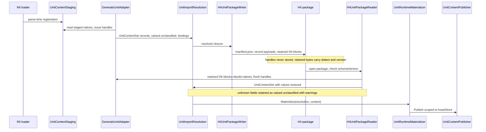

# H4: Unit-definition storage format

> Audience: human + agent.
> Design scaffold for the H4 unit-definition storage format: a package reader adapter and package
> writer over H2a's unit-content records, with explicit schema versioning, record-fidelity rules,
> and optional F4a-coordinated physics fields. Planning base `2e5d3770` (H2 group 4, PR #326).
> Phase definition and milestone: [phase H4, track-h-storage-formats.md](../track-h-storage-formats.md#phases).
> Tickets below are proposed; OpenProject is canonical for ticket status
> ([ticket workflow](../agent/README.md#ticket-workflow)). Ticket creation follows the workflow:
> `op_find_card_work_package` first, then `op_create_work_package`; this document records no ticket
> numbers and creates no tickets.

## Scope and ownership

H4 adds persistence over the H2a unit-content interchange. In scope:

- A package reader implementing `IUnitSourceAdapter`, so package content enters the same
  inheritance, dependency, validation, materialization, and publication path as INI- or DDF-authored
  content (`UnitInheritanceResolver`, `UnitDependencyResolver`, `UnitImportValidator`,
  `UnitRuntimeMaterializer`, `UnitContentPublisher`).
- A package writer that emits packages from resolved records.
- An explicit schema-versioning and forward-compatibility policy.
- Optional physics fields storing stable engine concepts (F4a coordination).

Out of scope, permanently:

- Serializing live runtime assets. `ObjectDefinition`, `WeaponTemplate`, `ArmorTemplate`,
  `LocomotorTemplate`, `UpgradeTemplate`, and other `AssetStore` assets are never written to or
  read from packages. Materialized templates stay a runtime-only product of `UnitRuntimeMaterializer`
  and `UnitContentPublisher`.
- Serializing `LegacyBinding` or `LegacyModuleBinding` handles. They are adapter-owned integer
  indexes into session tables and never appear in package bytes; see D-H4-3.
- Replacing INI. INI stays a permanent legacy read path; H4 content is additive.
- Inventing a unit schema. The record set and field semantics are H2a's (`h2a-unit-content-import.md`);
  H4 persists them and adds nothing else.

Milestone (track doc): a unit authored in the new format loads with full parity to an equivalent
INI-authored unit, including resolved physics metadata, and adding a new field does not break older
content. Schema coverage alone never claims parity; WI-H4-05's runtime proof does
([H5 deep dive](h5-legacy-migration.md) owns the conversion side).

## Current state on main

Verified at `2e5d3770`. Paths relative to `src/Panopticon.Simulation/Content/Importing/Units/`.

| Seam | Location | Behavior |
|---|---|---|
| Source adapter contract | `IUnitSourceAdapter.cs:11` | `Source` plus `Read(IReadOnlyCollection<string> rootNames)` returning a `UnitContentSet`; implementations keep source syntax internal. |
| Interchange set | `UnitContentSet.cs` | Records, requested roots, read-stage diagnostics; duplicates kept for the resolver. |
| Record base | `SourceRecord.cs:13` | `Id`, `Provenance`, `Parent`, `Legacy` (`LegacyBinding?`, line 28), `Unclassified` list (line 30), typed `GetReferences()`. |
| Record kinds | `UnitRecord.cs`, `WeaponRecord.cs`, `ArmorRecord.cs`, `LocomotorRecord.cs`, `UpgradeRecord.cs`, `AbilityRecord.cs`, `ProjectileRecord.cs`, `VisualStateRecord.cs` | Eight kinds (`Types/ContentKind.cs`). Values are `Authored<T>` and `ListOverride<T>`, quantities are `Quantity` (`Quantity.cs`, `Types/QuantityUnit.cs`). |
| Unclassified fields | `Types/UnclassifiedField.cs:10` | `Name`, `AffectsGameplay`, `Provenance`, `ExcludedByPolicy`. No field value is carried; the raw source value is lost after the adapter read. |
| Legacy handles | `LegacyBinding.cs:9`, `LegacyModuleBinding.cs:9` | `(ContentSource Owner, int Handle)` into adapter-owned tables; session-local, not serializable. |
| Resolution | `UnitInheritanceResolver.cs:17`, `UnitDependencyResolver.cs:28`, `UnitImportResolution.cs:24` | One validated closure carrying every diagnostic from read through validate. |
| Validation | `UnitImportValidator.cs:34`, `UnitCapabilityRegistry.cs:22` | Capability-gated; unsupported gameplay fields are `H2A-UNSUPPORTED-MECHANIC` errors (`Types/DiagnosticCodes.cs`). |
| Materialization, publication | `Materialization/UnitRuntimeMaterializer.cs:15`, `Materialization/UnitContentPublisher.cs:30` | Scoped `AssetStore` publication, atomic, `Unload` rollback at line 96. |
| INI path | `UnitContentStaging.cs:17`, `Generals/GeneralsUnitAdapter.cs:20` | Parse-time staging side channel; the adapter reads staged natives and issues handles. |
| Map retained-bytes precedent | `../Maps/RetainedSection.cs:5` | Retained-opaque bytes with section name, version, and SHA-256; the shape H4 retained payloads mirror. |
| H3 container choices | `../implementation/track-h-h1-h3-map-storage.md` | Directory package, `manifest.json` at root, raw little-endian chunk files, JSON metadata. |

Gaps H4 closes: no persistence for records, no valued unclassified fields, no retained source
payload for legacy-bound records, no schema-version policy for unit content, no physics fields.

## Design decisions

WI-H4-01 is the review gate that confirms or amends these decisions.

### D-H4-1. Container and manifest

- Container: directory package with `manifest.json` at the package root. H4 owns its own directory
  package layout and manifest schema for unit content, independent of the H3 map manifest,
  matching the settled H1 decision that map packages and object/unit-definition storage stay
  separate. A manifest `containerKind` value of `unit-package` self-describes the format. Shared
  code is limited to generic primitives (JSON writing, SHA-256, safe relative paths) with no
  format coupling: no shared H3 manifest reader/writer and no shared container implementation, so
  either format versions independently. H5 conversion and H6 pipeline tooling consume the H4
  package reader and writer.
- One payload file per record. The manifest record index lists each record's `ContentId` (name and
  kind), payload path, and payload hash. Manifest also carries: `schemaVersion`, the source
  `ContentSource` identity (id and name-case rule, `ContentSource.cs`), root record ids, retained
  payload entries (path, dialect, dialect version, SHA-256), and package-level provenance.
- Quantities serialize as `{value, unit}` pairs. `Authored<T>` presence, `ListOverride<T>` mode
  (`Inherit`, `Replace`, merge variants as implemented), module edits, and `Provenance` per record
  and per field origin serialize as structured JSON; arrays inside payloads use raw little-endian
  encoding where they are large (mirroring the H3 layer rule), JSON otherwise.

### D-H4-2. Record fidelity, preferred mechanism: valued unclassified fields

`UnclassifiedField` is extended into an engine-owned valued form. The record carries what the
adapter could not map, including its value:

- `RawValue`: the field's source text, verbatim, never normalized or re-parsed.
- `RawBlock`: for block-valued fields, the ordered key or value lines exactly as parsed.
- Presence of either is optional so existing constructors stay valid; a missing value on a field the
  source demonstrably had is a conversion-time diagnostic, never a silent drop.

Rationale for preferring this over a retained INI payload per record: records stay the single
interchange truth; packages stay diffable and merge-friendly because no source syntax is embedded
for typed records; and the existing inheritance merge (`SourceRecord.MergeUnclassified`) already
unions parent and child lists, so values ride the existing rules. One added rule: two unclassified
fields with the same name, parent and child, resolve child-wins with the parent entry retained in
the package as overridden provenance; today the merge concatenates and the writer must not lose the
parent entry.

Diagnostics are unchanged: `AffectsGameplay` fields remain `H2A-UNSUPPORTED-MECHANIC` errors that
block publication unless `ExcludedByPolicy` (which stays a named warning). The preserved value
means a future typed mapping can migrate the field without returning to the INI source.

### D-H4-3. Record fidelity, legacy-bound records: retained versioned INI source payload

`LegacyBinding` and `LegacyModuleBinding` handles cannot round-trip: they index tables only the
Generals adapter builds in-session. For every record carrying a binding (whole-record `Legacy`,
per-module `Legacy` on `UnitModule`), the package stores a retained source payload:

- Payload shape mirrors `RetainedSection`: bytes, dialect tag (`generals-ini`), dialect version,
  SHA-256, plus the `Provenance` of the originating block.
- Payload content is the exact INI block text the adapter parsed, so re-reading rebuilds the native
  template and the reader path re-issues fresh handles. Handles are never stored.
- A binding whose retained payload is missing, or whose dialect or version the reading adapter does
  not support, is a hard read error. No silent substitution, no typed-only degradation.

Preference statement: D-H4-2 is the primary fidelity mechanism for all records; D-H4-3 exists only
because handles are session-owned and native template fidelity lives in adapter tables. Complete
Generals parity is claimed only after the WI-H4-05 runtime parity proof, never from schema
coverage, retained-payload presence, or field counts.

### D-H4-4. Schema versioning and forward compatibility

- `manifest.json` carries an integer `schemaVersion`. The current version is 1.
- Adding an optional field is a compatible change: same major version. Changing or removing a
  field, changing a value's meaning or unit semantics, or changing a record kind's identity bumps
  the major version and requires a written migration note in this document.
- Readers reject an unknown major version with an explicit diagnostic. Readers retain unknown
  fields: an unknown record field becomes a valued unclassified entry (D-H4-2) with a warning
  diagnostic naming the field, so an older reader re-emits what it did not understand instead of
  dropping it.
- Readers reject an unknown retained dialect or dialect version (D-H4-3). There is no best-effort
  parse of retained bytes.

### D-H4-5. Physics fields (F4a coordination)

`UnitRecord` gains optional `Authored<T>` fields storing stable engine concepts, never
`BepuPhysics` types, handles, broadphase state, or package-version-specific data (track doc
cross-track note):

| Field | Type | Meaning |
|---|---|---|
| `PhysicsParticipation` | `Authored<PhysicsParticipationKind>` | Participation override: `Default`, `Dynamic`, `Kinematic`, `Static`, `Sensor`, `None`, matching the F4a category set (`../track-f-terrain-destruction.md#phases`, phase F4a). Absent means the engine's default classification. |
| `CollisionLayer` | `Authored<string>` | Stable engine-owned layer name. |
| `CollisionMask` | `ListOverride<string>` | Stable engine-owned layer names this record collides with. |
| `PhysicsMaterial` | `Authored<string>` | Stable engine-owned material id; the material table is engine data, not package data. |
| `CollisionShapeSource` | `Authored<CollisionShapeSourceKind>` | `Geometry` (resolved from the record's `GeometryMajorRadius` and `GeometryHeight`), `Model` (authored collision model reference), `None`. |

Fields are additive and optional; packages written before WI-H4-04 stay valid. If the F4a
participation vocabulary is not landed when WI-H4-04 starts, the fields ship as reserved optional
names gated on AQ-H4-1 rather than guessed enums.

### D-H4-6. Quantity and frame tags

The format stores every quantity's declared unit exactly as the adapter emitted it
(`Types/QuantityUnit.cs`). `GameUnit` means legacy engine game units and is never reinterpreted as
feet or meters; `Meters` is explicitly metric; per-frame and per-second rate variants stay
distinct tags. Conversion never happens in the format: normalization stays at the source boundary
and per-frame conversion stays in `UnitConversionPolicy` at materialization. After the H2b cutover
([h2b-metric-core.md](h2b-metric-core.md)), adapters emit metric tags; packages written before the
cutover keep their tags and readers never rescale on read.

### D-H4-7. Publication path unchanged

A package read produces a `UnitContentSet` indistinguishable in kind from an adapter read: the
existing resolvers, validator, materializer, and publisher run unchanged, including scoped
`AssetStore` publication, atomicity, and rollback. H4 adds no second materialization path.

## Architecture diagram

Both ends of the storage round trip, at `2e5d3770` types plus the H4 boundaries from this design.



Diagram notes: `GeneralsUnitAdapter`, `UnitContentStaging`, `UnitImportResolution`,
`UnitRuntimeMaterializer`, and `UnitContentPublisher` are verified in the current-state table.
`H4UnitPackageReader` and `H4UnitPackageWriter` are new boundaries from this design, proposed under
`Panopticon.Content.Importing.Units.Packages`. The `INI` participant is the existing INI parse
entry, not a new component.

## Proposed tickets

All cards below are proposed. Creation follows the ticket workflow: `op_find_card_work_package`
for each card ID, then `op_create_work_package` when none exists. No work package numbers are
invented here; this document records no ticket status.

Dependency order: 01 before 02; 02 before 03; 03 before 04; 03 and 04 before 05.

| Proposed card | Title | Prerequisites | Deliverable |
|---|---|---|---|
| `WI-H4-01` | H4 schema and record-fidelity design gate | H2a merged | This scaffold reviewed; D-H4-1 through D-H4-7 confirmed or amended |
| `WI-H4-02` | Package reader adapter implementing `IUnitSourceAdapter` | 01 | Valued `UnclassifiedField` extension, schema payload types, `H4UnitPackageReader` |
| `WI-H4-03` | Package writer from resolved records | 02 | `H4UnitPackageWriter` over `UnitImportResolution` closures |
| `WI-H4-04` | Physics fields and forward compatibility | 03 | Optional physics fields on `UnitRecord`, writer and reader support, unknown-field retention proof |
| `WI-H4-05` | Bounded INI parity proof | 03, 04 | INI-authored roster vs package-authored roster: materialized equality plus one bounded behavioral assertion |

H4 depends on H2a only (track doc). H2b ([metric core](h2b-metric-core.md)) is not a prerequisite:
the format stores declared tags and never rescales (D-H4-6), and the parity proof compares
materialization under one runtime, whatever units that runtime uses.

### Per-ticket scope and acceptance

`WI-H4-01` (design gate, docs only)

- Prerequisites: H2a merged.
- Files: this document; no `.cs` files.
- Acceptance: each decision above has a recorded verdict; open questions AQ-H4-1 and AQ-H4-2 have
  named owners or closed evidence; the ticket workflow has created WI-H4-02 through WI-H4-05.
- Validation: relative links resolve; Mermaid parses; no markdown emphasis or em dashes.

`WI-H4-02` (reader)

- Prerequisites: 01.
- Files: new `Content/Importing/Units/Packages/` (reader, schema payload types, manifest model);
  `Types/UnclassifiedField.cs` extension; `SourceRecord.cs` merge rule if child-wins needs code.
- Tests: new `test/Panopticon.Simulation.Tests/Content/Importing/Units/` package reader fixtures.
- Acceptance: a fixture package reads into a `UnitContentSet` whose records equal the source
  records field by field, including valued unclassified fields and re-issued legacy handles;
  unknown major version rejected with a diagnostic; unknown record fields retained with warnings;
  missing retained payload for a binding is a hard error.
- Validation: `dotnet build src`, then `dotnet test src --filter "Category!=Interactive"`, then
  `dotnet format src --verify-no-changes`, then `python3 scripts/check_brace_newline.py`.

`WI-H4-03` (writer)

- Prerequisites: 02.
- Files: `Content/Importing/Units/Packages/` writer; manifest emission.
- Tests: package writer fixtures alongside the reader fixtures.
- Acceptance: a resolved `UnitImportResolution` closure writes a package that the WI-H4-02 reader
  reads back to an equal closure; a resolution carrying error diagnostics refuses to write;
  provenance and field origins survive the round trip.
- Validation: same four commands as WI-H4-02.

`WI-H4-04` (physics and forward compatibility)

- Prerequisites: 03. Coordinates with F4a; gated on AQ-H4-1.
- Files: `UnitRecord.cs` (new optional fields), new kind enums under `Types/`, writer and reader
  field support in `Packages/`.
- Tests: physics-field fixtures; a forward-compatibility fixture package containing a field this
  build does not know.
- Acceptance: physics fields round-trip; the schema contains no `BepuPhysics` types or handles
  (grep gate over `Packages/` passes); the future-field package loads with a warning and re-emits
  the unknown field.
- Validation: same four commands as WI-H4-02.

`WI-H4-05` (parity proof)

- Prerequisites: 03, 04.
- Files: test-side harness fixture and a bounded roster definition; no production `.cs` changes
  expected.
- Tests: parity fixture in `test/Panopticon.Simulation.Tests/Content/Importing/Units/`; the
  bounded behavioral assertion runs through the P0-style headless harness.
- Acceptance: a bounded Generals roster (P6b archetype units, USA reference) loads both from INI
  and from an H4 package converted from that INI; materialized `ObjectDefinition`,
  `WeaponTemplate`, `ArmorTemplate`, `LocomotorTemplate`, and `UpgradeTemplate` values assert
  equal field by field; one bounded behavioral assertion (produce, move, attack) passes on both
  paths; the ticket records that parity is proven by this run only.
- Validation: `CNC_GENERALS_PATH="/home/rmessinger/dev/Command and Conquer Generals" dotnet test
  src --filter "Category!=Interactive"` plus the standard build, format, and brace checks.

## Risks and audit questions

| Risk | Mitigation |
|---|---|
| Handle re-issue diverges from the original read (table order, duplicate names) | Reader rebuilds natives through the same staging path; parity proof asserts template equality, not handle equality; handles are never stored |
| Valued unclassified fields leak parse noise into packages | Values are stored verbatim; normalization is forbidden; diagnostics classify; `ExcludedByPolicy` warnings stay named |
| Shared container code couples unit-package schema to map schema | `containerKind` and separate schema namespaces; no shared record schema |
| Physics fields invent F4a semantics before F4a lands | AQ-H4-1 gates the vocabulary; fields ship reserved, not guessed |
| Forward-compatibility policy erodes under pressure | Major-version bump is the only escape hatch; migration notes are mandatory in this document |

| ID | Question | Evidence required to close |
|---|---|---|
| AQ-H4-1 | F4a participation vocabulary availability at WI-H4-04 time | F4a category set merged, or a frozen provisional set agreed with Track F |
| AQ-H4-2 | Collision layer and material name tables exist as engine-owned stable ids | Name table landed in the engine, or a schema-level stable id registry |

## Validation contract

Source tickets run the standard gates from repo root:

```sh
dotnet build src
dotnet test src --filter "Category!=Interactive"
dotnet format src --verify-no-changes
python3 scripts/check_brace_newline.py
```

WI-H4-05 prefixes `CNC_GENERALS_PATH` on the test command as shown in its scope. Documentation
changes (WI-H4-01, this scaffold) require link resolution and Mermaid checks only.
