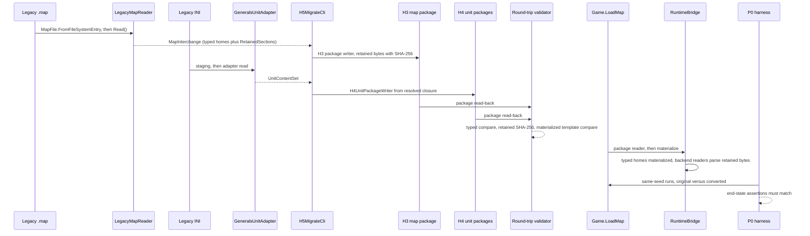

# H5: Legacy migration and compatibility tooling

> Audience: human + agent.
> Design scaffold for H5: conversion tooling from legacy `.map` and INI content to the H3 and H4
> formats, a round-trip validator, the retained-backend runtime integration that makes converted
> maps playable, and a behavioral equivalence harness. Planning base `2e5d3770` (H2 group 4,
> PR #326). Phase definition and milestone:
> [phase H5, track-h-storage-formats.md](../track-h-storage-formats.md#phases). Depends on H3
> ([implementation/track-h-h1-h3-map-storage.md](../implementation/track-h-h1-h3-map-storage.md))
> and H4 ([h4-unit-definition-storage.md](h4-unit-definition-storage.md)). Tickets below are
> proposed; OpenProject is canonical for ticket status
> ([ticket workflow](../agent/README.md#ticket-workflow)); creation follows
> `op_find_card_work_package` then `op_create_work_package`. This document invents no work package
> numbers and creates no tickets.

## Scope and ownership

H5 owns content migration, not format definition:

- A conversion CLI, following the `src/Panopticon.Tools.GeoImport` pattern, with subcommands for
  map conversion (legacy `.map` to H3 package), INI conversion (legacy INI to H4 unit packages),
  and round-trip validation.
- A round-trip validator comparing converted output against the original at three levels:
  interchange equality, retained-byte identity, and materialized template equality.
- The retained-backend runtime integration required before any playable claim for converted maps:
  typed interchange homes or backend readers for every section the runtime consumes from
  `MapFile` today.
- A behavioral equivalence harness on the P0 assertion layer: same-seed runs of original and
  converted content must end identically.

Out of scope: no authoring tools (H6), no standing regression suite (H7), no schema changes to H3
or H4 beyond the forward-compatible extensions this document names, no new game mechanics, and no
Buildability polarity inference (see the disposition rules).

Milestone (track doc): a converted legacy map and unit roster load through the new formats and play
identically, per the P0 assertion layer, to loading the original `.map`/INI content.

## Current state on main

Verified at `2e5d3770`.

| Seam | Location | Behavior |
|---|---|---|
| Legacy map read | `src/Panopticon.Simulation/Content/Importing/MapSources/LegacyMapReader.cs:41` | `IMapReader` over a parsed `MapFile`; heights, objects, and waypoints land in typed homes; every other present section is retained opaque (`BuildRetainedSections`, lines 259 to 394). |
| Retained bytes | `../Maps/RetainedSection.cs:5` | Section name, version, byte-exact payload, SHA-256; accepted only for known names and versions. |
| Interchange root | `../Maps/MapInterchange.cs:11` | `CurrentSchemaVersion = 1`; `RetainedSections` list beside typed `Layout`, `Blend`, `Objects`, `Waypoints`. |
| Runtime bridge | `MapSources/RuntimeBridge.cs:25,117,195` | Materializes `HeightMapData`, `MapObject[]`, and the navigation mask feed. The `Unbuildable` mask bit is carried but deliberately not applied (comment at line 192). |
| Map load path | `src/Panopticon.Simulation/Game.cs:793,796,804,805` | `MapReaderFactory` defaults to `LegacyMapReader`; `LoadMap` always builds `MapFile.FromFileSystemEntry` first, then reads the interchange and swaps in materialized heights (line 810). |
| Runtime consumers of retained sections | `src/Panopticon.Simulation/Scene3D.cs:148,156,321,324`; `Game.cs:812,821` | `GlobalLighting` and `NamedCameras` feed scene setup; `WaterAreaCollection` consumes `PolygonTriggers`, `StandingWaterAreas`, `StandingWaveAreas`; `Navigation` consumes `BlendTileData`; `SetupGameSides` consumes `SidesList`. |
| `MapFile` sections | `src/Panopticon.Simulation/Data/Map/MapFile.cs:29,35,78,87,95` | `BlendTileData`, `SidesList` (with `GetTeams`/`GetPlayerScriptsList`, lines 102 and 104), `GlobalLighting`, `NamedCameras`, `WaypointsList`. |
| Legacy INI unit path | `../Units/UnitContentStaging.cs:17`, `../Units/Generals/GeneralsUnitAdapter.cs:20`, `../Units/UnitImportResolution.cs:24` | Parse-time staging, adapter read to `UnitContentSet`, one validated resolution. |
| H4 writer | `h4-unit-definition-storage.md`, WI-H4-03 | `H4UnitPackageWriter` over resolved closures; retained versioned INI source payloads for legacy-bound records. |
| H3 package | `../implementation/track-h-h1-h3-map-storage.md` | Directory package, `manifest.json`, chunk layers; tickets `WI-H3-01..04` (Draft). Manifest currently names versions, chunk layout, layers, metadata, provenance, and hashes; no retained-section slot yet. |
| CLI pattern | `src/Panopticon.Tools.GeoImport/Program.cs:11`, `GeoImportCli.cs:27,40` | Console host subscribing Ctrl+C to one token; static `Run(args, out, err, token)` entry; options records; diagnostics writer. |
| Mask flags | `../Maps/Types/MapMaskFlags.cs` | `Impassable` and `Unbuildable` per-cell bits carried in `MaskLayer`. |

Two gaps H5 closes: no tooling converts legacy content to the new formats, and a converted map has
no runtime path, because `Game.LoadMap` requires a legacy `MapFile` parse before the seam runs and
`RuntimeBridge` materializes only heights, objects, and the mask feed.

## Conversion tool design

New tool project `src/Panopticon.Tools.H5Migrate` (proposed name), structured like GeoImport:
`Program.cs` console host, `H5MigrateCli.Run(args, standardOut, errorOut, token)`, options records,
diagnostics writer. Subcommands:

| Subcommand | Input | Output |
|---|---|---|
| `convert-map` | legacy `.map` entry | H3 map package |
| `convert-ini` | legacy INI roots, resolved through the game install (`CNC_GENERALS_PATH`) | H4 unit packages |
| `validate` | original content plus converted package(s) | round-trip report (JSON and text) |

Map conversion: `MapFile.FromFileSystemEntry` then `LegacyMapReader.Read()` produces the
`MapInterchange`; the H3 package writer (WI-H3-02/03) writes typed layers, placed objects,
waypoints, and every `RetainedSection` byte-exact. The H3 manifest records each retained section
with name, version, and SHA-256. Retained-section storage is a requirement H5 places on the H3
manifest schema; if `WI-H3-01`'s schema lacks the slot, WI-H5-01 adds it as a forward-compatible
manifest field, per the H3 versioning rules.

INI conversion: the existing import pipeline (`UnitContentStaging`, `GeneralsUnitAdapter`,
`UnitImportResolution.Resolve`) runs unchanged; WI-H4-03's writer emits packages from the resolved
closure. A resolution carrying error diagnostics refuses conversion, with a per-record report; the
tool never writes partial rosters.

## Retained-section disposition

Rule: every retained section in a converted package has exactly one disposition, and a section with
no disposition fails validation and load. Silent drops are forbidden at every layer: converter,
manifest, validator, and runtime.

### Typed interchange homes (materialized by the runtime bridge)

Sections the runtime consumes structurally, where the interchange gains engineering value (blend is
the future home of B4a-5 chunked terrain data; lighting and cameras feed scene tooling):

| Section | Runtime consumer today |
|---|---|
| `BlendTileData` | `Navigation` and terrain texture rendering (`Scene3D.cs:324`) |
| `GlobalLighting` | `Scene3D.cs:148` |
| `NamedCameras` | `Scene3D.cs:156` |
| `StandingWaterAreas`, `RiverAreas`, `StandingWaveAreas`, `GlobalWaterSettings` | `WaterAreaCollection` (`Scene3D.cs:321`) |
| `PolygonTriggers` | `WaterAreaCollection` (`Scene3D.cs:321`) |
| `WaypointsList` | waypoint path records (scripting paths; distinct from the starred waypoint objects already typed in `WaypointSet`) |

WI-H5-04 adds these as typed fields on `MapInterchange` with `RuntimeBridge` materializers. Legacy
`.map` reading keeps populating them as retained bytes too, until the bridge switches over; the
existing `RuntimeBridgeParityTests` guard legacy behavior throughout.

### Retained with a backend reader (bytes parsed at load)

Sections whose live types are deep native trees, mainly scripting and game-rules data. A backend
reader parses the retained bytes with the existing legacy section parsers and hands the runtime the
same live objects it consumes today; behavior carries without typing the interchange:

| Section | Runtime consumer today |
|---|---|
| `SidesList` (including `Teams` and `PlayerScriptsList` payloads) | `SetupGameSides` (`Game.cs:812`), `GetTeams`, `GetPlayerScriptsList` (`MapFile.cs:102,104`) |
| `TriggerAreas` | scripting areas |
| `BuildLists`, `LibraryMapLists` | AI build and library data |
| `WorldInfo`, `AssetList`, `MPPositionList` | map metadata, multiplayer start positions |
| `FogSettings`, `PostEffectsChunk`, `EnvironmentData`, `SkyboxSettings` | presentation state |
| `MissionHotSpots`, `MissionObjectives` | mission data |
| `CameraAnimationList`, `CastleTemplates` | camera and structure templates |

Promoting a retained section to a typed home later is deliberate design work in a phase that owns
it, never an ad hoc converter change.

### Disposition rules

- Converted values are copied verbatim. No Buildability polarity inference: blend buildability data,
  the `Unbuildable` mask bit, and passability bits are stored and materialized unchanged; neither
  the converter nor any H5 component flips, infers, or normalizes polarity. A suspected polarity
  mismatch is an audit question against the legacy reader, never a converter heuristic.
- An unknown retained section name, or a known name with an unsupported version, fails the
  package load (`RetainedSection` contract) and the validator.
- `MaskLayer` masks stay verbatim; `RuntimeBridge`'s decision to not apply the `Unbuildable` bit
  (line 192) is unchanged by H5.

## Runtime integration for converted maps

`Game.LoadMap` branches on source kind:

- Legacy `.map` entry: today's path, unchanged (`MapFile.FromFileSystemEntry`, then the seam).
- H3 package: the H3 package reader (WI-H3-02/03 scope; WI-H5-04 includes the
  package-to-`MapInterchange` assembly if H3 does not deliver it) produces the interchange;
  `RuntimeBridge` materializes heights, objects, the mask feed, and the typed homes from the
  disposition table, and the backend readers parse retained bytes into live sections.

`MapFile` gains an interchange-backed construction path internal to `Panopticon.Simulation`
(construction method or widened internal setters; exact accessor mechanics are WI-H5-04's choice).
Downstream consumers stay untouched: `SetupGameSides`, `Scene3D`, `TerrainLogic` receive the same
live types they consume today.

Playable claim rule: a converted map is not playable until WI-H5-04 lands. Conversion output alone
(WI-H5-01) proves storage fidelity, not playability.

## Round-trip validation

One validator implementation, used by both the CLI and tests:

- Map: fresh `LegacyMapReader` read of the original versus the package read-back. Typed sections
  compare semantically (heights and spacing, objects, waypoints, provenance); retained bytes
  compare by SHA-256; the manifest record index must account for every source section.
- Units: materialize both paths, original INI and converted package, through
  `UnitRuntimeMaterializer` and `UnitContentPublisher` into scoped publication, and compare typed
  template fields, valued unclassified fields (H4 D-H4-2), and diagnostic sets. Provenance-only
  differences are allowed through an explicit allowlist; anything else fails.
- Any missing section, missing record, or unexpected extra record fails. The report is JSON plus a
  text summary, with a per-section and per-record verdict; the process exit code is non-zero on any
  mismatch.

## Behavioral equivalence

The P0 assertion layer (TestHarness headless run-and-assert pattern) runs the same scenario twice,
once with original content and once with converted content, same seed, and asserts equal end state:
outcomes, survivors, and the engagement assertions the existing harness already reports. The
equivalence claim is same-runtime only: both sides run under the runtime of the day. It is never a
cross-runtime or cross-unit claim; the H2b metric cutover
([h2b-metric-core.md](h2b-metric-core.md)) does not affect it because both sides convert at the
same boundary.

## Architecture diagram



Diagram notes: `LegacyMapReader`, `RuntimeBridge`, `GeneralsUnitAdapter`, `Game.LoadMap`, and the
`P0 harness` (TestHarness) are verified in the current-state table. `H5MigrateCli`, the packages,
the validator, and the bridge's typed-home materializers are new boundaries from this design.

## Proposed tickets

All cards below are proposed; creation follows the ticket workflow
(`op_find_card_work_package`, then `op_create_work_package`). No work package numbers are invented
here and this document records no ticket status.

Dependency order: H3 (`WI-H3-01..04`) and H4 (`WI-H4-01..05`) land first; then 01 and 02 are
parallel; 03 needs both; 04 needs 01 and the H3 package reader; 05 needs 03 and 04.

| Proposed card | Title | Prerequisites | Deliverable |
|---|---|---|---|
| `WI-H5-01` | Legacy map conversion tool | H3 merged; retained-section manifest slot decided | `convert-map` emitting H3 packages, retained sections byte-exact |
| `WI-H5-02` | Legacy INI conversion tool | WI-H4-02, WI-H4-03, WI-H4-04 | `convert-ini` emitting H4 unit packages from resolved closures |
| `WI-H5-03` | Round-trip validator and report | 01, 02 | One validator implementation, JSON and text reports, non-zero exit on mismatch |
| `WI-H5-04` | Retained-backend integration for converted maps | 01; H3 package reader | Typed homes, backend readers, interchange-backed `MapFile`, `Game.LoadMap` source branch |
| `WI-H5-05` | Behavioral equivalence harness | 03, 04 | Same-seed original-versus-converted runs asserted on the P0 layer |

### Per-ticket scope and acceptance

`WI-H5-01` (map conversion tool)

- Prerequisites: H3 merged; retained-section manifest slot decided with `WI-H3-01` coordination.
- Files: new `src/Panopticon.Tools.H5Migrate/` (host, CLI, options, map conversion); H3 manifest
  extension only if the retained-section slot is missing.
- Tests: tool tests plus conversion fixtures against synthetic maps under
  `test/Panopticon.Simulation.Tests/Content/Importing/MapSources/`.
- Acceptance: a legacy `.map` converts to an H3 package; typed sections re-read semantically equal;
  every retained section matches by SHA-256; the manifest accounts for every source section, and a
  missing section fails conversion; mask and blend bits are byte-identical with no polarity change.
- Validation: `dotnet build src`, then `dotnet test src --filter "Category!=Interactive"`, then
  `dotnet format src --verify-no-changes`, then `python3 scripts/check_brace_newline.py`.

`WI-H5-02` (INI conversion tool)

- Prerequisites: WI-H4-02, WI-H4-03, WI-H4-04.
- Files: `src/Panopticon.Tools.H5Migrate/` INI subcommand; no engine `.cs` changes expected.
- Tests: conversion fixtures over a bounded roster, with `CNC_GENERALS_PATH` set.
- Acceptance: a bounded Generals roster converts; converted packages re-read to the same closure;
  resolutions carrying error diagnostics refuse conversion with a per-record report; no partial
  rosters are written.
- Validation: the four standard commands, with the test command prefixed
  `CNC_GENERALS_PATH="/home/rmessinger/dev/Command and Conquer Generals"`.

`WI-H5-03` (round-trip validator and report)

- Prerequisites: 01, 02.
- Files: validator and report writers in `src/Panopticon.Tools.H5Migrate/`; comparer types shared
  with tests (home: tool project or `Panopticon.Simulation` importing side; one implementation
  either way).
- Tests: validator fixtures covering each failure class: typed mismatch, retained hash mismatch,
  missing section, missing record, extra record, materialized template inequality.
- Acceptance: each failure class produces a named diagnostic and a report entry; identical content
  passes; provenance-only unit differences pass only through the explicit allowlist; exit code and
  JSON report are machine-checkable.
- Validation: the four standard commands.

`WI-H5-04` (retained-backend integration)

- Prerequisites: 01; H3 package reader (coordinate with `WI-H3-02`/`WI-H3-03`; include the
  package-to-interchange assembly here if H3 does not deliver it).
- Files: `Content/Importing/Maps/MapInterchange.cs` and new typed-home types;
  `Content/Importing/MapSources/RuntimeBridge.cs` (typed-home materializers, backend readers);
  `src/Panopticon.Simulation/Data/Map/MapFile.cs` (interchange-backed construction path);
  `src/Panopticon.Simulation/Game.cs` (source-kind branch in `LoadMap`).
- Tests: `RuntimeBridgeParityTests` stay green for legacy loading; new converted-map load tests
  covering every disposition row; negative test loading a package with an unknown retained section.
- Acceptance: a converted map loads and plays with lighting, cameras, water, blend navigation,
  waypoint paths, sides, teams, scripts, and trigger areas equivalent to the original; every
  retained section has a disposition; silent drops fail validation and load; the legacy `.map`
  path is unchanged.
- Validation: the four standard commands plus a focused
  `dotnet test src --filter "FullyQualifiedName~RuntimeBridgeParity"`; PR carries before/after
  screenshot evidence per `docs/screenshots.md`.

`WI-H5-05` (behavioral equivalence harness)

- Prerequisites: 03, 04.
- Files: `src/Panopticon.Tools.TestHarness/` comparison runner and scenario definitions; test-side
  fixtures.
- Tests: harness runs on a representative legacy map plus roster from the real install, original
  versus converted, same seed, repeated runs for stability.
- Acceptance: end-state assertions (outcomes, survivors, engagement assertions per the existing
  run-and-assert pattern) match across both runs; any divergence fails with a named diff report;
  the milestone's play-identically claim is recorded as proven by this ticket only.
- Validation: `CNC_GENERALS_PATH="/home/rmessinger/dev/Command and Conquer Generals" dotnet test
  src --filter "Category!=Interactive"` plus headless harness batch runs; build, format, and brace
  checks.

## Risks

| Risk | Mitigation |
|---|---|
| H3 has no explicit package-to-interchange reader card | Coordination note above; WI-H5-04 owns the assembly if H3 does not |
| H3 manifest lacks a retained-section slot | Forward-compatible manifest field added by WI-H5-01, agreed with `WI-H3-01` before implementation |
| Script and team fidelity rides retained bytes | Byte-exact retention with version gates already enforced at read (`SidesList` below version 2 fails import); backend readers parse with the existing parsers, so parser drift is caught by parity tests |
| Structural equality while visuals differ (lighting, water, blend) | WI-H5-04's PR carries before/after screenshot evidence per `docs/screenshots.md`; behavioral harness covers simulation, not presentation |
| H2b metric cutover lands between H4 and H5 execution | Equivalence is same-runtime original-versus-converted; declared tags make packages cutover-neutral (H4 D-H4-6) |
| Polarity or normalization "fixes" creeping into conversion | Disposition rule above; converter copies verbatim; suspected mismatches become audit questions |
| Validator and test comparisons drift apart | One validator implementation shared by CLI and tests, enforced by WI-H5-03 acceptance |

## Validation contract

Source tickets run the standard gates from repo root; conversion tickets that read real content
prefix `CNC_GENERALS_PATH` on the test command as shown in their scopes:

```sh
dotnet build src
dotnet test src --filter "Category!=Interactive"
dotnet format src --verify-no-changes
python3 scripts/check_brace_newline.py
```

Documentation changes (this scaffold) require link resolution and Mermaid checks only.
