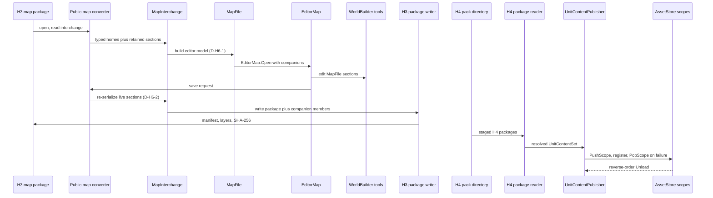

# H6: Authoring and pipeline integration

> Audience: human + agent.
> Design scaffold for H6: WorldBuilder reads and writes H3 map packages, staged content packs load
> through the H4 package adapter and `AssetStore` scope layering, and the INI edit loop stays as it
> is. Planning base `2e5d3770` (H2 group 4, PR #326). Phase definition and milestone:
> [phase H6, track-h-storage-formats.md](../track-h-storage-formats.md#phases). Depends on H5
> ([h5-legacy-migration.md](h5-legacy-migration.md)), which depends on H3
> ([implementation/track-h-h1-h3-map-storage.md](../implementation/track-h-h1-h3-map-storage.md)) and
> H4 ([h4-unit-definition-storage.md](h4-unit-definition-storage.md)). Tickets below are proposed;
> OpenProject is canonical for ticket status ([ticket workflow](../agent/README.md#ticket-workflow)).
> Creation follows `op_find_card_work_package` then `op_create_work_package`. This document invents
> no work package numbers and creates no tickets.

## Scope and ownership

H6 owns the consumers of the H3 and H4 formats: the WorldBuilder boundary, the staged pack load
path, and the preserved INI iteration loop. It does not define either format.

In scope:

- `EditorMap` boundary conversion: open an H3 package into the editor model, save the editor model
  out to an H3 package.
- A staged content-pack load path that reads H4 package directories through the H4 package adapter
  and publishes them with `UnitContentPublisher` under scoped `AssetStore` layers.
- A check that the legacy INI edit and reload path is unchanged by the new formats.

Out of scope:

- The standalone ModCollector downloader and extractor. It is external Track D scope
  ([mod-collector.md](../plans/mod-collector.md)). H6 consumes its output directory; H6 does not
  build, extend, or call it.
- Re-platforming WorldBuilder tools onto `MapInterchange`. The editor model stays `MapFile`.
- Map validation and regression suites. Those are [H7](h7-validation-roundtrip-regression.md).
- Runtime residency and chunked terrain paging. Those stay with B4a-5.

Track milestone wording, reconciled against this scope: the track doc says ModCollector staging is
part of H6. Under this document, H6 covers only the pack load side of that staging. The downloader
is Track D. The shared track doc (`track-h-storage-formats.md`), the implementation checklist, and
the roadmap tree need the same wording change. That reconciliation happens outside this change set.

Milestone (track doc): WorldBuilder authors, saves, and reloads a map in the new format, and a
ModCollector-staged content pack's object definitions load through the new format alongside built-in
content.

## Current state on main

Verified at `2e5d3770`.

| Seam | Location | Behavior |
|---|---|---|
| Editor model | `src/Panopticon.Tools.WorldBuilder.Core/EditorMap.cs:11` | `public MapFile MapFile { get; private set; }`. The editor edits `MapFile` sections directly. |
| Editor save | `EditorMap.cs:54-72` | `Save()` writes through `MapFile.WriteTo(stream)` at line 63, then the companions, then clears `IsDirty`. |
| Editor open | `EditorMap.cs:43-51` | `EditorMap.Open(MapFile, filePath)` takes an already-parsed `MapFile`. Companions are read from `filePath + ".ini"` and `filePath + ".str"`. |
| Companion state | `EditorMap.cs:17-21`, `69-70` | `MapIniContent` and `MapStrContent` are strings. Companions are written only when non-empty (`WriteCompanion`, line 79). |
| Open UI | `src/Panopticon.Tools.WorldBuilder.Avalonia/MainWindow.cs:582-617` | Picker filter `*.map`; `File.OpenRead`, then `MapFile.FromStream`, then `EditorMap.Open`. Loose files only. |
| Save UI | `MainWindow.cs:619-680` | Calls `CurrentMap.Save()` or `SaveAs(path)`. |
| Headless capture | `src/Panopticon.Tools.WorldBuilder.Avalonia/Program.cs:18-27`, `35-77` | `--screenshot <path> [mapPath]`. Requires `CNC_GENERALS_PATH`. Loads `mapPath` through `installation.CreateFileSystem().GetFile(mapPath)` (line 60), which is the composite disk and `.big` filesystem. Renders 3 warm-up frames, then one PNG. |
| `MapFile` serialization | `src/Panopticon.Simulation/Data/Map/MapFile.cs:172` (`FromFileSystemEntry`), `413` (`WriteTo`), `432-563` | `WriteTo` builds an asset-name table, then writes each chunk through its own `WriteTo`. Sections are written conditionally on presence. |
| Legacy object reference | `src/Panopticon.Simulation/Content/Importing/MapSources/LegacyMapReader.cs:43`, `191` | Default scope label `"legacy"`. Each placed object becomes `AssetReference("legacy", TypeName)`. |
| Bridge drops scope | `src/Panopticon.Simulation/Content/Importing/MapSources/RuntimeBridge.cs:136-137`, `145` | Comment: scope resolution happens downstream. Code passes `source.Type.Name` only, so the scope is discarded at the bridge. |
| Palette references | `src/Panopticon.Simulation/Content/Importing/Maps/BlendModel.cs:12-18`; `Types/MaterialPaletteEntry.cs:6` | `MaterialPaletteEntry.Texture` is an `AssetReference`. The palette is held by `BlendModel`. No runtime consumer that resolves the texture name was found in `src`. |
| Scoped asset types | `src/Panopticon.Simulation/Content/AssetStore.cs:148` | `ObjectDefinitions` is a `ScopedAssetCollection<ObjectDefinition>`. `ScopedAssetCollection.GetByName` at `ScopedAssetCollection.cs:62`. |
| Scope push and pop | `AssetStore.cs:377`, `392` | `PushScope` and `PopScope` fan out to every scoped collection and singleton. |
| Publish and unload | `src/Panopticon.Simulation/Content/Importing/Units/Materialization/UnitContentPublisher.cs:30`, `64`, `82`, `121` | `Publish` pushes a scope, registers assets, and pops on failure, returning diagnostics only. `Unload` requires the publication to be the most recent scope. |
| INI load | `src/Panopticon.Simulation/Content/SubsystemLoader.cs:153-177` | INI is loaded through `ContentManager.LoadIniFile` at content load. No file watcher or reload entry point was found in `src` (search for `FileSystemWatcher` and reload calls returned none). |
| Legacy map read | `src/Panopticon.Simulation/Content/Importing/MapSources/LegacyMapReader.cs:41` | `IMapReader` over `MapFile`; typed homes plus retained sections (see [H5](h5-legacy-migration.md#current-state-on-main)). |
| Mod layout | [mod-collector.md](../plans/mod-collector.md#engine-integration) | ModCollector extracts `.big` files under `<output>/<game>/<category>/`. Panopticon reads them through `SkudefReader`. No engine changes. |

Gaps H6 closes:

- `EditorMap` cannot open or save anything except a legacy `.map`.
- `MapFile` has no construction path from `MapInterchange`, and no reverse conversion to it.
- Staged packs have no load path that uses the H4 adapter.
- The `.map` save path writes companions as sibling files, and packages need a defined companion
  home.

## Design decisions

WI-H6-01 is the review gate that confirms or amends these decisions.

### D-H6-1. The editor model stays `MapFile`

`EditorMap` keeps `MapFile` as its model. H6 adds conversion at the boundary:

- Open: H3 package reader (H5-04 assembly) produces a `MapInterchange`; a converter builds a
  `MapFile` from it.
- Save: a converter builds a `MapInterchange` from the live `MapFile`; the H3 package writer
  (WI-H3-02/03) writes it.

Rationale: the tools mutate `MapFile` sections directly (height, blend, objects, sides). Moving them
onto `MapInterchange` is a re-platform with no payoff for v1.

Visibility: H5-04 specifies the interchange-backed `MapFile` construction path as `internal` to
`Panopticon.Simulation`. WorldBuilder is a separate assembly, so the converter must be public.
D-H6-1 requires that visibility to be widened on a public conversion type, not on `MapFile`
internals. Exact shape is WI-H6-01's choice.

### D-H6-2. Reverse conversion re-serializes live sections

`LegacyMapReader` reads `MapFile` into `MapInterchange`. No reverse path exists. For save, the
converter must produce each retained section's bytes. Two options:

| Option | Behavior | Verdict |
|---|---|---|
| A. Carry original bytes | Retained bytes from the open package are written back unchanged. Editor changes to a retained section are lost or rejected. | Rejected. Sides, objects, and triggers are edited, so this is unsafe for them. |
| B. Re-serialize from live objects | Each retained section is re-serialized with the same chunk `WriteTo` that `MapFile.WriteTo` uses (`MapFile.cs:432-563`). SHA-256 is recomputed. | Recommended. H7-01 proves the read, write, read cycle. |

Open question AQ-H6-1 asks for review of option B. The asset-name table that `WriteTo` builds
(`MapFile.cs:432`) must be reproduced by the converter, not carried from the source package.

### D-H6-3. Package addressing: loose directories only in v1

A package is a loose directory with `manifest.json` at its root (H3 D-container). WorldBuilder and the
converter accept only a loose directory path. A path that resolves inside a `.big` archive, including
through `CreateFileSystem().GetFile` as the headless capture does today, produces a named diagnostic
and no partial open. The diagnostic code is WI-H6-01's choice and is recorded in
`Types/DiagnosticCodes.cs`-style form under the H5 conventions.

The existing `.map` path keeps its current behavior, including the headless capture path that reads
legacy maps from archives. Only package addressing is restricted.

### D-H6-4. Companions are package members

The `.map` save writes `<path>.ini` and `<path>.str` as siblings (`EditorMap.cs:69-70`). A package
is self-contained, so companions are members of the package directory:

- `companions/map.ini` and `companions/map.str`, stored as verbatim UTF-8 text.
- The manifest records each member's name and SHA-256. This needs a manifest slot. Coordinate with
  `WI-H3-01`, the same way H5 coordinates the retained-section slot.
- Absent member and empty string are equivalent, matching the existing `WriteCompanion` rule.
- `EditorMap.MapIniContent` and `MapStrContent` are populated from members on open and written back
  on save. Their editing UI (`MapStrEditorWindow`) is unchanged.

The legacy `.map` save path is unchanged.

### D-H6-5. Staged pack contract

ModCollector output is `.big` archives of legacy INI (`mod-collector.md`). The milestone wants
object definitions from a staged pack to load through the new format. Those two facts need a
contract, and the contract is one of the open questions:

- Pack input for H6-03 is a loose directory of H4 packages.
- Those packages are produced from staged INI by the H5 `convert-ini` subcommand (WI-H5-02) over an
  extracted tree.
- ModCollector is unchanged. It does not emit H4 packages.

Open question AQ-H6-2 asks whether Track D accepts this contract or needs ModCollector to emit
packages. Emitting packages would be Track D scope, not H6.

### D-H6-6. Scope layering for staged packs

Pack load uses the existing publication contract, not a new one:

- Each pack publishes through `UnitContentPublisher.Publish` (`UnitContentPublisher.cs:30`), which
  pushes a scope and registers assets under `Content/Importing/Units/Materialization`.
- Packs unload in reverse publication order through `Unload`. The most recent scope must be the one
  unloaded.
- `overrides` lists ids allowed to shadow a same-source asset in a lower scope. A pack that shadows a
  built-in id without listing it fails publication.
- Any error diagnostic means no scope is left behind. The `Publish` catch path pops the scope.

### D-H6-7. INI iteration loop is preserved by construction

The legacy INI path is a separate load path (`SubsystemLoader.cs:153-177`,
`ContentManager.LoadIniFile`). H6 adds no step to it:

- Editing an object definition in INI, then reloading the session, does not convert, read, or write
  any package. Packages are an export and load format only.
- Conversion is explicit: `convert-ini` (H5) is run on demand. The INI loop never runs it
  automatically.
- No watcher is added. The repo has no file watcher today, so the "hot reload" in the track doc means
  a session reload. WI-H6-04 records that meaning explicitly and tests against it.

## Architecture diagram



Diagram notes: `MapFile`, `EditorMap`, `UnitContentPublisher`, and `AssetStore` are verified in the
current-state table. The public map converter, the package writer and reader, and the pack reader
are new boundaries from this design. The H3 package and H4 pack are formats defined by their own
scaffolds.

## Proposed tickets

All cards below are proposed. Creation follows `op_find_card_work_package` for each card ID, then
`op_create_work_package` when none exists. No work package numbers are invented here and this
document records no ticket status.

Dependency order: 01 before 02. 03 needs H4-02 and H4-03 and the H5 gate. 04 needs H4-02 and the
H5 gate, and has no code dependency on 01 to 03. Track H phase gates are listed in
[track-h-h4-h7-storage.md](../implementation/track-h-h4-h7-storage.md#phase-gates).

| Proposed card | Title | Prerequisites | Deliverable |
|---|---|---|---|
| `WI-H6-01` | WorldBuilder package open and save boundary conversion | H5-01, H5-04 | Public map converter both directions, `EditorMap` package open and save, companion members, loose-directory diagnostic |
| `WI-H6-02` | WorldBuilder package edit round trip with capture evidence | 01 | Edit, save, reopen equality test; headless `--screenshot` extended to accept a package directory; stills and save-reload GIF |
| `WI-H6-03` | Staged pack loading through H4 adapter and AssetStore scopes | H4-02, H4-03, H5-02 | Pack reader over a loose directory, publish and reverse-order unload, shadow and failure proofs |
| `WI-H6-04` | INI edit and reload preservation check | H4-02, H5 gate | Test that the INI path creates and reads no package, and that a session reload picks up an INI edit |

### Per-ticket scope and acceptance

`WI-H6-01` (boundary conversion)

- Prerequisites: H5-01 (map package writer), H5-04 (package reader to interchange and interchange
  backed `MapFile`). Retained-section and companion slots agreed with `WI-H3-01`.
- Files: `src/Panopticon.Tools.WorldBuilder.Core/EditorMap.cs`; a public converter in
  `Panopticon.Simulation` or the WorldBuilder core (WI-H6-01 decides; see D-H6-1); H3 manifest
  companion slot only if missing.
- Tests: `test/Panopticon.Tools.WorldBuilder.Core.Tests/` (extend `MapCompanionTests.cs` pattern) with
  a synthetic package fixture.
- Acceptance: `EditorMap.Open` on a package yields a `MapFile` whose heights, blend, objects, and
  waypoints equal the package's typed sections. Companion members round-trip byte for byte. Opening
  a path inside a `.big` archive fails with the named diagnostic and no partial state. The legacy
  `.map` open and save tests pass unchanged.
- Validation: `dotnet build src`, then `dotnet test src --filter "Category!=Interactive"`, then
  `dotnet format src --verify-no-changes`, then `python3 scripts/check_brace_newline.py`.

`WI-H6-02` (edit round trip, capture)

- Prerequisites: 01.
- Files: `EditorMap` save path tests; `src/Panopticon.Tools.WorldBuilder.Avalonia/Program.cs`
  (accept a package directory in `--screenshot`); no UI control changes.
- Tests: a scripted edit (one height brush stroke, one placed object) through `EditorMap`, save,
  reopen, and compare against the edited in-memory state.
- Acceptance: save-reopen state equals edited state for heights, objects, and companions. The
  headless capture renders the package before and after the edit and after reload. Evidence below.
- Validation: standard four commands, plus the headless capture run with `CNC_GENERALS_PATH` set.
- Evidence: this ticket touches WorldBuilder Avalonia behavior, so the PR needs screenshot evidence
  per [docs/screenshots.md](../../screenshots.md). Stills: before-edit, after-edit, after-reload,
  each a unique versioned file under `/mnt/pit2/Network Storage/temp/`. GIF: the save and reload
  sequence, assembled from ordered frames in `frames/<topic-version>/`. Windowed GUI capture is not
  available on this host (see screenshots.md environment facts), so headless capture is the only
  evidence path. If it cannot show the edit, the PR states the blocker.

`WI-H6-03` (staged pack loading)

- Prerequisites: H4-02 (reader), H4-03 (writer, used to build fixtures), H5-02 (INI conversion, which
  produces real staged packs). Track H gate: H5 merged.
- Files: new pack reader under `src/Panopticon.Simulation/Content/Importing/Units/Packages/`
  (H4 package adapter, no second path); a pack loader in the content load path; fixtures under
  `test/Panopticon.Simulation.Tests/Content/Importing/Units/`.
- Tests: a two-pack load (built-in plus one pack); a shadow case with and without `overrides`; a
  failing pack that must leave no scope behind; reverse-order unload.
- Acceptance: a pack's object definitions resolve by name alongside built-in content. Unloading the
  pack restores the prior set exactly. A failed pack publishes nothing and leaves `ScopeDepth`
  unchanged. A pack that ships no matching ModCollector output is out of scope for this ticket.
- Validation: standard four commands. Real-install proof, when run, uses
  `CNC_GENERALS_PATH="/home/rmessinger/dev/Command and Conquer Generals"`.

`WI-H6-04` (INI preservation check)

- Prerequisites: H4-02; H5 gate.
- Files: test-side only, under `test/Panopticon.Simulation.Tests/Content/`.
- Tests: an INI object-definition edit followed by a session reload changes the loaded definition.
  The same run asserts that no `manifest.json` is created or read under the content root.
- Acceptance: the INI edit reload produces the edited value. Zero package files are touched. The test
  records that "hot reload" means session reload, because no watcher exists.
- Validation: standard four commands.

## Open questions

| ID | Question | Evidence required to close |
|---|---|---|
| AQ-H6-1 | Is re-serialization from live sections (D-H6-2, option B) acceptable for sections that have no typed home | WI-H6-01 spike: a read, write, read cycle over one retained section produces equal SHA-256 with no edits |
| AQ-H6-2 | Does Track D accept the staged pack contract in D-H6-5 (ModCollector output converted by H5, not emitted as packages) | Track D decision recorded in `open-questions.md` |

## Risks

| Risk | Mitigation |
|---|---|
| Editing a section the converter re-serializes loses data | H7-01 round-trip suite compares every section per save; option A is rejected for edited sections |
| Companion slot missing from H3 manifest | Coordinate with `WI-H3-01` before WI-H6-01 starts; slot added as forward-compatible field |
| Headless capture cannot show an edit | Stated blocker in the PR; no silent omission of evidence |
| Package addressing silently accepts an archive path | D-H6-3 diagnostic is tested in WI-H6-01 acceptance |
| Track wording says ModCollector staging is H6 scope | Scope section above; reconciliation outside this change set |

## Validation contract

Source tickets run the standard gates from repo root:

```sh
dotnet build src
dotnet test src --filter "Category!=Interactive"
dotnet format src --verify-no-changes
python3 scripts/check_brace_newline.py
```

Documentation changes (this scaffold) require link resolution and style checks only.
