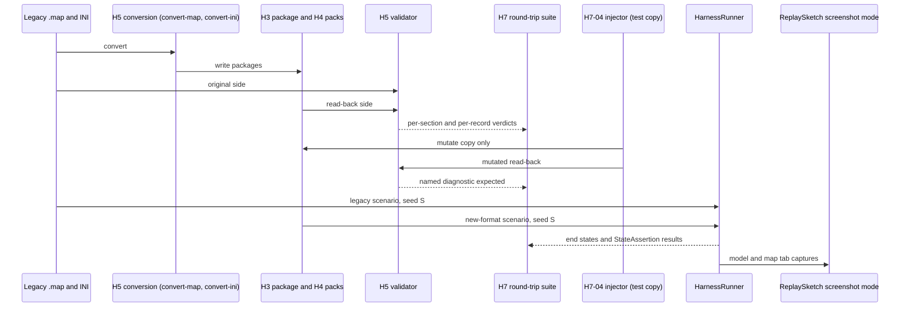

# H7: Validation and round-trip regression

> Audience: human + agent.
> Design scaffold for H7: a standing regression suite that loads legacy content, converts it,
> reloads it, and compares the result for a representative map and unit roster; a fault-injection
> proof that the suite catches a mismatch; and a ReplaySketch scenario built and fought on new-format
> content, asserted headlessly against its legacy equivalent. Planning base `2e5d3770` (H2 group 4,
> PR #326). Phase definition and milestone:
> [phase H7, track-h-storage-formats.md](../track-h-storage-formats.md#phases). Depends on H5
> ([h5-legacy-migration.md](h5-legacy-migration.md)) and H6
> ([h6-authoring-pipeline-integration.md](h6-authoring-pipeline-integration.md)). Tickets below are
> proposed; OpenProject is canonical for ticket status
> ([ticket workflow](../agent/README.md#ticket-workflow)). Creation follows
> `op_find_card_work_package` then `op_create_work_package`. This document invents no work package
> numbers and creates no tickets.

## Scope and ownership

H7 owns the standing regression coverage for the storage track. It consumes the validator and
conversion tooling from H5 and the editor and pack paths from H6. It defines no new format and no
new conversion.

In scope:

- Map round-trip suite: legacy `.map`, convert to H3 package, reload, compare.
- Unit round-trip suite: legacy INI, convert to H4 packages, materialize both paths, compare.
- ReplaySketch new-format scenario proof, headless, against the legacy-format equivalent.
- Fault-injection proof that the two round-trip suites fail on an injected mismatch.

Out of scope:

- The validator implementation itself. H5-03 owns it. H7 calls it from tests so the CLI and tests
  share one implementation.
- Behavioral equivalence harness. H5-05 owns it. H7-03 reuses its assertion layer for ReplaySketch.
- Baseline or golden regeneration. H7 never updates a baseline (see the stop rule below).

Milestone (track doc): a regression suite catches a round-trip mismatch for maps or object
definitions, and a ReplaySketch scenario using new-format content passes the same headless assertions
as its legacy-format equivalent.

## Current state on main

Verified at `2e5d3770`.

| Seam | Location | Behavior |
|---|---|---|
| Existing map fixtures | `test/Panopticon.Simulation.Tests/Content/Importing/Maps/` | `MapInterchangeValidationTests.cs` exercises `MapInterchangeValidator` with synthetic palette and reference data. |
| Existing map reader parity | `RuntimeBridgeParityTests` (named in H5) | Guards legacy loading through the H2 seam. Must stay green. |
| P0 harness pattern | `test/Panopticon.Simulation.Tests/Tools/ReplaySketch/P0HarnessAcceptanceTests.cs` | Builds scenarios with `P0HarnessTestHelpers.BuildSinglePlayerScenario` (line 496), asserts with `StateAssertion` (`src/Panopticon.Tools.ReplaySketch.Core/Assertions/ScenarioAssertion.cs:123`), runs through `HarnessRunner` (`src/Panopticon.Tools.ReplaySketch.Core/HarnessRunner.cs:19`). Several cases are `Category=Interactive` and need `CNC_GENERALS_PATH`. |
| WorldBuilder tests | `test/Panopticon.Tools.WorldBuilder.Core.Tests/` | `MapCompanionTests`, `NewMapFactoryTests`, `ScenarioPopulationTests`, `UndoRedoEditApplicationTests`. |
| ReplaySketch screenshot mode | `src/Panopticon.Tools.ReplaySketch.Avalonia/MainWindow.cs:19-20`, `54`, `175` | `REPLAYSKETCH_SCREENSHOT_PATH`, `REPLAYSKETCH_SCREENSHOT_TAB` (`tree`, `map`, `validationground`, `model`, `harness`, `results`), `REPLAYSKETCH_SCREENSHOT_DELAY`. |
| Model tab | [screenshots.md](../../screenshots.md#recipe-replaysketch-validation-ground-editor-2d-no-display) | Uses a deterministic fake session (`ExternalModelScreenshotFixture`); reproducible. Map tab needs `CNC_GENERALS_PATH` and an 8 s delay. |
| Scenario capture | [screenshots.md](../../screenshots.md#recipe-generic-scenario-capture-headless) | `ScenarioCapture` writes PNG sequences and a manifest; `scripts/annotate_capture_gif.py` makes GIFs. |
| Retained-section precedent | `src/Panopticon.Simulation/Content/Importing/Maps/RetainedSection.cs:5` | Name, version, byte-exact payload, SHA-256. The map round-trip compares these hashes. |
| Installed-files convention | `InstalledFilesTestData.GetInstallation` (named in [AGENTS.md](../../../AGENTS.md#environment)) | Real-install tests resolve through `CNC_GENERALS_PATH`. Tests that boot the game are tagged `Interactive`. |

CI has no game install. Any suite that needs the real Generals content must run outside routine CI,
or fall back to synthetic fixtures in CI. Open question AQ-H7-1 decides which.

## Stop rule for determinism and golden checks

These checks are determinism-enforcing or golden byte-identity checks under
[AGENTS.md](../../../AGENTS.md#validation):

- Retained-section SHA-256 equality in the map round-trip (H7-01).
- Same-seed end-state equality in the ReplaySketch proof (H7-03).
- Any byte-identity check against a stored baseline.

On failure: stop, preserve every artifact (converted packages, diffs, run outputs, manifests), report
the failing assertion and the most likely cause, and wait for the user's determination. Baselines are
never auto-updated, and fixing or declaring the run failed happens only after that determination.
Standard unit-test failures follow the normal rules.

H7-02 template field comparison is a semantic comparison, not byte identity, so a failure there
follows the normal rules. H7-04 expects failures by design and follows the normal rules.

## Design decisions

### D-H7-1. Representative content

| Input | Map round-trip (H7-01) | Unit round-trip (H7-02) |
|---|---|---|
| Synthetic | Small map under `test/Panopticon.Simulation.Tests/Data/` covering every typed section and at least one retained section per disposition row in H5 | Synthetic roster covering each record kind and one valued unclassified field |
| Real install | One representative Generals map from the install, `CNC_GENERALS_PATH` set | P6b archetypes (infantry, vehicle, aircraft, builder, support, superweapon) and the USA reference units |

Synthetic inputs run in routine CI. Real-install inputs run as a separate `Category` (AQ-H7-1).

### D-H7-2. Comparison levels

Mirrors the three levels in [H5](h5-legacy-migration.md#round-trip-validation). H7 reuses the H5
validator; it does not add a comparer:

- Typed sections: semantic equality (heights and spacing, objects, waypoints, provenance).
- Retained sections: SHA-256 equality, plus a check that the manifest accounts for every source
  section.
- Materialized templates: field-by-field equality through `UnitRuntimeMaterializer` and
  `UnitContentPublisher`. Provenance-only differences pass only through the H5 allowlist.

Any missing section, missing record, or unexpected extra record fails.

### D-H7-3. Fault injection is test-side only

H7-04 injects a mismatch into a copy of a converted package at test time: one typed field, one
retained byte, one dropped record, and one changed valued unclassified field. The suite must fail on
each injection with the named diagnostic from H5-03. Injection never edits committed fixtures or
production code. The unmodified suite must pass in the same run.

### D-H7-4. ReplaySketch proof uses the P0 assertion pattern

H7-03 builds one scenario twice through `P0HarnessTestHelpers`-style construction:

- Legacy variant: content loaded from the legacy `.map` and INI.
- New-format variant: content loaded from the H3 package and H4 packs (through H6-03 scope
  publication).

Both run headless through `HarnessRunner` with the same seed. The same `StateAssertion` set must pass
on both. The end state of the two runs must be equal, which is a same-seed equality check under the
stop rule.

Playable claim gate: H7-03 may claim playability only after H5-04 (retained-backend integration) is
merged. Conversion output alone does not qualify.

### D-H7-5. Visual proof

ReplaySketch changes require screenshot-mode proof under
[AGENTS.md](../../../AGENTS.md#validation). H7-03 captures both panels for each variant:

```sh
setsid nohup Xvfb :99 -screen 0 1600x1000x24 -nolisten tcp >/dev/null 2>&1 &
DISPLAY=:99 LIBGL_ALWAYS_SOFTWARE=1 \
REPLAYSKETCH_SCREENSHOT_PATH=/tmp/shot.png REPLAYSKETCH_SCREENSHOT_TAB=model \
  dotnet run --project src/Panopticon.Tools.ReplaySketch.Avalonia --no-build
```

Repeat with `REPLAYSKETCH_SCREENSHOT_TAB=map` and `CNC_GENERALS_PATH` set. Copy results to
`/mnt/pit2/Network Storage/temp/` under unique versioned names. The fight itself is motion, so it
ships as a GIF from the `ScenarioCapture` recipe, not as stills.

## Architecture diagram



Diagram notes: `HarnessRunner`, `StateAssertion`, and the ReplaySketch screenshot environment
variables are verified in the current-state table. The H5 conversion and validator, the injector,
and the suite are new boundaries from this design.

## Proposed tickets

All cards below are proposed. Creation follows `op_find_card_work_package` for each card ID, then
`op_create_work_package` when none exists. No work package numbers are invented here and this
document records no ticket status.

Dependency order: 01 and 02 are parallel once their H5 and H6 prerequisites are in. 03 needs H6-03.
04 needs 01 and 02.

| Proposed card | Title | Prerequisites | Deliverable |
|---|---|---|---|
| `WI-H7-01` | Map round-trip regression suite | H5-01, H5-03, H6-01 | Legacy map, convert, reload, compare for a synthetic and a real-install map |
| `WI-H7-02` | Unit round-trip regression suite | H4-05, H5-02, H5-03 | Legacy roster, convert, materialize both paths, compare field by field |
| `WI-H7-03` | ReplaySketch new-format scenario proof | H5-05, H6-03 (and H5-04 for the playable claim) | Legacy and new-format scenario, same seed, same assertions, both panels captured |
| `WI-H7-04` | Fault-injection catch proof | 01, 02 | Test-side injections that each produce a named failure, with the unmodified suite passing |

### Per-ticket scope and acceptance

`WI-H7-01` (map round trip)

- Prerequisites: H5-01, H5-03, H6-01.
- Files: `test/Panopticon.Simulation.Tests/Content/Importing/Maps/` round-trip tests; synthetic map
  fixture under `test/Panopticon.Simulation.Tests/Data/`.
- Tests: synthetic round trip in routine CI; real-install representative map under the separate
  category from AQ-H7-1.
- Acceptance: typed sections compare semantically equal; every retained section matches by SHA-256;
  the manifest accounts for every source section. A byte or record mismatch fails and reports the
  section. Stop rule applies to any SHA-256 failure.
- Validation: standard four commands. Real-install variant prefixed with
  `CNC_GENERALS_PATH="/home/rmessinger/dev/Command and Conquer Generals"`.

`WI-H7-02` (unit round trip)

- Prerequisites: H4-05 (parity proof), H5-02, H5-03.
- Files: `test/Panopticon.Simulation.Tests/Content/Importing/Units/` round-trip tests; synthetic
  roster fixture.
- Tests: synthetic roster in routine CI; P6b archetype and USA reference roster as a real-install
  category.
- Acceptance: each materialized template field equals its counterpart on the converted path; valued
  unclassified fields match; diagnostic sets match. Provenance-only differences pass only through the
  H5 allowlist. Missing or extra records fail.
- Validation: standard four commands, with the real-install variant prefixed as in `WI-H7-01`.

`WI-H7-03` (ReplaySketch new-format proof)

- Prerequisites: H5-05 (behavioral harness), H6-03 (pack scope publication). H5-04 is required before
  any playable claim is made from this ticket.
- Files: scenario definition under `src/Panopticon.Tools.ReplaySketch.Core/` (scenario data only; no
  UI changes); test under `test/Panopticon.Simulation.Tests/Tools/ReplaySketch/`.
- Tests: a legacy and a new-format variant through `HarnessRunner` at one seed; the same
  `StateAssertion` set on both.
- Acceptance: both variants pass every assertion. End states are equal under the same seed. The
  fight runs to the same outcome on both. Any inequality is a same-seed failure under the stop rule.
- Evidence: ReplaySketch changes need screenshot-mode proof of both the map and model panels for each
  variant, per D-H7-5. The fight ships as a GIF from the `ScenarioCapture` recipe. Results are
  copied to `/mnt/pit2/Network Storage/temp/` with unique versioned names. Map-tab capture needs
  `CNC_GENERALS_PATH`; if it cannot be captured on the host, the PR states the blocker.
- Validation: standard four commands, `CNC_GENERALS_PATH`-prefixed focused run, and the screenshot
  commands above.

`WI-H7-04` (fault-injection proof)

- Prerequisites: 01, 02.
- Files: test-side injector under `test/Panopticon.Simulation.Tests/Content/Importing/`; no
  production or fixture edits.
- Tests: four injections (typed field, retained byte, dropped record, changed valued unclassified
  field) each run against a copy of the converted output.
- Acceptance: each injection fails the suite with its named H5-03 diagnostic. The unmodified suite
  passes in the same run. The injector never writes to a committed path.
- Validation: standard four commands.

## Open questions

| ID | Question | Evidence required to close |
|---|---|---|
| AQ-H7-1 | Which real-install suites run in routine CI, given CI has no game install | Decision recorded in `open-questions.md`; CI policy agreed |
| AQ-H7-2 | Does the H7-03 fight GIF need a new `ScenarioCapture` profile, or does an existing profile suffice | Profile review during `WI-H7-03` |

## Risks

| Risk | Mitigation |
|---|---|
| Suite passes only because both sides share the same bug | Fault injection (H7-04) proves the comparer can fail; H5 disposition rules forbid normalization |
| Real-install suites silently skip in CI | Named category with an explicit skip reason; AQ-H7-1 decides the policy |
| Same-seed equality flakes from ambient effects | Compare manifest trajectories and end state, not pixels (screenshots.md caveat on ambient effects) |
| Baseline updated to hide a mismatch | Stop rule above; baselines are never regenerated by H7 tickets |
| ReplaySketch proof passes without the playable gate | Playable claim requires H5-04; the ticket states this |

## Validation contract

Source tickets run the standard gates from repo root:

```sh
dotnet build src
dotnet test src --filter "Category!=Interactive"
dotnet format src --verify-no-changes
python3 scripts/check_brace_newline.py
```

Real-install variants prefix `CNC_GENERALS_PATH` as shown in each ticket's scope. Documentation
changes (this scaffold) require link resolution and style checks only.
