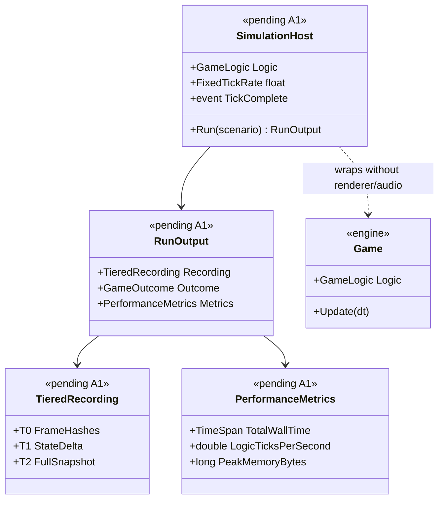

# Deep Dive: Headless Simulation Host

> Expands phase A1 of [Track A — Foundations](../track-a-foundations.md). Part of the
> [Large-Scale RTS Roadmap](../README.md). First-pass design — refine as phases land.
>
> Audience: human — design intent and architecture diagrams. Code references are in the agent-context appendix at the bottom.
>
> The agent-context section at the bottom ([What already exists appendix](#appendix-what-already-exists--agent-context)) contains code-level details about the current state. Skip it if you are reading for design intent.

Goal: run the simulation logic core with no window and, ideally, no GPU or audio, so the engine
can drive batch and offline simulation, CI, faster-than-real-time (FTRT) runs, and later
distributed runs, with a way to analyze those results.

Detaching the logic step from the render and present cadence lets the host tick as fast as the
hardware allows instead of at the wall-clock game rate. That is the point of headless batch and
experiment runs.

The host is domain-agnostic. It owns a simulation world through the [Simulation Domain Model seam (A4)](../track-a-foundations.md), not an RTS world specifically. Stepping,
recording, and analysis are parameterized by the domain, so the same FTRT host can drive RTS
battles, city builders, or transportation/logistics sims. RTS, the `GameObject` and module engine,
is the first domain adapter. Per the [domain-scope Decision](../open-questions.md), a
transport or graph domain is the first non-RTS validation target, and non-RTS domains extend the
same `GameObject` and module system with a topology and interaction adapter rather than a separate
runtime.

---

## 2. What blocks a true headless host

| # | Coupling | Where | Impact |
|---|---|---|---|
| H1 | `Game` constructor unconditionally creates a `GraphicsDevice` and graphics resources (`StandardGraphicsResources`, `ShaderSetStore`, `ShaderResourceManager`) | `Game.cs` ctor (~L481–532) | No GPU → no `Game`. Blocks CI/cloud nodes without a GPU. |
| H2 | `AssetStore` requires a `GraphicsDevice` and graphics load context | `AssetStore` ctor (`Content/AssetStore.cs`), `Game.cs` L534–542 | Asset data (INI/object defs) is entangled with GPU upload of textures/shaders/models. |
| H3 | `Game.Update` interleaves presentation with logic | `Game.cs` `Update`/`LocalLogicTick` (L881–943) | Each tick runs input pumping, Scene2D UI, audio, cursors before the logic tick. A host wants only logic + scripting + network. |
| H4 | No `SimulationHost` abstraction owning the logic step | — | The deterministic step is embedded in `Game`; batch/distributed drivers must instantiate the full `Game`. |
| H5 | Audio/Graphics `GameSystem`s always constructed and ticked | `Game.cs` L583–585, `LocalLogicTick` audio update | Presentation systems run even when nothing is displayed. |
| H6 | Reproducibility not yet guaranteed | see [A2](../track-a-foundations.md) | Headless results (and their analysis) are only meaningful if runs are comparable — seeded and metric/invariant-stable per the [relaxed-determinism Decision](../open-questions.md). Bit-exactness is not required. |

---

## 3. Required infrastructure (first pass)

### 3.1 A GPU-optional graphics seam
Introduce a null or headless rendering path so logic can run without a real device.

Decision: a null device abstraction. Define an interface over the `GraphicsDevice` parts the
logic and asset-data path touch, with a no-op headless implementation. This is the cleanest
long-term option, decouples logic from `GraphicsDevice`, aligns with
[A3 — Simulation/presentation seam](../track-a-foundations.md), and is scoped and validated in
A1-1.

The rejected primary alternative is a headless Veldrid offscreen device. It is a smaller change
but still requires working graphics drivers, so it does not unblock GPU-less CI or cloud nodes.
It may still be useful where a real device is available, such as frame capture.

### 3.2 Data-only asset loading
Split asset data (object, weapon, and locomotor INI, map data) from GPU upload (textures,
shaders, model buffers) so a headless host loads only the logic-side data it needs (H2). The
`OnDemandAssetLoadStrategy.None` path used by `TestGame` is the seed.

### 3.3 Logic-tick extraction
Separate the fixed-rate logic step (`GameLogic.Update`, network tick, `Scene3D.LogicTick`,
`PartitionCellManager.Update`, scripting) from the local or render tick (input, Scene2D, audio,
cursors) so a host can call logic-only (H3). The fixed-rate stepping already lives in
`Game.Update`; extract it into a reusable stepper.

### 3.4 `SimulationHost`
A lightweight host that owns the logic-side world through the existing `IGameEngine` seam,
parameterized by the [domain model (A4)](../track-a-foundations.md). It advances the world by N
frames or until a stop condition at FTRT speed and exposes hooks for input or order injection
(`InjectOrders`) and result capture. It must run with presentation systems absent or stubbed
(H4/H5) and avoid RTS-specific assumptions so a non-RTS domain can supply its own entity and step
model.

### 3.5 Reproducibility + result outputs
Build on [A2](../track-a-foundations.md): a seeded, re-runnable stepper plus structured run
outputs that the analysis layer consumes. Per the [relaxed-determinism Decision](../open-questions.md), runs are comparable, not bit-exact, so outputs lean on recorded state and metrics
instead of input-only re-simulation:
- Recorded state snapshots/deltas — periodic world snapshots (+ per-frame deltas) so any
  frame can be reconstructed for analysis without assuming a re-run reproduces it bit-for-bit.
- Metrics/events stream — domain-defined probes (RTS: unit counts, deaths, economy, APM;
  city: population, traffic, utility coverage; transport: throughput, delay, utilization) — the
  primary basis for comparing runs.
- Hierarchical state signature per frame — a tolerance-aware signature tree (world →
  partition → entity-bucket), not a single global hash, so divergence screening can be drilled
  down to a locus rather than only flagged globally (tier design in
  [visualization.md §5](visualization.md)). An opt-in strict-hash mode remains available for
  bit-exact debugging.
- Triggered detail capture — when the signature tree trips a tolerance threshold, the host
  writes detailed per-entity/per-system deltas for the affected frame+region window into a
  bounded ring buffer. Captured live, because (per the relaxed-determinism Decision) a re-run
  will not reproduce the same divergence (see [visualization.md §5](visualization.md)).
- Replay recording of inputs (orders + seed + map), reusing the existing `.rep` path
  (`ReplayConnection`, TestHarness export) — useful for re-running an experiment, with the
  caveat that the re-run is statistically equivalent, not identical.
- Optional frame captures via `FrameCaptureService` when a GPU is available.

### 3.6 Result analysis & visualization → see phase A5
Replaying, visualizing, comparing, and localizing divergences between runs, plus authoring the
scenarios that feed the host, belong to [A5 — Scenario authoring & visualization](visualization.md).
A1 ends at emitting the run outputs in §3.5. A5 consumes them, makes them inspectable, and is the
validation surface for [B3](../track-b-scale.md) parallelism and
[B6](distributed-simulation.md) sharding. The tiered recording (T0/T1/T2) emitted here is
specified in [visualization.md §5](visualization.md).

---

## 4. Sub-phases

| Phase | Goal | Status |
|---|---|---|
| A1-1. Headless seam audit & approach | Confirm exactly what the logic/asset-data path needs from `GraphicsDevice`/graphics resources, then scope the null device abstraction (chosen §3.1 approach) and document the target "logic-only" surface. | Not started |
| A1-2. Data-only asset loading | Allow `AssetStore`/`ContentManager` to load logic-relevant data without GPU upload (H2), generalizing the `OnDemandAssetLoadStrategy.None` path. | Not started |
| A1-3. Logic-tick extraction | Extract the deterministic logic step from `Game.Update`/`LocalLogicTick` into a reusable stepper that runs without presentation systems (H3/H5). | Not started |
| A1-4. `SimulationHost` | Introduce the domain-agnostic host that owns a simulation world via `IGameEngine` + the [domain model seam (A4)](../track-a-foundations.md), steps N frames / until a condition at FTRT, and supports input injection + result hooks (H4). RTS is the first domain adapter. | Not started |
| A1-5. Run outputs | Emit recorded state snapshots/deltas, a metrics/events stream, the tiered divergence recording ([visualization.md §5](visualization.md): T0 aggregate + T1 hierarchical signature tree + T2 triggered detail), and replay (input) recordings from a headless run (builds on [A2](../track-a-foundations.md) for seeded, comparable runs). | Not started |

> Result analysis, visualization, and scenario authoring were previously sketched here as
> A1-6/A1-7; they now live in their own phase, [A5](visualization.md) (A5-1 scenario authoring,
> A5-2 sweeps, A5-3 replayer/visualizer, A5-4 divergence localization).

---

## 5. Sequencing notes

- A1-1 gates the rest; everything depends on the chosen graphics seam.
- A1-2/3/4 are the core host and can land incrementally behind the existing windowless path.
  The TestHarness `RunHeadless` loop is the integration target throughout.
- A1-5 depends on [A2 — Reproducibility & statistical stability](../track-a-foundations.md)
  so runs are seeded and comparable. Its outputs lean on recorded state rather than bit-exact
  re-simulation and are consumed by [A5 visualization](visualization.md).

## 7. Architecture Diagrams

Diagrams for this phase will be elaborated once A1 moves to active implementation. The
placeholder below captures the key types the headless simulation host introduces.

## 8. Related

- Track A overview: [`../track-a-foundations.md`](../track-a-foundations.md)
- Architecture snapshot: [`../agent/current-state.md`](../agent/current-state.md)
- Scenario authoring & visualization (consumes A1 outputs): [`visualization.md`](visualization.md)
- Relaxed-determinism Decision (was an open question): [`../open-questions.md`](../open-questions.md)

---

## Appendix: What already exists — agent context

> Agent context: this section contains file:line code references for agents
> implementing this phase. Human readers: the design intent above does not
> require reading this section.

A surprising amount of headless plumbing already exists and should be reused:

- Windowless graphics device. `GraphicsDeviceUtility.CreateGraphicsDevice`
  (`src/OpenSage.Game/Graphics/GraphicsDeviceUtility.cs`) accepts a `null` window and creates a
  swapchain-less D3D11/Vulkan/Metal device. `new Game(installation, backend, config, window:
  null)` already works.
- A headless run loop. `OpenSage.Tools.TestHarness` (`Program.cs`, `RunHeadless`)
  constructs a windowless `Game`, loads a replay, and ticks `game.Update(empty)` + `game.Render()`
  in a loop with a frame cap.
- Frame capture for inspection. `FrameCaptureService`
  (`src/OpenSage.Game/Graphics/FrameCaptureService.cs`) renders to a texture and writes PNGs
  with machine-parseable `[CAPTURE]` stdout lines — explicitly "for use in headless test runs".
- Replay action monitoring. `ReplayActionMonitor` (ReplaySketch) surfaces dispatched/
  completed in-game actions with player + frame, used by the TestHarness for logging and
  deferred-order injection.
- A logic-only mock. `MockedGameTest.TestGame` (`src/OpenSage.Game.Tests/MockedGameTest.cs`)
  implements `IGame` with `GraphicsDevice = null` and an `AssetStore` built with
  `OnDemandAssetLoadStrategy.None`, proving parts of the logic layer can exist without GPU
  resources.
- A non-rendering data tool. `OpenSage.Tools.Sav2Json` constructs a `Game` purely to load/
  persist save state.
- An engine seam. `IGameEngine` / `GameEngine` (`src/OpenSage.Game/GameEngine.cs`) already
  abstracts the logic-side services (`AssetLoadContext`, `GameLogic`, `Terrain`, `Navigation`,
  `Quadtree`, `Scene3D`) behind an interface — a natural foundation for a host.

Today, headless means no window but still requires a real GPU and still runs the full
`Game.Update` → `Render` path. True GPU-less, logic-only simulation is not yet possible.

---