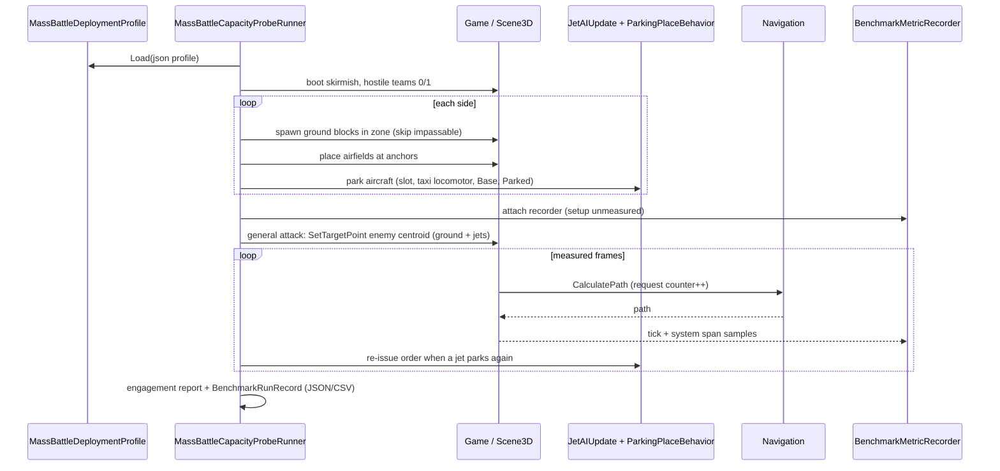
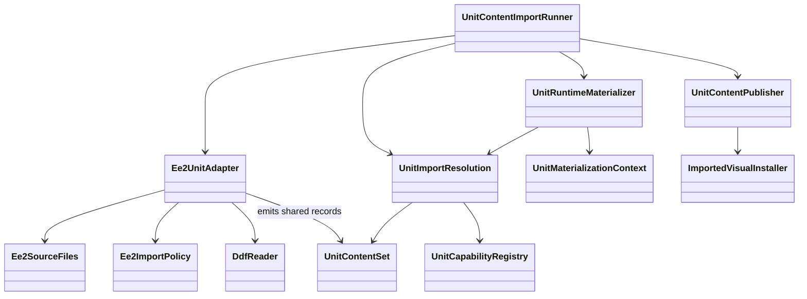
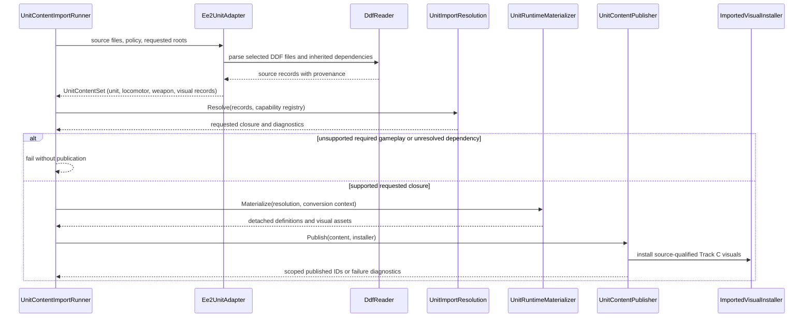
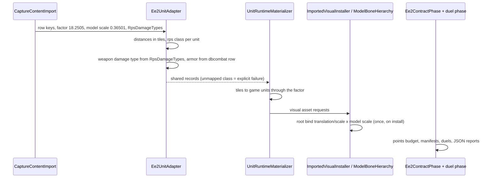
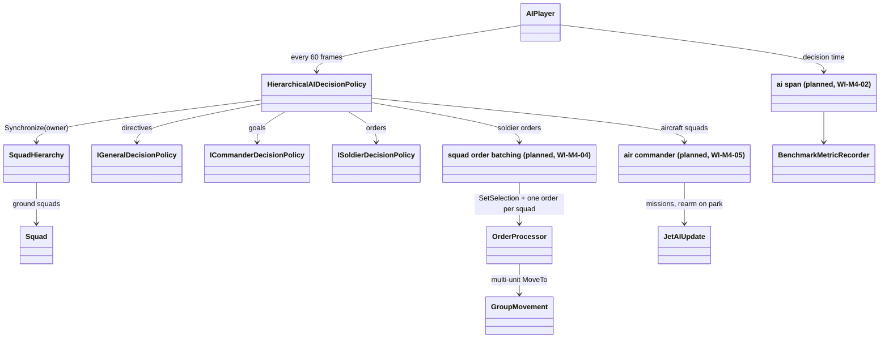

# Deep Dive: 1000 vs 1000 Mixed-Roster Battle

> Expands the mixed-roster mass battle goal in the [Large-Scale RTS Roadmap](../README.md) and
> covers every phase of [Track M](../track-m-mass-battle.md).
>
> Audience: human charter and design for a long-term integration goal.

Purpose: run an AI versus AI battle of 1000 units per side on a large map, with each army drawn
from Command & Conquer Generals and Empire Earth II combat units, both as headless batch runs and as
a live windowed view. The goal integrates scale (Track B), external assets (Track C), hierarchical
AI (A4-3), and run analysis (A1/A5) on the RTS domain. It is independent of
[Track W](../track-w-western-front.md) and its Sedan and Somme scenarios.

---

## 1. Goal and evidence sought

Research question: can the engine run a 2000-unit mixed-roster battle to a decided outcome, inspect
it after the fact, and present it live, with every cost measured?

Evidence:

- seeded headless runs end in a [P3](p3-victory-defeat.md) outcome and record run output and replay;
- batch runs report each side's win rate with a confidence interval, plus kills and losses per unit
  type, for armies of different composition but equal points;
- a mirrored control run shows no side or spawn bias on the map;
- a windowed run sustains the real-time rate with the whole battle in view;
- B1 reports tick cost, frame cost, memory, and the first failing constraint at each stage.

## 2. Scope

In scope:

- 1000 combat units per side, two sides, AI versus AI;
- pre-deployed armies; no base building, economy, or production;
- ground combat units (infantry, vehicles, artillery) and aircraft (helicopters and fixed-wing);
- pre-placed airfields per side for aircraft rearm, as scenario data;
- Generals units from the shipped install and EE2 units from an operator-supplied EE2 install;
- one large map, sourced from the community or authored in WorldBuilder.

Out of scope for this track:

- human players and control-bar play at this scale;
- naval units, garrisons, special powers, and superweapons;
- buildable structures; airfields are fixed scenario objects;
- distributed simulation and variable fidelity (2000 units fit one process; see section 7);
- tuning individual unit stats for cross-game balance; fairness comes from the points budget.

## 3. Viewing model

2000 units is a fifth of the [near-term scale anchor](../open-questions.md) of 10k units at ~30 fps
on one machine, so the battle is both a batch experiment and a real-time spectacle:

| Mode | Host | Purpose |
|---|---|---|
| Batch | Headless `SimulationHost` (A1), faster than real time | Seeded runs, outcome distributions, benchmarks. |
| Live | Windowed game at real time, spectator camera, no local player | Watching the battle as it runs. |
| Replay | A5 replayer over A1-6 recording | Scrubbing and inspecting a finished batch run. |

Live viewing is an observer slot: both armies stay AI-controlled, and the operator only moves the
camera. The live milestone is a sustained 30 fps median with the full battle in view, measured
through B1 on the operator's machine.

## 4. Map

Requirements:

- two deployment zones, each holding 1000 units at twice their footprint spacing;
- zone separation greater than the longest weapon range in either roster;
- a ground path between zones for every ground locomotor class in the rosters;
- space behind each zone for that side's airfields, and airspace over the whole battle area;
- open ground plus cover and chokepoints, so pathfinding and formation movement are exercised;
- loads headless and windowed within current or B4a-lifted limits.

Sourcing order:

1. Community Generals map. The operator downloads candidate large maps (8-player and "huge"
   community maps) into the install's user map folder or stages them through
   [ModCollector](../plans/mod-collector.md). M0 evaluates each candidate against the requirements
   and records size in cells, player slots, waypoints, passability, load result, and provenance.
   Community maps are never committed to the repo.
2. Authored map. If no candidate passes, M0 authors one with the B4a large-map wizard and object
   population tools, saved in the B4a/H3 format.

Deployment zones and army anchors are scenario data, not map edits, so either source works without
modifying a downloaded map.

## 5. Rosters

Each side fields its own authored roster manifest: a list of `(source game, unit type, count)`
entries summing to 1000. The two sides differ in composition. Fairness comes from a points budget:
both manifests total the same points within an authored tolerance. Each manifest includes
anti-air, and aircraft count toward the 1000. Airfields are not units and do not count.

A mirrored control (one manifest on both sides) is a calibration run only: its win rate checks the
map and spawn positions for side bias before asymmetric results are read.

Points:

- Generals units cost their `BuildCost`;
- EE2 units cost their resource columns in `db/TechTree/dbtechtreenode.csv` (food, wood, stone,
  gold, iron, oil, uranium, and others), converted through one authored rate per resource;
- the rates and the tolerance are recorded with each manifest pair, so results stay comparable.

Generals units come from `INI.big` object definitions already exercised by
[P6b](p6b-unit-contract-validation.md) and [P9](p9-unit-validation-ground.md).

EE2 units need gameplay definitions. EE2 stores them as text `.ddf` files in `db.zip` (119 under
`db/Units/`), with `parent` inheritance, `properties` (`hitpoints`, `SizeX`, `moveType`, `rps`
counter class), and `abilities` (`VehicleMove` or `AircraftMove` speed and cruising height, `LOS`
range, `Attack` range, reload, damage, and missile). Aircraft carry the `GoesOnAirMissions`
attribute. [H2a](h2a-unit-content-import.md) adds the shared unit-content import layer and a bounded
EE2 vertical slice. M2 expands that adapter to the reference roster; the shared materializer emits `ObjectDefinition`s with
locomotor, weapon, armor, body, and draw modules, using a jet or
helicopter locomotor with return-to-airfield rearm for aircraft, and C4a-C4d models and animations for the draw
side. The translated definitions register as a scoped content layer, so Generals definitions are
untouched.

Normalization (M3):

- model scale: EE2 models are scaled to the Generals convention of roughly 5 world units per meter
  (see [G10](../track-g-rendering-clarity.md)), measured from model bounds against reference
  Generals units;
- gameplay distances: EE2 tile-based range, LOS, size, and speed convert through one authored
  tiles-to-world factor recorded with the manifest;
- damage: EE2 `rps` counter classes and the `db/Simulation/dbcombat.csv` attacker-defender
  matrix map to Generals armor and damage types through an authored table;
- era: the reference rosters use EE2 late-epoch units (infantry, light and heavy tanks,
  artillery, fighters, bombers, helicopters), closest to Generals in role and weapon range.

## 6. AI

Each side runs the [A4-3 decentralized hierarchy](a4-decentralized-hierarchical-ai.md): one general,
commanders per squad group, soldiers per unit, using the rule-based reference policies. The skirmish
AI's build and economy layers are not used. M4 sizes squads and commanders for 1000 units, bounds
per-tick decision cost, and adds group movement orders that B4 pathfinding serves as requests per
squad rather than per unit. Aircraft form their own squads under an air commander that assigns
strike, patrol, and escort missions and returns aircraft to their airfields to rearm.

Neural policies (A4-3e/f) can replace the rule-based ranks later through the same seam; the
points-balanced battle is a natural co-evolution arena but is not a goal of this track.

## 7. Scale dependencies

| Need | Owner | Why |
|---|---|---|
| Benchmarks and first-bottleneck report | [B1](b1-benchmarking.md) | Every stage reports through B1. |
| Headless host and recording | [A1](a1-headless-host.md), A1-6 | Batch runs and replay input. |
| Group pathfinding | [B4](../track-b-scale.md) | 2000 concurrent movers on a large map. |
| Large maps | [B4a](b4a-larger-maps.md) | Only if no community map passes M0. |
| Instanced rendering | [B5](../track-b-scale.md) | Live view at 30 fps, including Track C models. |
| Replay and visualization | [A5](a5-visualization.md) | Scrubbing finished runs. |
| EE2 skinned infantry | [C4d](c4d-ee2-skinned-animation.md) | EE2 infantry are skinned. |

B2/B3 are not hard dependencies: M1 decides whether allocation cleanup or parallel logic is needed
at 2000 units. B6 and B7 are not used.

## 8. Phases

Phase table, milestones, and dependencies live in [Track M](../track-m-mass-battle.md). Order:
M0 selects the map; M1 measures the current engine on it with a Generals-only 1000 vs 1000,
aircraft included; M2 (EE2 units) runs in parallel from the start; M4 (army AI) follows M1; M3
normalizes the mixed roster; M5 runs the full battle in all three viewing modes.

## 9. Architecture Diagrams

The M1 sequence below is grounded in the implemented code (`src/Panopticon.Tools.TestHarness/MassBattleDeploymentRunner.cs`,
`MassBattleCapacityProbeRunner.cs`, `MassBattleDeploymentProfile.cs`; `src/Panopticon.Simulation/Navigation/Navigation.cs`;
`src/Panopticon.Benchmarks.Simulation/BenchmarkMetricRecorder.cs`). The M2 diagrams below use H2a's existing types and import orchestration. The M4 diagrams
are grounded in the A4-3 hierarchy and mark M4's planned additions. Diagrams for the M5 batch and
live run flows remain placeholders; they are required before M5's first source-edit card is
marked `Ready`.

Sequence: the M1 capacity probe (WI-M1-01..03):



### M2 import pipeline

Grounding: `Content/Importing/Units/Ee2/`, `UnitImportResolution`, shared `Materialization/`, and
`Panopticon.Tools.TestHarness/UnitContentImportRunner.cs`. Aircraft typed construction is the planned
WI-M2-02 extension; helicopter rearm is not yet an established runtime capability.





Card sequence and evidence: [M2 implementation plan](../implementation/track-m-m2-ee2-combat-units.md).

### M3 normalization flow

Grounding: `Ee2ImportPolicy` (authored factor, model scale, rps damage types),
`UnitConversionPolicy` and `UnitMaterializationContext` (declared conversions), the M3 seams in
`UnitVisualMaterializer` and `ImportedVisualInstaller`/`ModelBoneHierarchy` (install-time
root-bind model scale), and the TestHarness phases (`Ee2ContractPhase`, duel phase, roster budget
evaluator) documented in the
[M3 implementation plan](../implementation/track-m-m3-mixed-roster.md).



### M4 army hierarchy

Grounding: `Logic/AI/AIPlayer.cs` (60-frame decision cadence, `DispatchOrders`),
`Logic/AI/Hierarchy/` (`HierarchicalAIDecisionPolicy`, `SquadHierarchy` with `MaxSquadSize` 8,
`Squad`, rule-based general/commander/soldier ranks), `Logic/Orders/OrderProcessor.cs`
(`MoveTo`/`AttackObject` act on `Player.SelectedUnits`), `Navigation/GroupMovement.cs`
(`MoveSquad`, no engine consumer yet), `LogicStepper.SystemSpan`, and the M1 probe runner.
Elements marked `planned` are the WI-M4 cards' additions; their final names follow the
WI-M4-01 audit.



```mermaid
sequenceDiagram
    participant R as M4 army scenario (M1 probe profile)
    participant A as AIPlayer (per side)
    participant H as HierarchicalAIDecisionPolicy
    participant S as SquadHierarchy
    participant X as air commander
    participant O as OrderProcessor
    participant G as GroupMovement / Navigation
    participant M as BenchmarkMetricRecorder
    R->>A: spawn armies, hierarchical policy on both sides (AI enabled)
    loop every 60 logic frames
        A->>H: DecideNextOrders(context)
        H->>S: Synchronize (assign, remove dead, promote)
        H->>H: general directives, commander goals, soldier orders
        H->>X: aircraft squads: strike, patrol, escort
        X-->>H: mission orders; parked aircraft re-tasked after rearm
        H-->>A: SetSelection(squad) + one order per squad
        A->>O: DispatchOrders
        O->>G: MoveSquad: one leader path per ground squad
        A-->>M: ai span (decision cost)
    end
    R->>R: assignment invariant, idle-stall check, B1 record
```

The M5 diagram placeholder remains a closed gate for that phase.
