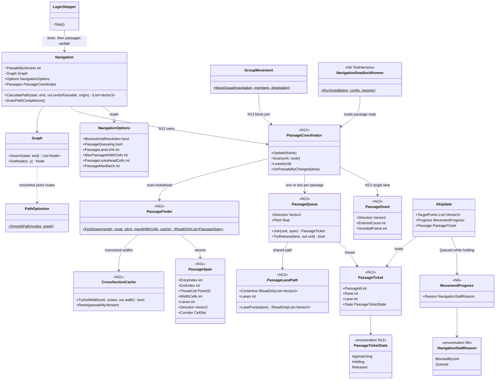
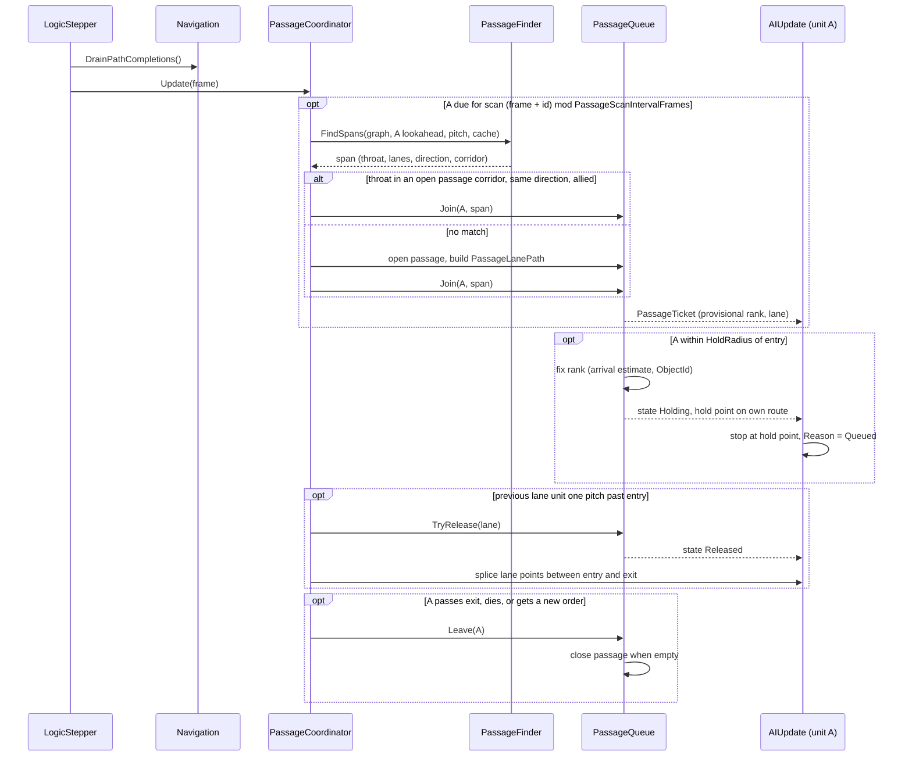
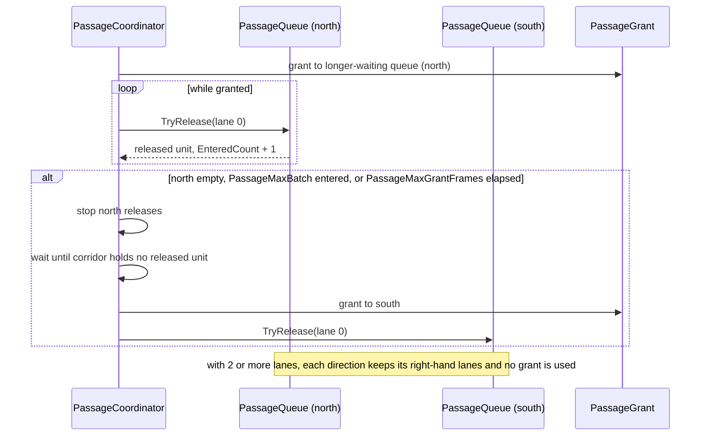

# Track N: Confined Passage Queueing

> Part of the [roadmap](../README.md) and [Track N](../track-n-pathfinding-performance.md).
> Audience: human.

Phases N11 to N14 add ad hoc queueing for confined spaces. When friendly ground units whose
routes cross the same narrow passage approach it, they form a transient group (an ad hoc squad)
around that passage: the group shares one path through the constraint, split into lanes, and a
deterministic unit order decides who enters next. Units outside a passage move as before.
Reactive jam resolution (wait, give way, local repath) is N8, in the
[deadlock deep dive](n-navigation-deadlocks.md); this document covers the proactive side.

## 1. Evidence

| Source | Finding |
|---|---|
| `RoutingChoke` scenario | 40 tanks ordered through a 120-unit wall gap end on `NoProgress` once units jam at the mouth; the progress monitor exists because the jam is the common outcome. |
| N6 `corridor-opposed-20` case | Opposing columns through the same gap are the planned regression for a chokepoint cycle; nothing prevents the cycle from forming. |
| [N2 results](../implementation/track-n-pathfinding-performance.md#wi-n2-results) | Squad followers retrace leader offsets across impassable cells; a spread formation crossing a gap is the worst case. |

Code facts (see the [grounding appendix](#appendix-grounding)):

- Paths are point-sized. `Graph.Search` treats each cell as passable or not, and
  `PathOptimizer.SmoothPath` removes nodes while a Bresenham line stays on passable cells. A
  smoothed route through a gap therefore runs along the gap's corner cells, and every unit from
  the same side aims at nearly the same corner point.
- Units do not know a passage exists. Nothing measures width along a route, and no code relates
  two units whose routes cross the same gap.
- The only unit-unit interaction is the swept-footprint gate (clearance = both bounding radii +
  2.5). Units converging on the mouth from different angles block each other laterally, and
  each blocked unit stops and turns toward its goal.
- `GroupMovement.MoveSquad` gives followers the leader path at their current offset. A gap
  narrower than the formation puts offset waypoints inside walls.
- Order paths are assigned once, at order time or at the async drain
  (`LogicStepper` calls `Navigation.DrainPathCompletions`). There is no per-tick hook where
  units are re-planned as a group.

## 2. Scope

In scope:

- Passage detection along a unit's route from the passability grid (N11).
- Ad hoc passage queues: joining, a shared lane path through the constraint, unit order, hold
  before the mouth, release, and route restore after the exit (N12).
- Opposing flows through one passage, and squads or selection clusters entering as a contiguous
  block with formation collapse and restore (N13).
- Verification against N8 resolution and the M4 probe (N14).

Out of scope:

- Continuous local avoidance and push-apart physics (the [deadlock scope](n-navigation-deadlocks.md#2-scope)
  applies unchanged).
- Clearance-aware global search. The grid stays point-sized and unit-free; unit-size clearance
  in the grid belongs with E1's locomotor layers.
- A precomputed map-wide chokepoint graph. Passages are found where routes cross them.
- Enemy coordination. Enemies are obstacles to a queue, handled by N8.
- Aircraft, bridges, and water layers.

## 3. Targets

Authored before measurement. N11 confirms or revises them with option-off baselines.

| Target | Value | Basis |
|---|---|---|
| Passage cases settle | every unit `Arrived` or `CrowdArrived` inside the case frame budget, 0 `NoProgress` terminations | the case is the regression for its mechanism |
| Mouth jams | no unit `BlockedByUnit` for more than 90 frames within `HoldRadius` of an open passage's entry | 90 frames is the `RoutingChoke` progress timeout |
| Column throughput, `passage-column-40` | last arrival frame at most 0.8 x the option-off baseline when the baseline settles; settles when it does not | ordered entry should beat a jam, not just end it |
| Wait-for cycles at case end | 0 | a cycle is a deadlock by definition |
| Squad passage retrace | 0 offset waypoints on impassable cells inside open passages | the N2 retrace hazard |
| Open-ground no-op | 0 passages opened in `crowd-goal-100` and N0 open-ground cases; movement byte-identical with the option on | queueing must not touch unconstrained moves |
| Coordinator cost, M4 army-AI probe | `passage` span median at most 0.25 ms per tick; N5 path budgets still met | a fraction of the 1.7 ms amortized path budget |

## 4. Phase design

Terms:

- Pitch. Lane spacing for a unit: `2 x BoundingCircleRadius + 2.5`, the footprint gate clearance
  for two equal units.
- Cross-section. At a route sample, two rays cast perpendicular to the route direction over the
  passability grid, each capped at `MaxPassageWidthCells` (default 16). Width is the passable
  run between the first impassable cells hit; a ray that reaches the cap counts as open.
- Passage span. A run of route samples whose cross-section is closed on both sides and narrower
  than `PassageLaneLimit` (default 3) pitches. Its throat is the narrowest sample; its corridor is
  the union of its cross-section cells.

### N11: Passage detection and baseline

- `PassageFinder.FindSpans(graph, route, pitch, maxWidthCells)` samples the route once per cell,
  measures cross-sections, and returns `PassageSpan` values: entry and exit route positions,
  throat cell, minimum width, lane count (`floor(width / pitch)`, at least 1), direction, and
  corridor. Samples within `PassageMergeCells` (default 2) of each other merge into one span.
  A cliff or wall on one side only stays open and is never a passage.
- `CrossSectionCache` memoizes width per (cell, direction octant) and clears when
  `Navigation.PassabilityVersion` changes, so units crossing the same area share casts.
- The finder is pure: it reads the graph and changes no movement.
- Baseline: passage cases join the N6 `NavigationDeadlock` scenario and run with
  `PassageQueueing` off. The sampler adds a mouth-jam count (blocked units near a detected entry).

| Case | Setup | Mechanism exercised |
|---|---|---|
| `passage-column-40` | `RoutingChoke` setup: 40 tanks, 120-unit gap | single-direction column |
| `passage-converge-2x20` | two 20-tank groups approaching the gap from 45 degrees left and right, one shared goal beyond | lateral merge at the mouth |
| `passage-mixed-30` | 20 infantry and 10 tanks, one selection | mixed pitch in one queue |
| `passage-opposed-1lane` | 60-unit gap (one tank lane), two 10-tank columns in opposite directions | single-lane opposing flow |
| `passage-squad-12` | one army-AI squad of 12 in spread formation through the gap | formation through a constraint |

`corridor-opposed-20` from N6 is reused as the two-lane opposing case.

### N12: Passage queues

Behind `PassageQueueing`, default off. `PassageCoordinator` lives on `Navigation` and runs once
per logic tick on the logic thread, after the async drain.

1. Scan. A ground unit with a route scans its next `PassageLookaheadCells` (default 24) every
   `PassageScanIntervalFrames` (default 15), staggered by `ObjectId`. A squad scans its leader
   route once per order.
2. Join. A span whose throat lies in an open passage's corridor joins that `PassageQueue` if the
   unit is the passage's owner or an ally and travels in the queue's direction; otherwise it opens
   a new passage. The unit gets a `PassageTicket` (passage, rank, lane, state).
3. Shared path. On open, the queue builds one `PassageLanePath`: the centerline is the sequence
   of cross-section midpoints from entry to exit; lane k is offset from it by
   `(k - (lanes - 1) / 2) x pitch`. A lane point on an impassable cell drops that lane. Every
   member uses this path, so no member routes along a corner.
4. Order. Rank is the estimated time to the entry (remaining route length over locomotor speed),
   ties broken by `ObjectId`. Ranks are provisional until the unit reaches `HoldRadius` (default
   3 pitches) from the entry, then fixed. Lane is the lane nearest the unit's lateral approach
   position, balanced by count. Queue pitch is the largest member pitch.
5. Hold. A fixed-rank unit that is not released stops at the first point on its own route at
   `HoldRadius` from the entry, faces the entry, and reports `NavigationStallReason.Queued`.
   N8 ignores `Queued` units.
6. Release. The lowest-rank holding unit in a lane is released when that lane's previous
   released unit has moved at least one pitch past the entry. Release splices the lane path
   between the unit's last route point before the entry and its first route point after the exit.
7. Exit and leave. Passing the exit, dying, receiving a new order, or a passability change
   inside the corridor removes the ticket. A passability change closes the passage; members
   rescan. A passage closes when its queue is empty.

Tickets and passages are not persisted. After a load, units rescan and rejoin; save format is
unchanged.

### N13: Opposing flow and group entry

- Opposing flow. A span whose direction opposes an open passage's flow joins the same passage
  as a second queue. With 2 or more lanes, each direction takes the lanes on its right. With 1
  lane, the passage grants one direction at a time: the grant holds until that queue is empty,
  `PassageMaxBatch` (default 8) units have entered, or `PassageMaxGrantFrames` (default 300)
  pass, then switches once the corridor is clear. The longer-waiting queue gets the first grant;
  ties go to the lower owning player index.
- Group entry. `GroupMovement.MoveSquad` and selection clusters (`GroupSelectionMoves`) join as
  a block: members take consecutive ranks in their current front-to-back order, and the block
  ranks by its first member. Inside the passage members use lane points instead of formation
  offsets; after the exit each member's offset waypoints resume. Replaces the offset retrace
  through the constraint.

### N14: Passage verification

Re-run every passage case, the N6 cases, and the M4 army-AI probe over 3 seeds with all Track N
options on, then with `PassageQueueing` off, then with `BlockedUnitResolution` off, and report
each target in section 3 with before and after numbers. Records a default-flip recommendation
for `PassageQueueing`.

## 5. Decisions

- Passage queueing extends Track N as N11 to N14. It shares `MovementProgress`, the
  `NavigationDeadlock` scenario, and the option set, and its default flip is decided with N10's.
- Proactive queueing complements N8 instead of replacing it. Queueing orders traffic before the
  mouth; N8 still resolves residual blocks, enemies, and stationary blockers. `Queued` keeps the
  two from acting on the same unit.
- Passages are detected from route cross-sections on demand, not from a precomputed choke graph.
  Cost scales with units approaching constraints, the cache shares casts, and structure changes
  only clear the cache.
- Ad hoc groups are navigation-transient. They are not `SquadHierarchy` squads, carry no AI
  intent, and dissolve at the exit.
- Ordering is deterministic: logic-thread only, keyed on arrival estimate and `ObjectId`, with
  ranks fixed at `HoldRadius` to prevent churn.
- `PassageQueueing` defaults off until N14 evidence and an operator decision.

## 6. Risks

| Risk | Mitigation |
|---|---|
| Wide-open areas next to walls read as passages | Cross-sections must be closed on both sides; one-sided walls stay open |
| Holding units block traffic that does not use the passage | Hold points sit on each unit's own route at `HoldRadius`; non-members keep the footprint gate and N8 |
| Late fast units starve slow ones, or ranks churn | Ranks fix at `HoldRadius`; provisional ranks only reorder units still approaching |
| Single-lane grants starve one side | Grant bounded by `PassageMaxBatch` and `PassageMaxGrantFrames`; the longer-waiting side goes next |
| Mixed pitch wastes lanes for infantry | Queue pitch is the largest member pitch; `passage-mixed-30` measures the loss, and per-pitch lanes stay a follow-up |
| Scan cost at M4 scale | Lookahead window, staggered intervals, cross-section cache; N14 checks the `passage` span |
| Seeded baselines move | Option defaults off; suspected-deviation protocol from `AGENTS.md` |

## 7. Card sequence

`WI-N11-01` (no N6 dependency) then `WI-N11-02` after `WI-N6-02`; `WI-N12-01` then
`WI-N12-02`; `WI-N13-01` and `WI-N13-02` in parallel after `WI-N12-02`; `WI-N14-01` last, after
`WI-N10-01`. Card table:
[implementation plan](../implementation/track-n-pathfinding-performance.md#confined-passage-queueing-n11-n14).

## 8. Architecture diagrams

Existing types show current members; types and members marked with a phase are new. N6 to N10
types are in the [deadlock diagrams](n-navigation-deadlocks.md#8-architecture-diagrams).

### Class diagram

### Sequence: join, hold, release, exit (N12)

### Sequence: single-lane opposing flow (N13)

## Appendix: grounding

| Fact | Location |
|---|---|
| Point-sized grid search | `src/Panopticon.Simulation/Navigation/Graph.cs:122` (`Search`) |
| Line-of-sight smoothing over passable cells | `src/Panopticon.Simulation/Navigation/PathOptimizer.cs:30`-`:52` |
| Grid from tile impassability, structures update cells | `src/Panopticon.Simulation/Navigation/Navigation.cs:29`-`:45`, `:218`-`:258` |
| Passability version for cache invalidation | `Navigation.cs:269` |
| Footprint clearance radius + 2.5 | `src/Panopticon.Simulation/Logic/PartitionCellManager.cs:253`, `:275` |
| Follower offset retrace | `src/Panopticon.Simulation/Navigation/GroupMovement.cs:116`-`:150`, `:208`-`:232` |
| Async drain each logic step | `src/Panopticon.Simulation/LogicStepper.cs:115` |
| Option home | `src/Panopticon.Simulation/Navigation/NavigationOptions.cs` |
| Team relationship for allied joins | `src/Panopticon.Simulation/Logic/Player.cs:929` (`GetRelationship`) |
| Gap scenario constants | `src/Panopticon.Tools.TestHarness/RoutingChokeRunner.cs:30`-`:73` |
