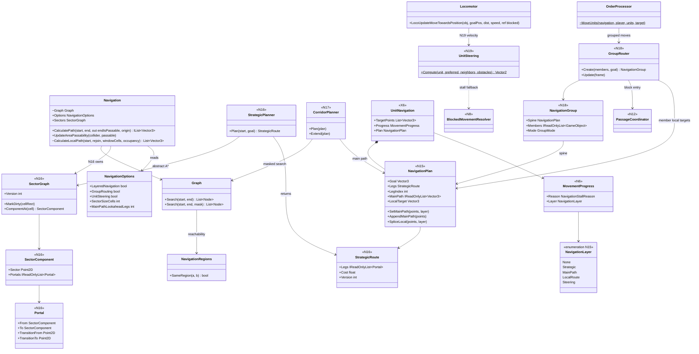
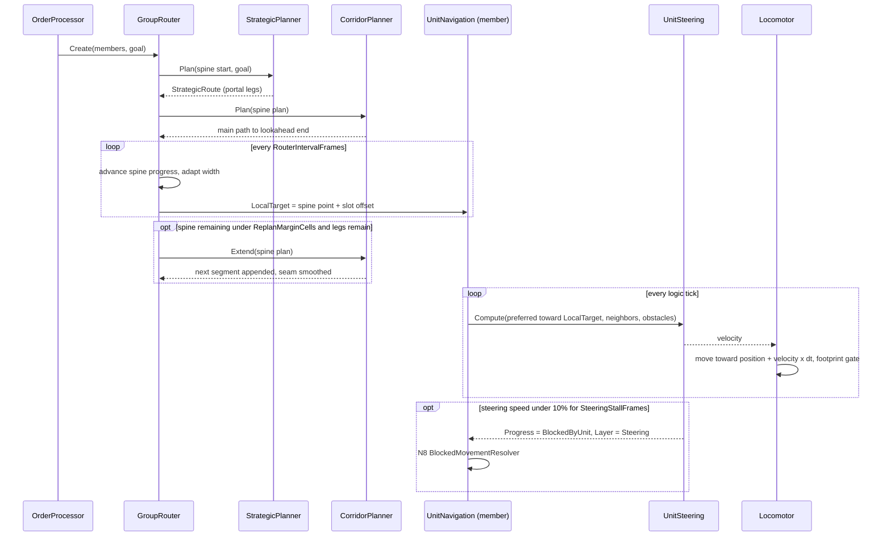
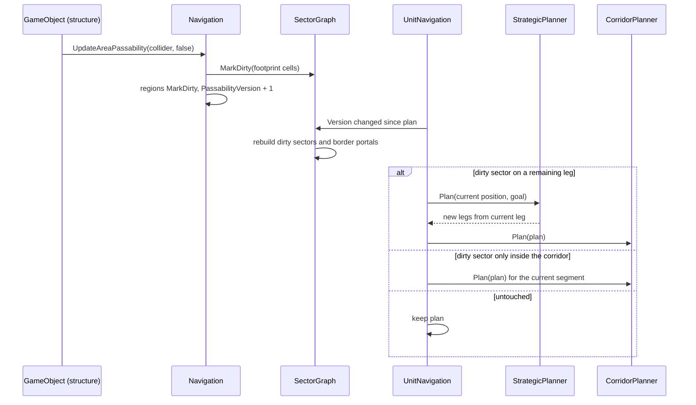

# Track N: Layered Navigation

> Part of the [roadmap](../README.md) and [Track N](../track-n-pathfinding-performance.md).
> Audience: human.

Phases N15 to N20 split navigation into four scoped layers. A strategic planner picks roughly
connected sector portals toward the final goal. A main-path planner charts the truly reachable
path inside a corridor of the next few portals. A local router moves a squad or crowd along that
path as one group. Unit steering moves each unit around neighbors and nearby obstacles. Each layer
owns a distinct part of a unit's route and replans only that part.

## 1. Evidence

Current layer coverage, checked against `origin/main` and the open N6 to N11 branches:

| Layer | What exists | Coverage |
|---|---|---|
| Strategic | `NavigationRegions` connected-component labels, used only to reject unreachable goals before a search | None. No region adjacency, no portals, no coarse route. The AI rank hierarchy (`RuleBasedCommanderDecisionPolicy.GoalFor`) picks destinations, not routes. |
| Main path | `Graph.Search` A* over every 10-unit tile, then `PathOptimizer` smoothing; synchronous or on the async `PathRequestQueue` | Complete, but it is the only planner and always searches start to goal across the whole map. |
| Local route | `GroupMovement.MoveSquad` (leader path, followers retrace offsets), `FollowerLanding`, `MoveUnitsByPositionCluster`; on branches `DestinationSlots` (N9), `OffsetRouteValidator` (N7); planned N11 to N14 passage queues | Partial and one-shot at order time. After the order each unit follows its own waypoint list; nothing keeps a group together. |
| Steering | `Locomotor.LocoUpdateMoveTowardsPosition` drives toward the next waypoint; `GroundFootprint.BlocksAdvance` stops a unit that would overlap; on branches `BlockedMovementResolver` (N8) waits, gives way, or repaths in a bounded window | Discrete and reactive only. No continuous avoidance. |

Code facts (see the [grounding appendix](#appendix-grounding)):

- The only hand-off between layers is the flat `AIUpdate.TargetPoints` list. `SetTargetPoint`,
  `FollowWaypoints`, async completion, N8 detours, and N12 lane splices all overwrite or splice it,
  and nothing records which layer produced which waypoints.
- Every order path searches the full grid. N1 made the search allocation-free and the region check
  rejects unreachable goals, but a cross-map route still expands nodes in proportion to its length
  and detours.
- Structure placement marks passability and region labels dirty for the whole map; the next
  region query relabels every cell.
- N8 already builds a bounded window graph (`Navigation.CalculateLocalPath`) by copying cells.
  This is the only search scope smaller than the map.
- `WI-X6-01` moves route state out of `AIUpdate` into `UnitNavigation`, which is the natural owner
  of a per-unit plan.

## 2. Scope

In scope:

- A per-unit `NavigationPlan` with explicit layer ownership, and layered baseline cases (N15).
- A sector-and-portal strategic graph with incremental rebuilds and a strategic planner (N16).
- Corridor-bounded main-path planning with lookahead extension (N17).
- Persistent navigation groups for squads, selection clusters, and crowds (N18).
- Reciprocal velocity-obstacle steering for ground units (N19).
- Verification against every Track N case and the M4 probe (N20).

Out of scope:

- Navigation meshes. The grid stays the single source of passability.
- Flow fields. N3's closed gate stands; N17 reopens nothing there.
- Threat-aware or enemy-aware strategic costs. The AI ranks choose goals; strategic cost is
  distance only.
- Unit-size clearance in the grid and per-layer bridges and water (E1). Sector graphs become per
  locomotor layer when E1 lands.
- Aircraft and naval movement.
- Push-apart collision response in `PhysicsBehavior`. Steering avoids contact; the footprint gate
  stays as the overlap guard.

## 3. Layer contract

| Layer | Owner | Reads | Writes | Replans on |
|---|---|---|---|---|
| Strategic | `StrategicPlanner` over `SectorGraph` | goal, sector graph | `NavigationPlan.Legs` | new goal; a dirty sector on a remaining leg |
| Main path | `CorridorPlanner` | next `MainPathLookaheadLegs` legs | `NavigationPlan.MainPath` (waypoints to the lookahead end) | lookahead extension; a dirty sector inside the corridor |
| Local route | `GroupRouter` for grouped units, otherwise the main path head | main path, group slots, passages | `NavigationPlan.LocalTarget` and local splices (N8 detours, N12 lane points) | every `RouterIntervalFrames`; width change; passage hold or release |
| Steering | `UnitSteering` | local target, neighbors, nearby impassable cells | a velocity for this tick | every tick; never edits waypoints |

Rules:

- `TargetPoints` stays the list the locomotor follows. It becomes the materialized main path plus
  local splices, written only through `NavigationPlan` methods.
- A layer replans only its own part. A dirty sector replans the legs that touch it, not the whole
  route; a steering stall escalates to N8, not to a main-path replan.
- With every new option off, the plan holds one leg whose main path is today's full-map path, and
  movement is byte-identical.
- `MovementProgress` gains `Layer` (`NavigationLayer`), the layer that last failed or held the unit,
  so N6 stall records attribute to a layer.

## 4. Targets

Authored before measurement. N15 confirms or revises them with option-off baselines.

| Target | Value | Basis |
|---|---|---|
| Strategic search cost | abstract nodes expanded per cross-map query at most 5% of full-grid nodes expanded for the same pair, N1 corpus | the strategic layer must be cheap enough to run on every order |
| Main path quality | layered length / full-A* length: median at most 1.05, p99 at most 1.20, N1 corpus | sector-portal routes are near-optimal at this sector size |
| Order cost, 1000-unit selection | order tick at most the N5 value; full-grid nodes expanded per order down at least 80% | corridors replace full-map searches |
| Sector rebuild | at most 0.5 ms per structure placement on the largest shipped map | only touched sectors rebuild |
| Segment seams | 0 frames with an empty route while legs remain | lookahead extension lands before the unit runs out |
| Group cohesion | 0 member waypoints on impassable cells; median slot lag at most 2 pitches outside passages | groups stay formed without the N2 retrace hazard |
| Steering contact | head-on pair and crossing cases pass with 0 N8 give-way events and 0 footprint-gate stops | steering resolves what N8 resolves today, before contact |
| Steering cost, M4 probe | `steer` span median at most 1.0 ms per tick | under the per-tick logic budget at 2000 units |
| Deadlock and passage targets | N10 and N14 targets still met with all layers on | layers must not reopen deadlocks |
| Off no-op | all new options off: golden baselines and `SeededRunTests` unchanged | defaults off until N20 |

## 5. Phase design

Terms:

- Sector. A square block of `SectorSizeCells` (default 16) grid cells.
- Component. A connected set of passable cells inside one sector, using the
  `Node.GetAdjacentNodes` neighbour rule restricted to the sector.
- Portal. A maximal run of adjacent cell pairs across a shared sector border where both cells are
  passable, split at `MaxPortalCells` (default 8). Each portal has one transition cell per side at
  the run midpoint. Diagonal-only corner links are single-cell portals.
- Leg. One portal crossing on a strategic route, from the previous transition cell to the next.

### N15: Layered navigation contract and baseline

- `NavigationPlan` on `UnitNavigation` (after `WI-X6-01`): `Goal`, `Legs`, `LegIndex`, `MainPath`,
  `LocalTarget`, `Version`. All writes to `TargetPoints` go through `SetMainPath`,
  `AppendMainPath`, `SpliceLocal`, and `Clear`. Existing callers (order paths, async completion,
  `GroupMovement`, N8 detours, N12 splices) are rerouted with no behavior change.
- `NavigationLayer` {`None`, `Strategic`, `MainPath`, `LocalRoute`, `Steering`} on
  `MovementProgress`.
- B1 spans `strategic`, `mainpath`, `route`, `steer`; empty until their phases land.
- Baseline cases join the N6 `NavigationDeadlock` scenario and the N0 `PathfindingLoad` cost run,
  all options off:

| Case | Setup | Measures |
|---|---|---|
| `layered-cross-map-8x12` | 8 army-AI squads of 12 ordered corner to corner | full-grid nodes expanded, settle frames, seam gaps |
| `layered-detour-wall` | goal behind a long wall with one gap far from the straight line | route length vs optimal, strategic gap choice |
| `layered-structure-placed` | 20 tanks en route; a structure is placed across their route at frame 300 | replan scope and cost, settle frames |
| `steer-crossing-2x10` | two 10-tank columns crossing at right angles | gate stops, give-way events, crossing time |
| `steer-crowd-60` | 60 infantry selection through open ground to a shared goal | gate stops, slot lag, arrival spread |

`head-on-pair` and `corridor-opposed-20` from N6 are reused for steering.

### N16: Strategic sector graph

- `SectorGraph` builds sectors, components, portals, and intra-sector edges. Edge cost between two
  portal transitions of one component is an exact search bounded to the sector, cached per sector.
- Incremental update. `Navigation.UpdateAreaPassability` marks the sectors under the collider
  footprint dirty. The next query rebuilds those sectors and their border portals only, then bumps
  `SectorGraph.Version`. Region labels stay as they are.
- `StrategicPlanner.Plan(start, goal)`: region check first (unreachable returns no route), same
  sector and component returns zero legs, otherwise insert start and goal as temporary nodes linked
  to their component's portals by bounded searches, then A* over the abstract graph with an octile
  heuristic. Returns `StrategicRoute` (portal sequence, cost, version).
- Pure: no movement change. Quality and cost are measured on the N1 start/end corpus.

### N17: Corridor main path

Behind `LayeredNavigation`, default off.

- Corridor. The union of sectors containing the unit and the next `MainPathLookaheadLegs`
  (default 2) legs, as a cell mask.
- `Graph.Search(start, end, mask)` overload: identical A* that skips cells outside the mask, with
  no graph copy. `CorridorPlanner.Plan(plan)` searches to the last lookahead transition (or the
  goal), smooths within the mask, and calls `SetMainPath`.
- Extension. When the remaining main path is shorter than `ReplanMarginCells` (default 8) and legs
  remain, the next segment is planned from the current segment end and appended; the seam is
  re-smoothed over its last two waypoints. With `AsyncOrderPaths` on, extension requests use the
  async queue and are submitted early enough to land before the margin runs out.
- Dirty sectors. A `SectorGraph.Version` change that touches a remaining leg replans the strategic
  route from the current leg; one touching only the corridor replans the main path segment.
- Fallback. A corridor search that fails replans the strategic route once, then falls back to the
  full-map search, counted as `CorridorFallbacks`.

### N18: Group local router

Behind `GroupRouting`, default off; requires `LayeredNavigation`.

- `NavigationGroup` is created by `OrderProcessor.MoveUnits` for squads, selection clusters
  (`GroupSelectionMoves`), and squad-less selections, and dissolves when all members arrive, a
  member count drops below 2, or members receive other orders. It is navigation-transient, like
  passage queues; it is not a `SquadHierarchy` squad.
- Spine. One `NavigationPlan` for the group, planned from the leader (squads) or the member
  nearest the centroid.
- Slots. Each member keeps a slot offset (lateral, longitudinal) in the spine frame, taken from
  its position at order time. Every `RouterIntervalFrames` (default 5, staggered by group id), the
  router sets each member's `LocalTarget` to the spine point at the group's progress plus its
  rotated slot offset, clamped to a passable cell in the same region. This replaces the one-shot
  offset retrace.
- Width adaptation. The router samples cross-section width ahead on the spine with N11's
  `CrossSectionCache` and compresses the formation's lateral extent to fit (columns = lanes),
  restoring it after. When N12 opens a passage on the spine, the group joins as a block
  (`WI-N13-02`) and resumes slots after the exit.
- Crowd mode. Selections larger than `CrowdModeThreshold` (default 24) use hex-packed slots sized
  by member count, assigned greedily by distance with `ObjectId` tie-break, and reassigned only on
  a compression change.
- Cohesion. Group speed is the slowest member's locomotor speed; a member lagging more than
  `RegroupDistance` (default 6 pitches) slows the spine until it closes.
- Arrival uses N9 `DestinationSlots`.

### N19: Unit steering

Behind `UnitSteering`, default off.

- `UnitSteering.Compute(unit, preferred, neighbors, obstacles)` is pure. Preferred velocity points
  at the local target at the locomotor's desired speed.
- Neighbors. Up to `SteeringMaxNeighbors` (default 8) nearest ground units within
  `speed x SteeringHorizonFrames + radii`, from `PartitionCellManager.CollectCells`, sorted by
  `ObjectId`. Moving friendlies take half the avoidance (reciprocal); stationary, enemy, and
  `Queued` units take none.
- Obstacles. Impassable cells within the horizon window become static half-planes.
- Solve. ORCA-style 2D linear program for the velocity closest to preferred; vehicles clamp the
  result to the heading change their turn rate allows this tick.
- Integration. The locomotor moves toward `position + velocity x dt` instead of the waypoint. The
  footprint gate stays as the overlap guard.
- Fallback. Speed below 10% of desired for `SteeringStallFrames` (default 45) reports
  `BlockedByUnit` with `Layer = Steering`, and N8 resolution takes over.

### N20: Layered navigation verification

Re-run every N6, N11, and N15 case, the N0 cost cases, and the M4 army-AI probe over 3 seeds with
all Track N options on, then with each of `LayeredNavigation`, `GroupRouting`, and `UnitSteering`
off in turn. Report each target in section 4 with before and after numbers and record default-flip
recommendations for the three options.

## 6. Decisions

- Layered navigation extends Track N as N15 to N20. It reuses N's spans, cases, `MovementProgress`,
  and option set, and folds N7 to N13 behaviors into layers instead of replacing them.
- The strategic layer is a fixed-size sector-and-portal graph over the existing grid (HPA*
  style), not a navigation mesh. It keeps one passability source and rebuilds locally.
- This supersedes "Track N builds no hierarchical layer" in the
  [ownership decision](../open-questions.md). B4's gate measured request latency only; the layers
  are justified by route scope, group cohesion, and local replanning, and N20 still measures cost.
- Continuous steering is added as the lowest layer, superseding the N6 to N10 exclusion. Discrete
  N8 resolution stays as the fallback when steering stalls, and N12 queueing stays the policy at
  passages.
- Groups are navigation-transient and carry no AI intent. AI ranks choose goals; navigation layers
  choose routes.
- Logic-thread planning and steering with fixed neighbor order keep runs reproducible; async work
  stays on the existing queue with frame-bounded completions.
- `LayeredNavigation`, `GroupRouting`, and `UnitSteering` default off until N20 evidence and an
  operator decision.

## 7. Risks

| Risk | Mitigation |
|---|---|
| Portal midpoints make routes zig-zag | Corridor search plus smoothing over the whole lookahead, not leg by leg; quality target measured on the N1 corpus |
| Seams stall units | Extension starts at `ReplanMarginCells`; async extensions submit early; seam gaps counted |
| Sector rebuild spikes on base building | Lazy rebuild of touched sectors only; rebuild time recorded per placement |
| Group slots pull members into walls | Slots clamp to passable cells in the same region; width adaptation compresses ahead of narrows |
| Steering oscillation and jitter | Reciprocal share, fixed horizon, neighbor cap; jitter measured as heading changes per second |
| Steering pushes vehicles off turn-rate limits | Velocity clamped to reachable heading change |
| Steering cost at M4 scale | Neighbor cap, partition query, `steer` span budget |
| Baselines move | Options default off; suspected-deviation protocol from `AGENTS.md` |

## 8. Card sequence

`WI-N16-01` can start now (pure, depends on N1 only); `WI-N16-02` follows it. `WI-N15-01` waits on
`WI-X6-01`, then `WI-N15-02` after `WI-N6-02`. `WI-N17-01` after `WI-N16-02`, then `WI-N17-02`
after `WI-N15-01`. `WI-N19-01` can start now (pure); `WI-N19-02` waits on `WI-N15-01` and
`WI-N10-01`. `WI-N18-01` after `WI-N17-02`, then `WI-N18-02` (after `WI-N14-01`) and `WI-N18-03`.
`WI-N20-01` last. Card table:
[implementation plan](../implementation/track-n-pathfinding-performance.md#layered-navigation-n15-n20).

## 9. Architecture diagrams

Existing types show current members; types and members marked with a phase are new. N6 to N14
types are in the [deadlock](n-navigation-deadlocks.md#8-architecture-diagrams) and
[passage](n-confined-passage-queueing.md#8-architecture-diagrams) diagrams; `UnitNavigation` is from
[X6](../implementation/track-x-x6-aiupdate-navigation-extraction.md#architecture-diagrams).

### Class diagram

### Sequence: grouped order through all layers

### Sequence: structure placed on a planned route

## Appendix: grounding

| Fact | Location |
|---|---|
| Region labels, full relabel on dirty | `src/Panopticon.Simulation/Navigation/NavigationRegions.cs:13`, `:30`, `:42` |
| Unreachable reject, then full-grid search | `src/Panopticon.Simulation/Navigation/Navigation.cs:185`, `:198` |
| A* over the whole graph, no bound | `src/Panopticon.Simulation/Navigation/Graph.cs:122` |
| Smoothing | `src/Panopticon.Simulation/Navigation/PathOptimizer.cs:30` |
| Structures update passability and version | `Navigation.cs:218`, `:226`, `:269` |
| Flat route list and its writers | `src/Panopticon.Simulation/Logic/Object/Update/AIUpdate/AIUpdate.cs:101`, `:204`, `:262`, `:346`, `:439` |
| Waypoint following | `AIUpdate.cs:542`-`:596` |
| One-shot squad offsets | `src/Panopticon.Simulation/Navigation/GroupMovement.cs:39`, `:138`-`:146` |
| Order entry for group moves | `src/Panopticon.Simulation/Logic/Orders/OrderProcessor.cs:668`, `:742` |
| Locomotor move and footprint gate | `src/Panopticon.Simulation/Logic/Object/Locomotor.cs:287`, `:305`, `:404` |
| Neighbor queries | `src/Panopticon.Simulation/Logic/PartitionCellManager.cs:243`, `:286`, `:339` |
| Async drain each logic step | `src/Panopticon.Simulation/LogicStepper.cs:115` |
| AI ranks choose goals only | `src/Panopticon.Simulation/Logic/AI/Hierarchy/RuleBasedCommanderDecisionPolicy.cs:36` |
| Bounded window search (N8 branch) | `Navigation.CalculateLocalPath` on `track-n-n8-3-blocked-resolution` |
| Planned `UnitNavigation` | [X6 plan](../implementation/track-x-x6-aiupdate-navigation-extraction.md) |
