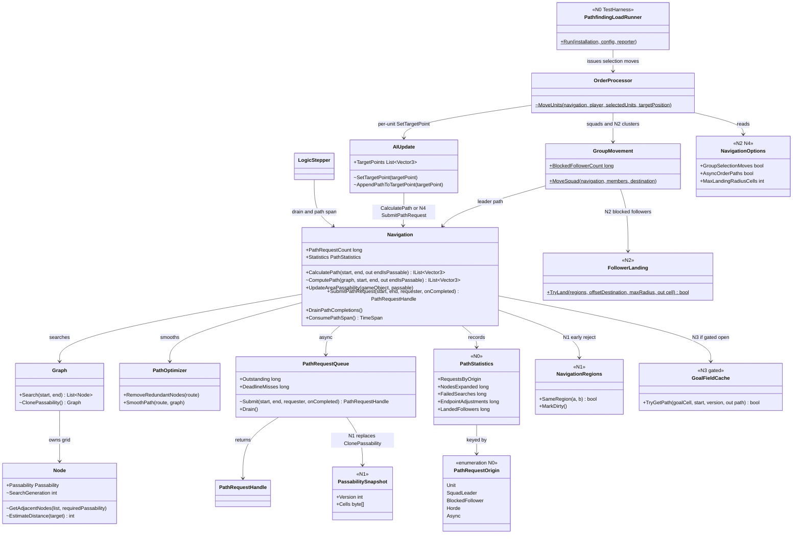
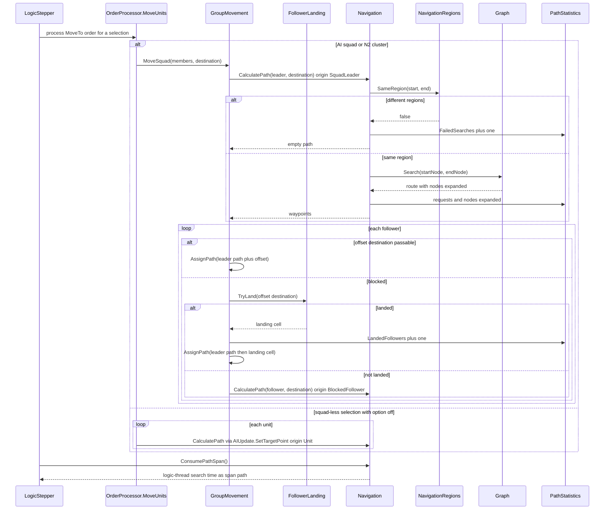
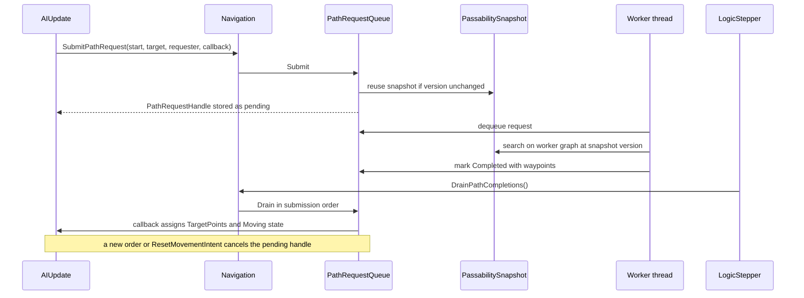

# Track N: Multi-Unit Pathfinding Performance

> Part of the [roadmap](../README.md) and [Track N](../track-n-pathfinding-performance.md).
> Audience: human.

Track N lowers the cost of path requests issued by multi-unit orders. B4 measured request rate
and closed its hierarchical gate; this track measures and reduces the cost of each request and
of each order that fans out into many requests.

## 1. Evidence

| Source | Finding |
|---|---|
| [M4 full-scale run](../implementation/track-m-m4-army-ai.md) | Worst decision tick: 912 path requests for 248 squads plus 664 blocked followers. Blocked followers are 73 percent of the requests, and each one is a full-map search. |
| [B4 report](../implementation/track-b-b4-spatial-scaling.md) | Request counts only (`path.requestsPerTick`). Search cost sits unmeasured inside the `gameLogic` and `ai` spans. The async anchor measured wait frames, not search time. |
| [M1 report](../implementation/track-m-m1-capacity-probe.md) | Scripted orders front-load requests into the approach, so per-tick medians read 0 and hide order-tick spikes. |

Code facts (see the [grounding appendix](#appendix-grounding)):

- Every request is an A* over the full-resolution tile grid (`Graph.Search`), run synchronously
  on the logic thread from `AIUpdate.AppendPathToTargetPoint` and `GroupMovement.MoveSquad`.
- The visited set is a `HashSet<Node>`, and each call allocates its route and waypoint lists.
- An unreachable goal floods the whole connected region before `Search` returns `null`.
- Squad-less multi-unit selections (player orders, scripts) call `AIUpdate.SetTargetPoint` per
  unit, so a 1000-unit selection pays 1000 searches on one tick.
- A follower is "blocked" when its formation-offset destination is impassable. It then pays a
  full search from its own position, even when the leader's path ends a few cells away.
- `PathRequestQueue` serves only the B4 anchor. Each submitting tick snapshots the graph through
  `Graph.ClonePassability`, which allocates a new `Node` per cell plus a grid-sized priority queue.

## 2. Scope

In scope: measurement of path cost, the grid search core, request sharing for multi-unit orders,
shared-destination fields (gated), off-thread computation of order paths, and scale
verification.

Out of scope:

- Partition and collision cost (B4 closed, B3 parallelism).
- Locomotor surface layers, water, and the `Pathfinder` stubs (E1).
- Unit-size clearance and local avoidance or steering. These change movement results, not
  request cost.
- Cross-shard routing (B6-5) and larger-map streaming (B4a).
- The pathfinding seam extraction (A4-32), which wraps N's result.

## 3. Budgets

Authored against the 33.3 ms tick anchor. N0 confirms or revises them with measured numbers.

| Budget | Value | Basis |
|---|---|---|
| `system.path.spanMs` amortized median, M4 army-AI probe | at or under 1.7 ms | 5 percent of the anchor, matching the M4 AI budget |
| `system.path.spanMs` p99 on order ticks, M4 army-AI probe | at or under 16.7 ms | half a frame, so a decision tick does not cost a dropped frame on its own |
| `system.path.spanMs` on the tick a 1000-unit selection moves | at or under 33.3 ms | at most one frame hitch per player order |
| Full searches per multi-unit order | at or under groups plus region-crossing followers | request sharing bound, extending the M4-2 bound |

## 4. Phase design

### N0: Path cost baseline

- `path` span: `Navigation` accumulates logic-thread time spent in `ComputePath`;
  `LogicStepper` emits it as a nested span after `ai`, the same way it consumes
  `ConsumeAiDecisionSpan`. Worker search time is reported separately as `path.workerMs`.
- `PathStatistics` counters: requests by `PathRequestOrigin` (`Unit`, `SquadLeader`,
  `BlockedFollower`, `Horde`, `Async`), nodes expanded, failed searches, and endpoint
  adjustments (`GetNextPassablePosition` hits).
- `PathfindingLoad` TestHarness scenario on the M0 map, seeded. Cases: squad-less selections of
  1, 10, 100, and 1000 ground units ordered across the map through `OrderProcessor.MoveUnits`;
  the same counts as army-AI squads; one unreachable destination case. Each case reports the
  order-tick span, request counts by origin, nodes expanded, and wall time per search.
- One M4 army-AI probe run with the counters attached gives the contact-phase share.

### N1: Search core efficiency

- Generation-stamped scratch: `Node` carries a search generation, so visited checks compare an
  integer instead of hashing. Route and waypoint buffers become caller-supplied.
- `NavigationRegions`: connected-region labels over the grid using exactly the neighbour rule of
  `Node.GetAdjacentNodes` (8 neighbours, target-cell passability only). `UpdateAreaPassability`
  marks labels dirty; the next query relabels. A request whose adjusted start and end sit in
  different regions returns the same empty result as a failed search, without searching.
- `PassabilitySnapshot`: workers copy a passability byte array keyed by a version that
  `UpdateAreaPassability` increments, and each worker reuses one search graph across requests.
  This replaces the per-tick `ClonePassability`.
- Result equality is the gate: a seeded corpus of start/end pairs on the M0 map returns identical
  waypoint lists before and after.

### N2: Shared group requests

- `FollowerLanding`: a blocked follower lands on the nearest passable cell to its offset
  destination that lies in the destination's region, found by a ring search bounded by
  `MaxLandingRadiusCells`. The follower retraces the leader's path and finishes on the landing
  cell. A full search remains only when the follower starts in another region or the ring search
  fails.
- Squad-less selections: with `NavigationOptions.GroupSelectionMoves` on, `MoveUnits` clusters
  ground units by position (fixed cell buckets, ties by object id) and calls
  `GroupMovement.MoveSquad` per cluster. Default off, so player orders, replays, and golden
  baselines keep per-unit behavior until the operator flips the default.
- Counters split blocked followers into landed and fallback.

### N3: Shared-destination fields (gated)

Gate: after N2, on the N0 cases and the M4 probe, at least `GoalFieldMinRequests` full searches
on one tick share a goal cell neighbourhood, and the order-tick span still misses budget. If
the gate stays closed, the decision and numbers are recorded and nothing is built, as with the
B4 hierarchical gate.

If opened: `GoalFieldCache` computes one reverse Dijkstra field per goal cell, bounded to a
window around the requesters, keyed by goal cell and passability version, with a fixed entry
cap. A path is a descent through the field, then the existing `PathOptimizer` smoothing.

### N4: Off-thread order paths

- With `NavigationOptions.AsyncOrderPaths` on, `AIUpdate.SetTargetPoint` and
  `GroupMovement.MoveSquad` submit through `Navigation.SubmitPathRequest` instead of calling
  `CalculatePath`. The unit records a pending handle and holds until the drain callback assigns
  its waypoints.
- A new order or `ResetMovementIntent` cancels the pending handle. Destroyed requesters already
  cancel in `Drain`.
- Completion frames vary between runs. That is accepted under the
  [determinism Decision](../open-questions.md); the option stays off for determinism-enforcing
  tests, and any baseline failure is handled as a suspected deviation.

### N5: Scale verification

Re-run every N0 case and the M4 army-AI probe (same profile, seed, and frame budget) with N1 to
N4 enabled and N3 if built. Report each budget in section 3 against before and after medians
with CIs, plus M4 invariants (stalls, unassigned units, commanderless squads) and engagement
checks.

## 5. Decisions

- Multi-unit request cost is its own track, not a B4 reopening. Recorded in
  [open-questions](../open-questions.md).
- No hierarchical layer. N3's field is the only new structure and is gated on N2's residual.
- Behavior-changing options (`GroupSelectionMoves`, `AsyncOrderPaths`) default off until N5
  evidence and an operator decision flip them.

## 6. Risks

| Risk | Mitigation |
|---|---|
| Region labels disagree with the search's diagonal rule and reject reachable goals | Labels reuse `GetAdjacentNodes`; the N1 corpus includes diagonal-only gaps and asserts equality |
| Relabeling after every structure placement costs more than it saves | N1 measures relabel time; labels relabel lazily on query, not per placement |
| Landed followers retrace leader offsets across impassable mid-path cells (already true today, since only the destination is checked) | N2 records the count of impassable retrace points in the scenario report; fixing it is a follow-up card, not silent scope |
| Holding units for async paths raises idle time | N4 asserts M4 stall invariants and reports wait frames |
| Seeded baselines move | Options default off; suspected-deviation protocol from `AGENTS.md` |

## 7. Card sequence

`WI-N0-01` then `WI-N0-02`; `WI-N1-01..03` in order; `WI-N2-01` then `WI-N2-02`; `WI-N4-01`
then `WI-N4-02` (after N1, parallel to N2); `WI-N3-01` after N2; `WI-N5-01` last. Card table:
[implementation plan](../implementation/track-n-pathfinding-performance.md).

## 8. Architecture diagrams

Existing types are shown with their current members; types marked with the introducing phase
are new.

### Class diagram

### Sequence: multi-unit order tick (N0 measurement, N1 and N2 changes)

### Sequence: off-thread order path (N4)

## Appendix: grounding

| Fact | Location |
|---|---|
| Synchronous entry, request counter | `src/Panopticon.Simulation/Navigation/Navigation.cs:84` (`CalculatePath`) |
| Shared search core | `Navigation.cs:93` (`ComputePath`) |
| Passability mutation | `Navigation.cs:137` (`UpdateAreaPassability`) |
| Async submit, drain, worker snapshot hook | `Navigation.cs:191`, `:198`, `:210` |
| A* with `HashSet<Node>` visited set | `src/Panopticon.Simulation/Navigation/Graph.cs:20`, `:89` |
| Full-graph clone | `Graph.cs:57` (`ClonePassability`) |
| Neighbour rule | `src/Panopticon.Simulation/Navigation/Node.cs:49` (`GetAdjacentNodes`) |
| Per-tick snapshot clone | `src/Panopticon.Simulation/Navigation/PathRequestQueue.cs:139` |
| Submission-ordered drain | `PathRequestQueue.cs:177` |
| Squad move, blocked-follower fallback | `src/Panopticon.Simulation/Navigation/GroupMovement.cs:29`, `:104` |
| Selection routing | `src/Panopticon.Simulation/Logic/Orders/OrderProcessor.cs:668` (`MoveUnits`) |
| Per-unit path request | `src/Panopticon.Simulation/Logic/Object/Update/AIUpdate/AIUpdate.cs:199`, `:267` |
| Horde formation requests | `src/Panopticon.Simulation/Logic/Object/Contain/HordeContain.cs:93` |
| Drain and span emission | `src/Panopticon.Simulation/LogicStepper.cs:115`, `:125`-`:141` |
| AI span accumulation pattern | `src/Panopticon.Simulation/Game.cs:499`-`:508` |
| Probe path statistics | `src/Panopticon.Tools.TestHarness/MassBattleCapacityProbeRunner.cs:671` |
| Scenario catalog and parameter attributes | `src/Panopticon.Tools.TestHarness/HarnessScenarioCatalog.cs`, `TestHarnessConfig.cs` |
