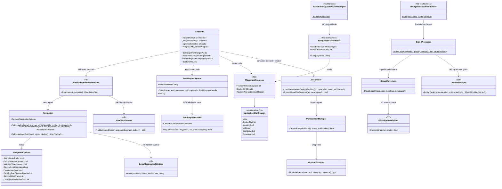
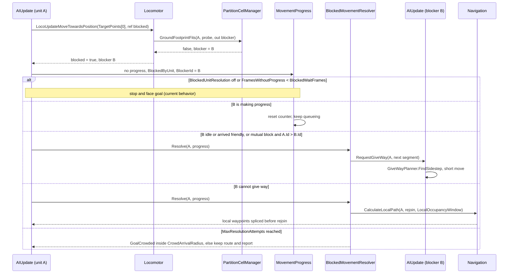
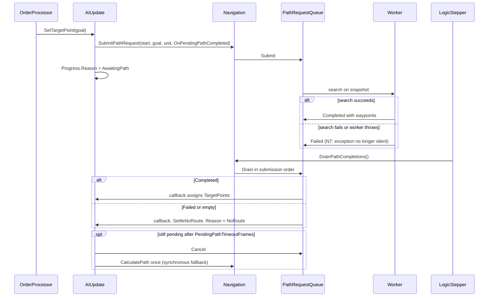

# Track N: Navigation Deadlocks

> Part of the [roadmap](../README.md) and [Track N](../track-n-pathfinding-performance.md).
> Audience: human.

Phases N6 to N10 extend Track N from path cost to movement liveness: units that hold an order but
stop making progress because other units, failed paths, or a crowded goal block them. N0 to N5
design and results live in the [pathfinding performance deep dive](n-multi-unit-pathfinding.md).

## 1. Evidence

| Source | Finding |
|---|---|
| [N2 and N5 results](../implementation/track-n-pathfinding-performance.md#wi-n5-01-verification) | The M4 idle-stall check fails in both option modes: 2 to 6 units idle for 1110 to 2900 frames against the 600-frame threshold. The pre-merge N1 head passes, so the cause entered with merged mainline movement content. |
| [N2 results](../implementation/track-n-pathfinding-performance.md#wi-n2-results) | Landed followers retrace leader offsets across impassable mid-path cells. The `impassableRetracePoints` counter reports them; the fix was deferred to a follow-up card. |
| [N5 default-flip recommendation](../implementation/track-n-pathfinding-performance.md#wi-n5-01-verification) | `AsyncOrderPaths` stays off until the stall check holds run over run with it on. |
| `RoutingChoke` scenario | 40 tanks through a wall gap terminate on `NoProgress` when units jam; retained waypoints do not keep the run alive. No case runs opposing traffic. |

Code facts (see the [grounding appendix](#appendix-grounding)):

- The only unit-unit movement check is the swept-footprint gate. `GroundFootprint.BlocksAdvance`
  blocks any obstacle ahead of the step and never pushes units apart. Two units moving head-on
  are each ahead of the other, so both block every frame.
- A blocked ground unit zeroes its velocity and turns toward its goal. It does not wait with a
  timeout, repath, sidestep, or ask the blocker to move. `AIUpdate` discards the locomotor's
  `blocked` output.
- The original engine's resolution fields are ported but unused: `_waitingForPath`,
  `_moveOutOfWay1/2`, `_repulsor1/2`, `_canPathThroughUnits`, `_ignoreObstacleId`,
  `_queueForPathFrame`. They are only persisted. `IsMoving` is a `false` stub.
- The pathfinding grid holds terrain and structures only. Units never mark cells, so a path can
  end on a cell held by an arrived unit. `GameData.MaxCellsAdjustDestination` is parsed with no
  consumer.
- Every unit of a squad-less selection gets the same final point. Arrival requires
  `CloseEnoughDist`, so units held off by an arrived unit keep their waypoints indefinitely.
- An async path that is cancelled by a worker exception never calls back; the unit stands with
  an empty route. A failed squad-leader search leaves members with their previous route or none.
  Nothing re-requests a pending path that outlives `AsyncPathFrameBound`.
- The M4 sampler counts a unit as engaged while it holds target points, so a jammed unit with
  waypoints never registers as idle. The check sees only units with no route, and it reports
  per-side aggregates without unit IDs, reasons, or blockers.

## 2. Scope

In scope: per-unit stall attribution and deadlock cases (N6), path liveness for failed,
cancelled, and stale requests plus offset-route validation (N7), blocked-unit resolution by wait,
give-way, and bounded local repath (N8), destination spreading and crowd arrival (N9), and
verification at scale (N10).

Out of scope:

- Continuous local avoidance or steering (velocity obstacles, flow-based crowds). See the
  decision in section 5; N19 later adds steering behind an option, in the
  [layered navigation deep dive](n-layered-navigation.md).
- Unit-size clearance in the global grid and per-layer bridges and water (E1; bridge layers are
  stubs today).
- Push-apart collision response and crush behavior in `PhysicsBehavior`.
- Aircraft, which do not use the footprint gate.
- Proactive queueing at narrow passages: N11 to N14, in the
  [passage deep dive](n-confined-passage-queueing.md).

## 3. Targets

Authored before measurement. N6 confirms or revises them with baseline numbers.

| Target | Value | Basis |
|---|---|---|
| Deadlock cases settle | every unit `Arrived` or `CrowdArrived` inside the case frame budget | the case is the regression for its mechanism |
| Zero-progress units holding an order, M4 army-AI probe | none longer than 600 frames, 3 seeded runs, all Track N options on | the M4 stall threshold, measured on progress instead of route state |
| Wait-for cycles at case end | 0 | a cycle is a deadlock by definition |
| No-route settle latency | the drain that delivers the failure; pending watchdog at 2 x `AsyncPathFrameBound` (60 frames) | a failed order never leaves a unit holding |
| Resolution cost | N5 path budgets still met; one local repath expands at most (2W+1)^2 cells, W = `LocalRepathWindowCells` | resolution must not reopen N0 to N5 |

## 4. Phase design

### N6: Deadlock detection baseline

- `PartitionCellManager.GroundFootprintFits` reports the first blocking object. The locomotor
  returns it through `blocked`, and `AIUpdate` records it in a per-unit `MovementProgress`:
  frames without progress toward `TargetPoints[0]`, blocker ID, and a `NavigationStallReason`
  (`BlockedByUnit`, `AwaitingPath`, `NoRoute`, `GoalCrowded`). Progress means the distance to
  the current waypoint shrank by at least `ProgressEpsilon` since the last sample. Detection
  changes no movement.
- The TestHarness `NavigationStallSampler` builds the wait-for graph from blocker IDs each
  sample, finds cycles, and writes per-unit stall records (ID, definition, reason, blocker,
  frames, order destination). `MassBattleSquadInvariantSampler` adopts its progress-based idle
  rule, which exposes jams the route-state rule hides. The M4 stall count is expected to rise;
  the new count is the baseline.
- `NavigationDeadlock` scenario, seeded cases run to settle or frame budget:

| Case | Setup | Mechanism exercised |
|---|---|---|
| `head-on-pair` | two tanks ordered through each other's start | mutual footprint block |
| `corridor-opposed-20` | two 20-tank columns crossing the `RoutingChoke` wall gap in opposite directions | chokepoint cycle |
| `crowd-goal-100` | 100 squad-less tanks to one point on open ground | crowded destination |
| `queue-behind-idle` | a column ordered through a gap held by an idle friendly | stationary blocker |
| `async-no-route` | `AsyncOrderPaths` on, goal in a sealed pocket, plus an injected worker failure | no-route hold |
| `squad-offset-retrace` | squad leader path hugging a cliff edge | impassable retrace |

### N7: Path liveness

- A worker exception completes the request as `Failed` and calls back, the same as an empty
  search. `AIUpdate.SettleNoRoute` clears the route and moving state and records `NoRoute`.
  Requester-cancelled requests still never call back.
- A pending handle older than `PendingPathTimeoutFrames` (default 60) cancels and falls back to
  the synchronous `CalculatePath` once. Only reachable with `AsyncOrderPaths` on.
- A failed or empty squad-leader result settles every member as `NoRoute`, synchronously and
  through the async callback.
- `OffsetRouteValidator` walks each retrace segment through the passability snapshot. A
  follower whose offset route crosses an impassable cell lands (N2 landing) or falls back to its
  own search. Behind `ValidateOffsetRoutes`, default off; `impassableRetracePoints` reads 0 with
  it on.

### N8: Blocked-unit resolution

Behind `BlockedUnitResolution`, default off. `BlockedMovementResolver` runs on the logic thread
when `MovementProgress` shows a unit blocked for `BlockedWaitFrames` (default 15):

1. Wait. A blocker that is itself making progress resets the counter, so following traffic
   queues as it does today.
2. Give way. A blocker that is idle, arrived, or a friendly with no move order gets a
   `RequestGiveWay` (sets its `_moveOutOfWay1`), and `GiveWayPlanner.FindSidestep` moves it to
   the nearest free cell off the requester's next segment. A mutual block (each records the
   other) yields by lower `ObjectId`, so exactly one unit sidesteps.
3. Local repath. A blocker that cannot give way (enemy, structure under construction, attacking,
   pinned by its own order) triggers `Navigation.CalculateLocalPath` from the unit to the first
   waypoint outside a (2W+1)-cell window, over the passability snapshot plus a
   `LocalOccupancyWindow` of stationary units. Counted as `PathRequestOrigin.BlockedRepath`.
4. Give up. After `MaxResolutionAttempts` (default 3) the unit settles as `GoalCrowded` if
   within `CrowdArrivalRadius` of its goal, otherwise it keeps its route and stays reported.

The port's unused fields map onto this design: `_moveOutOfWay1/2` and `_ignoreObstacleId` are
reused; `_repulsor1/2` and `MoveAwayFromRepulsors` stay panic behavior.

### N9: Destination crowding

- `DestinationSlots.Assign` gives each unit of a squad-less or cluster selection its own goal,
  packed outward from the order point by footprint radius, in the destination's region, bounded
  by `GameData.MaxCellsAdjustDestination`. Squads keep formation offsets. Behind
  `DestinationSlots`, default off.
- Crowd arrival: a unit on its final segment blocked by an arrived friendly whose own goal lies
  within `CrowdArrivalRadius` of this unit's goal stops, clears its route, and reports
  `CrowdArrived`. Applies with or without slots.

### N10: Deadlock verification

Re-run every N6 case and the M4 army-AI probe (3 seeds) with all Track N options on, then with
each N7 to N9 option off in turn, and report each target in section 3 with before and after
numbers, the N5 path budgets, and M4 invariants. Records a default-flip recommendation for
`AsyncOrderPaths`, `GroupSelectionMoves`, `ValidateOffsetRoutes`, `BlockedUnitResolution`, and
`DestinationSlots`.

## 5. Decisions

- Deadlock work extends Track N, not a new track: it shares N's measurement, options, and
  scenarios, and N5's default-flip decision waits on it.
- Discrete resolution (wait, give way, bounded local repath), not continuous local avoidance.
  It matches the ported original-engine model, keeps per-frame cost bounded, and leaves the
  global grid unit-free. Continuous avoidance would change every move and every baseline.
- Detection lives in the simulation (`MovementProgress`), so N8 and N9 act on the same signal
  the harness reports.
- Behavior-changing options default off until N10 evidence and an operator decision. N7's
  failure-path settle is unconditional: it only touches units that already hold no route.

## 6. Risks

| Risk | Mitigation |
|---|---|
| The progress-based idle rule makes M4 checks fail that passed before | Expected; N6 records the new baseline and labels it, it does not tune the threshold |
| Give-way sidesteps cascade through a dense column | Sidestep targets must be free cells off the requester's segment; one give-way per blocker per `BlockedWaitFrames` |
| Local repaths spike the `path` span in a jam | Window bound per search and `MaxResolutionAttempts`; N10 re-checks the N5 budgets |
| Crowd arrival stops units short of a reachable goal | Applies only on the final segment, behind an arrived friendly, inside `CrowdArrivalRadius` |
| Seeded baselines move | Options default off; suspected-deviation protocol from `AGENTS.md` |

## 7. Card sequence

`WI-N6-01` then `WI-N6-02`; `WI-N7-01` then `WI-N7-02`; `WI-N8-01` then `WI-N8-02`; `WI-N9-01`
then `WI-N9-02`; N7, N8, and N9 may run in parallel after N6; `WI-N10-01` last. Card table:
[implementation plan](../implementation/track-n-pathfinding-performance.md#navigation-deadlocks-n6-n10).

## 8. Architecture diagrams

Existing types show current members; types and members marked with a phase are new.

### Class diagram

### Sequence: blocked unit resolution (N6 detection, N8 resolution)

### Sequence: async order path liveness (N7)

## Appendix: grounding

| Fact | Location |
|---|---|
| Waypoint advance, `blocked` discarded | `src/Panopticon.Simulation/Logic/Object/Update/AIUpdate/AIUpdate.cs:563`-`:596` |
| Unused original-engine fields | `AIUpdate.cs:63`-`:88`; `IsMoving` stub `:120` |
| Async request and callback | `AIUpdate.cs:249`-`:306` |
| Shared final point for every unit | `AIUpdate.cs:228`-`:238` |
| Footprint gate | `src/Panopticon.Simulation/Logic/Object/Locomotor.cs:287`, block handling `:403`-`:416` |
| Swept test, no push-apart | `src/Panopticon.Simulation/Logic/GroundFootprint.cs:8`-`:26` |
| Footprint query over partition cells | `src/Panopticon.Simulation/Logic/PartitionCellManager.cs:243`-`:281` |
| Bepu step cancel | `src/Panopticon.Simulation/Logic/Object/Behaviors/PhysicsBehavior.cs:617`, `:655` |
| Grid passability from terrain and structures | `src/Panopticon.Simulation/Navigation/Navigation.cs:29`-`:45`, `:218`-`:263`; `GameObject.cs:659` |
| Impassable-only endpoint adjustment | `Navigation.cs:87` (`GetNextPassablePosition`) |
| Unconsumed destination adjust limit | `src/Panopticon.Simulation/GameData.cs:547`, `:1445` |
| Pathfinder stubs | `src/Panopticon.Simulation/Logic/AI/Pathfinder.cs:22`-`:42` |
| Cancelled requests and worker exception | `src/Panopticon.Simulation/Navigation/PathRequestQueue.cs:212`-`:226`, `:369`-`:381` |
| Failed async squad leader ignored | `src/Panopticon.Simulation/Navigation/GroupMovement.cs:92`-`:108` |
| Offset destination checked, route not | `GroupMovement.cs:146`, `:213`-`:238` |
| Retrace counter | `src/Panopticon.Tools.TestHarness/PathfindingLoadRunner.cs:424`-`:441` |
| Route-state idle rule, 600-frame threshold | `src/Panopticon.Tools.TestHarness/MassBattleSquadInvariantSampler.cs:128`-`:168` |
| Gap scenario and progress monitor | `src/Panopticon.Tools.TestHarness/RoutingChokeRunner.cs`, `RoutingChokeProgressMonitor.cs` |
| Repulsor state wired to panic only | `src/Panopticon.Simulation/Logic/AI/AIUpdateStateMachine.cs:35`-`:47`, `:189` |
