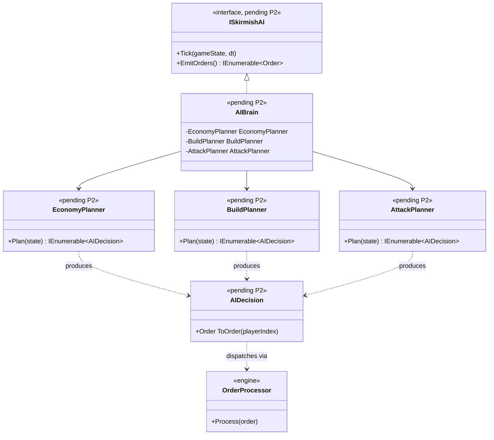

# Deep Dive: Skirmish AI Opponent (P2)

> Expands phase P2 of [Track P: Playable Baseline](../track-p-playable-baseline.md). Part of
> the [Large-Scale Simulation Roadmap](../README.md).
>
> Audience: human overview of the skirmish-AI design. Code references are in the agent-context appendix at the bottom.
>
> The agent-context section at the bottom ([Current code appendix](#appendix-current-code-agent-context)) contains file:line code references. Skip it if reading for design intent.

Purpose: give `SkirmishAIPlayer`/`AIPlayer` a strategic decision loop so a computer opponent can
play a complete, legal skirmish. The design covers base build-out, economy management,
unit production, and attack/defense decisions.

This deep dive also covers the construction/production execution surface (P5) that P2 drives.
P2 is the decision layer; P5 is the mechanism it actuates.

---

## 1. Design

### 1.1 Add a strategic decision loop to the skirmish AI
Give `SkirmishAIPlayer` (and/or `AIPlayer`) an `Update(...)` driven from the player tick, where
`PlayerManager`/`GameLogic` already advance players each frame. The loop is a coarse-cadence state
machine that runs every N logic frames, not every frame:

1. Economy: ensure a supply structure + enough harvesters; if income is low and affordable,
   queue another harvester/supply building.
2. Base build-out: walk the `AIData.SkirmishBuildLists` for the AI's faction in priority order;
   for the next unbuilt, affordable, prerequisite-satisfied structure, issue a build.
3. Production: at production structures, queue army units toward a target composition, gated by
   `Player.CanProduceObject(...)`.
4. Military: once a threshold force exists, select an attack target (an enemy structure via the
   relationship data from [P1](p1-skirmish-setup.md)) and issue attack-move; otherwise hold/defend.

The loop must be idempotent and budget-aware: never queue what it can't afford
(`BankAccount`), never duplicate in-flight build/production jobs (check
`ProductionUpdate`/`IsBeingConstructed`).

### 1.2 Consume the stranded build-list data (P5)
Wire `AIData.SkirmishBuildLists` / `BuildListInfo` (`AIData.cs`, `BuildListInfo.cs`) into the base
build-out step. This is the data the original engine drives skirmish AI from, already parsed and
waiting. `BuildListInfo`'s `PriorityBuild`, `DesiredGatherers`, `IsSupplyBuilding`, `IsBuildable`
fields directly inform steps 1–2.

### 1.3 How the AI issues actions (Decision: orders via `OrderProcessor`)
Two actuation styles were considered:
- (a) Via `Order`s through `OrderProcessor`: the AI emits the same `Order`s a human would
  (`BuildObject`, `CreateUnit`, `ForceAttack…`). Pro: one code path, automatically replay/record
  compatible (matches the [P0 harness](p0-playable-baseline-harness.md) and A2 reproducibility). Con:
  must synthesize valid order arguments (positions, object ids).
- (b) Direct API calls: `GameLogic.CreateObject`, `PrepareConstruction`,
  `ProductionUpdate.QueueProduction/QueueUpgrade`, `IBuilderAIUpdate.SetBuildTarget`. Pro: simpler
  to author. Con: bypasses the order stream, so AI actions wouldn't appear in replays/recordings.
  a problem for A2/B-track reproducibility.
- Decision: use (a). AI actions live in the same order stream the framework records and
  replays, keeping Track P's loop honest for the scaling tracks (the argument-synthesis cost is
  accepted). Settled before P2-2. See [open-questions](../open-questions.md).

### 1.4 P5: construction and production completeness
The mechanism is largely present (see appendix §1.4). P5 closes the remaining gaps and verifies both paths:
- Confirm construction debits `BankAccount` (the audit could not confirm production/construction
  debits money; verify in `ProductionUpdate`/build paths; add if missing).
- Confirm prerequisite/tech gating holds for AI-issued builds the same as for the player
  (`Player.CanProduceObject`, `GameObject.CanConstructUnit`).
- Confirm upgrades complete and apply (`GrantUpgrade`, `Player.AddUpgrade`,
  `GameObject.Upgrade`).
- Identify the control-bar/UI buildability binding (the audit did not locate the UI consumer of
  `CanPurchase`/`CanConstructUnit`/`CanEnqueueUpgrade`); needed for P6 player-side parity.

---

## 2. Integration surface
- AI decision (new): an `Update(...)` on `SkirmishAIPlayer`/`AIPlayer`, ticked from the player
  loop; reads `Player.BankAccount`, `AIData.SkirmishBuildLists`, relationships (P1).
- Actuation: the AI emits `Order`s via `OrderProcessor.Process`, not the direct API, so AI
  actions enter the recorded order stream (§1.3).
- Gating: `Player.CanProduceObject`, `GameObject.CanConstructUnit/CanEnqueueUpgrade`.
- Targets: consume the foundational [P1-5](p1-skirmish-setup.md) per-`Player` owned-object set for
  enemy target selection (no all-objects scan).

## 3. Sub-phases

| Phase | Goal | Status |
|---|---|---|
| P2-1. AI tick scaffold | Add a coarse-cadence `Update(...)` to the skirmish AI, ticked from the player loop; no behavior yet. | Not started |
| P2-2. Economy & base build-out | Consume `SkirmishBuildLists`; ensure supply + harvesters; build prerequisite-satisfied, affordable structures in priority order. (Actuation = orders; decided.) | Not started |
| P2-3. Unit production | Queue army units toward a target composition, money/prereq gated. | Not started |
| P2-4. Military behavior | Threshold force → select enemy target (P1 relationships) → attack-move; basic defense. | Not started |
| P5-1. Funding & gating verification | Confirm construction/production debit `BankAccount` and respect prerequisites for both player and AI; fix gaps. | Done |
| P5-2. Upgrades & buildability binding | Verify upgrade completion/application; locate + verify the control-bar buildability consumer. | Done |

The scenario matrix's synthetic-data and real-order-path gaps (see §6 below) are tracked as part of
[Track P phase P8](../track-p-playable-baseline.md), not as a further P5 sub-phase. See
[deep-dives/p8-implementation-delta-remediation.md](p8-implementation-delta-remediation.md).

## 4. Sequencing and dependencies
- P2 depends on P1 (related, spawned players + the foundational [P1-5](p1-skirmish-setup.md)
  ownership tracking that P2-4 uses for target selection), P4 (a working economy to spend), and
  P5 (construction/production mechanism). P2-1 can scaffold in parallel; P2-2+ need P4/P5.
- Actuation = orders (§1.3, decided): the AI emits `Order`s through `OrderProcessor`, reusing the
  engine order path the [P0 harness](p0-playable-baseline-harness.md) drives. P2's recorded-stream
  check therefore runs through P0, which A2/B reproducibility requires.
- P2 feeds P7 (the AI must "make progress", an asserted invariant in the
  [P0 harness](p0-playable-baseline-harness.md)).

## 5. Resolved design questions and open work
- Actuation style: decided on orders via `OrderProcessor` (§1.3), so AI actions enter the
  recorded stream. See [open-questions](../open-questions.md).
- AI competence scope: Decided: minimum legal opponent in Track P
  (build/economize/produce/≥1 attack → terminating win/lose). The design leaves room for
  configurable difficulty tiers, but only the minimum tier is implemented now. Richer behavior is
  later expansion. See [open-questions](../open-questions.md).
- AI architecture depth: single state machine now. Formalize pluggability later as the
  candidate [A4](../track-a-foundations.md) experiment seam; the stubbed difficulty tiers are the
  natural variation axis. Design: [pluggable-ai.md](a4-pluggable-ai.md)
  (`IAIDecisionPolicy`, with this phase's `SkirmishAIPlayer` state machine as the reference
  implementation). Not implemented by P2; see that doc's §6 for follow-on work.
- Where `BankAccount` is debited for construction: open verification task (not a design
  choice): locate/confirm before P5-1.

## 6. Scenario Matrix

The P0-5b matrix runner validates P2 and P5 by sweeping over faction and map configurations,
ensuring the AI plays a legal game across its full faction × map space.

### P2: AI decision loop

| Axis | Values | Notes |
|---|---|---|
| `humanFaction` | `USA`, `GLA`, `China` | The human-controlled player's faction |
| `aiFaction` | `USA`, `GLA`, `China` | The AI-controlled player's faction |
| `mapSize` | `small`, `medium` | Maps with different supply distribution |

Constraints: none (all 3×3×2 = 18 cells are valid).

Each cell runs the AI for a fixed number of frames through the P0 harness and asserts:
- AI built ≥1 structure (command center or equivalent exists in `GameLogic`).
- AI produced ≥1 unit.
- AI issued ≥1 attack order.
- `BankAccount` went positive at least once (economy is running).

### P5: Construction/production completeness

| Axis | Values | Notes |
|---|---|---|
| `faction` | `USA`, `GLA`, `China` | Currently only varies a name label on a synthetic reflection-built prerequisite chain; no distinct per-faction build tree is exercised yet. Tracked in [Track P phase P8](../track-p-playable-baseline.md). |
| `buildTreeDepth` | `tier1`, `tier2`, `tier3` | How far up the tech tree prerequisites are exercised |
| `playerType` | `human`, `AI` | Only the `AI` cell issues `Order.CreateBuildObject` through `OrderProcessor`; the `human` cell currently calls `GameLogic.CreateObject` + sets `BuildProgress` directly, bypassing the order path. Tracked in [Track P phase P8](../track-p-playable-baseline.md). |

Constraints: `tier3` requires that `tier1` and `tier2` prerequisites are satisfied within the
same cell run (the scenario issues the full prerequisite chain).

Each cell asserts:
- Each prerequisite structure at the requested tier exists and is fully constructed before the
  gated unit/upgrade is attempted.
- `Player.CanProduceObject` returns true once prerequisites are met. It does not yet assert the
  gated unit actually spawns or the upgrade actually applies; tracked in
  [Track P phase P8](../track-p-playable-baseline.md).
- The build tree is accessible via `OrderProcessor` (not just through direct API calls) for the
  AI cell only; the human cell does not yet exercise this. Tracked in
  [Track P phase P8](../track-p-playable-baseline.md).

## 7. Architecture Diagrams

Diagrams for this phase will be elaborated once P2/P5 move to active implementation. The
placeholder below captures the key types the AI subsystem introduces.

## 8. Related
- Track overview: [`../track-p-playable-baseline.md`](../track-p-playable-baseline.md)
- Players/relationships it needs: [`p1-skirmish-setup.md`](p1-skirmish-setup.md) (P1)
- Economy it spends: [`p4-p6-economy-production-combat.md`](p4-p6-economy-production-combat.md) (P4/P5/P6)
- Order stream / harness: [`p0-playable-baseline-harness.md`](p0-playable-baseline-harness.md) (P0)
- Pluggable AI policy seam this phase's reference implementation is carved from:
  [`a4-pluggable-ai.md`](a4-pluggable-ai.md) (A4)
- Architecture snapshot: [`../agent/current-state.md`](../agent/current-state.md)

---

## Appendix: Current code (agent context)

> Agent context: this section contains file:line code references for agents
> implementing this phase. Human readers: the design intent above does not
> require reading this section.

### The strategic AI is state-only (the gap)
- `AIPlayer` is persisted fields only: counters, flags, an object id, a position, and `Persist(...)`;
  no update/decision loop (`src/OpenSage.Game/Logic/AI/AIPlayer.cs:8-154`).
- `SkirmishAIPlayer` adds 4 persisted scalars + `Persist(...)`; no behavior
  (`Logic/AI/SkirmishAIPlayer.cs:3-31`).
- ⇒ There is currently no strategic AI at all, only save/load state.

### Per-object AI exists (unit-level, not strategic)
- Base `AIUpdate` owns locomotion, target points, pathing/turret state, idle/move helpers
  (`Logic/Object/Update/AIUpdate/AIUpdate.cs:13-260`).
- Builder behavior: `DozerAIUpdate` (`.../DozerAIUpdate.cs:9-74`) and `WorkerAIUpdate`
  (`.../WorkerAIUpdate.cs:12-220`) wrap `DozerAndWorkerState` with `SetBuildTarget`/`SetRepairTarget`.
- Harvester loop: `SupplyAIUpdate` (search/approach/request/gather/pickup/dump,
  `.../SupplyAIUpdate.cs:8-258`) and the thin `SupplyTruckAIUpdate` (`.../SupplyTruckAIUpdate.cs:6-34`).
- These drive individual units; none is a player-level strategy loop.

### Data-driven AI inputs exist but are unconsumed
- `AIData` parses the `AIData` INI block and stores `SkirmishBuildLists`
  (`Logic/AI/AIData.cs:7-260`; `SkirmishBuildList` parse `:99-100,242-245`).
- `BuildListInfo` carries AI-only fields: `ResourceGatherers`, `IsSupplyBuilding`, `DesiredGatherers`,
  `CurrentGatherers`, `PriorityBuild`, `IsBuildable` (`Logic/Map/BuildListInfo.cs:10-237`).
- `IniParser.BlockParsers.cs` parses `AIData`/`SkirmishAIData`; `SkirmishAIData.cs` exists (container).
- ⇒ No code consumes `AIData.SkirmishBuildLists` yet. The build-order data is parsed and stranded.

### How actions are actuated (the P5 mechanism)
- Human/scripted orders run through `OrderProcessor.Process(...)`
  (`Logic/Orders/OrderProcessor.cs:96-204`):
  - Build structure → `CreateObject(...)` + `GameObject.PrepareConstruction()` +
    `(dozer?.AIUpdate as IBuilderAIUpdate)?.SetBuildTarget(...)`.
  - Upgrade → `ProductionUpdate.QueueUpgrade(...)`; Unit → `ProductionUpdate.QueueProduction(...)`;
    Repair → `SetRepairTarget(...)`.
- `ProductionUpdate` owns the queue and spawn: `Update()` advances the front job and spawns units
  (`Logic/Object/Update/ProductionUpdate.cs:59-156`); `ProduceObject(...)` calls
  `GameEngine.GameLogic.CreateObject(...)`, places the transform, and moves out to the rally point
  (`:343-395`); `QueueProduction(...)` (`:472-483`), `QueueUpgrade(...)` (`:516-525`),
  `CanProduceObject(...)` (`:271-291`), `CanEnqueue()` (`:551`).
- Construction lifecycle on `GameObject`: `PrepareConstruction()` (`:991-1034`),
  `SetIsBeingConstructed()` (`:1039-1044`), `AdvanceConstruction()` (`:1046-1058`),
  `FinishConstruction()` (`:1060-1074`), `IsBeingConstructed()` (`:1077-1082`)
  (`Logic/Object/GameObject.cs`).
- Prerequisites/tech gating: `Player.CanProduceObject(ObjectDefinition)` checks
  `Prerequisites.Objects` (AND of OR-lists) + `Prerequisites.Sciences` (`Logic/Player.cs:357-420`);
  `GameObject.CanConstructUnit(...)` (`:1186-1192`), `CanPurchase(CommandButton)` (`:1164-1182`),
  `CanEnqueueUpgrade(...)` (`:1194-1222`).
- Builder placement: `OrderProcessor.BuildObject` (`:96-121`) → `DozerAIUpdate.SetBuildTarget`
  (`DozerAIUpdate.cs:41-46`) / `WorkerAIUpdate.SetBuildTarget` (`WorkerAIUpdate.cs:48-54`); builder
  cancels if the target dies (`GameObject.cs:1298-1316`).
- Upgrades: `QueueUpgrade`/`CancelUpgrade` (`ProductionUpdate.cs:516-549`); completion via
  `GrantUpgrade(...)` (`:113-123`); `Player.AddUpgrade/HasUpgrade/HasEnqueuedUpgrade`
  (`Player.cs:423-492`); `GameObject.Upgrade(...)`/`UpdateUpgradeableModules()` (`:1232-1247`).

---