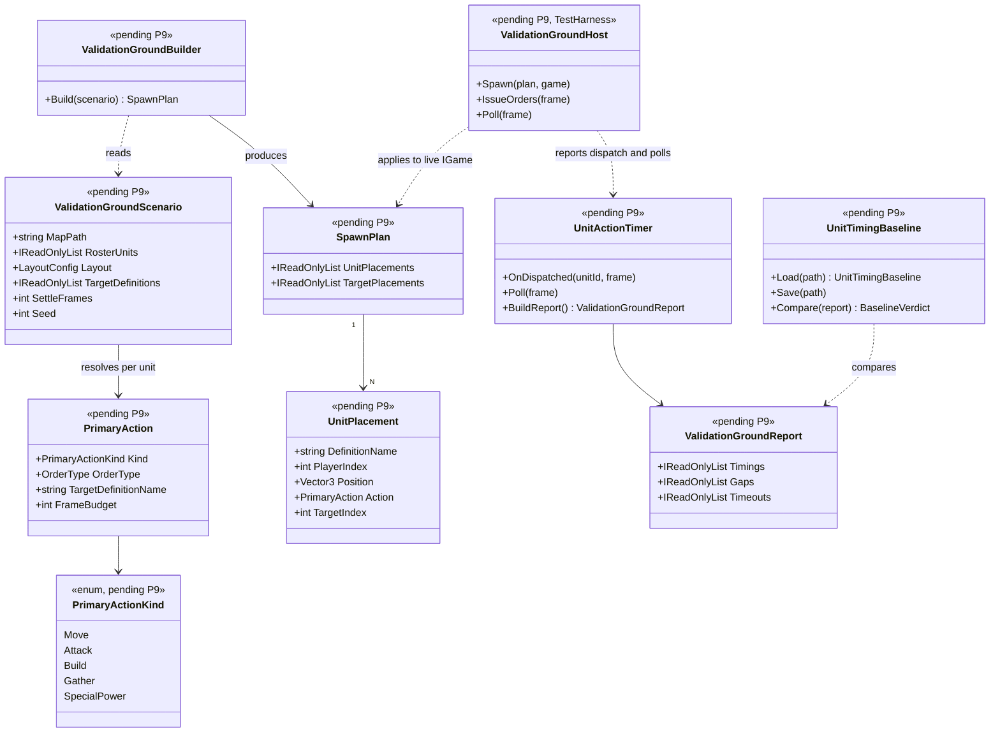
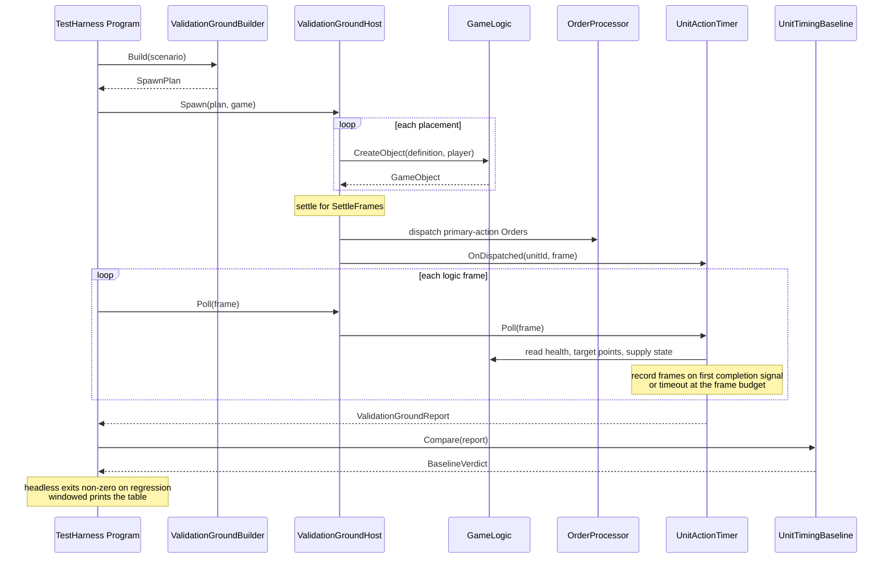

# Deep Dive: Unit Validation Ground (P9)

> Expands phase P9 of [Track P: Playable Baseline](../track-p-playable-baseline.md). Part of
> the [Large-Scale Simulation Roadmap](../README.md).
>
> Audience: human overview of the validation-ground design. Code references are in the agent-context appendix at the bottom.
>
> The agent-context section at the bottom ([Current code appendix](#appendix-current-code-agent-context)) contains file:line code references. Skip it if reading for design intent.

Purpose: a non-skirmish sandbox that stands up one of every unit in the reference game side by side,
orders each to perform its primary action against its own assigned target, and measures how long that
action takes in logic frames. The measurement is compared against a checked-in golden baseline, so
unit behaviour becomes a watchable demonstration and a numeric regression signal at the same time.

---

## 1. Rationale

[P6b](p6b-unit-contract-validation.md) proves the per-archetype unit contract, but only for one
reference unit per archetype/faction cell, only as pass/fail, and only headlessly against a null
`Scene3D` where there is no pathfinding, no movement, and no rendering. Three things are therefore
still unverified after P6b:

- Coverage beyond the reference units. Sixteen archetype cells stand in for the whole roster.
- Behaviour under a live scene. Movement, pathfinding, and targeting only exist once `Scene3D` is
  real, which the mocked host cannot provide.
- Duration. Nothing measures how long an action takes, so a unit that becomes ten times slower still
  passes every existing test.

P9 covers all three with one artifact. Because the scenario is watchable, it also fills a gap with no
current home: a human checking "do units still behave correctly" today has to author a skirmish and
watch it play out.

---

## 2. Design

### 2.1 Shape of the scenario

Not a skirmish and not a replay. There is no AI, no economy, no victory condition, and no `.rep`
export. The ground is a fixed arena on a real map with three faction rows facing a shared cluster of
destructible objects and supply sources in the middle. A run has four stages:

1. Spawn. Every unit in the roster is created directly, along with one destructible target per unit.
2. Settle. A fixed number of frames pass so spawn-time transients (settling to terrain height,
   aircraft reaching a stable state) do not pollute the measurement.
3. Order. Each unit receives its primary action as a real engine `Order`, all on the same frame.
4. Observe. Each unit's completion signal is polled every frame until it fires or the unit's frame
   budget expires.

### 2.2 Direct spawn instead of production

Producing the roster through real build trees would require a full per-faction base build-out, income,
and prerequisite chains before any measurement could begin, and would make each measured duration
depend on production order and queue contention rather than on the unit. Units are therefore created
directly through `GameLogic.CreateObject`, the same seam the P5 human matrix path already uses. The
orders issued afterwards are real engine orders dispatched through `OrderProcessor`, so the action
path being measured is not mocked; only the unit's arrival on the map is shortcut.

The cost of this choice is that a unit depending on production to reach a valid state may behave
differently here. That is treated as a reportable gap rather than worked around: see
[§2.6](#26-gaps-rather-than-workarounds).

### 2.3 Roster

The roster is the existing `UnitCatalog` in `Panopticon.Tools.ReplaySketch.Core`: 32 units across USA,
GLA, and China. Reusing it means the ground grows as the catalog grows, and keeps one list of
known-good definition names rather than a second parallel one. A completeness test asserts every
catalog entry resolves to a primary action, so adding a unit to the catalog without deciding its
action fails the test suite instead of silently dropping it from the ground.

### 2.4 Primary action per unit

Most of the roster attacks, but dozers, workers, and support units do not, so a blanket attack order
would produce meaningless timings for them. Each unit resolves to one primary action:

| Unit group | Primary action | Completion signal |
|---|---|---|
| Combat units | `AttackObject` against its assigned target | Target is destroyed |
| Dozers and workers | `BuildObject` for a fixed cheap structure | Construction completes |
| Supply units | `GatherDumpSupplies` | One full `SupplyAIUpdate` state cycle returns to its start state |
| Support units with an implemented ability | `SpecialPowerAtObject` or `SpecialPowerAtLocation` | The ability's observable effect |
| Anything else | `MoveTo` a fixed offset | The unit's target-point queue empties |

Every unit additionally performs a measured `MoveTo` leg before its primary action. That gives one
metric directly comparable across the entire roster, and means a unit whose primary action is
unimplemented still contributes a useful number instead of only a gap.

Targets are assigned by index rather than by proximity or threat, so assignment
cannot drift when target ordering or unit stats change.

### 2.5 Measuring duration

Duration is counted in logic frames derived from `MapTime` and `MsPerLogicFrame`, never in wall-clock
time. Wall-clock would make the baseline depend on machine speed, renderer, and whether the run is
windowed or headless; logic frames are identical across all of those as long as the simulation is
fixed.

A unit's timer starts on the frame its order is dispatched and stops on the frame its completion
signal is first observed. For combat units the signal is the assigned target being destroyed, not the
first damaging shot: a unit has finished its attack command only once the target is gone. Attack
targets are standardized to a low HP at spawn so destroying them is feasible for the whole roster and
the measured duration reflects each weapon's real damage and fire rate. The completion signals reuse
the patterns already proven in `EngineActionRecorder`, which tracks pending moves, per-target health
deltas, pending builds, and supply approach legs for the existing scenarios. P9 generalizes that per
unit rather than reimplementing it.

Each unit has a frame budget. Exceeding it records a timeout, which is a distinct result from a
regression: a timeout means the action never happened, a regression means it happened too slowly.

### 2.6 Gaps rather than workarounds

If a unit's primary action hits an unimplemented handler, or a unit misbehaves specifically because
it was spawned rather than produced, the report records an explicit gap for that unit. This follows
the P6b convention of surfacing unimplemented handlers as named gaps instead of silent passes.
Forcing a workaround so a gap unit produces a number would distort the very measurement the phase
exists to produce.

### 2.7 Baseline and regression gate

Measured durations are compared against a golden baseline checked into the repository. Each entry
stores its golden frame count and its own tolerance, expressed as a percentage with a minimum
absolute frame floor. A single global tolerance would be simultaneously too loose for fast actions
and too tight for slow ones, and a percentage alone would flag a twenty-frame action over one frame
of jitter.

The baseline is captured by an explicit refresh mode and is never rewritten by a normal run;
otherwise a regression would quietly become the new normal.

### 2.8 Two run modes, one definition

| Mode | Host | Purpose |
|---|---|---|
| Windowed | `Panopticon.Tools.TestHarness` with normal camera control | A human watches the roster act and inspects anything that looks wrong |
| Headless | Same code path with headless configuration | Compares against the baseline and sets a non-zero exit code on regression |

Both modes drive the same scenario definition, spawn host, and timer. Only presentation and the
terminal assertion differ, so a discrepancy between what a human sees and what CI reports is not
possible by construction.

### 2.9 Controlled scenario inputs

Fixed spawn positions, target assignment, order-issue frame, settle duration, and RNG seed keep the
baseline workload well-defined. Cross-run identity is not required; per-entry tolerances absorb
normal execution variation.

---

## 3. Placement in the codebase

Logic lives in `Panopticon.Tools.ReplaySketch.Core` so it is unit-testable headlessly, per the project
convention that testable logic stays in `.Core` behind injectable seams. `TestHarness` only hosts it
and owns the parts requiring a live `IGame`.

| Component | Project | Responsibility |
|---|---|---|
| `PrimaryAction` | `ReplaySketch.Core/Model` | Action kind and per-unit resolution, with a universal move fallback |
| `ValidationGroundScenario` | `ReplaySketch.Core/Model` | Roster, layout parameters, target and supply-source set, per-unit frame budgets |
| `UnitTimingBaseline` | `ReplaySketch.Core/Model` | Golden frame counts, per-entry tolerance, load/save, comparison |
| `ValidationGroundReport` | `ReplaySketch.Core/Model` | Per-unit results, gaps, timeouts, baseline verdicts |
| `ValidationGroundBuilder` | `ReplaySketch.Core/Services` | Fixed spawn plan: positions, target assignment, order sequence. No engine dependency |
| `UnitActionTimer` | `ReplaySketch.Core/Services` | Per-unit dispatch-to-completion frame measurement and timeout handling |
| `ValidationGroundHost` | `TestHarness` | Applies the spawn plan to a live `IGame`, issues orders, drives the poll loop |

---

## 4. Sub-phases

| Phase | Goal | Status |
|---|---|---|
| P9-1. Primary-action model | `PrimaryAction` kinds plus per-unit resolution covering every `UnitCatalog` entry, with `MoveTo` as the universal fallback. Completeness is test-enforced. | Done |
| P9-2. Scenario and layout model | `ValidationGroundScenario` plus `ValidationGroundBuilder`: fixed per-faction rows, target cluster, supply sources, target assignment by index. Engine-free and headlessly tested. | Done |
| P9-3. Direct-spawn host | `ValidationGroundHost` creates the planned units, targets, and supply sources on a live `IGame` through `GameLogic.CreateObject` with terrain-height sampling, and runs the settle stage. | Done |
| P9-4. Action timer | `UnitActionTimer` measures dispatch-to-completion in logic frames per unit, with per-action completion signals and per-unit frame budgets. | Done |
| P9-5. TestHarness wiring | New built-in scenario value and config knobs; the ground runs in both the windowed and headless loops without disturbing the existing replay-driven path. | Done |
| P9-6. Report output | Per-unit stdout table and JSON artifact, reporting gaps and timeouts distinctly from durations. | Done |
| P9-7. Baseline and regression gate | `UnitTimingBaseline` with per-entry tolerance, an explicit refresh mode, a committed baseline captured against a real install, and a non-zero exit code on regression. | Done (live-captured baseline against a real install; fixed-timestep stepping; 22 units measured, 10 gaps escalated) |
| P9-8. Test coverage | Install-free tests for layout rules, roster completeness, action-mapping totality, and baseline comparison; an install-gated end-to-end test for the live run. | Done |

---

## 5. Sequencing and dependencies

- P9 depends on P0 (the command/assertion harness and the `.Core` model it extends), P6 (order
  dispatch paths), and P6b (the archetype contract and reference-unit tagging the action mapping
  builds on).
- P9 does not gate P7. P7 asserts a match terminates correctly; P9 asserts individual units act and
  how fast. They are independent signals and can land in either order.
- P9's report is an input to [A5](a5-visualization.md) visualization and to
  [B1](../track-b-scale.md) benchmarking, both of which need per-unit timing that does not exist
  today.
- Gaps surfaced by P9 that are unimplemented handlers escalate to P6b; gaps caused by
  spawn-versus-production differences escalate to P5.

---

## 6. Architecture Diagrams

### 6.1 Types

### 6.2 Run flow

---

## 7. Open items

Resolved during implementation, recorded here so they are not rediscovered:

- Map choice. The ground needs terrain flat and open enough for the whole roster plus a target
  cluster. `alpine assault` is the existing scenario convention but may not suit; the map is a
  configuration value so it can change without touching the model.
- Aircraft spawn state. Directly spawned aircraft may need an airfield to reach a valid state. If so,
  spawn a faction airfield rather than special-casing the timer.
- Tolerance values. Set deliberately after the first capture, not derived from a single sample run.

---

## 8. Related

- Track overview: [`../track-p-playable-baseline.md`](../track-p-playable-baseline.md)
- Harness and `.Core` model this extends: [`p0-playable-baseline-harness.md`](p0-playable-baseline-harness.md) (P0)
- Per-archetype contract this generalizes to the whole roster: [`p6b-unit-contract-validation.md`](p6b-unit-contract-validation.md) (P6b)
- Order dispatch paths under measurement: [`p4-p6-economy-production-combat.md`](p4-p6-economy-production-combat.md) (P6)
- Architecture snapshot: [`../agent/current-state.md`](../agent/current-state.md)

---

## Appendix: Current code (agent context)

> Agent context: this section contains file:line code references for agents
> implementing this phase. Human readers: the design intent above does not
> require reading this section.

### Direct-spawn seam
`GameLogic.CreateObject(ObjectDefinition, Player)` (`Logic/GameLogic.cs:76`) is public and is the
only practical way to place a roster of this size without production. There is no spawn or cheat
`OrderType`, so the spawn stage cannot be expressed as replay orders.

### Roster source
`UnitCatalog` (`src/Panopticon.Tools.ReplaySketch.Core/Model/UnitCatalog.cs`) holds 32 `UnitOption`
records across USA, GLA, and China. `BuildingCatalog` in the same folder supplies structure
definitions usable as destructible targets and as the dozer build target. `UnitArchetypeCatalog`
(P6b) maps archetypes to reference units with their `ObjectKinds` tags and is the natural input for
deriving each unit's primary action.

### Existing timing patterns to generalize
`EngineActionRecorder` (`src/Panopticon.Tools.TestHarness/EngineActionRecorder.cs`) already implements
per-frame completion polling: `CurrentFrame()` at `:477-478` derives the logic frame from
`MapTime.TotalTime` and `GameEngine.MsPerLogicFrame`; `ApproachLeg.StartFrame` with the
`travelFrames` computation at `:240` is a working per-leg frame measurement; `_pendingMoves`,
`_pendingAttacksByTarget`, `_pendingBuilds`, and `_lastHealth` at `:55-60` are the completion
trackers, polled by `PollPendingMoves()`, `PollHealthChanges()`, and `PollSupplyCycles()`.
`ReplayActionMonitor` exposes `ActionDispatched`/`ActionCompleted` events, which is the dispatch
seam. `ReplayActionMetrics` is not timing: it only counts attack orders per player.

### Host integration points
`TestHarness/Program.cs` `RunWindowed()` (`:206-260`) calls `game.StartRun()` at `:217`; the spawn
stage hooks in immediately after. The per-frame poll section near `:253-256` is where the timer
polls. `RunHeadless()` (`:262+`) mirrors it. `TestHarnessConfig` and the `BuiltInScenario` enum
(currently `AlpineAssaultUSAvGLA` and `AlpineAssaultUSAvGLAFullBuild`) hold the config surface.

### Why the mocked host is insufficient
`MockedGameTest.TestGame` (`test/Panopticon.Simulation.Tests/MockedGameTest.cs`) provides a real `AssetStore`,
`PlayerManager`, and `GameLogic` (`:168`), but leaves `Scene3D` uninitialized and throws
`NotImplementedException` from `Update()`, `Render()`, and `Step()`. Movement, pathfinding, and
combat resolution cannot run there, which is why P9's live half is install-gated with
`[GameFact(SageGame.CncGenerals)]` while only the engine-free model and baseline logic are covered by
plain `[Fact]`.

---
