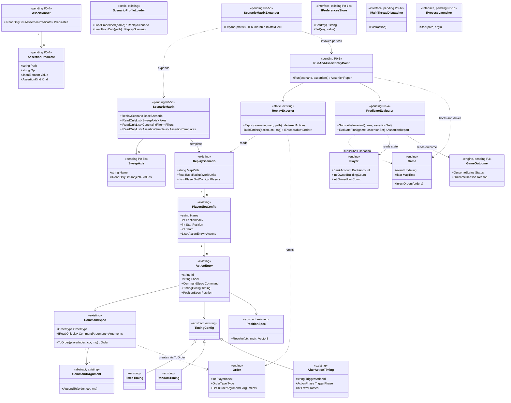
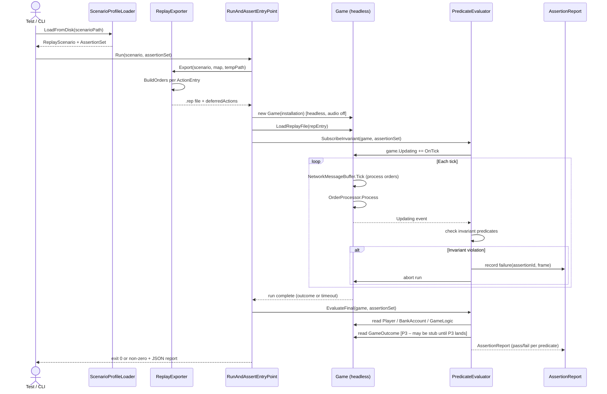
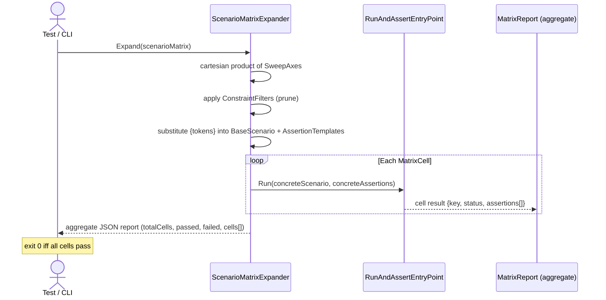

# Deep Dive: ReplaySketch Arbitrary-Command Harness (P0)

> Expands phase P0 of [Track P — Playable Baseline](../track-p-playable-baseline.md). Part of
> the [Large-Scale Simulation Roadmap](../README.md). First-pass design — refine as it lands.
>
> Audience: human — design intent and architecture diagrams. Code references are in the agent-context appendix at the bottom.
>
> The agent-context section at the bottom ([Current code appendix](#appendix-current-code--agent-context)) contains file:line code references used to ground the design in the actual codebase. Skip it if you are reading for design intent.

Goal: turn ReplaySketch from a fixed-vocabulary scenario sketcher into a general
command-authoring + headless validation harness that can express any engine `Order`, over
any object definition and player, and assert post-conditions/invariants/outcomes on a
headless run. This is the substrate every other Track P phase validates through, and the base the
[A5 result visualizer](visualization.md) later extends.

---

## 1. Why this is P0

Every other P phase needs a way to drive a scenario and check what happened. Today ReplaySketch
can drive only five canned action shapes against two hardcoded factions, and it has no assertion
layer at all — it exports a `.rep` and (optionally) round-trips the header. To validate "the AI
built a base," "the player was defeated," or "money never went negative," we need (a) arbitrary
commands and (b) a way to read final/peri-tick state and assert on it. P0 builds both.

---

## 3. Design

### 3.1 MAUI ViewModel testability (prerequisite for harness unit coverage)
`MainViewModel.LoadMapFromFolder` currently uses `Preferences.Default` (a MAUI static) to persist
the installation path. This makes the unconditional-save behaviour (path is recorded before map load
is attempted, not only when it succeeds) untestable without a MAUI runtime. Before the harness
expands further, extract an `IPreferencesStore` interface and inject it into `MainViewModel`, with
a `MemoryPreferencesStore` for tests and the `Preferences.Default` adapter for production. The
non-MAUI test project (`OpenSage.Tools.ReplaySketch.Tests`) then covers the full `LoadMapFromFolder`
contract.

`IPreferencesStore` is only the first MAUI seam. `MainViewModel` also binds directly to
`MainThread.BeginInvokeOnMainThread` (background-load completion, `StartBackgroundLoad`
`Program`/`MainViewModel.cs:180-190`) and to `System.Diagnostics.Process.Start` /
`LauncherLocatorService` (`ExecutePlayInGame`, `MainViewModel.cs:250-273`). While those statics
remain inline, the command flows that matter most for agents — `ValidateCommand`, `ExportCommand`,
`PlayInGameCommand`, and the apply-results half of the background load — cannot be exercised
headlessly, so a change to them has no fast, deterministic check. Abstract each behind a small
injectable seam (a dispatcher that runs the continuation synchronously in tests; a process launcher
that records the request instead of spawning), so the full `MainViewModel` command surface is
unit-testable in `OpenSage.Tools.ReplaySketch.Tests` without a MAUI runtime. This is the testability
substrate the agent validation playbook (§3.7) documents.

### 3.2 Open command model (replaces the closed `ActionType`)
Introduce a `CommandSpec` (working name) that maps directly onto an engine `Order` rather than a
fixed gameplay verb:

- `OrderType` (the full enum) + `PlayerIndex` + an ordered list of typed `CommandArgument`s mirroring
  `OrderArgumentType` (`Integer/Float/Boolean/ObjectId/Position/ScreenPosition/ScreenRectangle`).
- Object references by definition name (resolved generically — see §3.3) and position via the
  existing polymorphic `PositionSpec`, so authoring stays scenario-relative.
- Object-id arguments (e.g. `AttackObject`, `Enter`) need a way to reference runtime objects that
  don't exist until produced. Decision (see [open-questions](../open-questions.md)): objects an
  earlier command created are referenced by an implicit handle keyed to the producing command
  (the author normally writes nothing — "the barracks built in command #3" resolves automatically at
  dispatch from production/build results), with an explicit name as opt-in sugar; objects the
  script did not create (enemy/world objects) use a small set of query selectors
  (faction/relationship/definition/proximity) resolved against `GameLogic`. This generalizes today's
  `AfterActionTiming` trigger model (`TimingConfig.cs`, `DeferredAction.cs`).
- Keep `TimingConfig` (fixed/random/after-action) and the deferred-injection path; they already give
  authored and reactive ordering.

### 3.3 Generic definition resolution (removes hardcoded `KnownDefinitions`)
Replace the hardcoded USA/GLA name→hash table (`ReplayExporter.cs:21-32`) with resolution against the
loaded `AssetStore` by definition name (the same `AssetHash.GetHash` path, but for any object/
player). This makes the harness faction-agnostic and is a prerequisite for authoring any baseline
match (any side, any unit/structure).

### 3.4 Validation / assertion layer (new)
A declarative assertion set attached to a scenario, evaluated headlessly. Authoring shape
(Decision, see [open-questions](../open-questions.md)): assertions are JSON predicates (e.g.
`{path: "player[1].money", op: ">=", value: 0}`) over a fixed path/operator vocabulary, with an
escape hatch of code-defined (C#) predicates (registered by name, referenced from the scenario)
for invariants that exceed the vocabulary. The three assertion kinds:

- Outcome assertions — match terminated; winner/loser/team; reason. (Consumes P3's queryable
  `GameOutcome` — see [victory-defeat.md](victory-defeat.md).)
- State assertions — predicates over `Player`/`GameLogic`/`BankAccount` at end-of-run or at a
  trigger frame (e.g. `player[1].money >= 0`, `player[2].ownedBuildings > 0` after frame N).
- Invariant assertions — predicates checked every tick via the `Game.Updating` hook (e.g. money
  never negative, unit count never duplicated/leaked, AI made progress). A failing invariant records
  the frame and aborts.
- Evaluation hooks: subscribe to `Game.Updating` for per-tick invariants; read final state after the
  run loop exits. Result is a structured pass/fail report (assertion id, expected, actual, frame).

### 3.5 Headless run-and-assert entry point
A single callable surface (CLI + library) that cheap agents and CI use:
`scenario/command file in → run headless → assertion report out (exit code + machine-readable JSON)`.
This wraps `RunHeadless`'s boot/loop (`Program.cs:195-270`) plus the §3.4 evaluator, and replaces the
current bespoke "exit on enemy-CC destruction" termination with P3's real outcome signal.

### 3.5b Scenario matrix runner
A layer on top of P0-5 that accepts a `ScenarioMatrix` file instead of a single scenario. The
matrix declares named sweep axes; the runner expands them into individual runs and aggregates
the results into a single keyed report.

Data model (`OpenSage.Tools.ReplaySketch.Core/Model`):
- `ScenarioMatrix` — wraps a `BaseScenario` template, one or more named `SweepAxes`, optional
  `ConstraintFilters`, and a list of `AssertionTemplates`.
- `SweepAxis` — a named list of values (strings, ints, or enum names). Each axis name corresponds
  to a token (`{faction}`, `{mapPath}`, `{playerCount}`, etc.) that can appear in the
  `BaseScenario` template or in assertion path/value fields.
- `ConstraintFilter` — an optional predicate expression that prunes axis combinations before
  expansion (e.g. skip faction pairs that are not valid together).
- `AssertionTemplate` — a JSON predicate where `path` and `value` fields may contain `{axisName}`
  substitution tokens. Resolved per-cell after axis values are bound.

Matrix expander algorithm:
1. Enumerate all axis value lists.
2. Compute the cartesian product of all lists.
3. Apply `ConstraintFilters`; discard filtered cells.
4. For each remaining cell, substitute `{axisName}` tokens into the `BaseScenario` template and
   `AssertionTemplates` to produce a concrete `(ReplayScenario, AssertionSet)` pair.
5. Key each cell by its axis binding (e.g. `{faction: "USA", map: "AlpineAssault"}`).

Each cell runs through the P0-5 headless runner and P0-4 assertion evaluator independently.

Output (aggregate JSON report):
```
{
  "totalCells": N,
  "passed": P,
  "failed": F,
  "cells": [
    {
      "key": {"faction": "USA", "map": "AlpineAssault"},
      "status": "passed" | "failed",
      "assertions": [ {…per-assertion detail…} ]
    },
    …
  ]
}
```

Exit code is 0 iff all cells pass. The CLI/library entry point accepts either a single
`ReplayScenario` or a `ScenarioMatrix`; both go through P0-4 and P0-5 internally.

This is the primitive that A5-2 (experiment matrix tooling/visualizer) builds on. A5-2 adds
a result replayer, graphing, and multi-run comparison; P0-5b only provides the expansion,
execution, and keyed output.

### 3.6 Scale (forward link)
The model must support programmatic/procedural generation of large command sets (not hand-entry)
and efficient `.rep` emission, so the harness scales toward sim-scale runs. Full authoring/replay
scaling (streaming, bounded-memory loading, throughput benchmarks) is finalized under
[A5-5](visualization.md); P0 only needs the model to not assume small, hand-authored scenarios.

### 3.7 Agent validation playbook (new)
A recurring obstacle for low-effort/automated agents working on ReplaySketch is the absence of a
reliable, specific, repeatable way to validate a change — particularly in the MAUI layer, which has
no automated coverage and cannot be driven by a windowless agent. The renderer side solves this with
`OpenSage.Tools.TestHarness/AGENTS.md` (a documented visual-validation workflow); ReplaySketch needs
the equivalent for command/scenario authoring and the MAUI tool. P0 adds a checked-in agent guide,
`src/OpenSage.Tools.ReplaySketch.Maui/AGENTS.md`, that documents the exact, runnable validation loop:

- The Core-vs-MAUI split (all logic lives in `.Core`; MAUI only hosts), so agents know which changes
  are headlessly checkable and which need the MAUI runtime.
- Build / test / format commands: the non-MAUI `OpenSage.Tools.ReplaySketch.Tests` suite (controller,
  interaction, and service tests), the MAUI screenshot mode (`REPLAYSKETCH_SCREENSHOT_PATH`) for visual
  verification of any renderer or MAUI-layer change, and `dotnet format src --verify-no-changes`.
- The headless run-and-assert entry point (§3.5 / P0-5) for command-level validation, once it lands.
- The MAUI seams (§3.1, P0-1b/P0-1c) that keep new logic in `.Core` and unit-testable, plus what is
  not headlessly reachable and how to add coverage when touching the MAUI layer.
- A step-by-step checklist and a common-failure-mode table mirroring the TestHarness guide.

The playbook is authored now and is honest about current state: it documents the test/screenshot/format
loop that exists today and marks the run-and-assert flow (P0-4/P0-5) as forthcoming, tightening as
those phases land. It is the documented surface for "how do I validate a ReplaySketch change" — the
single answer to the persistent agent-validation gap.

---

## 4. Integration surface (what P0 plugs into)
- Author: `CommandSpec`/assertion model in `OpenSage.Tools.ReplaySketch.Core/Model`; lowering in
  `Services/ReplayExporter` (`BuildOrders`/`Export`); definition resolution via `AssetStore`.
- Drive: `ReplayFile.Write`/`ReplayHeader.Create`; `Order`/`OrderArgument*`; deferred path via
  `DeferredAction` + `Game.InjectOrders`.
- Run: `TestHarness.RunHeadless`/`BuildDeferredInjector`/`DrainPendingInjections`.
- Assert: `Game.Updating`/`Game.MapTime`; `Player`/`BankAccount`/`GameLogic`; P3 `GameOutcome`.
- Validate (agent-facing): `OpenSage.Tools.ReplaySketch.Tests` (controller/interaction/service);
  MAUI screenshot mode (`REPLAYSKETCH_SCREENSHOT_PATH`) for visual verification; `dotnet format`;
  the §3.7 playbook (`ReplaySketch.Maui/AGENTS.md`).

## 5. Sub-phases

| Phase | Goal | Status |
|---|---|---|
| P0-1. Open command model | Replace closed `ActionType` with `CommandSpec` mapping to any `OrderType` + typed args + object references (implicit auto-handles keyed to the producing command, opt-in names, query selectors for world/enemy objects); `ActionType` is preserved as a convenience enum on `ActionEntry` only. | Done |
| P0-1a. MAUI screenshot mode | Add screenshot-and-exit mode to `MainPage`: env-var `REPLAYSKETCH_SCREENSHOT_PATH` triggers capture via `Screenshot.Default.CaptureAsync()` after a configurable settle delay, then auto-exit. Env vars `REPLAYSKETCH_SCREENSHOT_TAB` (tree/map) and `REPLAYSKETCH_SCREENSHOT_DELAY` (seconds). Agents use this to verify MAUI-layer changes without manual app interaction. See `src/OpenSage.Tools.ReplaySketch.Maui/AGENTS.md`. | Done |
| P0-1b. ViewModel testability | Extract `IPreferencesStore` from `MainViewModel`; inject it so `LoadMapFromFolder`'s unconditional path-persistence is unit-testable without a MAUI runtime. | Done |
| P0-1c. MAUI command-flow testability | Abstract the remaining MAUI statics `MainViewModel` binds to — the `MainThread` dispatcher (background-load completion) and `Process.Start`/launcher (`ExecutePlayInGame`) — behind small injectable seams so `ValidateCommand`/`ExportCommand`/`PlayInGameCommand` and the apply-results half of the background load are unit-testable headlessly in `OpenSage.Tools.ReplaySketch.Tests`. | Not started |
| P0-2. Generic definition/player resolution | Remove hardcoded `KnownDefinitions`; resolve any object definition/player by name via `AssetStore`. | Not started |
| P0-3. Exporter generalization | Generalize `BuildOrders`/`Export` to emit orders for the full handled `OrderType` subset; preserve timing + deferred injection. | Not started |
| P0-4. Assertion layer | Declarative outcome/state/invariant assertions, evaluated via `Game.Updating` + end-of-run state, producing a machine-readable pass/fail report. (JSON predicates over a fixed vocabulary + code-defined escape hatch — decided.) | Not started |
| P0-5. Run-and-assert entry point | One CLI/library call: scenario+commands in → headless run → report out (exit code + JSON). Wraps `RunHeadless` + the evaluator; terminates on P3 outcome. | Not started |
| P0-5b. Scenario matrix runner | Accept a `ScenarioMatrix` file with named sweep axes; expand to one run per cartesian-product cell; emit a per-cell result keyed by axis combination and an aggregate JSON report. Wraps P0-5; provides the expansion primitive that A5-2 (tooling/visualizer) builds on. | Not started |
| P0-6. Large/procedural authoring | Programmatic generation of large command sets + efficient `.rep` emission (model-level scale; full tooling scale = A5-5). | Not started |
| P0-7. Agent validation playbook | Check in `src/OpenSage.Tools.ReplaySketch.Maui/AGENTS.md`: a documented, repeatable checklist + exact commands agents run to validate a ReplaySketch change (Core test suite, screenshot mode for visual verification, `dotnet format`, the P0-5 run-and-assert flow, and the MAUI testability seams), with a common-failure-mode table. Authored now against current capability; forward-references P0-4/P0-5. | Done |

## 6. Sequencing & dependencies
- P0-1a (screenshot mode) is complete; it is a standalone agent-tooling change independent of
  the command-model work and requires no other sub-phase.
- P0-1→P0-3 are the authoring generalization; P0-4/P0-5 are the validation half and can start once
  P0-1's model exists.
- P0-1c continues the MAUI testability seam started by P0-1b; both are independent of the
  command-model work and can land any time.
- P0-4's outcome assertions depend on P3 ([victory-defeat.md](victory-defeat.md)) for a real
  `GameOutcome`; until then P0-4 can assert state/invariants only.
- P0-5b depends on P0-5 (single-scenario runner) being in place; it wraps it.
- P0-5b is the final P0 sub-phase before P0-6 (procedural scale).
- A5-2 (experiment matrix tooling/visualizer) builds on P0-5b; A5-2 does not re-implement
  expansion or execution.
- P0-7 (the playbook) is done; it now documents the screenshot mode as the primary visual
  verification method and the test/format loop.
- P0 unblocks P3/P6/P7 (they author + assert through it) and is later extended by
  [A5-3](visualization.md) (visualizer) and [A5-5](visualization.md) (scale).

## 7. Resolved design questions
- Runtime object references — Decided: implicit auto-handles keyed to the producing command
  (opt-in explicit names) for script-created objects; query selectors
  (faction/relationship/definition/proximity) for world/enemy objects. Generalizes
  `AfterActionTiming`. See [open-questions](../open-questions.md).
- Assertion DSL shape — Decided: declarative JSON predicates over a fixed path/operator
  vocabulary, with a code-defined (C#) predicate escape hatch for complex invariants. See
  [open-questions](../open-questions.md).
- MAUI validation reach + agent playbook — Decided: ReplaySketch logic stays in `.Core` and is
  validated headlessly via `OpenSage.Tools.ReplaySketch.Tests` (controller/renderer/golden/service)
  plus the P0-5 run-and-assert flow; MAUI-only behaviour is minimized behind injectable seams
  (P0-1b/P0-1c) rather than UI-automated, and the documented surface agents follow is a checked-in
  `ReplaySketch.Maui/AGENTS.md` playbook (P0-7). See [open-questions](../open-questions.md).
- MAUI screenshot mode — Decided (P0-1a): agents capture MAUI-layer changes via an
  env-var-triggered screenshot-and-exit mode (`REPLAYSKETCH_SCREENSHOT_PATH`), using
  `Microsoft.Maui.Media.Screenshot.Default.CaptureAsync()`. No external tooling, screen-recording
  permission, or human interaction required. Implemented in `MainPage.OnLoaded`. See
  [open-questions](../open-questions.md).
- ScenarioMatrix / sweep primitive placement — Decided (P0-5b): the cartesian-product matrix
  expansion primitive belongs in P0 (P0-5b), not deferred to A5. A5-2 adds tooling and
  visualization on top; it does not re-implement expansion or execution. All axis dimensions
  (OrderType, faction, map, assertion parameters) are in scope; the matrix is built out
  incrementally alongside implementation. See [open-questions](../open-questions.md).

## 8. P0 Acceptance Suite

The authoritative pass/fail definition for "P0 is done." Every entry maps to a stub test
that fails with `NotImplementedException` until the sub-phase lands.

| Test class | Project | Sub-phase | What it proves |
|---|---|---|---|
| `P0_1c_MauiCommandFlowTests` | `ReplaySketch.Tests` | P0-1c | `ValidateCommand`, `ExportCommand`, `PlayInGameCommand`, background-load apply-results all exercise headlessly via injected seams; no MAUI runtime needed |
| `P0_2_GenericDefinitionResolutionTests` | `ReplaySketch.Tests` | P0-2 | No hardcoded faction strings in `ReplayExporter`; any definition resolves by name via `AssetStore` |
| `P0_2b_PlayerOwnerTargetingTests` | `ReplaySketch.Tests` | P0-2b | ≥3-player scenario attributes each command to the correct `PlayerIndex` |
| `P0_6_ProceduralAuthoringTests` | `ReplaySketch.Tests` | P0-6 | ≥10k procedurally-generated commands export and load within documented time/memory budget |
| `P0_3_RuntimeObjectReferenceTests` | `Game.Tests` | P0-3 | Implicit auto-handle resolves from producing command; query selector resolves against `GameLogic` |
| `P0_3_OrderTypeMappingTests` | `Game.Tests` | P0-3 | Move, attack, construct, produce, ability each produce the expected `OrderProcessor` effect in a headless run |
| `P0_4_AssertionLayerTests` | `Game.Tests` | P0-4 | Passing/failing JSON predicates; outcome assertion; per-tick invariant pass and violation; code-defined escape hatch |
| `P0_5_RunAndAssertEntryPointTests` | `Game.Tests` | P0-5 | Exit code 0/non-zero; well-formed JSON report; full end-to-end multi-command scenario |
| `P0_5b_ScenarioMatrixTests` | `Game.Tests` | P0-5b | Matrix expands ≥2-axis sweep to individual runs; all-pass → exit 0 + aggregate JSON; one-cell-fail → exit non-zero + cell-keyed failure detail |

Stubs live at:
- `src/OpenSage.Tools.ReplaySketch.Tests/P0AcceptanceTests.cs`
- `src/OpenSage.Game.Tests/Tools/ReplaySketch/P0HarnessAcceptanceTests.cs`

P0 is considered complete when all stubs pass and no test in either file throws
`NotImplementedException`. The §5 sub-phase table Status column is the per-item tracker;
this table is the aggregate gate.

## 9. Architecture Diagrams

### 9.1 Class diagram

Classes marked `<<existing>>` are already in the codebase. Classes marked `<<pending>>` are
planned but not yet implemented; the sub-phase responsible for each is noted in parentheses.



### 9.2 Sequence diagram — run-and-assert flow (single scenario)

Shows the flow through P0-5 (`RunAndAssertEntryPoint`) for a single `ReplayScenario`.
The matrix runner (P0-5b) wraps this in a loop over expanded cells.



### 9.3 Sequence diagram — matrix expansion flow (P0-5b)



---

## 10. Related
- Track overview: [`../track-p-playable-baseline.md`](../track-p-playable-baseline.md)
- Visualizer that extends this harness: [`visualization.md`](visualization.md) (A5-3/A5-5)
- Outcome it asserts on: [`victory-defeat.md`](victory-defeat.md) (P3)
- Architecture snapshot: [`../agent/current-state.md`](../agent/current-state.md)

---

## Appendix: Current code — agent context

> Agent context: this section contains file:line code references for agents
> implementing this phase. Human readers: the design intent above does not
> require reading this section.

### 2.1 The closed authoring vocabulary
- `ActionType` is a closed 5-value enum — `Construct, GatherResources, RecruitBasicUnit,
  AttackEnemyBase, EnemyBaseDestroyed` (`src/OpenSage.Tools.ReplaySketch.Core/Model/ActionType.cs:3-10`).
- `ActionEntry` models one action with optional `BuildingDefinitionName`/`UnitDefinitionName`, a
  `PositionSpec`, and a `TimingConfig`
  (`src/OpenSage.Tools.ReplaySketch.Core/Model/ActionEntry.cs:6-46`).
- `ReplayScenario` holds `MapPath`, `BaseRadiusWorldUnits`, `Players`; `CreateAlpineAssaultUSAvGLA()`
  loads an embedded JSON profile (`Model/ReplayScenario.cs:6-31`).
- `PositionSpec` is polymorphic (`NormalizedPosition`, `LandmarkRelativePosition`) resolved to world
  coordinates via a `PositionContext` (`Model/PositionSpec.cs:8-67`).
- `TimingConfig` is polymorphic — `FixedTiming`, `RandomTiming`, `AfterActionTiming` (the latter
  carries `TriggerActionId`, `TriggerPhase`, `ExtraFrames`) (`Model/TimingConfig.cs:6-48`).
- `PlayerSlotConfig` carries per-player `Name`, `FactionIndex`, `Color`, `StartPosition`, `Team`,
  `Actions` (`Model/PlayerSlotConfig.cs:6-30`).
- `UnitCatalog`/`BuildingCatalog` are faction-indexed name/definition lookup tables
  (`Model/UnitCatalog.cs:7-107`, `Model/BuildingCatalog.cs:7-71`).

### 2.2 The exporter (action → engine `Order` → `.rep`)
- `ReplayExporter.Export(...)` builds `(frame, Order)` pairs plus `DeferredAction`s
  (`Services/ReplayExporter.cs:44-95`); non-deferred actions advance
  `cumulativeFrame += action.Timing.Resolve(rng)` (`:83-89`); deferred actions are not written to
  the file (`:67-80`).
- `BuildOrders(...)` is the closed translation table (`:194-250`):
  - `Construct` → `Order.CreateBuildObject(...)` (`:201-208`)
  - `GatherResources` → `Order.CreateSupplyGatherDump(...)` (`:210-215`)
  - `RecruitBasicUnit` → `ClearSelection` + five `CreateUnit` orders (`:218-237`)
  - `AttackEnemyBase` → `ClearSelection` + `ForceAttackGround` (`:240-249`)
- `KnownDefinitions` hardcodes USA/GLA barracks + ranger/rebel names and hashes (`:21-32`).
- `InjectChecksums(...)` inserts `OrderType.Checksum` every 150 frames (`:164-192`).
- File write is `ReplayFile.Write(stream, header, allOrders)` (`:139-143`); a round-trip read-back
  compares header metadata (`:253-284`).
- `DeferredAction` wraps a runtime-injected action: `PlayerIndex`, trigger `ActionType`,
  `ActionPhase`, prebuilt `Orders`, `ExtraFrames` (`Services/DeferredAction.cs:9-36`).
- `ScenarioProfileLoader` loads JSON (embedded or from disk) with case-insensitive enums
  (`Services/ScenarioProfileLoader.cs:13-55`).
- `ReplayActionMonitor` maps runtime orders/state back to `ActionType` (e.g. `BuildObject`→
  `Construct`, `CreateUnit`→`RecruitBasicUnit`) for observation (`Services/ReplayActionMonitor.cs:18-107`).

### 2.3 The engine order system P0 must generalize toward
- `Order` = `PlayerIndex` + `OrderType` + typed `Arguments`, appended via `AddIntegerArgument`,
  `AddFloatArgument`, `AddBooleanArgument`, `AddObjectIdArgument`, `AddPositionArgument`,
  `AddScreenPositionArgument`, `AddScreenRectangleArgument`; plus static helpers (`CreateBuildObject`,
  `CreateMoveOrder`, `CreateAttackGround`, `CreateAttackObject`, …)
  (`src/OpenSage.Game/Logic/Orders/Order.cs:10-260`).
- `OrderArgument` = `ArgumentType` + `OrderArgumentValue` (`Logic/Orders/OrderArgument.cs:6-60`);
  the value is an explicit-layout union over `int/float/bool/ObjectId/Vector3/Point2D/Rectangle`
  (`Logic/Orders/OrderArgumentValue.cs:8-30`).
- `OrderArgumentType` = `Integer, Float, Boolean, ObjectId, Unknown4, Unknown5, Position,
  ScreenPosition, ScreenRectangle, Unknown9, Unknown10` (`Logic/Orders/OrderArgumentType.cs:3-16`).
- `OrderType` is a ~110-value enum (`Logic/Orders/OrderType.cs:3-137`); real user orders include
  `BuildObject, CreateUnit, ForceAttackGround, AttackObject, MoveTo, SetSelection, ClearSelection,
  SetRallyPoint, SpecialPower*, Enter, GatherDumpSupplies, BeginUpgrade, Sell, RepairStructure,
  EndGame, PurchaseScience, Evacuate, ToggleOvercharge, Checksum`, …
- `OrderProcessor.Process(...)` is the dispatch switch (`Logic/Orders/OrderProcessor.cs:42-566`);
  it has real handlers for the above and `CreateGroup0-9`/`SelectGroup0-9`, and a default that
  logs `Unimplemented order type` (`:553-560`). This is the authoritative list of what a command
  can actually do — the harness should target the handled subset first.

### 2.4 The headless run + where to read state
- `TestHarness` `RunHeadless(...)` boots `new Game(...)` (audio off), `LoadReplayFile(repEntry)`,
  `StartRun()`, installs a `ReplayActionMonitor`, then loops
  `DrainPendingInjections → game.Update → EnsureFrame → Render → capture.FlushPending`, exiting on
  enemy-CC destruction + runout or a frame timeout (`src/OpenSage.Tools.TestHarness/Program.cs:195-270`).
- Deferred runtime injection: `BuildDeferredInjector(...)` hooks
  `ReplayActionMonitor.ActionDispatched/ActionCompleted` and `DrainPendingInjections(...)` calls
  `game.InjectOrders(...)` when the delay expires (`Program.cs:280-337`).
- Orders enter the logic tick via `NetworkMessageBuffer.Tick()` (process current-frame orders
  through `OrderProcessor`); `InjectOrdersNow(...)` bypasses the queue
  (`src/OpenSage.Game/Network/NetworkMessageBuffer.cs:25-77`). Replay-backed orders flow through
  `ReplayConnection` keyed by timecode (`Network/ReplayConnection.cs:12-33`).
- `.rep` container: `ReplayFile.FromFileSystemEntry/Write` (`Data/Rep/ReplayFile.cs:10-67`);
  `ReplayHeader.Create/Write/Parse` (`Data/Rep/ReplayHeader.cs:9-210`).
- State readable for assertions: `Game.Updating` event + `Game.MapTime`
  (`src/OpenSage.Game/Game.cs:126,342,876-959`); `Player` and `Player.BankAccount`
  (`Logic/Player.cs`, `Logic/BankAccount.cs:9`); the `GameLogic` world container
  (`Logic/GameLogic.cs:12`).

---