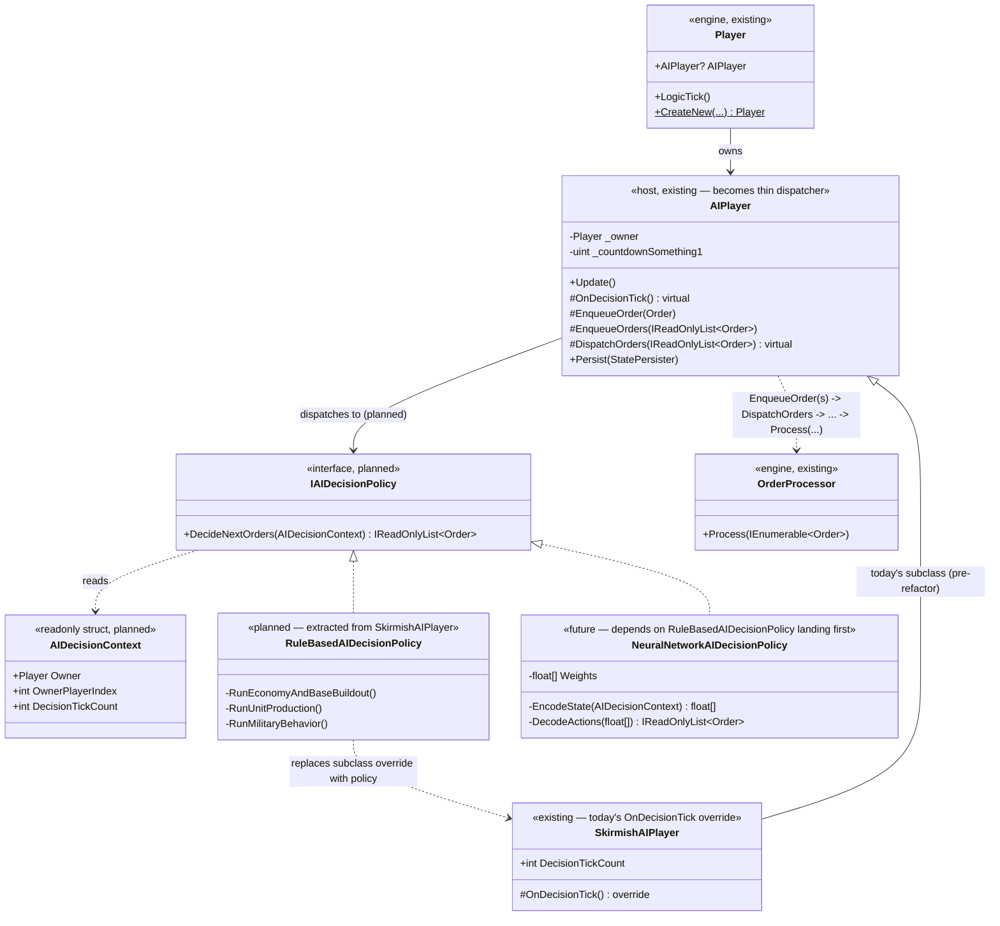
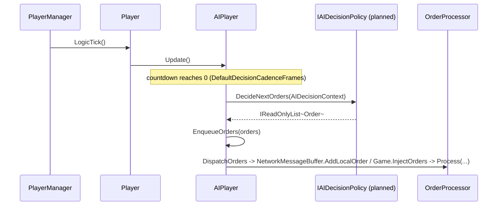

# Deep Dive: Pluggable AI Decision Policy

> Expands phase A4 of [Track A — Foundations](../track-a-foundations.md). Part of the
> [Large-Scale Simulation Roadmap](../README.md). First-pass design — refine as it lands.
>
> Audience: human — design intent and architecture diagrams. Code references are in the
> agent-context appendix at the bottom.

Goal: carve out how a player's strategic decisions are made as its own A4 experiment seam, so
the rule-based skirmish AI that [P2](../track-p-playable-baseline.md) lands is one swappable
implementation, not the only possible one. This is what unblocks plugging in a learned policy —
in particular a small neural network whose weights are evolved by running many seeded
self-play matches — without touching `Player`, `OrderProcessor`, or anything else that treats
"the AI" as an opaque decision-maker.

This doc designs the seam only. It does not implement a neural-network policy or a training
harness; see §6 for the follow-on work this unblocks.

---

## 1. Why this is a seam, not a P2 detail

[skirmish-ai.md §6](skirmish-ai.md#6-resolved-design-questions--open-work) already flagged this:
"a pluggable AI policy is a candidate A4 experiment seam ... not a P2 requirement." P2 lands a
single concrete policy (`SkirmishAIPlayer`: a state machine over economy → build-out →
production → military, described in skirmish-ai.md §2.1). That is exactly the shape an
[A4](../track-a-foundations.md) seam wants: a stable interface with one reference
implementation, sized so a second, very different implementation (a neural net) can sit behind
the same interface and be selected/compared without caller changes.

The axis of variation here is narrow and specific: how a player's per-tick strategic decisions
get made (what to build, what to produce, when/where to attack). It is not the per-object AI
(`AIUpdate`/`DozerAIUpdate`/`SupplyAIUpdate` etc. — locomotion, pathing, individual unit
behavior); that stays exactly as it is. It is also not the actuation path — every implementation
behind this seam still emits `Order`s through `OrderProcessor`, per the P2 actuation decision
(skirmish-ai.md §2.3), so reproducibility (A2) and the recorded/replayed order stream are
preserved regardless of which policy is running.

---

## 2. Interface shape (design, not implementation)

The seam sits at exactly the point `AIPlayer.OnDecisionTick()` occupies today: a coarse-cadence
callback, driven from `AIPlayer.Update()` (ticked from the player loop), that reads game state
and enqueues `Order`s. Today that method is a `protected virtual` hook overridden by
`SkirmishAIPlayer`; the seam formalizes it as an injectable strategy rather than a subclass
override, so a policy is a pluggable collaborator instead of a base-class override:

```csharp
// Illustrative — not implemented by this doc.
public interface IAIDecisionPolicy
{
    // Called at the AI's decision cadence (AIPlayer.DefaultDecisionCadenceFrames).
    // Reads whatever state it needs from the context; returns orders to enqueue.
    // Must not mutate game state directly — same actuation-via-orders constraint as P2 (§2.3
    // of skirmish-ai.md) so every policy stays replay/record-compatible and A2-reproducible.
    IReadOnlyList<Order> DecideNextOrders(AIDecisionContext context);
}

// Read-only view of the state a policy is allowed to consume. Wraps Player/GameLogic/AssetStore
// access the reference implementation already uses (Owner.BankAccount, Owner.OwnedObjects,
// Owner.Enemies, AssetStore.AIData, ...) behind one seam so implementations aren't coupled to
// engine internals more broadly than necessary, and so a future non-engine (e.g. batched
// training) context can supply a lighter-weight fake.
public readonly struct AIDecisionContext
{
    public Player Owner { get; }
    public int OwnerPlayerIndex { get; }
    public int DecisionTickCount { get; }
    // ... read accessors mirroring what SkirmishAIPlayer already reads (§2.1 of skirmish-ai.md).
}
```

`AIPlayer` becomes a thin host: it owns the tick cadence and dispatches to an
`IAIDecisionPolicy`, instead of subclasses overriding `OnDecisionTick()` directly.
`SkirmishAIPlayer`'s existing state machine (economy/build-out/production/military,
skirmish-ai.md §2.1) becomes the reference implementation of this interface — a
`RuleBasedAIDecisionPolicy` (or the `SkirmishAIPlayer` type itself is refactored to hold one) —
proving the seam is real per the A4 definition ([seams.md](../seams.md#what-is-a-seam)).

### 2.1 Selection

Which policy a player uses is config-selected, matching the A4 pattern used elsewhere in the
registry (e.g. Model/animation import, Partition scheme): a `PlayerAIType`-adjacent setting
(skirmish slot config, already the source of `isSkirmish`/`AIPlayer` vs `SkirmishAIPlayer`
selection in `Player.CreateNew`) grows a policy identifier, and a small factory maps it to an
`IAIDecisionPolicy` implementation. No caller of `AIPlayer` needs to know which policy is
running.

### 2.2 Why this shape, specifically

- Matches the existing actuation boundary exactly (orders via `OrderProcessor`), so it costs
  nothing in reproducibility or replay compatibility — the seam is additive over what P2 already
  decided (skirmish-ai.md §2.3), not a re-litigation of it.
- Keeps the interface narrow (one method, one read-only context) so a neural-network
  implementation is not forced to understand build lists, prerequisites, or unit kind flags —
  it only needs a state encoding and an order-decoding step, both private to that
  implementation.
- Leaves cadence, persistence (`AIPlayer.Persist`), and dispatch (`EnqueueOrder(s)`) owned by
  the host (`AIPlayer`), not duplicated per policy.

---

## 3. What this unblocks: a neural-network policy

A neural-network implementation of `IAIDecisionPolicy` is the concrete motivating case:

- State encoding: `AIDecisionContext` → a fixed-size feature vector (economy state, owned unit
  counts by kind, enemy visibility, build-list progress, ...). This encoding is itself an
  implementation detail of the NN policy, not part of the seam.
- Network: a small feed-forward network (weights = the evolvable genome) mapping the feature
  vector to a fixed action space (build/produce/attack decisions), decoded back into the same
  `Order`s a human or the rule-based policy would issue.
- Determinism: because actuation is still orders through `OrderProcessor`, a match run with a
  given weight vector and a given map/seed is exactly as reproducible as today's rule-based
  games (A2) — the network's forward pass is a pure function of its weights and the encoded
  state, with no additional nondeterminism to audit beyond what A2 already covers.

## 4. What this unblocks: evolutionary training via seeded weight populations

The user's stated training goal — generate multiple seed weight vectors and see how each
evolves via repeated simulation runs — maps directly onto the [A4 experiment
harness](../track-a-foundations.md): the harness already selects/configures an implementation
behind a seam, runs it, and reports results ([A5](visualization.md) visualizes them). Applied
here:

1. Population — a set of weight vectors (genomes), one `IAIDecisionPolicy` instance per genome.
2. Fitness — a full headless match per genome (via the [P0 harness](playable-baseline-harness.md)
   and [A1 headless host](headless-host.md)), scored from the already-first-class
   [`GameOutcome`](victory-defeat.md) (win/loss/score) plus auxiliary metrics (economy growth,
   territory held, survival time) as a shaped fitness signal.
3. Selection/variation — standard evolutionary-strategy moves (truncation/tournament selection,
   Gaussian mutation, optional crossover) produce the next generation's weight vectors.
4. Repeat — generations run as an A4 experiment sweep (matching the parameter-matrix mechanism
   [A5](visualization.md) already drives for scenario authoring), with per-generation results
   (best/mean/worst fitness, diversity) reported to the visualizer so evolution progress across
   seeds is inspectable, not just the final result.

This training harness is not designed in detail here — it is downstream of this seam existing
(§6) — but the seam is shaped so it drops in cleanly: nothing about "run N genomes across M
seeded matches and collect fitness" requires any change to `AIPlayer`, `OrderProcessor`, or
`GameOutcome`; it only requires the ability to construct an `IAIDecisionPolicy` from a weight
vector and hand it to a player slot, which is exactly what §2.1's factory does.

---

## 5. Integration surface

- Host: `AIPlayer.OnDecisionTick()` becomes a dispatch to an injected `IAIDecisionPolicy`
  instead of a `protected virtual` override point.
- Reference implementation: `SkirmishAIPlayer`'s existing economy/build-out/production/military
  state machine (skirmish-ai.md §2.1), refactored behind the interface — no behavior change.
- Selection: a policy-identifier config value (alongside the existing skirmish/`PlayerAIType`
  slot configuration in `Player.CreateNew`) resolved by a small factory.
- Actuation: unchanged — every policy still emits `Order`s via `OrderProcessor` (skirmish-ai.md
  §2.3); this seam does not touch that decision.
- Persistence: unchanged in shape — `AIPlayer.Persist`/`SkirmishAIPlayer.Persist` keep owning
  save/load; a stateful policy (e.g. a NN's activations, if ever persisted) would extend that
  same path, not a new one.

---

## 6. Follow-on work (not in this doc)

This doc formalizes the seam only. Concrete follow-ups, each sizeable enough to be its own
task-card set once picked up:

- Extract `IAIDecisionPolicy`/`AIDecisionContext` and refactor `SkirmishAIPlayer` to implement
  it as the reference policy, with no behavior change (verified by the existing P2 tests:
  `SkirmishAIEconomyBuildoutTests`, `SkirmishAIMilitaryBehaviorTests`,
  `SkirmishAIUnitProductionTests`, `SkirmishAIPlayerTickTests`, and the P0-5b scenario matrix in
  skirmish-ai.md §6.5).
- Add the policy-selection config plumbing (§2.1) and a factory, defaulting to the rule-based
  policy so existing skirmish setups are unaffected.
- Design and implement a first neural-network `IAIDecisionPolicy` (state encoding, network
  shape, order decoding).
- Design and implement the evolutionary training harness (§4) as an A4 experiment: population
  management, fitness scoring off `GameOutcome`, selection/mutation, per-generation reporting
  to [A5](visualization.md).

---

## 7. Related
- Seam registry entry: [`../seams.md`](../seams.md) (Experiment seams (A4) table).
- Reference implementation this seam is carved from: [`skirmish-ai.md`](skirmish-ai.md) (P2).
- Fitness signal: [`victory-defeat.md`](victory-defeat.md) (`GameOutcome`, P3).
- Training-run execution surface: [`headless-host.md`](headless-host.md) (A1),
  [`playable-baseline-harness.md`](playable-baseline-harness.md) (P0).
- Sweep/reporting mechanism the training harness would reuse: [`visualization.md`](visualization.md) (A5).
- Reproducibility guarantee every policy inherits: [open-questions.md](../open-questions.md)
  (relaxed-determinism Decision), [Track A A2](../track-a-foundations.md).

---

## 8. Architecture diagrams

Grounded in the current code (`src/OpenSage.Game/Logic/AI/AIPlayer.cs`,
`src/OpenSage.Game/Logic/AI/SkirmishAIPlayer.cs`, `src/OpenSage.Game/Logic/Player.cs`,
`src/OpenSage.Game/Logic/Orders/OrderProcessor.cs`). Class names ending `(planned)` do not exist
yet; everything else is the type/member as it stands today.



Sequence — today's dispatch path (`AIPlayer.Update()` → `OnDecisionTick()` override), and the
planned path once `IAIDecisionPolicy` lands:



Today, `Pol` does not exist: `AIPlayer.OnDecisionTick()` is a `protected virtual` hook and
`SkirmishAIPlayer` overrides it directly, calling `RunEconomyAndBaseBuildout()` /
`RunUnitProduction()` / `RunMilitaryBehavior()` inline instead of through a policy object. The
first task card ([`WI-A4-01`](../agent/cards/WI-A4-01-extract-ai-decision-policy-interface.md))
introduces `Pol` without changing this sequence's observable behavior.

---

## Appendix: Current code — agent context

> Agent context: file:line references for agents implementing this phase. Human readers: the
> design intent above does not require reading this section.

- `AIPlayer.OnDecisionTick()` is the current override point (`protected virtual`), dispatched
  from `AIPlayer.Update()` on a `DefaultDecisionCadenceFrames`-frame cadence
  (`src/OpenSage.Game/Logic/AI/AIPlayer.cs`).
- `SkirmishAIPlayer.OnDecisionTick()` overrides it with the reference state machine — economy
  (`RunEconomyAndBaseBuildout`), production (`RunUnitProduction`), military
  (`RunMilitaryBehavior`) — reading `Owner.BankAccount`, `Owner.OwnedObjects`, `Owner.Enemies`,
  `Game.AssetStore.AIData` (`src/OpenSage.Game/Logic/AI/SkirmishAIPlayer.cs`).
- Actuation: `AIPlayer.EnqueueOrder(s)` → `DispatchOrders(...)` →
  `NetworkMessageBuffer.AddLocalOrder` (networked) or `Game.InjectOrders` (local), both ultimately
  processed by `OrderProcessor.Process(...)` (`Logic/Orders/OrderProcessor.cs`) — the actuation
  path every future policy must keep using.
- Selection point: `Player.CreateNew(...)` chooses `SkirmishAIPlayer` vs. `AIPlayer` vs. `null`
  based on `isHuman`/`isSkirmish`/`side` (`src/OpenSage.Game/Logic/Player.cs`) — this is where a
  policy-identifier config value would plug in (§2.1).
- Fitness data source for future training: `GameOutcome` (victory-defeat.md, P3) — not yet
  landed at time of writing; the training harness (§4) depends on it existing and being
  queryable headlessly.
