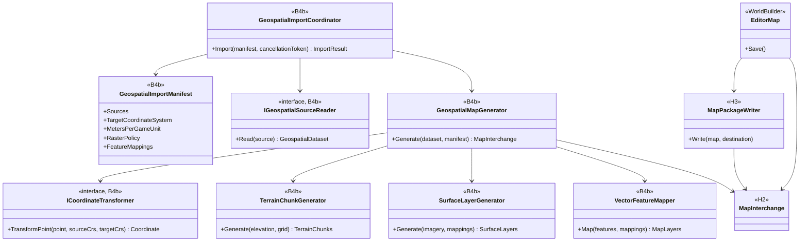
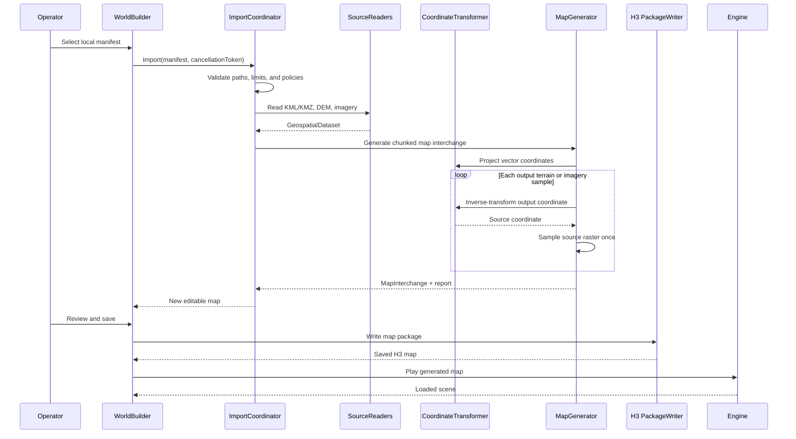
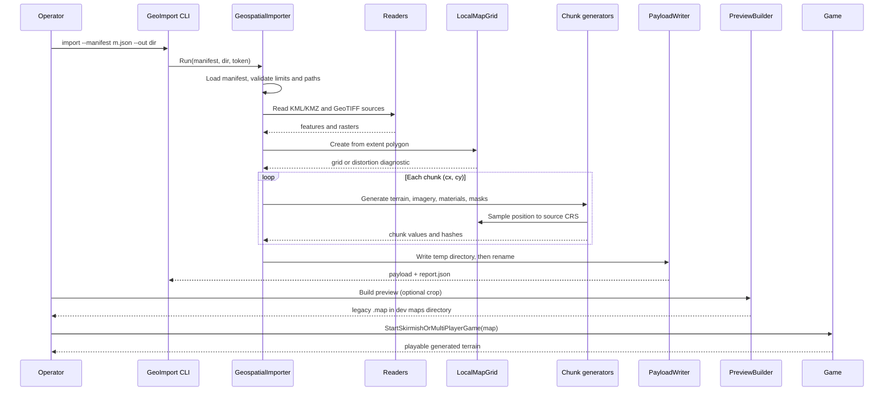

# Deep Dive: Geospatial Map Generation

> Expands phases R1 to R6 of [Track R: Real-World Terrain](../track-r-real-world-terrain.md)
> (formerly Track B phase B4b; sub-phase labels and card IDs keep the B4b prefix). Part of the
> [Large-Scale RTS Roadmap](../README.md).
>
> Audience: human design for offline generation of Panopticon maps from operator-supplied
> geospatial data. Code references are in the agent-context appendix.

Purpose: generate an editable, playable Panopticon map from a bounded real-world area. Command-line
preparation scripts (`scripts/geo/`, §8.1) fetch openly licensed elevation, imagery, ground-truth, and
building footprint data from per-provider profiles (national agencies such as IGN, Europe-wide
Copernicus), reproject it, and generate the extent KML. The importer converts those local KML/KMZ
and GeoTIFF files into the B4a/H3 map representation. KML may also be authored by hand or in Google
Earth Pro, and rasters may be exported from openly licensed Earth Engine datasets; Google basemap
imagery and terrain are not input sources (§2). The importer does not couple the engine to a
network service or treat geographic coordinates as game-space coordinates.

---

## 1. Scope and completion boundary

Track R owns an offline source-to-map pipeline:

1. Read a local import manifest and its referenced files.
2. Parse KML/KMZ vector data and georeferenced elevation/imagery rasters.
3. Reproject every source into one local planar coordinate system.
4. Generate chunked terrain, imagery, and configured vector-derived map layers.
5. Write the H3 map package through the H2 map interchange boundary.
6. Open, edit, save, reload, and play the generated map through WorldBuilder.

The first completed pipeline supports:

- one KML or KMZ document containing an extent and named point, line, or polygon features;
- one georeferenced DEM raster;
- one optional georeferenced imagery raster;
- one optional classification raster;
- one WGS84 Transverse Mercator target: a UTM zone or a custom central meridian;
- deterministic nearest-neighbour, bilinear, and area-weighted resampling;
- a visual imagery layer and explicit vector-to-map mapping rules;
- a machine-readable import report and source manifest.

The milestone is not visual resemblance alone. Source control points must map to the generated
terrain and named landmarks within declared horizontal and vertical tolerances. The generated map
must then survive a WorldBuilder save/reload and run in the engine.

Operator data preparation sits outside the importer: scripts under `scripts/geo/` download open
data with `curl` and reproject it with GDAL, never run in CI, and commit no source or derived data
(§8.1). Structures are in scope as footprint masks in R2 and as generated or placed geometry in R3
(§5.4).

Out of scope:

- network access from the importer or engine: downloading tiles, resolving remote KML links, or
  querying a service (preparation scripts own all downloads);
- providers that need accounts, API keys, or interactive licence acceptance, including any Google
  service;
- Google basemap imagery, Google 3D terrain, and data traced or digitized from them (§2);
- automatically inferring object definitions from arbitrary feature names;
- globe-scale coordinates (a spherical or Earth-centred world frame); Earth curvature on the
  planar map is a later goal (R6, §4.1);
- reconstructing buildings from imagery or from surface-model (DSM) elevation;
- OpenStreetMap data until an ODbL decision is recorded;
- merging a changed source dataset into arbitrary hand edits;
- legacy `.map` export for operators (deferred until H5 migration tooling; the dev preview in
  §6.1 is not an operator export).

## 2. Source and provenance boundary

The [geospatial-import Decision](../open-questions.md) fixes an offline boundary. The operator
supplies every input file and is responsible for the right to use it. B4b records provenance but
does not implement license adjudication.

The manifest records:

- source file paths and content hashes;
- source label and optional attribution text;
- source and target coordinate reference systems;
- horizontal and vertical units;
- vertical datum or an explicit `unknown` value;
- selected extent and local origin;
- meters per game unit and vertical exaggeration;
- terrain lattice spacing, chunk size, and border;
- resampling and no-data policies;
- horizontal and vertical validation tolerances;
- imagery and vector mapping rules.

Paths resolve relative to the manifest. Absolute paths may be used interactively but are rewritten
as relative paths when all inputs share a project root. A saved map retains hashes and descriptive
metadata, not copies of source files unless the operator explicitly embeds generated assets.

KMZ is treated as an archive, not a remote-document container. Archive-local resources are
allowed. Path traversal, absolute archive paths, `NetworkLink`, and remote `href` values fail
before extraction.

## 3. Input and normalized interchange

Format-specific readers produce CPU-only values before map generation:

```text
GeospatialImportManifest
  Sources[]
  ExtentPolicy
  TargetCoordinateSystem
  LocalOrigin
  MetersPerGameUnit
  VerticalPolicy
  RasterPolicy
  FeatureMappings[]

GeospatialDataset
  Extent
  ElevationRaster
  Optional ImageryRaster
  VectorLayers[]
  Provenance

GeospatialRaster<T>
  Width, Height
  AffineTransform
  CoordinateSystem
  NoData
  Samples

GeospatialFeature
  SourceId
  Geometry
  Attributes
  CoordinateSystem
```

These types do not reference `MapFile`, renderer resources, Google SDK types, or a selected
GeoTIFF/projection library. Readers and coordinate transforms sit behind narrow interfaces so a
dependency can be replaced without changing the generation pipeline.

KML support is deliberately bounded:

- `Point`, `LineString`, `Polygon`, and `MultiGeometry`;
- folder and placemark names;
- extended string/number attributes;
- longitude, latitude, and optional altitude coordinates;
- `clampToGround` and absolute altitude interpreted through explicit policy.

Styles may supply a mapping key but do not define engine materials directly. Tours, models,
overlays with remote resources, network links, and dynamic updates are unsupported.

The initial raster contract is GeoTIFF with an affine transform, declared CRS, bands, and no-data
metadata. KML/KMZ vectors come from the preparation scripts (`ogr2ogr`), hand authoring, or Google
Earth Pro drawing; raster inputs come from openly licensed datasets reprojected with GDAL or
exported through Earth Engine. Google Earth basemap imagery and terrain are explicitly unsupported.

The initial TIFF adapter accepts single-image classic TIFF with axis-aligned affine metadata.
BigTIFF, multiple images, sub-IFDs, non-meter units, and nonidentity elevation mappings fail
before decoding. RGB and straight-alpha RGBA use unsigned 8-bit samples. An unspecified fourth
band is treated as straight alpha; associated-alpha imagery is rejected. Raw metadata has a
16 MiB auxiliary-data limit before LibTiff opens the file.

Dependencies (see the B4b dependency Decision in [open-questions.md](../open-questions.md)):

| Concern | Choice |
|---|---|
| TIFF decoding | `BitMiracle.LibTiff.NET` (managed, BSD-style license) with in-house GeoTIFF key parsing |
| Projection | in-house WGS84 Transverse Mercator (Krüger series, order 6); no projection package |
| PNG encoding | existing `SixLabors.ImageSharp` |
| KML/KMZ | `System.Xml` and `System.IO.Compression` |
| Polygon overlay | `NetTopologySuite` 2.6.0 (CPU-only, BSD-3), private to `FeatureClipper`; robust rectangle clipping that preserves holes and disconnected parts |

Both stay behind `IGeospatialRasterReader` and `ICoordinateTransformer`, so either can be
replaced without changing the generation pipeline. All code lives in the CPU-only
`Panopticon.Geospatial` project, which references no engine assembly.

## 4. Coordinate and elevation contract

KML coordinates are WGS84 longitude/latitude. They are never copied directly into game X/Y.
Raster coordinates come from their embedded CRS and affine transform.

Import uses this sequence:

1. Transform the selected KML polygon into the manifest's projected CRS.
2. Build the smallest axis-aligned target-CRS rectangle containing that polygon. Anchor the local
   lattice at its southwest corner and round its width and height upward to whole chunks.
   Retain the polygon as the playable-area mask; exterior samples are impassable and unbuildable.
3. Use that southwest corner as the standalone payload's origin. Other origin policies are deferred.
4. Subtract the origin to obtain local meters.
5. Divide by `metersPerGameUnit` to obtain Panopticon horizontal world units.
6. For each output sample, inverse-transform its target-CRS location into each source raster and
   sample that raster exactly once.

`ICoordinateTransformer` transforms coordinates only; it never creates an intermediate warped
raster. This single inverse-warp rule avoids two rounds of interpolation.

Geographic `Vector2d` coordinates use X longitude and Y latitude. An extent source must contain
exactly one polygon unless `extentFeatureId` selects a polygon explicitly. Ambiguous extents fail.

Projected easting maps to game +X and projected northing maps to game +Y. Raster row order comes
from the affine transform: a north-up raster with negative row scale is flipped while sampling so
it is not mirrored in game space.

The initial terrain lattice remains the engine's ten game units per sample. Therefore:

```text
outputSpacingMeters = 10 * metersPerGameUnit
```

The values are not independent controls. A later B4a/H3 variable-lattice contract may replace the
constant, but it must preserve the same declared relation.

The transform is retained as map metadata:

```text
GeospatialMapTransform
  SourceCoordinateSystems[]
  ProjectedCoordinateSystem
  OriginEastingNorthing
  MetersPerGameUnit
  VerticalDatum
  VerticalOriginMeters
  VerticalExaggeration
```

Supported coordinate systems:

- sources: EPSG:4326 (KML and geographic rasters) and WGS84 UTM, EPSG:32601-32660 and
  EPSG:32701-32760; any other CRS fails with a `Coordinates` diagnostic, and the operator
  reprojects at export time;
- target: WGS84 Transverse Mercator. `utm` presets use the zone's central meridian, scale 0.9996,
  and standard false easting/northing. `transverse-mercator` uses scale 1, zero false
  easting/northing, and a central meridian that defaults to the extent's WGS84 bounding-box centre
  rounded to 0.01 degrees.

A custom central meridian lets one import cover several UTM zones, such as the whole Western Front
(about 5 degrees of longitude, under 0.05% scale error at the edges). Import fails when the point
scale error `|k/k0 - 1|` at any extent corner or edge midpoint exceeds `maxScaleError` (default
0.001). Earth curvature is not applied before R6 (§4.1).

Vertical datum is metadata only: the manifest records each source's datum (for example `EGM96`,
`EGM2008`, or `unknown`), no geoid conversion runs, and sources that declare different known
datums fail with a `Coordinates` diagnostic.

Elevation conversion is explicit:

```text
gameZ =
  (sourceElevationMeters - verticalOriginMeters)
  * verticalExaggeration
  / metersPerGameUnit
```

The H3 terrain payload retains enough precision for the configured tolerance. Optional legacy
export quantizes to the target game's height representation only after reporting range and
precision loss.

Source no-data handling is selected in the manifest:

- `fail`: any output sample touching no-data rejects the import;
- `nearest-valid`: fill from the nearest valid source sample within a bounded radius, choosing the
  lowest source row and then column when candidates are equidistant;
- `constant`: fill with an explicit elevation.

There is no silent zero fill. The report records filled sample counts and affected bounds.

Coverage outside a source raster footprint is distinct from an in-raster no-data value. The
manifest's `edgePolicy` either fails, uses a bounded nearest-edge sample, or supplies an explicit
constant. The report records outside-footprint and no-data counts separately.

Resampling follows source and output ground-sample distance:

- nearest-neighbour is for categorical masks;
- bilinear is for continuous elevation or imagery when output spacing does not exceed source
  ground-sample distance;
- deterministic area-weighted sampling is required for decimation.

The report records source ground-sample distance, output spacing, their ratio, and the selected
kernel.

Affine coordinates refer to pixel corners; samples lie at half-pixel centers. Output sampling
footprints are rectangles in target projected meters, transformed into source pixel space.
Ground-sample-distance comparisons use meters, including for geographic rasters. Decimation in
either axis selects area weighting; zero-weight neighbours do not contribute no-data failures.
Partial source coverage applies the edge policy independently from in-raster no-data.

Default validation tolerances are owned by the manifest:

- horizontal: at most the greater of one output sample spacing and the source's stated horizontal
  accuracy;
- vertical: the maximum of the DEM's stated vertical accuracy and the explicit operator tolerance
  whenever either is available; a stricter operator tolerance never undercuts the stated accuracy,
  and with neither the absolute comparison fails with the typed missing-tolerance error.

The H3 output elevation quantum must be no greater than half the vertical tolerance. An operator
may tighten either tolerance. Absolute vertical validation requires a declared vertical datum.
With `unknown`, the report marks absolute validation `not evaluated` and requires an explicit
relative-elevation tolerance.

### 4.1 Earth curvature (R6, later goal)

R1 to R5 treat the projected map as flat. Curvature drop at distance `d` is `d^2 / (2 R_eff)`,
with `R` 6,371 km and `R_eff = R / (1 - k)` for atmospheric refraction coefficient `k` (standard
0.13):

| Distance | Geometric drop | With refraction (k 0.13) |
|---|---|---|
| 1 km | 0.08 m | 0.07 m |
| 5 km | 1.96 m | 1.71 m |
| 10 km | 7.85 m | 6.83 m |
| 35 km (W3a east-west span) | 96 m | 84 m |

Below about 5 km the drop is under the vertical tolerance of 1 m DEMs plus mark height. W3a
observation and artillery lines of several kilometres, and any map spanning tens of kilometres,
exceed it.

R6 design constraints:

- Curvature is observer-relative, so it is not baked into terrain heights: a drop baked relative
  to one origin is wrong for every other observer. Terrain chunks and the payload stay planar.
- Line of sight and detection subtract the drop between observer and sample point along each ray.
  This is the gameplay-relevant effect and the first deliverable.
- Rendering applies the same drop relative to the camera in the terrain and object vertex
  stages, so the horizon matches line of sight. Optional after line of sight.
- Ballistic trajectories over long ranges take the same correction at the target point.
- An `EarthCurvature` option with `k` defaults off; small maps keep current behaviour.
- The payload already records the projection origin and scale, so no import change is expected;
  the projection scale factor and curvature stay separate corrections.
- Globe-scale coordinates stay out of scope (§1).

## 5. Terrain, imagery, and vector generation

### 5.1 Terrain

The output grid follows B4a-5's chunk boundaries. Each terrain chunk includes the overlap samples
needed for interpolation, normals, and seam-free patch generation. Sampling order, floating-point
rounding, and chunk traversal are fixed. Identical inputs, settings, platform, and pinned
geospatial dependency versions produce identical payloads. Cross-platform validation compares
coordinates and samples within declared tolerances rather than requiring byte-identical chunks.

The generator computes:

- height samples and min/max elevation;
- chunk bounds and overlap samples;
- normals or the inputs needed to derive them consistently;
- initial passability/buildability masks where explicit vector rules provide them;
- a deterministic content hash per chunk.

B4b does not create another terrain store. It populates B4a's runtime chunk contract and H3's
serialized terrain section.

Vertical exaggeration changes derived slopes. The report records it beside passability and
buildability generation, and those masks are regenerated whenever exaggeration changes.

### 5.1a Chunk layout

| Property | Value |
|---|---|
| Lattice spacing | 10 game units (`10 * metersPerGameUnit` meters) |
| Chunk extent | 128 sample intervals (1280 game units) per axis |
| Lattice points per chunk | 129 per axis; edge points are duplicated in both neighbours and must be equal |
| Apron | one read-only sample on each side for normals; stored chunk is 131 x 131 |
| Height payload | little-endian `float32` game units |
| Chunk key | `(cx, cy)` from the southwest origin; +X east, +Y north |

The map extent rounds outward to whole chunks. The same layout is the proposed
[B4a-5](b4a-larger-maps.md) runtime chunk contract; `WI-B4a-01` grounds it against the engine.

### 5.2 Imagery

Source imagery is a georeferenced visual reference, not automatically a gameplay material map.
The initial path resamples imagery into chunk-aligned RGBA8 PNG assets (default 10 pixels per
lattice interval, set by `imageryPixelsPerSample`) and exposes them through an
editor-only 2-D overlay outside `GameViewportRenderer`. Imagery validation is asset-level:
control pixels are compared with the source after the declared resampling. The current renderer
has one whole-map macro texture, not a streamed imagery layer, so displaying chunked source
imagery in game is deferred until B4a or B5 provides that binding. The playable proof uses
generated terrain material layers.

Gameplay terrain materials remain explicit. A manifest can map integer classification raster
values or vector polygon attributes to a controlled Panopticon material palette. Polygon rules
override classification rules, and later rules override earlier ones. Evaluation order:
classification entries in `materialRules`, attribute entries in `materialRules`, then
material-target feature mappings. Each family retains manifest order. An attribute rule
without `sourceId` matches polygons from any source. There is no built-in
vocabulary; an example manifest fragment maps the ESA WorldCover classes. Arbitrary imagery colors are not
silently quantized into legacy `BlendTileData`. The manifest requires one default base terrain
material; cells not matched by a classification or vector rule use that material.

### 5.3 Vector features

Feature mappings are declarative:

| Source geometry | Initial targets |
|---|---|
| Point | Landmark, waypoint, spawn/object candidate |
| Line | Road, rail, river, or annotation candidate |
| Polygon | Water, material, passability, buildability, or annotation region |

A mapping rule selects source layer and attributes, target kind, and target parameters. Object
placement requires an explicit object-definition name and orientation policy. Unmapped features
remain inspectable annotations and produce no gameplay state.

Rule predicates use source ID, optional exact `layerName`, geometry, and attribute presence or
exact string value. Authoring targets use the first matching rule. Water, passability, and
buildability retain all matching regions with their manifest rule index, so mask overrides use
global manifest order across features. Material rules are evaluated independently by the material
generator. A feature with no authoring or region match remains an annotation.

Generated points sample terrain Z after terrain creation. Lines and polygons are clipped to the
selected extent before rasterization. Stable source IDs and attributes remain attached to
generated authoring records for diagnostics.

Generation order: terrain, clipped and mapped features, then materials and masks. Water sets both
mask bits; subsequent passability and buildability rules change only their respective bit.
Exterior playable-area masking is applied last. Polygon holes remain excluded; clipping preserves
disconnected parts and gives each split part a stable identity.

### 5.4 Real-world structures

Buildings, bridges, and other structures reach a generated map only through these inputs:

| Input | Treatment |
|---|---|
| Elevation | Profiles use bare-earth terrain models (RGE ALTI is one), so buildings, vegetation, and bridges are absent from the terrain. A surface model would bake roofs in as terrain lumps; a surface-model profile records that limit in its `sources.txt`. |
| Imagery | Roofs and streets are flat texture with no height or collision. |
| Vector footprints | Building polygons map to Passability (impassable) and Buildability (unbuildable) regions through ordinary rules ([`WI-R2-03`](https://projects.reid-corp.com/work_packages/841)). Footprints smaller than a lattice cell set no mask cells and are counted in the report. |

Deferred to R3, where placed objects enter the map package:

- Structure objects: footprint or point to an object definition, size, orientation, and terrain
  seating. Needs a content source (Generals buildings or W3a period definitions) and a mapping
  vocabulary; R2 object candidates stop before placement.
- Bridges: bare-earth terrain removes them, so they come from vector lines and need engine bridge
  layers, which are stubbed today.
- Building heights from source attributes, for line of sight and visuals.

#### 5.4.1 Candidate content sources

Structures avoid one bespoke model per building. Candidate routes, combinable:

| Route | Sources | Licence | Notes |
|---|---|---|---|
| 1. Procedural extrusion | Footprint plus height attributes, roof rule; tiling PBR materials from ambientCG and Poly Haven | CC0 | Leading candidate. Fits every country with footprints and heights. OSM2World (LGPL) is a reference for footprint-to-roof generation. |
| 2. Modular kits | Kenney (City, Building, Castle, Fantasy Town kits), Quaternius, KayKit free editions | CC0 | Low-poly, stylized glTF; doors, windows, chimneys as details on route 1 walls. Style mismatch with realistic materials. |
| 3. Open LoD2 city models | Netherlands 3D BAG, German state LoD2, swissBUILDINGS3D; some French cities (CityGML) | Open, per dataset (3D BAG CC-BY 4.0) | Real per-building geometry where published; no national French equivalent. A separate source type. |

Sketchfab and OpenGameArt assets carry per-asset licences and are used only after individual
review. Landmarks such as the Sedan château stay bespoke. Both glTF import (C4) and PBR materials
(C3) exist, so routes 1 and 2 need no new importer.

#### 5.4.2 Procedural building investigation

[`WI-R3-01`](https://projects.reid-corp.com/work_packages/842) prototypes route 1 on the
Sedan footprints and recommends the R3 layout (merged chunk meshes or per-building objects), roof
rule, and material list.

Route 1 is feasible on the Sedan footprints and is recommended as the R3 representation. Flat roofs
apply to every footprint and gabled roofs to the 559 convex ones. Merged meshes per terrain chunk
render at a mean of 3.340 ms against 1.363 ms with buildings off, while one model per building costs
30.882 ms for all 1,676 buildings. Four CC0 tiling material sets are recommended; Kenney kit details
are rejected at gameplay camera distance. The prototype stays on its investigation branch and is not
merged.

##### Results by question

| Question | Result |
|---|---|
| 1. Attributes | KML: 1,789 placemarks. `cleabs`, `nature`, and `usage_1` are populated in 100 percent; `hauteur` in 1,774 of 1,789 (99.2 percent); `usage_2` is empty in every placemark. Payload: 1,679 building polygons covering 1,676 unique `cleabs` (2 multi-part). `hauteur` is populated in 1,665 of 1,679 (99.2 percent); the 14 missing values fell back to the `usage_1` median, and none needed the global median. Heights span 1.2 to 49.0 m, median 9.4 m. The 113 KML-only `cleabs` are the GEO-FEA-001 drops outside the map rectangle. Acquisition: 2,425 features acquired, 1,789 kept, 636 dropped below the 20 m2 filter. The payload also retains 27 sub-filter slivers from a later stage. |
| 2. Roof rule | Flat applies to 1,679 of 1,679 footprints. Gabled along the longest axis applies to 559 of 1,679 (33 percent); the 1,120 failures are concave 1,049, holes 42, too few vertices 19, and tiny area 10. Hipped from the straight skeleton was not implemented. Its convexity gate alone would cover the same 559, and a true skeleton adds headroom on the 1,091 concave or holed footprints. The baked prototype used gabled where applicable with flat fallback (559 gabled, 1,120 flat). |
| 3. Materials at camera distance | Four ambientCG CC0 tiling sets (two wall, two roof), assigned deterministically per `cleabs`. At overview distance isolated buildings are distinguishable and walls read separately from roofs; the pale plaster and brick wall variants visibly break repetition; brick courses are legible at close range. Roof materials render nearly black under default world lighting, so the two roof variants cannot be told apart and roof tiling could not be judged. Roof tone and lighting evaluation is a follow-up. |
| 4. Kit details | Kenney Prototype Textures kit (CC0) adds 1,673 doors, 66,172 windows, and 559 chimneys: 141,280 triangles (182,074 total, +346 percent) and 3 materials. At close range faint window patterns modestly improve facade readability, but the detail geometry is low contrast. At overview distance the kit variant is visually indistinguishable (208 of 30,000 sampled pixels differ) while merged render cost rises from 3.34 to 4.83 ms mean (+45 percent). Verdict: not justified as always-on geometry at gameplay camera distance; optional for close-range cinematics if a higher-contrast kit is sourced. |
| 5. Cost | See the cost table below. |
| 6. Layout for R3 and H3 | Merged per chunk: 9 models, 3.340 ms render, 1.86 s import. It fits the B4a-5 chunk model and an H3 terrain-payload section. Measured drawback: a single chunk translation cannot follow intra-chunk terrain relief. At the close-up target building the chunk-mean seating floated it about 20 game units (6 m) above local ground (capture published). Per-building identity for selection, damage, and line of sight needs sidecar metadata. Per building: exact seating and natural object semantics, but 1,676 render-list entries cost 30.882 ms render and 10.46 s import at prototype quality, with no instancing, LOD, or culling (Track B5 owns those). |

##### Cost

| Mode | Models | Meshes | Render ms mean (p95) | Import wall s |
|---|---|---|---|---|
| Buildings off | - | - | 1.363 (1.643) | - |
| Merged per chunk | 9 | 36 | 3.340 (3.951) | 1.86 |
| Per building, 50 buildings | - | - | 1.747 (2.253) | - |
| Per building, all | 1,676 | 3,352 | 30.882 (32.721) | 10.46 |
| Merged per chunk with kit details | - | - | 4.833 (7.547) | 2.59 |

Logic ms mean is 0.33 to 0.38 in every mode, as buildings are presentation-only. Dashes mark values
not recorded in the measurement summary. Counts are render-list entries (BuildRenderList calls per
frame: 9 merged, 1,676 per building), not GPU draw calls. Measured on this host with the headless
harness, fixed timestep, static camera, no AI, n=50 or 110 post-warmup frames, one run per mode; the
off-mode noise band is about 0.1 ms. Memory was not measured.

Without kit details the merged set has 40,794 triangles (walls 27,752, gable ends 1,118, roofs
11,924). Per chunk: 1,976 to 8,333 triangles and 114 to 315 buildings.

##### Evidence and sources

- Prototype: branch `track-r-r3-1-procedural-buildings-prototype`, commit
  `8c9467e403a0609f4f6245cffbc721148c031a09` (generator and kit), and scratch scenario commit
  `fa699fe1b` (not merged). The branch is a permanent reference.
- Generator: stdlib Python. It reads the WI-R2-03 payload footprints (game-space polygons with BD
  TOPO attribute tables) and the kept buildings KML, extrudes walls, bakes gabled or flat roofs with
  world-meter UVs, and writes glTF 2.0 with external textures. Output is 9 merged files (one per
  terrain chunk) and 1,676 per-building files. Two generator runs are byte-identical.
- Scratch scenario: TestHarness scenario `R3BuildingPrototype` spawns the glTFs on the Sedan preview
  map (`maps/r2-03-footprints-payload-v2`) through the glTF importer and the RenderPipeline
  render-list hook, seats them on terrain, captures PNGs, and records per-frame logic and render
  timings (mean, median, p95, variance, min, max; warmup discarded).
- Captures in the screenshot viewer, under the shared temp root with versioned names:
  `r3-01-buildings-baseline-off-overview-v1.png`, `r3-01-buildings-merged-overview-v1.png`,
  `r3-01-buildings-perbuilding-overview-v1.png`, `r3-01-buildings-merged-oldtown-closeup-v1.png`,
  `r3-01-buildings-merged-closeup-chunk-seating-offset-v1.png`,
  `r3-01-buildings-perbuilding-oldtown-closeup-v1.png`,
  `r3-01-buildings-kit-details-closeup-v1.png`, and `r3-01-buildings-kit-details-closeup-v2.png`.
- Per-frame stills and all metrics JSON: `frames/r3-01-v1/`.
- Pixel check: the off and merged overviews differ at 14,184 of 30,000 sampled pixels; the merged and
  per-building overviews are statistically identical. An independent vision agent reviewed the
  captures qualitatively.

| Source | Used for | Licence | Pin |
|---|---|---|---|
| ambientCG Bricks097 | Wall brick | CC0 1.0 | `https://ambientcg.com/get?file=Bricks097_2K_JPG.zip` |
| ambientCG Plaster001 | Wall plaster | CC0 1.0 | `https://ambientcg.com/get?file=Plaster001_2K_JPG.zip` |
| ambientCG RoofingTiles003 | Roof slate | CC0 1.0 | `https://ambientcg.com/get?file=RoofingTiles003_2K_JPG.zip` |
| ambientCG RoofingTiles013A | Roof clay | CC0 1.0 | `https://ambientcg.com/get?file=RoofingTiles013A_2K_JPG.zip` |
| Kenney Prototype Textures | Door, window, and chimney kit (rejected for gameplay distance) | CC0 (zip `License.txt`: "License: (Creative Commons Zero, CC0)") | Recorded in prototype root `materials/KIT-LICENSE.md` |

The ambientCG zip SHA-256 values are recorded in prototype root `materials/LICENSES.md`.

##### Recommendation

- Layout: merged meshes per terrain chunk as the R3 layout, with per-building records (`cleabs`,
  height, footprint) carried in the package as metadata for later gameplay promotion. Revisit
  per-building placement when B5 instancing exists.
- Roof rule: flat by default, gabled on convex footprints (559 buildings). A straight-skeleton hip
  stays an optional follow-up if roof variety proves valuable.
- Materials: the four ambientCG CC0 sets with deterministic per-building assignment. Kenney kit
  details are rejected for gameplay distance.
- Follow-up R3 cards implied, not yet carded: building placement into the H2/H3 package (blocked on
  H2/H3 and B4a-5); roof material tone and lighting evaluation; straight-skeleton hip evaluation; a
  high-contrast close-range detail kit for cinematics; a bespoke landmark card for the Sedan château.

##### Limitations

- Prototype only; no production code is merged.
- Single host and single run per mode. Render-list counts are not GPU draw calls, and memory is
  unmeasured.
- Roofs are too dark to evaluate tiling.
- Merged chunk seating approximates intra-chunk relief.
- The scratch scenario applies an axis permutation and `unitsPerMeter: 1f`, which the measured
  importer behaviour required. The generator docstring's axis claim is superseded by the scenario's
  measured contract.
- glTF base-color textures only. Normal and roughness maps are extracted but not bound.

## 6. H2/H3 and WorldBuilder boundary

B4b depends on B4a and H6, but format-specific parsing must not write H3 bytes directly.

- B4b owns source parsing, coordinate normalization, generation policy, and diagnostics.
- B4a owns chunked runtime terrain and streaming.
- H2 owns the format-neutral map interchange boundary.
- H3 owns the versioned on-disk package and serialization.
- H6 supplies WorldBuilder's H3 read/write lifecycle.
- B4b owns the interactive import command, preview, generation report, and capability-gated
  new-to-legacy export.

The generated result enters WorldBuilder as a normal editable map. The import operation is one
transaction: cancellation or a blocking diagnostic leaves the current editor session unchanged.
Successful import creates a new dirty document and an import report.

Initial reimport is replace-only. A source change generates a new map document; B4b does not
attempt a three-way merge with edited terrain or objects. The retained manifest and feature IDs
make a later layer-aware reimport experiment possible.

Operator-facing legacy `.map` export is deferred until H5 migration tooling exists.

### 6.1 Standalone payload and dev preview

Until H2/H3/H6 exist, B4b-1..6 write a B4b-owned payload directory:

| File | Contents |
|---|---|
| `payload.json` | payload version, `GeospatialMapTransform`, chunk layout, material palette, generated features, provenance with SHA-256 hashes |
| `terrain/<cx>_<cy>.bin` | 131 x 131 `float32` heights |
| `imagery/<cx>_<cy>.png` | RGBA8 imagery |
| `materials/<cx>_<cy>.bin` | 129 x 129 material indices (`byte`) |
| `masks/<cx>_<cy>.bin` | 129 x 129 passability and buildability bit flags |
| `report.json` | diagnostics, kernel and sample-distance ratios, fill counts, control-point results |

The importer writes into a temporary sibling directory and renames it on success, so a failed or
cancelled import leaves no partial payload. B4b-7 later maps the same generated values into the
H2 interchange; the payload remains a debug artifact.

Control-point validation runs before the rename. Replacing an existing output preserves it until
generation and validation succeed, then swaps through a recoverable sibling backup. Payload reads
validate safe paths, exact chunk inventory and byte lengths, hashes, finite heights, seam equality,
palette indices, known mask bits, and consistent optional imagery before preview.

Horizontal control points include independent expected game XY or a matched generated feature ID;
coordinates alone report horizontal validation as not evaluated. Imagery tolerance is an explicit
per-channel byte threshold. Unknown-datum elevation comparisons are relative to the declared
vertical origin and require a relative-elevation tolerance.

The dev preview (`Panopticon.Geospatial.Preview`) converts a payload, or a chunk-aligned crop of
it, into a resident legacy `MapFile`: 16-bit `HeightMapData` (`gameZ / 0.0390625`, clamped with
reported loss), uniform-then-painted `BlendTileData` from a palette-to-terrain-texture map,
passability from masks, and waypoints from mapped features. It writes a `.map` into a dev maps
directory so the existing load path plays it. Publication runs through the `GeoImport` CLI's
separate `preview` verb (`preview --payload <dir> --textures <map.json>
[--crop cx0,cy0,cx1,cy1] [--force] --out <maps dir>`); there is no `import --emit-preview`
alias. It is dev-only: no capability gating, no compatibility promise, and it is removed or
kept as a debug tool when B4b-7 lands.

Preview crops use a half-open chunk rectangle. XY is translated by the crop origin (border is
index padding only); Z is rebased by the crop minimum elevation. The report retains both
offsets and quantization loss.
Legacy preview masks: `Impassability = true` is blocked. The later-format
`BlendTileData.Buildability` field has unverified polarity and no runtime consumer; Generals
version 8 does not serialize it. The preview reports unrepresented buildability cells and
retains the authoritative `Unbuildable` payload bit without converting it to impassability.

Default preview border: zero. An assembled heightmap index `(i, j)` maps to engine XY
`((i - border) * 10, (j - border) * 10)`. Stored waypoint coordinates use engine XY, not indices.
Waypoints outside the crop are excluded; retained waypoints and control-point checks use the same
transform. Height comparisons restore the reported Z offset before comparison.
Player-start waypoints use Z zero because skirmish startup adds terrain height; ordinary mapped
waypoints retain their rebased absolute elevation.

## 7. Diagnostics and security

Diagnostics have stable codes and stages:

| Stage | Example failures |
|---|---|
| Manifest | Missing source, invalid policy, path outside project root |
| Archive | Unsafe KMZ path, remote reference, unsupported compression |
| Parse | Unsupported KML geometry, malformed raster metadata |
| Coordinates | Missing CRS, projection failure, excessive distortion |
| Raster | Outside-footprint policy, no-data threshold, incompatible bands, invalid affine transform |
| Generate | Elevation overflow, invalid chunk seam, unknown material/object mapping |
| Write | H3 capability or serialization failure |
| Validate | Control-point, round-trip, or playability mismatch |

Errors are not inferred from exception messages. Reader adapters translate known dependency
failures into typed diagnostics and preserve the original exception as detail.

Resource limits are checked before allocation or extraction:

- maximum manifest and KML entry size;
- maximum KMZ entry count, expanded bytes, and compression ratio;
- maximum raster dimensions and decoded bytes;
- maximum feature and coordinate counts;
- checked output dimensions and chunk counts.

## 8. Determinism and validation

Repository tests use generated fixtures, never downloaded data:

- a small KML file with point, line, polygon, and nested geometry;
- a KMZ containing the same data and archive-local resources;
- a synthetic projected DEM with a known plane, ridge, no-data hole, edge values, and row order
  that exposes vertical mirroring;
- deterministic imagery with known control pixels;
- mismatched-CRS and malformed-input fixtures.

Validation layers:

1. Unit tests: parsing, archive safety, transforms, extent clipping, raster kernels, no-data,
   elevation conversion, feature mapping, and diagnostic codes.
2. Chunk tests: adjacent borders, overlap samples, pinned-platform hashes, cross-platform numeric
   tolerances, traversal order, and bounded memory.
3. Package tests: generated H3 package save/reload and retained transform/provenance metadata.
4. WorldBuilder tests: import transaction, cancellation, dirty state, preview, edit, and save.
5. Engine test: load and play a generated synthetic map.
6. Operator proof: import one authorized real-world area, compare named control points against the
   source within declared tolerances, save/reload it in WorldBuilder, and play it. This is an
   operator-local gate; no source data is committed or required in CI.
7. B1 benchmark: import time, peak memory, chunk generation/streaming time, and editor latency.

### 8.1 Early operator proof (R2)

Before R5, [`WI-R2-01`](https://projects.reid-corp.com/work_packages/839) runs layers 5 and 6 on the
R2 dev preview with real data: about 1.1 km of Sedan around the Château fort, IGN RGE ALTI 1 m
elevation (`NGF-IGN69`), IGN BD ORTHO imagery, a generated KML extent, and blinded ground-truth
cells derived from IGN LiDAR HD class-2 points as independent vertical control, selected by the
frozen pre-DEM protocol owned by the [Sedan ground-truth protocol](r2-sedan-ground-truth.md). The
2026-11-02 levelling-benchmark audit found 0 of 21 in-square `IGNF_GEODESIE:rn` marks
ground-comparable, so the levelling marks are retained only as metadata and candidate-exclusion
evidence. It omits the H3 package and WorldBuilder round-trip,
which stay in R5. Data preparation is command-line only (`scripts/geo/prepare-sedan-proof.sh`:
`curl` downloads, GDAL reprojection, `ogr2ogr` KML generation); no desktop tool is required.
[`WI-R2-02`](https://projects.reid-corp.com/work_packages/840) then generalizes it into
`scripts/geo/prepare_area.py` with one source profile per provider (`ign-fr`, Europe-wide
`copernicus-glo30`), so other countries need a profile, not a new script.

Results: completed at source commit `03fb42f0a285d8507d9cfc37742d74026251d16e` by the fourth Interactive `SedanOperatorProofTests` case, after three diagnostic attempts: 1 passed, 0 failed, 0 skipped, wall `23:08.33`, whole-process max RSS `3,034,348 kB` (distinct from the frozen 1 GiB per-worker LiDAR probe guard). Data editions and local hashes come from `sources.txt` and `preparation/receipt.json` (`ff8f34aae0b1399ecc60ba599e43bb1a388313ad29c114af0e41e9a66874343d`). The 63-event chronology ledger `commands.jsonl` (`48d0a0cfad07d04d260a40693857b007a044fc7b0e1d9fd7d50460975135c26e`) records `freezeVerifiedAt` `2026-11-04T11:05:32.733-05:00` before `firstDemRasterIoAt` `2026-11-04T11:06:09.949-05:00`. Inputs: 8 archive parts (`29,835,514,326` B); 27 extracted members (`205,266,077` B); `RGEALTI 2-0 1M TIF LAMB93-IGN69 D008 2019-10-14` (livraison `2021-01-00150`, index DBF `2021-01-20`), 6 MNT height tiles warped to `prepared/sedan-dem-32631.tif` (`93c97b48ce1e9f924abe31f24bb94c229dce495235f452b332ae988ec6b0b35e`), with 6 SRC masks bound as provenance only; `ORTHOHR 1-0 RVB-0M20 JP2-E080 LAMB93 D008 2022-01-01` (livraison `2023-06-00036`, index DBF `2023-06-08`), tiles `08-2022-0835-6960` (`88342b3111dcaa0d1f9c812bbb08be8584b1ac6a4fba8aaac2df060508fdb16c`) and `08-2022-0840-6960` (`fc63030022bbd3a23bd0659bc63dba2ad692579790700e4da11b726bb017180a`) warped to `prepared/sedan-ortho-32631.tif` (`c544e38f33a36a0f5a4a7a1c0e1f0fa0b7f36ef5020ef36371cbd9cb3a074288`); `prepared/sedan-extent.kml` (`cfa7beaec9bbf89339093cf6ce2933f8306dcc8a723cf0e6854cf1f568418102`); `sedan-ign-proof.json` (`e79fe10a256ed4f10ea00a099853197f5dc29c778784949091f461697fa12aec`); `preview-textures.json` (`6633a0ffb07ce7ed5aea2c3d491c795ea891f4657f97a2160914aa49965f930e`); and 6 LiDAR HD COPC tiles (`830,532,133` B total, local SHA-256 consistency only, no publisher checksums claimed). The frozen pre-DEM canonical digest is `ea3e5f2e806b836c144dc33ffe6804dafcbad036abf240ffe7967aed589ea2f1`. Pipeline: 3 x 3 chunks (`385 x 385` height nodes) over a `1,170.432 m` storage span around the `1,100.0 m` playable AOI square at origin `E 639841.997, N 5506768.179` (EPSG:32631), `metersPerGameUnit = 0.3048`, `verticalExaggeration = 1`, `verticalOriginMeters Z0 = 149.381 m`, `cropMinimumGameZ C = 0.07160952687263489` game units. Core and CLI payloads are byte-identical (`d6cf5d001c47123e70630dcf2492041f4481762f850414bf7b365e76c5e35d35`); in-process and CLI `.map` files are byte-identical (`eef342757e049cba95100ea8dc4d1542883346488277566092dfb35368e5a8b9`). `AreaWeighted` was selected for all `154,449` terrain samples (observed source GSD `1.000 m`, output spacing `3.048 m`, ratio `3.048`) and all `44,236,800` imagery samples (observed source GSD `0.200 m`, output spacing `0.3048 m`, ratio `1.524`), with 0 failed samples, 0 no-data fills, and 0 outside fills. 148,225 encoded 16-bit `.map` nodes match `Quantize(core, C)` with 0 mismatches and maximum node quantization error `0.01953122` game units (`<= 0.01953125` half-quantum). 42 Core validation checks: 11 Passed, 31 NotEvaluated by design, 0 Failed.

Budget A and Budget B per primary, from `sedan-operator-proof.metrics.json` (full-precision authority `55750ce830217b14070d8928fe4c2134bcab33d2acbd67a56039b702efbd22f9`; values rounded to 4 decimals):

| Site | Sector | Stratum | Game XY | Frozen truth (m) | Payload Z (gu) | Payload (m) | Residual A (m, <= 1.0) | Engine bilinear Z (gu) | Residual B (gu, <= 0.0390625) |
|---|---|---|---|---|---|---|---|---|---|
| `r29c117` | `s00` | `S2` | `(1175, 295)` | `155.1130` | `18.1162` | `154.9028` | `0.2102` | `18.0469` | `0.0023` |
| `r291c342` | `s22` | `S1` | `(3425, 2915)` | `201.9755` | `172.7045` | `202.0213` | `0.0458` | `172.6270` | `0.0060` |
| `r32c280` | `s02` | `S1` | `(2805, 325)` | `154.0530` | `15.8531` | `154.2130` | `0.1600` | `15.7910` | `0.0095` |
| `r8c320` | `s02` | `S1` | `(3205, 85)` | `154.4085` | `16.5888` | `154.4373` | `0.0287` | `16.5137` | `0.0035` |
| `r266c285` | `s22` | `S3` | `(2855, 2665)` | `192.4443` | `141.9058` | `192.6339` | `0.1895` | `141.8457` | `0.0115` |

Pre-DEM alternates `r122c275` (sector `s12`) and `r69c19` (sector `s00`) remain recorded in `selection.tsv` only and were never activated. Frame crosscheck deltas are `-7.61e-5` game units in X and `-1.46e-4` game units in Y across all 5 primaries, within the `0.005` game-unit crosscheck guard.

Scope: Budget A (`<= 1.0 m`) is the operator's engineering acceptance limit against the frozen LiDAR truth, not a certified RGE source accuracy. The actual tile-specific RGE accuracy is undocumented and omitted from the manifest. Carried unresolved: the RGE 2012-2016 versus BD ORTHO 2022 versus LiDAR HD 2024 epoch differences and the 2024 LiDAR auto-classification bias. Budget B (`<= 0.0390625` game units, one 16-bit height quantum) is evaluated in the test harness via continuous bilinear `HeightMap.GetHeight(float, float)` in `SedanProofHeightSampling`, replacing the integer south-west node lookup `Terrain.GetGroundHeight(Vector2)` in the test caller only; production `Terrain` and `HeightMap` callers are unchanged. Restored engine elevation: `Z0 + (E + C) x metersPerGameUnit / verticalExaggeration`.

- Imagery control points: `rgb-quarter-centre` (global pixel `(960, 960)`, expected RGB `(83, 88, 93)`, actual `(83, 88, 93)`, delta `0` B) and `rgb-three-quarter-centre` (global pixel `(2880, 2880)`, expected RGB `(65, 88, 78)`, actual `(65, 88, 78)`, delta `0` B), both within the 2-byte tolerance over the prepared `0.20 m` RGB GeoTIFF.
- Warm wrapper idempotence (`scripts/geo/prepare-sedan-proof.sh /mnt/pit2/panopticon/geo-proof/sedan`): read-only preflight (`8.66 s`, exit `0`, `2,418` root files unchanged); warm `--prepare` call 1 (`9.39 s`, exit `0`, wrote only wrapper-owned `freeze/archive-evidence.txt`, `1,160` B, sha256 `9adc09a39cace03f736814b90f858fab1ba665c4cb3aad67b080158a27ab9736`, root files `2,418 -> 2,419`); warm `--prepare` call 2 (`8.79 s`, exit `0`, all 7 stages `SKIP`, root files `2,419 -> 2,419`, 0 changes). All 15 pinned proof/freeze/prepared artifact hashes are byte-identical before and after, with zero network, GDAL, or point-worker invocations. The existing `tools/lidar-venv` was reused read-only, verified by `pyvenv.cfg`, `sys.prefix`, and pinned package versions `laspy 2.7.0`, `lazrs 0.8.2`, `numpy 2.5.4`; ownership was established by the first-tile lock and recovery receipts. `installed-receipt.json` is absent on that pre-policy venv and is not claimed.
- Visual and comparison evidence under `/mnt/pit2/Network Storage/temp/` (no viewer URLs), verified PASS by numerical audit and independent Vision review:
  - `trackr-r2-sedan-native-proof-v2.png` (`2,769,646` B, sha256 `87914901f0380dd95db77b8f02572be8eec14d90b8fbb96ced3b187347fb1770`) and `trackr-r2-sedan-native-proof-v2.png.metrics.json` (`2,322` B, sha256 `55750ce830217b14070d8928fe4c2134bcab33d2acbd67a56039b702efbd22f9`): unedited native Generals frame after 300 logic frames (paused at frame 300) at whole-map centre aim `(1920, 1920)`, height `560`, angle `0`, pitch `0`, showing shaded 3D `GrassType1` terrain relief (`Luminance` mean `48.13`, stddev `13.20`, distinct `140`, bright fraction `99.95%`). The frame is terrain-only with `SkipStartingBuildings=true`; no objects or HUD are present, and no object-grounding claim is made.
  - `trackr-r2-sedan-bdortho-crop-v2.png` (`5,688,391` B, sha256 `12c0ef494f4d083ba8c4cc1e4516e8508fd71bd1ee2b0149c0d5d616326aa233`): north-up `EPSG:32631` crop warped directly from the two raw 2022 BD ORTHO `0.20 m` JP2 tiles (`5,854 x 5,854` px at `0.20 m` GSD over `warpTe [639841.8, 5506768.0, 641012.6, 5507938.8]`, `validCoverage 1.0`), displaying the `1,170.432 m` storage outline, the `1,100.0 m` playable AOI outline, and `IGN BD ORTHO 2022 (0.20 m), Licence Ouverte 2.0` attribution.
  - `trackr-r2-sedan-native-vs-bdortho-v2.png` (`8,075,641` B, sha256 `1e5448fd92e60bfe15f4618d0f37a3fc8be1ae60eeed0dc1c51925df8355ab07`) and `trackr-r2-sedan-comparison-v2.manifest.json` (`7,318` B, sha256 `a28f1112f14ce7953475cd352ab626cfd1a953d224720bba7c06d3cec23ab7b6`): side-by-side comparison plate and audit manifest. The left panel is an oblique perspective view of the uniform `GrassType1` preview terrain (imagery chunks are editor/package data and are not bound to the legacy `.map` terrain renderer). The right panel is a nadir top-down orthophoto at a different vantage and scale and is not pixel-registered.
- Motion evidence: `trackr-r2-sedan-rotating-relief-v2.gif` (primary) shows the rotating relief of the preview terrain over 72 frames, 12.96 s. The GIF is resized and quantized for display, not raw pixels, and motion review uses representative frames only.
- Corrected contact sheet: `trackr-r2-sedan-rotating-relief-v3-contact.png` and its `v3.manifest.json` correct the labels of the v2 contact sheet, which showed a wrong negative height minimum and a 393 global dimension. The v2 files are kept unmodified.

Scope limits, carried and not resolved by this proof:

- No renderer-bound imagery: imagery chunks are not bound to the legacy `.map` terrain renderer.
- No building or unit grounding: the proof is terrain-only with `SkipStartingBuildings=true`.
- Sample sets: the 385 x 385 core spans height `0.07160953` to `261.39559937` game units (`149.4028` to `229.0544` m); the 387 x 387 outer apron holds unique samples; the 9 x 131² (154,449) aggregate stored samples contain duplicates.

#### Adding a provider

Entry point: `scripts/geo/prepare_area.py`. Default mode validates and prints a read-only plan; `--prepare` permits acquisition and publication. `ign-fr` delegates only the pinned Sedan request to the existing preparation pipeline. `copernicus-glo30` supports one DEM tile and one complete-AOI Sentinel-2 item per request. Profiles are not an automatic source-discovery service.

- Required profile data: identifier, coverage, capabilities, download kind, source CRS, vertical datum, surface type, resampling and no-data policy, imagery selection and scaling metadata, manifest requirements, licence, and attribution. Adapter constraints and fields: [`WI-R2-02`](https://projects.reid-corp.com/work_packages/840).
- Licence review covers source and derived notices, liability, no endorsement, obligations for subsequent users, retained intellectual property, and termination on breach. Applicable obligations are retained in `sources.txt`; Sentinel notices use the selected acquisition year. Account, API-key, RequesterPays, and interactive-acceptance providers are excluded.
- Every new profile requires one successful operator import before listing as supported. Required evidence: source identities and retained hashes, CRS and band layout, full storage and apron coverage, kernels, no-data counts, and import report. A completed acquisition alone is not importer compatibility evidence.
- Surface semantics remain explicit: GLO-30 is a DSM, not IGN bare earth. EGM2008 passes through unchanged. The importer performs no inter-provider datum conversion. Source LE90 is not a maximum error or a control-point acceptance result.
- PixelIsPoint DEM inputs use GDAL's native georeferencing without a manual half-pixel shift. PixelIsArea imagery follows its embedded transform. Geometry is checked after extraction and warp.
- The 30 m DEM is bilinearly magnified onto the 3.048 m lattice. The 10 m RGB source is magnified into imagery at ten pixels per lattice sample. Neither operation adds source detail. RGB scale and offset are applied once, clamped to the configured reflectance range, and emitted as explicit Red, Green, Blue Byte bands. Source no-data is checked before scaling; valid black remains valid.
- Reuse requires matching request, profile and driver hashes, retained-file hashes, and completion metadata. Resumable DEM acquisition additionally requires a matching strong ETag and byte length. Failure preserves the owned stage and download cache; publication never overwrites operator files.

#### Provider evaluation records

Evaluation root: `/mnt/pit2/panopticon/geo-proof/provider-evaluation-r2-02-v2/`. These command-line imports do not repeat the native Sedan proof or change its frozen selection.

Copernicus preparation started from an empty `cop/` directory at driver commit `1f8e6930d`. Preparation, import, and report exited `0`. Sources: full GLO-30 tile `N49_E004` (`44,369,708` B), and Sentinel-2 item `S2B_31UFR_20230907_0_L2A`. The retained STAC query covers the full source window, uses collection `sentinel-2-l2a`, dates 2023 through 2024, and cloud cover at most 20 percent. Selection reads every returned page before choosing the least-cloudy complete-AOI item, with item ID as tie-break. Source-window hashes are not whole Sentinel COG hashes.

The Copernicus report records 9 chunks, 154,449 bilinear terrain samples from 30 m inputs, and 44,236,800 bilinear imagery samples from 10 m inputs. Failed samples, no-data fills, and outside fills are all `0` for both layers. Output spacing is 3.048 m for terrain and 0.3048 m for imagery. The report contains no control-point checks: `0` passed, `0` failed, `0` not evaluated. The schema-required 1.0 m tolerance is not an accuracy verdict. EGM2008 remains unchanged; no independent imagery control is claimed.

Copernicus warm reuse exited `0` and reported `SKIPPED`; all 22 retained files had identical sizes and SHA-256 values before and after. A real GDAL numeric fixture separately verified scale and offset applied once, clamping to Byte, explicit RGB interpretation, and valid black pixels without a no-data tag. An earlier diagnostic preparation with grayscale photometric interpretation and an interrupted import are preserved under `provider-evaluation-r2-02-v1`; they are not accepted results.

| Copernicus artifact, relative to evaluation root | SHA-256 |
|---|---|
| `cop/sedan-copernicus-proof.json` | `5de241204dcaa29ae1eff97c2178f8e49526a2df9da66b051995b3b7c9e8b6f4` |
| `cop/preparation/receipt.json` | `744bd37c35a491fdc17366d0c0d991a02235a5f2ad507d7f2f017ac93387272c` |
| `cop/acquisition/dem-tile.tif` | `79c48db88fe796c9f6395b81cb065307b32fac67dfb3d5da4451dcf26feb77e5` |
| `cop/acquisition/stac.json` | `021c1c434fe2c007f1822360a0d705b602402a3e665494662149815abf8d7d6c` |
| `cop/prepared/sedan-copernicus-proof-dem-32631.tif` | `0bc91bf813960a2c7869cbc8756f1215224bce175429f7df33563ab111b60132` |
| `cop/prepared/sedan-copernicus-proof-ortho-32631.tif` | `7844004e7c7dfd9c276e7dea80dd47421415f9ab1d4c3c7506fdd5c1f9b9d8ce` |
| `payload-cop/report.json` | `ae9945cdb2dcd3dab488e12cdeaa83683ca75a74a84f271d44390f6ea04851ba` |

Reported Copernicus payload identity: `4929191f222b67142d85c830e7c0ac37fee4a16a67961b2ff3dfa846621717bc`. Operator logs: `~/log/track-r/provider-profiles-cop-rgb-20261105T122104-0500/`; warm inventory: `~/log/track-r/provider-profiles-cop-warm-20261105T122522-0500/`; numeric RGB fixture: `~/log/track-r/provider-profiles-rgb-gdal-20261105T122159-0500/`.

IGN preflight and warm preparation used the existing Sedan root through the delegate. Every prepared-file hash and size remained unchanged. Import and report exited `0`, reproducing payload identity `d6cf5d001c47123e70630dcf2492041f4481762f850414bf7b365e76c5e35d35`. The report records 9 chunks, 154,449 area-weighted terrain samples from 1 m inputs, and 44,236,800 area-weighted imagery samples from 0.2 m inputs. Both layers have zero failed samples, no-data fills, and outside fills. Existing controls remain 11 passed, 31 not evaluated, and zero failed. This is a regression check, not a new native or accuracy proof.

IGN report: `payload-ign/report.json`, SHA-256 `a8c44c978ab3a5651fdbed386c3943ab6924755f7f0a4ad8cc820b1737568613`. Preparation inventory: `~/log/track-r/provider-profiles-ign-operator-20261105T121641-0500/`; import and report: `~/log/track-r/provider-profiles-ign-import-20261105T122114-0500/`.

The following read-only comparison samples each float32 payload continuously at the five frozen primary coordinates, interpolates its lattice values, and converts game heights back to metres using that payload's transform. These are cell-centre positions, not lattice nodes. Inactive alternatives are excluded. Differences are payload minus frozen LiDAR height.

| Frozen primary | IGN difference (m) | Copernicus apparent difference (m) |
|---|---|---|
| `r29c117` | -0.210167 | +2.397435 |
| `r291c342` | +0.045827 | -0.125964 |
| `r32c280` | +0.159987 | +0.768199 |
| `r8c320` | +0.028739 | +1.457204 |
| `r266c285` | +0.189552 | +3.275191 |

Copernicus differences mix EGM2008 versus NGF-IGN69, DSM versus bare earth, 30 m versus finer ground sampling, and acquisition epochs: TanDEM-X 2011 to 2015, RGE ALTI 2012 to 2016, and LiDAR 2024. They are not pure geoid offsets, independent control passes, or evidence of a 1 m or 4 m guarantee. Comparison receipt: `~/log/track-r/provider-profiles-evaluation-20261105-v2/five-site-comparison.json`, SHA-256 `a453039555dbb9c32e848e2fc72df0e285f8c96c84ef157079f73275aaf27e6d`; the adjacent `compare_payloads.py` records the method and hashes of the selection, metadata, reports, and terrain chunks.

#### Building footprint masks and conservative coverage (R2-03)

The building footprint stage adds vector-derived terrain masks to the Sedan preview under card [`WI-R2-03`](https://projects.reid-corp.com/work_packages/841).

##### Coverage policy contract

Manifest feature mapping rules support an optional `coverage` property on vector rules:

- Key: `coverage` on an entry in `featureMappings`.
- Permitted values: omitted or `sample` (legacy point-sample rasterization), `conservative-area` (closed-cell polygon intersection rasterization).
- Validation: allowed only on rules with `geometry: polygon` and target `passability` or `buildability`. `ManifestValidator` rejects `coverage` on line or point geometries, non-region targets, and any unrecognized coverage token.
- Plumbing: loaded into `FeatureMappingRule.Coverage`, mapped via `FeatureMapper` to `GeneratedFeature.Coverage` and `RegionEntry.Coverage`, and consumed in `TerrainMaskGenerator`. Absence defaults to `sample`, preserving byte-identical behavior on existing manifests.

##### Rationale and problem statement

In v2, building footprint rasterization evaluated point inclusion at cell sampling positions (`Sample` mode). Vehicle paths smoothed around block corners clipped 3 building corners across Old Town corridors, causing 7 swept-segment penetrations and 4 point boundary crossings that failed Check 6 in the capture-vs-mask checker.

##### Conservative coverage design

Conservative area coverage ensures any cell overlapping a building polygon is marked blocked:

- Mode: per-rule `ManifestMaskCoverage.ConservativeArea` alongside default `ManifestMaskCoverage.Sample`.
- Cell geometry: for each candidate cell `(gx, gy)`, constructs a closed floor-cell axis-aligned bounding box `[gx * s, (gx + 1) * s]` in game units using `ChunkLayout.SampleSpacingGameUnits` (constant 10, never hardcoded literals).
- Topology: evaluates NTS `polygon.Intersects(cellRect)` with interior rings (holes) preserved. Boundary-touching contact is treated as an intersection and marked blocked.
- Candidate bounds: computes candidate cells from projected polygon envelopes via `ceil(min / s) - 1` to `floor(max / s)` with a `(last + 1) * s` chunk-maximum overhang, clamped to chunk bounds.
- Invariants: the `Sample` branch remains byte-identical. Zero-cell diagnostic tracking (`ZeroCellMappedPolygonFeatureCount`) counts unique `(sourceId, featureId)` identities that intersect the map sampling domain but apply no mask cells across all chunks and rules.

##### Implementation commits

- Contract: commit `5f377c0da` added manifest schema, validator constraints, driver CLI opt-in, and data models (inactive).
- Rasterization: commit `38afb9def` implemented `ManifestMaskCoverage.ConservativeArea` in `FeatureMapper`, `RegionEntry`, `TerrainMaskGenerator`, and 20 unit tests.
- Overlay naming: commit `90f9684a7` parameterized overlay script output stems and directories for versioned artifact publishing.

##### Operator fixture and provenance

Operator root: `/mnt/pit2/panopticon/geo-proof/r2-03-conservative-operator-v1/`. Assembled by `assemble.py` as a derived operator fixture from parent root `/mnt/pit2/panopticon/geo-proof/r2-03-footprints-v3/`, not a new WFS acquisition. The live IGN Géoplateforme WFS service is an unpinned edition that mints per-request timestamps and cannot produce reproducible byte snapshots.

- Composed manifest: `sedan-proof-footprints.json` (SHA-256 `5d122f3a4267003843c735112386c72661d1126d08844ecbf9eff7b3f66ce597`), adding `"coverage": "conservative-area"` to both featureMappings rules over parent manifest (SHA-256 `08d8179221cf0f383b73afdbb1e1d54ae1d1eace4e40296319e376b120a0c132`).
- Prepared source files preserved byte-identical via hardlinks: buildings KML `prepared/sedan-proof-buildings.kml` (SHA-256 `a4d278db93662b0b17fb1a68b687fb382b71529bdecd7e073c6906412f66a3e4`), DEM `prepared/sedan-dem-32631.tif` (SHA-256 `93c97b48ce1e9f924abe31f24bb94c229dce495235f452b332ae988ec6b0b35e`), orthophoto `prepared/sedan-ortho-32631.tif` (SHA-256 `c544e38f33a36a0f5a4a7a1c0e1f0fa0b7f36ef5020ef36371cbd9cb3a074288`), extent KML `prepared/sedan-extent.kml` (SHA-256 `cfa7beaec9bbf89339093cf6ce2933f8306dcc8a723cf0e6854cf1f568418102`).
- Derived provenance: recorded in `DERIVED-OPERATOR-FIXTURE.txt` with parent manifest SHA, parent receipt SHA (`a538548fab0ecee2f96beaa9f2a86d438f0fd870d09870d0e9cef4b458dc2521`), and per-file inventory.

##### Payload comparison (v1 versus v2)

Payload path: `/mnt/pit2/panopticon/geo-proof/r2-03-footprints-payload-v2/` (identity `11c61b56d653cc00da2fd6f0bcf6ddd37712da8d5e17c2547cfb3ee73305eff9`). Report exited `0`; import completed with publication verified and process termination observed.

- Terrain and imagery chunks: byte-identical to v1.
- Masks: strict superset of v1 coverage, cleared cells remaining 0 across all 149,769 cells (9 chunks).
- Impassable cells: increased from 48,078 to 59,494 (+11,416 cells).
- Unbuildable cells: increased from 59,284 to 69,980 (+10,696 cells).
- Rule applications: increased from 28,821 to 49,532 on both passability and buildability rules.
- Diagnostics: slope cells (impassable 3115, unbuildable 18344, unchanged from v1), outside-fill cells (0), and unmapped feature counts are identical.
- Zero-cell mapped features: decreased from 3 to 0. Small sub-node features that fell between grid nodes in point-sample mode now intersect closed cell rectangles and receive mask coverage.

##### Scenario capture and mask verification

ScenarioCapture profile: `capture-sedan-footprints-conservative-v2.json`, identical to committed HEAD profile except `MapPath` (`maps/r2-03-footprints-payload-v2/r2-03-footprints-payload-v2.map`) and unique `OutputDirectory` (`/tmp/panopticon_capture_sedan-footprints-conservative-v2`).

- Execution: 4 USA Humvees route across 4 Old Town corridors, duration 2,700 logic frames (900 captured frames at stride 3). Two consecutive headless test harness runs exited 0 with deterministic identical checker outcomes on both runs.
- Mask verification: `scripts/check_capture_vs_masks.py` exited 0 with `--generic-mask-diagnostic-only`.
- Route completion: all 4 actors reached declared goals (4 of 4 goals reached).
- Straight-line necessity: generic impassable count 47, 65, 76, 54 cells; building-inclusive count 36, 63, 78, 55 cells (289, 466, 558, 366 game unit chord coverage, replicating generic counts).
- Check 6 (building interior exclusion): 0 penetrations across 3,596 swept segments and 1,679 building polygons.
- Residual diagnostics: Check 1 (7 reported) and Check 5 (48 reported) reflect raster corner-grazing with minimal penetration depth.
- Control points: 0 passed, 0 failed, 0 evaluated. No independent ground control pass is claimed for mask payloads.

##### Visualization and projection artifacts

Artifacts published under local directory `/mnt/pit2/Network Storage/temp/` (plain filesystem paths only):

- Annotated GIF: `r2-03-footprints-street-movement-outlines-v2.gif` (`23,676,897` bytes, SHA-256 `80b81e5993f7148f1c309595e03a8203433286b4f4df1208d911c14e5019b1bf`), 118 frames at 10 fps (11.8 s).
- Poster still: `r2-03-footprints-street-movement-outlines-v2-poster.png` (`1,232,616` bytes, SHA-256 `8e3ba30b75814aac598f0eac19e3a061a01f309cacef40c864a41ae6fbe1ed19`).
- Retained frames: `frames/r2-03-footprints-outlines-v2/` containing 30 annotated PNG frames, `overlay-manifest.json`, and `SHA256SUMS`.
- Projection gate: verified recorded camera matrices (View, Projection, Viewport) against actor anchors. Maximum reprojection error on visible anchors was 0.001549 px (limit 1.0 px). 900 anchors inside camera frustum, 2,700 anchors excluded with recorded reasons.
- Presentation limits: x-ray vector outlines projected onto terrain; 3D building geometry is not rendered. Poster crop trims humvee-1 top edge as a cosmetic artifact. Vision review verified stills pass.

##### Operational failure history

- Missing environment variable: initial `geoimport preview` failed when probing for the game installation; resolved by providing `CNC_GENERALS_PATH`.
- Evidence-policy violation (not clean handling): a preview run with `--out` pointed at the maps directory instead of the per-map subdirectory published a flat `maps/r2-03-footprints-payload-v2.map` at 23:10, which was then deleted before the correct subdir run published `maps/r2-03-footprints-payload-v2/r2-03-footprints-payload-v2.map` (SHA-256 `2d98c83ea86786b164bcbc3b89ba414b4559aa2c4efddcd1809ef4b2676c84f3`). The deleted file's original bytes and timestamp are unrecoverable (only its 1503656-byte size was observed; its hash was never recorded); the subdir replacement is byte-reproducible from the same inputs but that is reproduction, not preservation of the original. Impact limited to that one file; no other deletions occurred; all failed runs and prior roots remain preserved.
- Missing sidecar on initial capture: the first capture run omitted `--payload-dir` and produced no `ground-vertices.json` sidecar. The run was preserved and passed mask verification independently, while a second run with `--payload-dir` generated the required sidecar for overlay projection.

##### Known limitations

- Live WFS edition: upstream data from IGN Géoplateforme is unpinned and serves per-request timestamps.
- Trajectory clearance: verification tests center-point trajectories only; vehicle-body width clearance is not mathematically guaranteed.
- Navigation invariant: no changes were made to engine navigation, simulation rules, or clearance thresholds.
- Corridor geometry: path smoothing corner ties and 8-connected diagonal traversals remain residual risks in tight corridors.
- File volume: animation GIF size (23.7 MB) exceeds the 20 MB documentation preference, consistent with the accepted v1 precedent (23 MB).

## 9. Sub-phases and cards

| Phase | Goal | Cards | Status |
|---|---|---|---|
| B4b-1. Input contract | Project, diagnostics, limits, manifest schema and loader. | [`WI-B4b-01`](https://projects.reid-corp.com/work_packages/362), [`02`](https://projects.reid-corp.com/work_packages/363) | Done |
| B4b-2. Geospatial interchange | Immutable raster, feature, CRS, provenance values and reader/transform interfaces. | [`WI-B4b-03`](https://projects.reid-corp.com/work_packages/364) | Done |
| B4b-3. Local source readers | KML, KMZ, and GeoTIFF readers with limits; synthetic GeoTIFF fixtures. | [`07`](https://projects.reid-corp.com/work_packages/368), [`08`](https://projects.reid-corp.com/work_packages/369), [`09`](https://projects.reid-corp.com/work_packages/370), [`10`](https://projects.reid-corp.com/work_packages/371) | Done |
| B4b-4. Coordinate normalization | Transverse Mercator, CRS transformer, local map grid with distortion check. | [`04`](https://projects.reid-corp.com/work_packages/365), [`05`](https://projects.reid-corp.com/work_packages/366), [`06`](https://projects.reid-corp.com/work_packages/367) | Done |
| B4b-5. Terrain and imagery generation | Sampling kernels, terrain chunks, imagery chunks, material layer. | [`11`](https://projects.reid-corp.com/work_packages/372), [`12`](https://projects.reid-corp.com/work_packages/373), [`13`](https://projects.reid-corp.com/work_packages/374), [`14`](https://projects.reid-corp.com/work_packages/375) | Done |
| B4b-6. Vector semantics | Clip and transform features, mapping rules, passability and buildability masks. | [`15`](https://projects.reid-corp.com/work_packages/376), [`16`](https://projects.reid-corp.com/work_packages/377), [`17`](https://projects.reid-corp.com/work_packages/378) | Done |
| B4b-6a. Standalone payload | Import pipeline, payload writer/reader, CLI, control-point validation (§6.1). | [`18`](https://projects.reid-corp.com/work_packages/379), [`19`](https://projects.reid-corp.com/work_packages/380), [`20`](https://projects.reid-corp.com/work_packages/381) | Done |
| B4b-6b. Dev preview | Payload to resident legacy `MapFile`, playable in the engine (§6.1). | [`21`](https://projects.reid-corp.com/work_packages/382), [`22`](https://projects.reid-corp.com/work_packages/383), [`23`](https://projects.reid-corp.com/work_packages/384), [`24`](https://projects.reid-corp.com/work_packages/385) | Done |
| B4b-7. H3 package output | Populate the H2 map interchange and write chunked terrain, generated assets, vector-derived layers, provenance, and diagnostics through H3. | blocked on H2/H3 and B4a-5 | Not started |
| B4b-8. WorldBuilder workflow | Build on H6 to add transactional import, preview, cancellation, report display, and edit/save/reload. | blocked on H6 | Not started |
| B4b-9. Validation and scale proof | Package and engine round-trips, one operator-supplied control-point proof, and B1 measurements. | blocked on B4b-7/8 | Not started |

Phase progress includes the additional R2 proof cards and R3 investigation in the [implementation checklist](../implementation-checklist.md); these are not B4b sub-phases.

B4b-1..6b depend on no Track H or B4a work. Design cards `WI-B4a-01` (chunk contract),
`WI-H1-01`/`02` (map format audit and decisions), and `WI-H2-01` (interchange design) prepare
B4b-7.

## 10. Architecture diagrams

Types marked `<<B4b>>` are planned. `MapInterchange` and `MapPackageWriter` name the boundaries H2
and H3 must provide; their final names are owned by Track H. §10.1 and §10.2 show the end state
after B4b-8; §10.3 and §10.4 show the B4b-1..6b types cards `WI-B4b-01..24` add, grounded against
current engine types.

### 10.1 Import types and ownership (end state)



### 10.2 Transactional import flow (end state)



### 10.3 Standalone pipeline and dev preview types

```mermaid
classDiagram
  class GeospatialImporter {
    <<B4b Panopticon.Geospatial>>
    +Run(manifestPath, outputDirectory, cancellationToken) GeoImportResult
  }
  class ManifestLoader {
    <<B4b>>
    +Load(path, diagnostics) GeospatialImportManifest
  }
  class GeoDiagnosticBag {
    <<B4b>>
    +Add(diagnostic)
    +HasErrors bool
  }
  class IVectorSourceReader {
    <<interface, B4b>>
    +Read(path, limits, diagnostics) IReadOnlyList~GeospatialFeature~
  }
  class IGeospatialRasterReader {
    <<interface, B4b>>
    +Read(path, limits, diagnostics) GeospatialRaster
  }
  class KmlReader
  class KmzArchiveReader
  class GeoTiffRasterReader
  class ICoordinateTransformer {
    <<interface, B4b>>
    +Transform(point, source, target) Vector2d
  }
  class WgsTransverseMercatorTransformer
  class TransverseMercatorProjection {
    +Forward(lat, lon) Vector2d
    +Inverse(e, n) GeoPoint
    +ScaleFactor(lat, lon) double
  }
  class LocalMapGrid {
    +Transform GeospatialMapTransform
    +ChunksX int
    +ChunksY int
    +SampleToProjected(x, y) Vector2d
  }
  class RasterSampler
  class TerrainChunkGenerator
  class ImageryChunkGenerator
  class MaterialLayerGenerator
  class FeatureMapper
  class TerrainMaskGenerator
  class GeneratedMapPayloadWriter
  class GeneratedMapPayload
  class GeneratedMapPreviewBuilder {
    <<B4b Panopticon.Geospatial.Preview>>
    +Build(payload, textureMap, crop) MapFile
  }
  class MapFile {
    <<existing>>
    +CreateEmpty(width, height, border, height) MapFile
    +WriteTo(stream)
  }
  class HeightMapData {
    <<existing>>
    +Create(border, elevations) HeightMapData
  }
  class BlendTileData {
    <<existing>>
  }

  GeospatialImporter --> ManifestLoader
  GeospatialImporter --> GeoDiagnosticBag
  GeospatialImporter --> IVectorSourceReader
  GeospatialImporter --> IGeospatialRasterReader
  IVectorSourceReader <|.. KmlReader
  IVectorSourceReader <|.. KmzArchiveReader
  KmzArchiveReader --> KmlReader
  IGeospatialRasterReader <|.. GeoTiffRasterReader
  ICoordinateTransformer <|.. WgsTransverseMercatorTransformer
  WgsTransverseMercatorTransformer --> TransverseMercatorProjection
  GeospatialImporter --> LocalMapGrid
  LocalMapGrid --> ICoordinateTransformer
  TerrainChunkGenerator --> RasterSampler
  ImageryChunkGenerator --> RasterSampler
  MaterialLayerGenerator --> RasterSampler
  GeospatialImporter --> TerrainChunkGenerator
  GeospatialImporter --> ImageryChunkGenerator
  GeospatialImporter --> MaterialLayerGenerator
  GeospatialImporter --> FeatureMapper
  GeospatialImporter --> TerrainMaskGenerator
  GeospatialImporter --> GeneratedMapPayloadWriter
  GeneratedMapPayloadWriter --> GeneratedMapPayload
  GeneratedMapPreviewBuilder --> GeneratedMapPayload
  GeneratedMapPreviewBuilder --> MapFile
  MapFile --> HeightMapData
  MapFile --> BlendTileData
```



### 10.4 Standalone import and dev preview flow



## 11. Resolved decisions

The B4b-1 decisions are recorded in the B4b geospatial pipeline Decision in
[open-questions.md](../open-questions.md) and applied in §3-§6 above.

## Appendix: Current-state hooks (agent context)

- `src/Panopticon.Simulation/Game.cs:711-740`: `LoadMap` resolves a map entry, calls
  `TerrainLogic.SetHeightMapData`, and constructs `Scene3D`; `Game.cs:870-884` is the skirmish entry.
- `src/Panopticon.Tools.WorldBuilder.Core/EditorMap.cs:8-72` owns editor map state, dirty tracking,
  undo, save, and save-as.
- `src/Panopticon.Tools.WorldBuilder.Core/NewMapFactory.cs:7-38` creates maps through
  `MapFile.CreateEmpty`.
- `src/Panopticon.Simulation/Data/Map/MapFile.cs:184-201`: `CreateEmpty` sets only `HeightMapData`;
  `MapFile.cs:344-430` writes `BlendTileData`, `WorldInfo`, and `SidesList` unconditionally.
- `src/Panopticon.Simulation/Data/Map/HeightMapData.cs:7-48` stores dimensions, border, elevation encoding
  (16-bit at scale 0.0390625 for version 5 and later), the resident `ushort[,]`, and `Create`.
- `src/Panopticon.Simulation/Terrain/HeightMap.cs:8-31,80-165` defines the current ten-world-unit sample
  spacing, border translation, horizontal X/Y axes, vertical Z axis, and height interpolation.
- `src/Panopticon.Simulation/Data/Map/BlendTileData.cs:6-176` stores current texture, blend,
  passability, buildability, visibility, and related per-cell data.
- `src/Panopticon.Simulation/Terrain/Terrain.cs:24-130` eagerly creates terrain resources and patches from
  the full map.
- `src/Panopticon.Simulation/Assets/Shaders/Terrain.frag:43,203-214` samples one whole-map macro texture in
  the current terrain shader.
- `src/Panopticon.Simulation/Graphics/Shaders/TerrainShaderResources.cs:34-60` owns the current
  macro-texture and terrain resource bindings.
- `src/Panopticon.Tools.WorldBuilder.Core/PlaceObjectTool.cs:6-44` maps viewport world coordinates
  directly into placed `MapObject` positions.
- `src/Panopticon.Tools.WorldBuilder.Core/GameViewportRenderer.cs:47-130` creates the editor's game
  viewport and reloads terrain after edits.
- `test/Panopticon.Simulation.Tests/Data/Map/MapFileTests.cs:10-180` contains existing map round-trip and
  blend/texture-cell coverage.
- `src/Panopticon.Tools.WorldBuilder.Core/Panopticon.Tools.WorldBuilder.Core.csproj:1-14` has no current
  geospatial package dependency.
