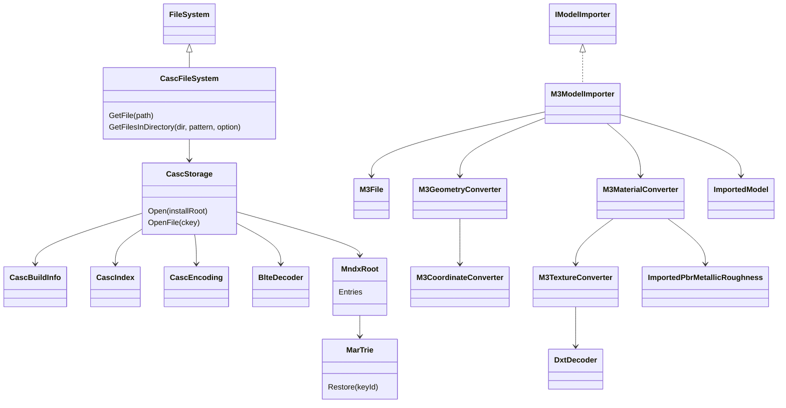
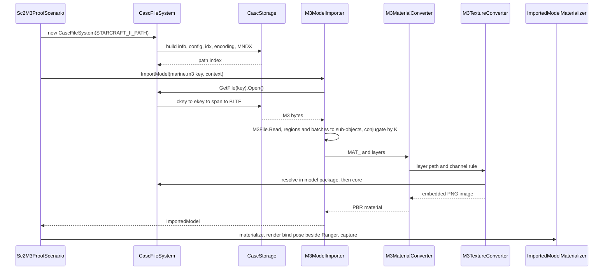

# Deep Dive: StarCraft II CASC storage and static M3 models (C7a, C7b)

> Expands phases C7a and C7b of [Track C: External Models & Animations](../track-c-external-assets.md).
>
> Audience: human design for reading StarCraft II CASC local storage and importing static M3
> models with DDS textures through the C1 and C3 contracts. Code references are in the
> agent-context appendix.

Purpose: add a third external format to the C1 seam, after glTF (C4) and EE2 NIF (C4a). C7a reads
the operator's StarCraft II install as a read-only `FileSystem`. C7b imports static M3 unit
models with their materials. Skinning and animation are [C7c](c7c-sc2-skinned-animation.md).

Facts below were measured on 2026-09-26 against the local StarCraft II install (build
5.0.16.97563) with temporary Python parsers kept outside the repository. Reproduction steps are
in the appendix.

---

## 1. Scope and method

C7a supports:

- CASC local storage under `SC2Data/`, located from `.build.info` at the install root;
- `.idx` version 7 index buckets, `data.NNN` archives, BLTE frames in modes `N` and `Z`;
- the encoding file and the MNDX root file with its three marisa-trie name tables;
- a read-only, case-insensitive `CascFileSystem` over the complete name list.

C7a rejects:

- online or CDN storage, TVFS roots, and writing;
- encrypted BLTE frames (`E`) and every other frame mode, with the frame mode in the message;
- root formats other than MNDX, and `.idx` versions other than 7.

C7b supports:

- M3 files with header tag `MD34` and the exact tag versions in section 5;
- static geometry from `VERT`, `DIV_`, `REGN`, and `BAT_` in bind pose;
- standard materials (`MAT_`) with opaque blend mode and their diffuse, normal, specular, and
  emissive layers, converted onto the C3 metallic-roughness payload;
- DXT1 and DXT5 DDS textures, decoded by the importer into embedded RGBA images.

C7b rejects or skips, with a diagnostic:

- M3 tag versions outside section 5, and vertex formats outside section 7.1: rejected;
- batches whose material is not a standard opaque material: skipped, listed by material name;
- decal, environment, alpha, height, light-map, and ambient-occlusion layers: ignored, listed;
- team color, particles (`PAR_`), ribbons (`RIB_`), lights (`LITE`), attachments (`ATT_`),
  physics, cloth, and XML or Galaxy data binding: out of scope.

Clean-room rule: format facts come from public descriptions and measurement. MNDX name lookup
follows the marisa-trie algorithm as implemented in Ladislav Zezula's CascLib (MIT), credited in
the C7a source. GPL M3 tooling (m3addon, m3studio) is used only as a factual reference and no code
is copied. No StarCraft II asset is committed.

## 2. Install and packaging

The install root holds `.build.info`, `SC2Data/`, and the game executables. `SC2Data/` has
`config/`, `indices/`, and `data/`. All game files, including models, textures, and data, live in
CASC archives. No loose model files exist.

| Item | Measured value |
|---|---|
| Build | `5.0.16.97563`, product `s2` |
| Index buckets | 16, one current `.idx` per bucket |
| Index entries | 188,852 |
| Encoding entries | 722,221 content keys |
| Root | MNDX, 21.1 MB |
| Named files | 675,745 entries, 5,561 packages |

Files are grouped into packages such as `mods/liberty.sc2mod/base.sc2assets`. A full path is
`<package>/<package-relative name>`, all lowercase.

## 3. CASC wire layout

### 3.1 Lookup chain

```
.build.info -> build config -> encoding (ekey) -> root (ckey) -> MNDX name -> ckey
ckey -> encoding -> ekey -> .idx -> (archive, offset, size) -> data.NNN -> BLTE -> bytes
```

### 3.2 `.build.info`

Pipe-separated table. The header row names columns as `Name!TYPE:size`. The active row
(`Active` = 1) supplies `Build Key`. The build config is at
`SC2Data/config/<k[0..2]>/<k[2..4]>/<key>`.

The build config is `key = value` text:

| Key | Use |
|---|---|
| `root` | Content key of the root file. |
| `encoding` | Two values, content key then encoding key. The encoding file is read by its encoding key. |
| `build-uid` | `s2`. |

### 3.3 Index files

`SC2Data/data/<BB><VVVVVVVV>.idx`: two hex digits of bucket, eight of version. The reader uses the
highest version per bucket.

| Offset | Field |
|---|---|
| 0 | `u32` header size, `u32` header hash |
| 8 | `u16` version (7), `u8` bucket, `u8` extra bytes, `u8` span size bytes (4), `u8` span offset bytes (5), `u8` key bytes (9), `u8` archive offset bits (30) |
| align16(8 + header size) | `u32` entries size, `u32` entries hash, then entries |

Each 18-byte entry is a 9-byte encoding-key prefix, a 5-byte big-endian span offset, and a 4-byte
little-endian span size. `archive = offset >> 30`, `archive offset = offset & 0x3FFFFFFF`. When a
key appears twice, the first entry wins.

### 3.4 Data archives and BLTE

`SC2Data/data/data.NNN`. Each span starts with a 30-byte header, followed by the BLTE stream.

| Field | Encoding |
|---|---|
| Magic | `BLTE` |
| Header size | `u32` big-endian. Zero means one frame covering the rest of the span. |
| Chunk table | `u8` flags (0x0F), `u24` big-endian chunk count, then per chunk `u32` BE compressed size, `u32` BE decompressed size, 16-byte MD5 |
| Frame | One mode byte, then payload |

| Mode | Meaning | C7a |
|---|---|---|
| `N` | Stored | Supported. |
| `Z` | zlib | Supported through `ZLibStream`. |
| `E` | Encrypted | Rejected. |
| other | `F` and unknown | Rejected. |

Over the proof files and every file the survey touched, only `N` and `Z` appeared. Chunk MD5
values are verified.

### 3.5 Encoding file

Header, all big-endian after the magic:

| Offset | Field |
|---|---|
| 0 | `EN`, `u8` version (1), `u8` content key size (16), `u8` encoding key size (16) |
| 5 | `u16` content page size in KB, `u16` encoding page size in KB |
| 9 | `u32` content page count, `u32` encoding page count |
| 17 | `u8` unknown, `u32` ESpec block size |

Content pages start at `22 + especSize + contentPageCount * 32`. Each page entry is `u8` key count,
`u40` BE file size, content key, then `keyCount` encoding keys. A zero key count ends a page.
Encoding pages are not needed.

### 3.6 MNDX root

| Offset | Field |
|---|---|
| 0 | `MNDX`, `u32` header version (2), `u32` format version (2) |
| 12 | Two `u32` build numbers (97563) |
| 20 | `u32` MAR info offset (48), `u32` MAR count (3), `u32` MAR info size (20) |
| 32 | `u32` content-key entry offset (108), `u32` entry count (675,745), `u32` file name count (199,505), `u32` entry size (24) |

MAR info: `u32` index, `u32` size, `u32` size high, `u32` offset, `u32` offset high.

Content-key entry: `u32` flags, 16-byte content key, `u32` content size. Flag bit 31 marks the
last entry of a name group. The low 24 bits are the package index. Name group `n` starts at entry
0 or after the `n`-th last-flag.

| MAR | Content | Keys |
|---|---|---|
| 0 | Package names | 5,561 |
| 1 | Package-relative names | 199,505 |
| 2 | Full names | 666,588 |

C7a enumerates MAR 1 names in key-id order. Name `i` owns name group `i`. Each group entry
contributes `<package[pkgIndex]>/<name>`. MAR 2 is not needed for enumeration.

6,479 full paths occur twice, always with the same content key (text, XML, and Galaxy data only).
C7a keeps one. A duplicate path with different content keys is rejected.

### 3.7 MAR tries

Each MAR is a serialized marisa-trie. The top-level trie starts with the `u32` signature `MAR\0`.
Nested tries have no signature.

| Part | Encoding |
|---|---|
| Vector | `u64` byte size, data, zero padding to 8 bytes |
| BitVector | Vector of `u32` words, `u32` bit count, `u32` ones count, rank Vector (12-byte entries), select0 Vector, select1 Vector |
| FlatVector | Vector of `u32`, `u32` bits per entry, `u32` mask, `u64` size |
| Tail | Vector of bytes, then an end-flag BitVector (empty here: NUL-terminated tails) |

Trie load order: LOUDS BitVector, terminal BitVector, link BitVector, bases (`Vector<u8>`), extras
(FlatVector), tail, next trie (present when the link BitVector has ones and the tail is empty),
cache (12-byte entries), `u32` L1 node count, `u32` config.

C7a builds its own rank and select tables from the raw bit words and ignores the serialized
ones. The cache is not used.

Key restore for key id `k`:

1. `node = terminal.select1(k)`.
2. If `link[node]`, append the link text: from the next trie (`restore`, without reversal) or
   from the tail at `bases[node] | extras[link.rank1(node)] << 8`, and reverse the appended
   bytes. Otherwise append `bases[node]`.
3. If `node <= L1 node count`, reverse the whole buffer and stop.
4. `node = louds.select1(node) - node - 1` and repeat from step 2.

The Python probe restored all 675,745 names on its first full run. C7a unit tests use small
synthetic tries built by a test helper, plus install-gated tests on the real root.

## 4. Corpus census

| Extension | Files |
|---|---:|
| `.m3` | 33,435 |
| `.m3a` | 453 |
| `.dds` | 49,286 |

Largest packages: `mods/liberty.sc2mod/base.sc2assets` (98,507 files), `mods/war3.sc2mod`, and
per-locale `campaigns/*.sc2campaign/<locale>.sc2assets`. `mods/core.sc2mod/base.sc2assets` holds
4,369 asset files.

Proof models:

| Unit | Path | Bytes |
|---|---|---:|
| Marine | `mods/liberty.sc2mod/base.sc2assets/assets/units/terran/marine/marine.m3` | 520,912 |
| Zealot | `mods/liberty.sc2mod/base.sc2assets/assets/units/protoss/zealot/zealot.m3` | 578,720 |
| Zergling | `mods/liberty.sc2mod/base.sc2assets/assets/units/zerg/zergling/zergling.m3` | 479,648 |

Some textures also exist in `teen.sc2assets` (low-violence variants, different content keys) and
in campaign packages. Section 8.4 fixes the search order.

## 5. M3 container

### 5.1 Header and index

| Offset | Field |
|---|---|
| 0 | Tag `43DM` (`MD34` reversed) |
| 4 | `u32` index offset, `u32` index entry count |
| 12 | Model Reference |

Index entry, 16 bytes: reversed 4-character tag, `u32` offset, `u32` repetitions, `u32` version.

Reference, 12 bytes: `u32` count, `u32` index entry, `u32` flags. `CHAR` references are
NUL-terminated strings with the count including the NUL.

### 5.2 Tag versions

| Tag | Size | Proof `.m3` | `.m3a` | Use |
|---|---:|---|---|---|
| `MODL` | 784 / 808 | v23 | v25 | Model root |
| `BONE` | 160 | v1 | v1 | Bones |
| `IREF` | 64 | v0 | v0 | Inverse bind matrices |
| `DIV_` | | v2 | v2 | Faces, regions, batches |
| `REGN` | 36 | v3 | | Regions |
| `BAT_` | 14 | v1 | | Batches |
| `MATM` | 8 | v0 | v0 | Material references |
| `MAT_` | | v15 | v16 | Standard materials |
| `LAYR` | | v22 | v24 | Material layers |
| `SEQS` | 96 | v1 | v1 | Sequences |
| `STG_` | | v0 | v0 | Sequence groups |
| `STC_` | 204 | v4 | v4 | Sequence clips |

C7b accepts exactly `MODL` v23 for models. The `.m3a` versions are C7c. Every other version
fails with the tag, version, and file in the message.

MODL v23 offsets used by C7b:

| Offset | Field |
|---|---|
| 0 | Name (`CHAR`) |
| 16 | Sequences (`SEQS`) |
| 28 | Sequence clips (`STC_`) |
| 40 | Sequence groups (`STG_`) |
| 80 | Bones |
| 92 | Skin bone count |
| 96 | Vertex flags |
| 100 | Vertices (`U8__` bytes) |
| 112 | Divisions (`DIV_`) |
| 124 | Bone lookup (`U16_`) |
| 136 | Bounds |
| 300 | Material references (`MATM`) |
| 312 | Standard materials (`MAT_`) |
| 660 | Inverse bind matrices (`IREF`) |

## 6. Proof models

| Unit | Vertices | Regions | Batches | Bones | Bone lookups | MODL skin bone count | Materials | Sequences |
|---|---:|---:|---:|---:|---:|---:|---:|---:|
| Marine | 1,678 | 2 | 2 | 38 | 20 | 23 | 1 | 24 |
| Zealot | 2,647 | 2 | 2 | 43 | 24 | 25 | 6 | 20 |
| Zergling | 775 | 1 | 1 | 44 | 30 | 31 | 1 | 16 |

Zealot materials 1, 2, 3, and 5 use additive blend modes (warp, blade glow, and ribbon effects).
Zealot batch 0 draws region 1 (the 28-vertex blade glow) with material 2. C7b skips it, so the
proof renders region 0 only.

## 7. Geometry

### 7.1 Vertex formats

| Vertex flags | Stride | Units |
|---|---:|---|
| `0x0186007D` | 36 | Marine, Zealot |
| `0x0182007D` | 32 | Zergling |

Layout: position (3 `f32`, offset 0), 4 `u8` weights (12), 4 `u8` bone lookups (16), normal
(4 `u8`, 20), UV0 (2 `i16`, 24), UV1 (2 `i16`, 28, only with flag `0x00040000`), tangent (4 `u8`,
last). Verified on the proof files: offset 20 decodes to unit normals, and offset 24 spans 0 to 2048.

- Normal component: `b / 255 * 2 - 1`. The fourth byte is ignored.
- UV: `i16 / 2048` (REGN v3 implies a multiplier of 16 over `i16 / 32768`). The V origin is top-left,
  which already matches C3.
- Weights: `u8 / 255`. C7b ignores them. C7c uses them.
- Tangents: ignored. C7b uses the C3 tangent generator on UV0, which every proof normal layer
  uses.

Other vertex flags fail with the flag value. Vertex byte count must be an exact multiple of the
stride.

### 7.2 Regions, faces, and batches

`DIV_` v2 holds `u16` faces, regions, batches, and an `MSEC` list.

REGN v3 (36 bytes): `u32` id, `u32` unknown, `u32` first vertex, `u32` vertex count, `u32` first
face index, `u32` face index count, `u16` bone count, `u16` first bone lookup, `u16` bone lookup
count, `u16` unknown, `u8` vertex lookups used, `u8` unknown, `u16` root bone.

Face indices are relative to the region's first vertex. C7b emits one C1 sub-object per imported
batch. It holds that region's vertices and its region-relative indices, so no index rebase is
needed and every index fits `ushort`.

BAT_ v1 (14 bytes): `u16` flags, `u16` priority, `u16` region, `u16` bounds, `u16` color,
`u16` material reference, `i16` bone. The proof batches all have bone -1.

### 7.3 Bind pose

Vertices are stored in model space in bind pose. The bind pose is the inverse of `IREF`, not the
`BONE` rest values. Section 6 of the [C7c deep dive](c7c-sc2-skinned-animation.md#6-bind-pose-and-rest-pose)
measures the difference. C7b therefore renders raw vertex positions as a rigid mesh attached to
the model root, with no skeleton evaluation.

## 8. Materials and textures

### 8.1 Material references and layers

`MATM` entries are `(u32 type, u32 index)`. Type 1 indexes `MAT_`. Other types fail. The proof
models use type 1 only.

MAT_ v15 fields used: name, flags, blend mode (0 opaque, 2 additive, 3 alpha add), specularity
(Blinn-Phong exponent), alpha test threshold, then layer references in this order: diffuse,
decal, specular, emissive 1, emissive 2, environment, environment mask, alpha 1, alpha 2, normal,
height, light map, ambient occlusion.

LAYR v22 fields used: bitmap path (`CHAR`), flags, UV source, color channel selector.

| Channel selector | Meaning |
|---|---|
| 0 | RGB |
| 1 | RGBA (RGB used) |
| 2 | Alpha, replicated to RGB |
| 3, 4, 5 | R, G, or B, replicated |

UV source 0 maps to C1 UV set 0 and source 1 to set 1. Other sources skip the layer with a
diagnostic.

Proof standard opaque materials:

| Unit | Diffuse | Specular | Emissive 1 | Normal |
|---|---|---|---|---|
| Marine | `marine_diffuse_blood.dds` | `Marine_Specular_Blood.dds` | | `Marine_Normal_Blood.dds` |
| Zealot | `Zealot_Diffuse.dds` | `Zealot_Specular.dds` | `Zealot_Specular.dds` alpha | `Zealot_Normal.dds` |
| Zealot dreads | `ZealotDreads_Diffuse2.dds` | same file | | `ZealotDreads_Normal.dds` |
| Zergling | `Zergling_Diffuse.dds` | `Zergling_Specular.dds` | `Zergling_Emissive.dds` | `Zergling_Normal.dds` |

The Marine decal layer (`Decal_Terran_0000_01.dds`, UV1) is ignored.

### 8.2 DDS census

Every proof texture is a DDS with a full mip chain in DXT1 or DXT5:

| Texture | Size | Format |
|---|---|---|
| `zealot_normal.dds` | 1024 x 1024 | DXT5 |
| `zergling_diffuse.dds` | 1024 x 1024 | DXT5 |
| `marine_specular_blood.dds`, `zergling_specular.dds` | 512 x 256, 512 x 512 | DXT1 |
| all other proof textures | 64 x 128 to 512 x 512 | DXT5 |

Channel statistics after decode:

| Texture | Mean RGBA | Reading |
|---|---|---|
| Normal maps | (1.0, 0.5, 0.0, 0.5), R and B constant | DXT5nm: X in alpha, Y in green |
| `zealot_specular` | (0.32, 0.24, 0.15, 0.01) | Specular color, emissive mask in alpha |
| `zergling_emissive` | (0.0, 0.0, 0.0, 0.05) | RGB black. The alpha is not selected by the layer |
| Diffuse | alpha 0.91 to 1.0 | Alpha is the team-color mask |

### 8.3 Conversion onto C3

Decision: C7b decodes DDS in the importer and emits C3 embedded RGBA images, leaving C3 unchanged.
`ImportedImageDecoder` keeps rejecting DDS. The channel remaps below need derived pixels, which a
path-based source cannot express.

A C7b `M3TextureConverter` decodes the top mip of each DXT1 or DXT5 texture on the CPU, derives
pixels, and PNG-encodes them into `ImportedImageSource.CreateEmbeddedBytes`. The runtime regenerates
mips through C3's `generateMipmaps` path.

| C3 slot | Source | Rule |
|---|---|---|
| Base color | Diffuse | RGB. Alpha forced to 1 (team color out of scope). Base color factor 1. |
| Normal | Normal | `x = a * 2 - 1`, `y = g * 2 - 1`, `z = sqrt(max(0, 1 - x^2 - y^2))`, re-encoded to RGB. |
| Metallic-roughness | Specular | Metallic 0. Roughness `r = lerp(1, r0, luma(spec))` with `r0 = (2 / (n + 2))^(1/4)` and `n` the material specularity, stored in green. |
| Emissive | Emissive 1 | Channel selector applied. Emissive factor 1. The HDR emissive multiplier is ignored. |
| Occlusion | none | Not bound. |

`luma` uses Rec. 709 weights. For the proof specularity 80, `r0 = 0.395`.

Decision: specular to roughness follows the rule above. The conversion is lossy by nature, and
the rule is deterministic and monotone: black specular is fully rough, and white specular reaches
the exponent-derived roughness.

Alpha mode: opaque, except `Mask` with cutoff `threshold / 255` when the alpha test threshold is
nonzero. The proof materials are opaque.

### 8.4 Texture path resolution

Layer paths are package-relative and mixed case, for example `Assets/Textures/Zealot_Diffuse.dds`.

Decision: C7b resolves a layer path against the referencing model's package first, then
`mods/core.sc2mod/base.sc2assets`. Lookup is case-insensitive. `teen.sc2assets` and locale
packages are never searched. A missing texture fails with the layer, path, and searched packages.

## 9. Coordinates and scale

SC2 models are Z-up and face -Y. Evidence: head and weapon attachment points of all three proof
units sit at negative Y, and the Zergling tail runs toward +Y. Panopticon (W3D) is Z-up and faces
+X.

Decision: conversion conjugates by `K = S(10) * Rz(+90 degrees)`. Vertices map
`(x, y, z) -> (-10y, 10x, 10z)`, and normals rotate without scale. One SC2 unit becomes 10 world
units, so one SC2 map cell matches one 10-unit Generals cell. Marine vertex height 0.88 becomes
8.8 units and Zealot 1.28 becomes 12.8.

C7b validates scale and facing with a side-by-side capture against the Generals Ranger. A
mismatch stops the card for review. The factor is not tuned silently.

C7c applies the same conjugation to bones and keys (see the
[C7c deep dive](c7c-sc2-skinned-animation.md#5-coordinate-conversion)).

## 10. Mapping onto the C1 interchange model

| M3 | C1 |
|---|---|
| Model | `ImportedModel`, name from the asset key |
| Opaque standard batch | `ImportedSubObject` + `ImportedMesh`, bone 0 in C7b |
| Region vertices | `ImportedVertex`: position, normal, generated tangent |
| UV0, UV1 | `ImportedMeshPart.TextureCoordinates0/1` |
| Faces | `ImportedMesh.Indices` (`ushort`, region-relative) |
| `MAT_` | `ImportedMaterial.CreatePbrMetallicRoughness` |
| Layer bitmap | `ImportedTextureBinding` over an embedded image |
| Bones | C7b: one synthetic root bone. C7c: the skeleton |

Asset keys: the model key is the full CASC path of the `.m3`, for example
`mods/liberty.sc2mod/base.sc2assets/assets/units/terran/marine/marine.m3`. Keys are
case-insensitive. Animation keys are C7c.

C7b registers as a directly constructed importer, like the NIF proof. `ExternalFormatFactory`
remains glTF-only. The TestHarness scenario mounts a `CascFileSystem` beside the Generals install
and never layers SC2 files into game assets, following the C5 external-root rule.

## 11. C7a contract

New project `Panopticon.FileFormats.Casc`:

| Type | Role |
|---|---|
| `CascBuildInfo` | Parses `.build.info` and the build config. Exposes the root and encoding keys. |
| `CascIndex` | Loads the 16 current `.idx` buckets. Maps an encoding-key prefix to a span. |
| `BlteDecoder` | Decodes a span to bytes: `N`, `Z`, MD5 check, rejects everything else. |
| `CascEncoding` | Maps a content key to its first encoding key and size. |
| `MndxRoot` | Parses MNDX, restores names through `MarTrie`, yields `(path, ckey, size)`. |
| `MarTrie` | Minimal marisa-trie reader: bit vectors with rank and select, key restore. |
| `CascStorage` | Opens an install root and composes the chain. `OpenFile(ckey)`. |

`Panopticon.IO.CascFileSystem : FileSystem`:

- builds a case-insensitive path index at construction with `/` separators, deduplicated per
  section 3.6;
- `GetFile` returns an entry whose `Open()` decodes the file into a fresh `MemoryStream` (seekable,
  unlike ZIP entries);
- `GetFilesInDirectory` supports the same patterns and options as `ZipFileSystem`;
- holds `data.NNN` handles open until disposed; opening is thread-safe per call.

Failure contract:

| Condition | Result |
|---|---|
| Missing `.build.info`, active row, or config | `FileNotFoundException` naming the path. |
| `.idx` version other than 7, or unexpected field widths | `NotSupportedException`. |
| Root not MNDX, or MNDX version other than 2 | `NotSupportedException`. |
| BLTE mode `E` | `NotSupportedException` "encrypted BLTE frame" with the content key. |
| Other BLTE mode | `NotSupportedException` with the mode byte. |
| Chunk MD5 or size mismatch | `InvalidDataException`. |
| Content key absent from encoding or index | `FileNotFoundException` with the path and key. |
| Duplicate path with different content keys | `InvalidDataException`. |

## 12. C7b contract

New project `Panopticon.FileFormats.M3`: `M3File` (header, index, typed reference reading),
`M3Model`, `M3Bone`, `M3Region`, `M3Batch`, `M3Material`, `M3Layer`, and `M3VertexFormat`.
The reader parses only the tags in section 5.2 and treats others as opaque.

`Panopticon.Simulation/Content/Importing/M3/`:

| Type | Role |
|---|---|
| `M3ModelImporter : IModelImporter` | Resolves the key, reads `M3File`, builds `ImportedModel`. |
| `M3GeometryConverter` | Regions and batches to sub-objects in the engine frame. |
| `M3MaterialConverter` | `MAT_` and layers to C3 PBR materials. |
| `M3TextureConverter` | DDS decode, channel derivation, PNG embedding, per-import cache by path and rule. |
| `M3CoordinateConverter` | The section 9 conjugation, shared with C7c. |

DXT1 and DXT5 decoding is a new small `DxtDecoder` in `Panopticon.FileFormats.M3`. Section 8.3
needs pixels, and C4b's installer only preserves blocks for GPU upload.

Failure contract:

| Condition | Result |
|---|---|
| Header tag not `MD34`, or truncated index | `InvalidDataException`. |
| Unsupported tag version | `NotSupportedException` with tag, version, file. |
| Unsupported vertex flags or stride mismatch | `NotSupportedException` with the flag value. |
| Face index beyond the region vertex count | `InvalidDataException`. |
| `MATM` type other than 1 | `NotSupportedException`. |
| Non-opaque or non-standard batch material | Batch skipped, diagnostic lists it. |
| Unsupported layer slot or UV source | Layer ignored, diagnostic lists it. |
| DDS not DXT1 or DXT5 | `NotSupportedException` with the four-CC. |
| Texture not found in the search order | `FileNotFoundException` listing the packages. |
| Model with no importable batch | `InvalidDataException`. |

## 13. Completion boundary

C7a is complete when:

- synthetic tests cover `.build.info` parsing, `.idx` decoding, BLTE `N` and `Z` plus the `E`
  rejection, encoding lookup, and a synthetic MNDX root with multi-level trie restore;
- install-gated tests (`STARCRAFT_II_PATH`) enumerate 675,745 entries, resolve the three proof
  models case-insensitively, and match their byte sizes from section 4 and the MD5 content keys
  from the appendix.

C7b is complete when:

- the three proof models import through `M3ModelImporter` with the section 6 vertex and batch
  counts, less the skipped Zealot glow batch;
- all proof textures decode, and the normal-map rule yields unit normals within 1e-2;
- a TestHarness `Sc2M3Proof` scenario captures each unit in bind pose, textured and lit,
  beside a Generals Ranger for scale and facing;
- unsupported versions, vertex flags, `MATM` types, and DDS formats fail with the section 12
  messages in synthetic tests;
- no SC2 asset is copied or committed.

## 14. Architecture diagrams





## Appendix: current-code grounding

- C1 seam: `src/Panopticon.Simulation/Content/Importing/IModelImporter.cs`,
  `AssetImportContext.cs`, `ImportedModel.cs`, `ImportedMesh.cs` (`ushort` indices),
  `ImportedMeshPart.cs` (UV sets), `ImportedVertex.cs` (four influences after C4d).
- C3 payload and images: `ImportedPbrMetallicRoughness.cs`, `ImportedTextureBinding.cs`,
  `ImportedImageSource.cs` (`CreateEmbeddedBytes`), `ImportedTangentGenerator.cs`.
- DDS rejection to keep: `src/Panopticon.Simulation/Content/Loaders/ImportedImageDecoder.cs:18,70-73`.
- File system precedent: `src/Panopticon.IO/FileSystem.cs`, `src/Panopticon.IO/ZipFileSystem.cs`.
- Importer and proof precedent: `src/Panopticon.Simulation/Content/Importing/Nif/NifModelImporter.cs`,
  `src/Panopticon.Tools.TestHarness/Ee2NifProofScenario.cs` (env-var gate and built-in scenario),
  `test/Panopticon.Simulation.Tests/Content/Importing/Ee2NifImportTests.cs`.
- DXT block precedent (GPU upload, not decode): `src/Panopticon.Tools.TestHarness/Ee2TexcacheTextureInstaller.cs`.

## Appendix: reproduction

```sh
SC2="/path/to/StarCraft II"
cat "$SC2/.build.info"
ls "$SC2/SC2Data/data" | grep -c '\.idx$'
```

The survey used about 700 lines of stdlib Python outside the repository. It had a CASC probe
(`.build.info`, config, `.idx`, BLTE, encoding), an MNDX and marisa-trie reader that listed all
names, an extractor, and an M3 census that printed tag versions, vertex flags, regions, batches,
materials, layers, and sequences. Proof content keys:

| File | Content key |
|---|---|
| `marine.m3` | `6c7cd25a530828b1bd67cfadb25f4f4c` |
| `zealot.m3` | `cfa1fad07310c629706b8ea05518eb9b` |
| `zergling.m3` | `ecfd1361f87972e29c1969ed6c94072a` |
