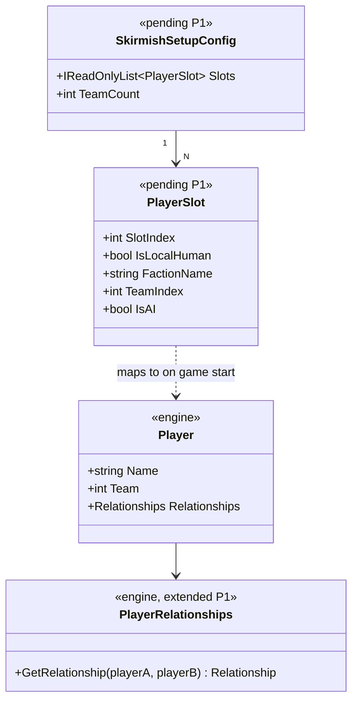

# Deep Dive: Skirmish Setup & Player Relationships (P1)

> Expands phase P1 of [Track P — Playable Baseline](../track-p-playable-baseline.md). Part of
> the [Large-Scale Simulation Roadmap](../README.md).
>
> Audience: human — design intent and architecture diagrams. Code references are in the agent-context appendix at the bottom.
>
> The agent-context section at the bottom ([Current code appendix](#appendix-current-code--agent-context)) contains file:line code references. Skip it if you are reading for design intent.

Goal: make starting a single-player skirmish vs. ≥1 AI work end-to-end without networking:
players created, factions/colors/teams assigned, start positions resolved, starting buildings/units
spawned, and player relationships wired (allies / enemies / neutrals). After P1, a match boots with
a human + AI players correctly related. Behavior (AI) and outcome (victory) come in P2/P3.

---

## 1. Why this is foundational

Track P assumes correctly initialized, related players. P2 needs to know who the enemy is. P3 needs
teams and relationships to decide who lost. P6 needs relationship checks to allow attacks. Today
relationships are an explicit `// TODO`, and the single-player spawn path diverges from the
multiplayer path, so an SP skirmish misses the starting buildings and camera placement the MP path
already provides.

---

## 3. Design

### 3.1 Relationship setup (the core fix)
Implement the `PlayerManager.OnNewGame()` TODO (`PlayerManager.cs:45-46`) so that, after players are
created from skirmish slots:

- Each player is assigned its `Team` from its slot (`PlayerSetting.Team`).
- Relationships are derived from teams: players on the same team are allies, players on different
  teams are enemies, and the neutral/civilian player is neutral to all. This drives
  `Player.GetRelationship(...)` (already team-aware at `Player.cs:811-831`).
- Wiring is reciprocal. Fix or augment `AddAlly()`/`AddEnemy()` (`Player.cs:779-786`) or set both
  sides in `PlayerManager`, so `A enemy B ⇒ B enemy A`.
- Reuse the existing map-relationship path (`CreatePlayers`, `PlayerManager.cs:50-76`) where the map
  defines relationships, but let skirmish-slot teams take precedence for slot-driven games.

### 3.2 Unified skirmish spawn path
Resolve the SP/MP divergence at `Game.cs:745-763`: a single-player skirmish must run the same
start-position lookup, `CreateSkirmishPlayerStartingBuilding`, and camera-placement path the MP
branch uses, for every non-neutral player, human and AI. Decide the player-array indexing
explicitly; the `Players[i + 2]` offset and `_players[2]` `LocalPlayer` fallback are ad hoc. See §5.

### 3.3 Faction / color / start-position fill
The lobby already fills missing factions, colors, and start positions (`GameOptionsUtil.cs:239-305`).
P1 must apply the same fill behavior to AI slots so every AI player is fully specified before
`StartGame`: faction from `GetPlayableSides()`, a free start position, and a free color.

### 3.4 Player object-ownership tracking (foundational)
Both the AI in P2 and victory/defeat in P3 need cheap answers to "what does player X still own?"
Rather than scanning all objects on demand, P1 establishes one maintained per-`Player` view:
building/unit counts plus an owned-object set, incremented on create/transfer and decremented on
`OnDie`/`Destroy`. Checks stay O(1). It belongs in P1 because it is player state set up alongside
relationships and spawns, consumed by both P2 and P3, and has no intra-P1 ordering constraint beyond
object create/death hooks existing.

---

## 4. Integration surface (what P1 changes)
- `Logic/PlayerManager.cs:24-46` — implement relationship + team setup after player creation.
- `Logic/Player.cs:779-786` (+ `:811-831,965-994`) — reciprocal ally/enemy wiring; confirm team→
  player default resolution.
- `Game.cs:717-802` (esp. `:745-763`) — SP skirmish uses the MP start-position/building/camera path.
- `Network/SkirmishManager.cs:55-114` — slot→`PlayerSetting` mapping for AI + human in the local path.
- `Gui/GameOptionsUtil.cs:239-305` — fill missing faction/color/start for AI slots.
- `Scene3D.cs:430-455` + `Scripting/Waypoints.cs:76-81` + `Content/MapCache.cs:29-38` — start-position
  lookup/spawn, already largely present; verify under SP.
- `Logic/Player.cs` + `GameObject` create/`OnDie`/`Destroy` hooks — maintain the per-`Player` owned-object
  set + counts, foundational and consumed by P2 and P3.

## 5. Resolved design questions
- `LocalPlayer` selection — Decided: the skirmish/lobby config marks which slot is the local
  human; `PlayerManager` reads that explicit flag instead of the `_players[2]` positional fallback
  (`PlayerManager.cs:39-46`). See [open-questions](../open-questions.md).
- Spawn ownership — Decided: unify on one shared SP+MP skirmish spawn path. SP is a skirmish with
  one human + AI slots through the same start-position/building/camera code (`Game.cs:745-763`). See
  [open-questions](../open-questions.md).

## 6. Sub-phases

| Phase | Goal | Status |
|---|---|---|
| P1-1. Team & relationship setup | Implement `OnNewGame()` relationships: assign teams from slots, derive ally/enemy/neutral, wire reciprocally. | Done (cards: `WI-P1-02`, `WI-P1-03`) |
| P1-2. Unified skirmish spawn | One start-position + starting-building + camera path for SP and MP; resolve player-array indexing and `LocalPlayer`. | Done (card: `WI-P1-04`) |
| P1-3. AI slot fill | Ensure AI slots get faction/color/start filled before `StartGame` (lobby + local path). | Done (card: `WI-P1-05`; start-position collision fix: `WI-P1-09`) |
| P1-4. Boot validation | A human + ≥1 AI skirmish boots headlessly with correct relationships and spawns (assert via [P0](playable-baseline-harness.md)). | Not started (card: `WI-P1-06`) |
| P1-5. Object-ownership tracking | Maintain per-`Player` building/unit counts + owned-object set via create/transfer/`OnDie`/`Destroy` hooks (O(1) checks); foundational, consumed by P2 (AI targets) and P3 (defeat). | Done (card: `WI-P1-07`; owner-transfer tracking: `WI-P1-11`) |

## 7. Sequencing
- P1 has no Track-P prerequisite and is an entry point alongside P0, but it gates P2/P3/P4/P5/P6.
  All of them assume correctly related, spawned players.
- P1-4's boot check rides on the [P0 harness](playable-baseline-harness.md) once P0-1/P0-5 exist.
- P1-5 is foundational and independent within P1. It only needs object create/death hooks +
  players, feeds P2 target selection and P3 defeat detection, and belongs in P1 rather than being
  duplicated in either consumer.

## 7. Scenario Matrix

The P0-5b matrix runner validates P1 by sweeping over player-count and team configurations and
checking relationship setup across valid match configurations.

| Axis | Values | Notes |
|---|---|---|
| `playerCount` | 2, 3, 4, 6, 8 | Full range supported by Generals skirmish slots |
| `teamConfig` | `FFA`, `2v2`, `3v1`, `4v4` | Team layout applied to the slot list |
| `factionMix` | `mirror` (same faction), `mixed` (two factions), `all-factions` (each slot a distinct faction) | Tests faction-agnostic relationship setup |

Constraints:
- `2v2` requires `playerCount ≥ 4`; `4v4` requires `playerCount = 8`.
- `all-factions` is only valid when `playerCount ≤` the number of available factions.

Each cell runs one match boot through the P0 harness and asserts:
- Every player pair has a defined `RelationshipType` with no unset defaults.
- Same-team players are mutual allies; different-team players are mutual enemies.
- Neutral players, teams not yet assigning an enemy relationship, are neutral.
- `Player.Faction` matches the configured faction for each slot.

This is the primary regression surface for P1. If relationship wiring or faction assignment regresses,
the matrix run identifies the exact cell.

## 8. Architecture Diagrams

Diagrams for this phase will be elaborated once P1 moves to active implementation. The
placeholder below captures the key types P1 introduces or wires together.

## 9. Related
- Track overview: [`../track-p-playable-baseline.md`](../track-p-playable-baseline.md)
- AI that consumes relationships: [`skirmish-ai.md`](skirmish-ai.md) (P2)
- Outcome that consumes teams: [`victory-defeat.md`](victory-defeat.md) (P3)
- Harness for the boot check: [`playable-baseline-harness.md`](playable-baseline-harness.md) (P0)
- Architecture snapshot: [`../agent/current-state.md`](../agent/current-state.md)

---

## Appendix: Current code — agent context

> Agent context: this section contains file:line code references for agents
> implementing this phase. Human readers: the design intent above does not
> require reading this section.

### 2.1 Start path
- `SkirmishManager.StartGame()` builds `List<PlayerSetting>` from `Settings.Slots` and calls
  `Game.StartSkirmishOrMultiPlayerGame(...)` (`src/OpenSage.Game/Network/SkirmishManager.cs:55-93`).
- `LocalSkirmishManager.HandleStartButtonClickAsync()` only sets `Connection = new EchoConnection()`
  and flips status to `ReadyToStart`; no networking (`Network/SkirmishManager.cs:96-114`).
- `HostSkirmishManager`/`ClientSkirmishManager` hold the real network path; SP never enters them
  (`Network/SkirmishManager.cs:373-588`).
- `Game.StartSkirmishOrMultiPlayerGame()` wraps `StartGame(...)`; `StartSinglePlayerGame()` uses
  `new EchoConnection()` and `gameType: SinglePlayer` (`Game.cs:822-845`).
- `Game.StartGame()` loads the map, creates `Scene3D`, sets `NetworkMessageBuffer`, builds the
  control bar, resets timers, enables scripting (`Game.cs:717-802`).
- Divergence: starting buildings + camera-at-start are created only for
  `gameType != SinglePlayer`, for `Scene3D.Players[i + 2]` (`Game.cs:745-763`), so a SP skirmish has
  no equivalent local placement path.
- `Game.LocalLogicTick()` pumps `SkirmishManager.Update()` until status is `Started`
  (`Game.cs:921-929`).

### 2.2 Menu entry points
- "Skirmish" button → `new LocalSkirmishManager(context.Game)` + opens `SkirmishGameOptionsMenu.wnd`
  (`src/OpenSage.Mods.Generals/Gui/MainMenuCallbacks.cs:127-130`).
- Lobby init: `SkirmishGameOptionsMenuCallbacks` → `GameOptionsUtil`
  (`Gui/SkirmishGameOptionsMenuCallbacks.cs:31-39`).
- Start button validates slots, fills missing start positions/factions/colors, then calls
  `SkirmishManager.HandleStartButtonClickAsync()` (`Gui/GameOptionsUtil.cs:239-305`); missing faction
  is randomized to a playable side (`:292-295`); faction combo from `Game.GetPlayableSides()` (`:68-75`).

### 2.3 Player model & relationships
- `PlayerManager.OnNewGame(...)` creates players from map players, picks `LocalPlayer`, then
  TODOs relationships (`src/OpenSage.Game/Logic/PlayerManager.cs:24-46`).
- `PlayerManager.CreatePlayers(...)` maps `mapPlayer.Allies/Enemies` into `player.Allies`/
  `player.Enemies` (`PlayerManager.cs:50-76`), so map-defined relationships are read, but the
  skirmish-slot-driven setup is the gap.
- `Player` has `_playerToPlayerRelationships` + `playerToTeamRelationships` (`Logic/Player.cs:33-35`),
  public `Allies`/`Enemies` sets (`:126-128`), a `Team` (`:139`),
  `GetRelationship(Team? that)` (team override → player override → neutral) (`:811-831`),
  `RelationshipType { Enemies=0, Neutral=1, Allies=2 }` (`:965-970`), `PlayerRelationships` overrides
  (`:972-994`), and `AddAlly()`/`AddEnemy()` that only add to sets, no reciprocal wiring (`:779-786`).
- `PlayerSetting` fields: `StartPosition`, `SideName`, `Color`, `Team`, `Owner`, `Name`,
  `IsLocalForMultiplayer` (`Logic/PlayerSettings.cs:17-36`).
- `PlayerTemplate` fields: `Side`, `PlayableSide`, `IsObserver`, `StartMoney`, `PreferredColor`,
  `DisplayName`, `StartingBuilding`, `StartingUnits`, … (`Logic/PlayerTemplate.cs:115-140`; INI parse
  `:58-113`).

### 2.4 Start positions & factions
- `Waypoints.TryGetPlayerStart(int playerIndex)` looks up `Player{i}_Start`
  (`src/OpenSage.Game/Scripting/Waypoints.cs:76-81`); map load builds `Waypoints` from map objects
  (`Scene3D.cs:139-152`).
- `Scene3D.CreateSkirmishPlayerStartingBuilding(...)` uses `TryGetPlayerStart`, falls back to
  `(80,80,0)` + heightmap Z (`Scene3D.cs:430-438`); `player.Template.StartingBuilding` +
  `StartingUnits[0]` drive spawns (`Scene3D.cs:440-455`).
- Map start positions stored in `MapCache` `Player_1..8_Start` (`Content/MapCache.cs:29-38,66-73`);
  user maps in `UserMapCache` (`Data/Map/UserMapCache.cs:144-145,272-273`).
- Slot faction index → playable side name (`SkirmishManager.cs:76-82`); replay metadata maps
  `PlayerTemplate.Side` ↔ faction index (`Game.cs:225-279`).

---
