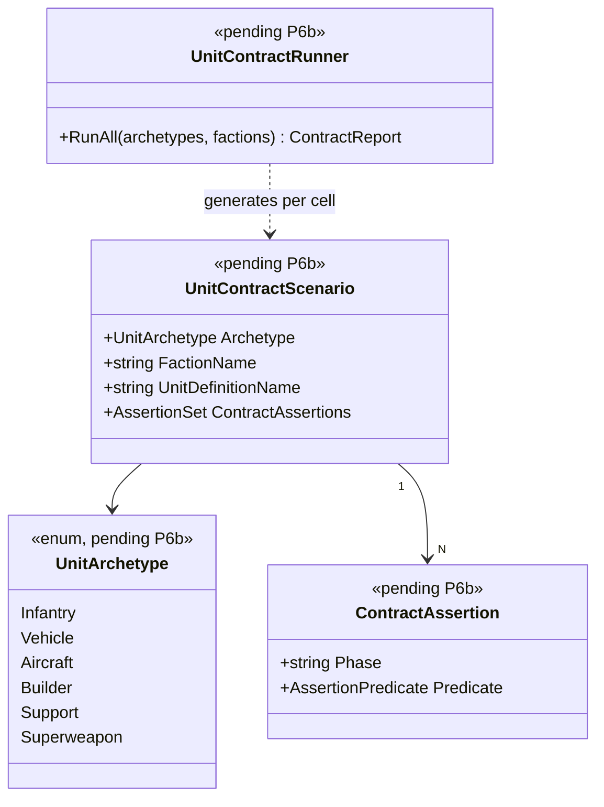

# Deep Dive: Unit-Contract Validation (P6b)

> Expands phase P6b of [Track P — Playable Baseline](../track-p-playable-baseline.md). Part of
> the [Large-Scale Simulation Roadmap](../README.md).
>
> Audience: human overview of the unit-contract design. Code references are in the agent-context appendix at the bottom.
>
> The agent-context section at the bottom ([Current code appendix](#appendix-current-code--agent-context)) contains file:line code references. Skip it if reading for design intent.

Purpose: verify unit archetypes in the reference game through repeatable headless scenarios. The
design uses one contract per archetype and feeds the P7 regression suite.

---

## 1. Why P6b

P6 confirms the player can drive selection and issue basic orders through the control bar. P6b
turns that into an archetype-by-archetype contract so no unit category is left untested before P7
locks the regression suite. Without it, P7 can only assert that the match finishes, not that
individual unit types work correctly.

---

## 3. Design

### 3.1 Archetype definitions
Six archetypes cover the meaningful variation in unit behaviour for Generals/ZH:

| Archetype | `KindOf` tag(s) | Reference unit | Notes |
|---|---|---|---|
| Infantry | `INFANTRY` | USA Ranger | Standard ground combat unit; can garrison buildings |
| Vehicle | `VEHICLE` (non-AIRCRAFT, non-DOZER) | USA Crusader Tank | Standard armoured combat unit; may have weapon-mode upgrade |
| Aircraft | `AIRCRAFT` | USA Comanche | Airborne combat unit; land/takeoff cycle; may have stealth or special attack |
| Builder | `DOZER` | USA Dozer | Construction unit; build, repair, clear mines |
| Support | Utility units not covered above (e.g. USA Ambulance / Hacker / ECM Tank) | USA Ambulance | Non-combat or secondary-combat unit with a primary special ability |
| Superweapon | `FS_SUPERWEAPON` (ZH) or the equivalent structure for Generals particle cannon | USA Particle Cannon | Charge-then-fire cycle, cooldown, area effect; authored as a structure-triggered ability |

The archetype set is defined in a small data file or constants block inside
`OpenSage.Tools.ReplaySketch.Core` (or a P6b-specific scenario profile) so it can be extended
without changing production code.

### 3.2 Full contract per archetype

Each archetype contract is a P0 harness assertion set. "Full contract" means:

1. Produced — the unit is ordered, the production completes, and the unit exists in `GameLogic`.
   Assert: `player[X].ownedUnits contains a unit of definition D after frame N`.
2. Mobile or static — for mobile archetypes: issue `MoveTo`, assert position delta after
   sufficient frames. For static archetypes (superweapon structure): assert it does not move.
3. Basic attack — for combat archetypes: issue `AttackObject` against a dummy target, assert
   target health decreases within N frames. For builders/support: skip or assert attack is
   declined (if the unit has no weapon).
4. Weapon modes — for each `WeaponSlot` the unit definition exposes: issue the matching
   `WeaponSetUpgrade` or `SpecialPower` order that activates it, then assert the unit fires with
   the expected slot (by observing health delta on a target or the order result).
5. Special abilities — for each `SpecialPowerType` the unit's command set references: issue the
   matching `SpecialPower*` order, assert the observable effect (e.g. health restored for
   ambulance heal, stealth toggled for stealth unit, garrison entered for infantry `Enter`, repair
   progress for dozer). If the handler is unimplemented, the assertion fails and logs it as a gap.
6. Die correctly — kill the unit (via `ForceAttackObject` from a test attacker or
   `GameObject.Kill` stub), assert the unit is removed from `GameLogic`, ownership counts
   decrement, and any occupied transport/garrison is cleared.

Assertions use the P0 harness JSON-predicate vocabulary plus code-defined predicates for cases
like "unit of definition D exists in player's owned set" that need a query selector.

### 3.3 Surfacing unimplemented handlers as gaps, not silent failures
If a special-ability handler is still unimplemented in `OrderProcessor`, the harness run should
fail with a clear message (assertion failed: `SpecialPower(X)` had no observable effect after N
frames). That turns missing handlers into an explicit P6b gap list instead of a silent failure.
Document gaps in `P6b.exchange` or `.exchange`, then fix them within P6b.

---

## 4. Sub-phases

| Phase | Goal | Status |
|---|---|---|
| P6b-1. Infantry archetype contract | P0 harness scenario for the reference infantry unit: produce, move, garrison (`Enter`), basic attack, die. Assert all six contract points. | Not started |
| P6b-2. Vehicle archetype contract | P0 harness scenario for the reference vehicle unit: produce, move, basic attack, weapon-mode upgrade (if applicable), die. Assert all six contract points. | Not started |
| P6b-3. Aircraft archetype contract | P0 harness scenario for the reference aircraft unit: produce, move (fly), basic attack, land/takeoff cycle, special ability (if applicable), die. Assert all six contract points. | Not started |
| P6b-4. Builder archetype contract | P0 harness scenario for the reference dozer/builder: produce, move, construct a building (via `CreateBuildObject`), repair a structure, die. Assert all six contract points. | Not started |
| P6b-5. Support archetype contract | P0 harness scenario for the reference support unit: produce, move (if mobile), primary special ability (heal, hack, ECM, etc.), die. Assert all six contract points. | Not started |
| P6b-6. Superweapon archetype contract | P0 harness scenario for the reference superweapon structure: produce/build, charge cycle, fire (`SpecialPowerAtLocation`), cooldown state, die/sell. Assert all six contract points. | Not started |

## 4.5 Scenario Matrix

P6b is naturally a matrix validation: the six sub-phases in §4 form the rows of the archetype
axis. Formalizing it as a P0-5b `ScenarioMatrix` makes coverage explicit and allows future
expansion to additional factions without new scenario files.

| Axis | Values | Notes |
|---|---|---|
| `archetype` | `infantry`, `vehicle`, `aircraft`, `builder`, `support`, `superweapon` | The six archetypes from §3.1 |
| `faction` | `USA`, `GLA`, `China` | Each faction provides a distinct reference unit per archetype |

Constraints:
- Not every archetype has a reference unit in every faction (e.g. `superweapon` is
  faction-specific). Cells without a valid reference unit are pruned by a `ConstraintFilter`.
- The `contractPoint` (produce/move/attack/ability/die) is not a separate axis — all points
  are asserted within each archetype × faction cell.

Each cell runs the full archetype contract (all six contract points from §3.2) for the given
reference unit and asserts:
- Unit produced: exists in `GameLogic` after production order.
- Unit mobile or static as expected: position delta for mobile; no movement for static.
- Attack (or attack declined): target health decreases / attack-declined assertion.
- All weapon modes exercised (if applicable).
- All special abilities produce observable effects (or are flagged as unimplemented gaps).
- Death: unit removed from `GameLogic`; ownership counts decremented.

The matrix result is P6b's pass/fail gate and an input to P7's regression suite. Any failing
cell identifies the exact archetype × faction combination that needs fixing.

---

## 5. Sequencing & dependencies

- P6b depends on P0 (arbitrary commands and assertions), P4 (economy funds production), P5
  (construction/production works), and P6 (basic combat paths confirmed; P6b refines them by
  archetype).
- P6b unblocks P7's per-archetype regression scenarios by promoting the six P6b scenario files
  into the P7 regression suite.
- Unimplemented special-power handlers surfaced by P6b become in-phase fixes before P6b is marked
  Done; deep or cross-cutting gaps escalate to P6 or a new phase.

---

## 7. Architecture Diagrams

Diagrams for this phase will be elaborated once P6b moves to active implementation. The
placeholder below captures the key types the unit-contract test suite introduces.

## 8. Related

- Track overview: [`../track-p-playable-baseline.md`](../track-p-playable-baseline.md)
- Harness used for authoring/asserting: [`playable-baseline-harness.md`](playable-baseline-harness.md) (P0)
- Combat paths P6b builds on: [`economy-production-combat.md`](economy-production-combat.md) (P6)
- Capstone that locks P6b scenarios as regression: [`../track-p-playable-baseline.md`](../track-p-playable-baseline.md) (P7)
- Architecture snapshot: [`../agent/current-state.md`](../agent/current-state.md)

---

## Appendix: Current code — agent context

> Agent context: this section contains file:line code references for agents
> implementing this phase. Human readers: the design intent above does not
> require reading this section.

### 2.1 Unit archetype tagging
`ObjectDefinition.KindOf` (`Logic/Object/ObjectDefinition.cs:912`) holds a `BitArray<ObjectKinds>`
whose values include `INFANTRY`, `VEHICLE`, `AIRCRAFT`, `STRUCTURE`, `DOZER`, `SUPPLY_SOURCE`,
`FS_SUPERWEAPON`, `TRANSPORT`, `HERO`, etc. (`Logic/Object/ObjectKinds.cs`). This is the canonical
archetype tag: a P6b scenario picks representative units by querying `KindOf` flags.

### 2.2 Movement and targeting
Movement orders use `OrderType.MoveTo` and `OrderType.AttackMove`; target orders use
`OrderType.AttackObject` / `OrderType.ForceAttackObject` / `OrderType.ForceAttackGround`. Enter
(garrison, hijack) uses `OrderType.Enter` (`Logic/Orders/OrderType.cs:50-51,66,69,101,104`).
`OrderProcessor.Process` dispatches these to the live handlers (`Logic/Orders/OrderProcessor.cs`).

### 2.3 Weapon system
`Weapon` (`Logic/Object/Weapon/Weapon.cs`) is the runtime weapon instance; `WeaponTemplateSet`
(`Logic/Object/Weapon/WeaponTemplateSet.cs`) maps up to 5 `WeaponSlot`s with `PreferredAgainst`
and `OnlyAgainst` filters, `AutoChooseSources`, and `WeaponSetUpgrade` for upgrade-switched weapon
sets. `UnitOrderGenerator` checks `CurrentWeapon` when deciding whether an attack order is
applicable (`Logic/OrderGenerators/UnitOrderGenerator.cs:150`). Weapon modes are expressed as
different slots in `WeaponTemplateSet` or as `WeaponSetUpgrade`.

### 2.4 Special powers / abilities
`OrderType.SpecialPower` / `SpecialPowerAtLocation` / `SpecialPowerAtObject` (order types 1040–1042)
are dispatched in `OrderProcessor.Process` (`:388-420`) to `SpecialPowerApplicator`,
`SpecialPowerAtLocationApplicator`, and `SpecialPowerAtObjectApplicator`. `SpecialPowerType` is the
discriminator enum. Some special powers already have live handlers; others log "Unimplemented."
P6b surfaces which are not yet handled.

### 2.5 Death and ownership cleanup
`GameObject.Kill`/`OnDie`/`Destroy` drive the death path; ownership changes are notified via the
[P3-3](victory-defeat.md) death/ownership-change event. Correct cleanup means the unit is removed
from the owner's counts and from `GameLogic`'s object list, and any garrison/transport it held is
cleared.

---