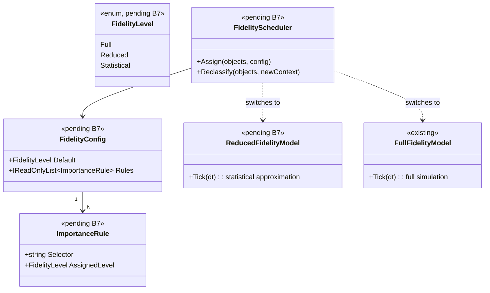

# Deep Dive: Variable Simulation Fidelity

> Expands phase B7 of [Track B — Scale](../track-b-scale.md). Part of the
> [Large-Scale RTS Roadmap](../README.md).
>
> Audience: human — design intent and architecture diagrams.

Goal: scale total simulated unit counts by spending compute in proportion to how much each unit
matters right now. Less-important units run more cheaply. This is an experimental toolkit of
fidelity-reduction techniques rather than a single mechanism, and it is the simulation-side
analogue of rendering LOD.

---

## 1. Concept

Not every unit needs full-fidelity simulation every frame. Units that are off-screen, far from any
player's interest, idle, or part of a large uniform crowd can often be simulated more cheaply
without a perceptible difference. Variable fidelity assigns each unit or region a fidelity level and
adjusts simulation accordingly.

This is primarily a scaling tool. It lets us push unit counts beyond full-fidelity limits and
measure the trade-off between cost and simulation accuracy.

---

## 2. Toolkit of techniques

| Technique | Idea | Strongest existing hook |
|---|---|---|
| Temporal LOD | Update distant/idle units less frequently, every N frames instead of every frame. | `UpdateModule.SetWakeFrame`/`NextCallFrame`/`UpdateOrder` already implement a per-module sleepy-update queue (`src/OpenSage.Game/Logic/Object/Update/UpdateModule.cs`, `GameLogic` sleepy queue). Temporal LOD generalizes this. |
| Simplified behavior/physics | Swap full AI/pathing/physics for cheap approximations for background units, such as straight-line move with no fine collision. | Module composition (`BehaviorModule`/`UpdateModule`) allows substituting a low-fidelity update path. |
| Group aggregation | Represent a crowd of similar units as one statistical or aggregate entity, expanding back to individuals only when it matters, such as combat or a close camera. | Quadtree/partition (`PartitionCellManager`, `Quadtree`) can cluster; aggregate is a new entity kind. |
| Precision reduction | Lower numeric or spatial precision for low-fidelity units. | Caution: contributes to bounded error. See §4. |

These techniques are independent and composable. The roadmap keeps all four so each can be
measured.

---

## 3. What drives a unit's fidelity level

A fidelity policy maps context to level. Candidate inputs:

- Interest/visibility: on-screen or near a player's camera/selection vs. far away.
- Distance from any player or active front.
- Activity: idle/garrisoned vs. moving/fighting.
- Local density: units in a dense crowd can share an aggregate.
- Per-shard hint: in [distributed sim (B6)](distributed-simulation.md), a shard with no observing
  client can run its whole region at reduced fidelity.

For shared/distributed runs the policy must be driven by replicated state, see §4, and should
ideally be hysteretic so units do not thrash between levels frame to frame.

---

## 4. Interaction with reproducibility (important)

Variable fidelity interacts with [A2 — Reproducibility & statistical stability](../track-a-foundations.md)
and [B6 — Distributed simulation](distributed-simulation.md). Under the
[relaxed-determinism Decision](../open-questions.md), the bar is bounded statistical error and
cross-shard consistency rather than bit-exactness:

- If fidelity depends on camera or interest, two players or two shards can choose different
  fidelity levels and therefore run different simulations. In a shared/distributed run, that is only
  acceptable if the error stays within tolerance and all shards agree on each unit's fidelity. That
  requires fidelity to be driven by replicated simulation state rather than local view.
- Decision, settled in [open-questions](../open-questions.md):
  - (a) Replicated-state fidelity inputs: drive fidelity only from shared simulation state such as
    position, activity, and density, never from local camera/view. This keeps shards consistent and
    is required for shared/distributed runs.
  - (b) View-driven fidelity: allow local view to drive fidelity, treating low-fidelity results as
    provisional and bounding the error. This is allowed only for single-node, non-distributed
    scaling experiments.

The [result replayer/visualizer (A5-3)](visualization.md) should visualize fidelity levels, for
example by colouring units by level, and run comparison must account for expected fidelity-induced
differences within tolerance.

---

## 5. Sub-phases

| Phase | Goal | Status |
|---|---|---|
| B7-1. Fidelity model & policy stance | Define the fidelity-level abstraction and the policy inputs (§3). The reproducibility stance is settled in [§4](#4-interaction-with-reproducibility-important): replicated-state fidelity inputs are required for shared/distributed runs; view-driven fidelity is single-node only. Design + benchmark targets via [B1](../track-b-scale.md). | Not started |
| B7-2. Temporal LOD | Generalize the existing wake-frame/sleepy-update mechanism so units update every N frames based on fidelity level; measure cost vs. accuracy. | Not started |
| B7-3. Simplified behavior/physics | Provide low-fidelity update paths, cheap move/no fine collision/simplified AI, selected by fidelity level via module composition. | Not started |
| B7-4. Group aggregation | Represent dense crowds of similar units as aggregate entities; expand to individuals on demand, such as combat or close interest. | Not started |
| B7-5. Precision reduction (experimental) | Explore coarser numeric/spatial precision for low-fidelity units, gated by the §4 policy and the bounded-error tolerance. | Not started |
| B7-6. Fidelity visualization & validation | Extend the [replayer/visualizer (A5-3)](visualization.md) to show per-unit fidelity levels and quantify the cost/accuracy trade-off across scaling experiments. | Not started |

---

## 6. Sequencing notes

- B7-1 gates the rest and must be settled alongside [A2](../track-a-foundations.md). A fidelity
  policy driven by non-replicated state would make shards disagree on shared/distributed runs.
- B7-2 is the cheapest first win. It extends machinery that already exists in `UpdateModule` wake
  frames and is low-risk.
- B7-3/4 build on [B3](../track-b-scale.md) so low-fidelity paths and aggregates are cheap to store
  and iterate.
- In [distributed sim (B6)](distributed-simulation.md), a shard-level fidelity hint, where a whole
  region runs at low fidelity when unobserved, is a powerful lever. Coordinate B7's per-unit policy
  with B6's per-shard policy.
- Every B7 technique is measured against [B1](../track-b-scale.md) benchmarks and validated with the
  [visualizer (A5-3)](visualization.md). Variable fidelity is explicitly a scaling experiment toolkit.

## 6.5 Scenario Matrix

The P0-5b matrix runner validates B7 by sweeping over fidelity level and unit count and confirming
that each technique reduces cost proportionally while staying within the bounded statistical error.
Like B6, this uses the benchmarking runner, A1 headless host + B1, rather than the P0 game harness.
It follows the same `ScenarioMatrix` pattern.

| Axis | Values | Notes |
|---|---|---|
| `fidelityLevel` | `full`, `temporal-lod`, `simplified-behavior`, `aggregated` | Each B7 technique in isolation |
| `unitCount` | 1000, 5000, 10000 | The near-term scale anchor and fractions of it |
| `importanceConfig` | `all-high`, `mixed` (50% high / 50% low), `all-low` | Tests that fidelity policy is driven by importance correctly |

Constraints:
- `aggregated` requires `unitCount ≥ 5000` because groups are too small to matter below that.
- The `full` baseline cell is required and is the comparison reference for error bounds.

Each cell runs a fixed-length simulation and asserts:
- Mean tick time is lower than the `full` baseline for the same `unitCount`, so the technique saves
  compute.
- Unit count at end of run equals the reference within B7's bounded-error tolerance.
- Aggregate metrics, positions and money, stay within the A2 tolerance band vs. `full`.

B7-6 extends the A5-3 replayer to display per-unit fidelity levels and graph the cost/accuracy
trade-off across matrix cells side by side.

## 8. Architecture Diagrams

Diagrams for this phase will be elaborated once B7 moves to active implementation. The
placeholder below captures the key types variable fidelity introduces.

## 9. Related

- Track B overview: [`../track-b-scale.md`](../track-b-scale.md)
- Reproducibility & statistical stability: [`../track-a-foundations.md`](../track-a-foundations.md)
- Distributed sim (per-shard fidelity): [`distributed-simulation.md`](distributed-simulation.md)
- Replayer/visualizer (fidelity visualization): [`headless-host.md`](headless-host.md)
- Open questions: [`../open-questions.md`](../open-questions.md)
