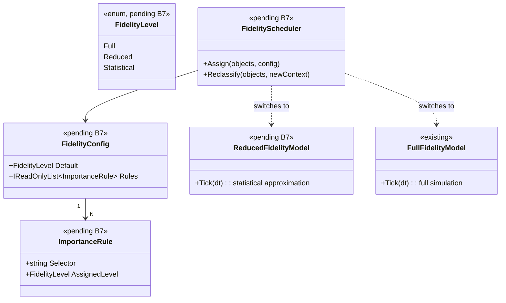

# Deep Dive: Variable Simulation Fidelity

> Expands phase B7 of [Track B — Scale](../track-b-scale.md). Part of the
> [Large-Scale RTS Roadmap](../README.md). First-pass design — refine as phases land.
>
> Audience: human — design intent and architecture diagrams.

Goal: scale total simulated unit counts by spending compute proportionally to how much each
unit matters right now — running less-important units more cheaply — as an experimental
toolkit of fidelity-reduction techniques rather than a single mechanism. This is the
simulation-side analogue of rendering LOD.

---

## 1. Concept

Not every unit needs full-fidelity simulation every frame. A unit that is off-screen, far from
any player's interest, idle, or part of a large uniform crowd can be simulated more cheaply
without a perceptible difference. Variable fidelity assigns each unit (or region) a
fidelity level and adjusts how it is simulated accordingly.

This is primarily a tool for scaling experiments: it lets us push unit counts far beyond
full-fidelity limits and measure the trade-off between cost and simulation accuracy.

---

## 2. Toolkit of techniques

| Technique | Idea | Strongest existing hook |
|---|---|---|
| Temporal LOD | Update distant/idle units less frequently (every N frames instead of every frame). | `UpdateModule.SetWakeFrame`/`NextCallFrame`/`UpdateOrder` already implement a per-module "sleepy update" queue (`src/OpenSage.Game/Logic/Object/Update/UpdateModule.cs`, `GameLogic` sleepy queue). Temporal LOD generalizes this. |
| Simplified behavior/physics | Swap full AI/pathing/physics for cheap approximations for background units (e.g. straight-line move, no fine collision). | Module composition (`BehaviorModule`/`UpdateModule`) allows substituting a low-fidelity update path. |
| Group aggregation | Represent a crowd of similar units as one statistical/aggregate entity, expanding back to individuals only when it matters (combat, close camera). | Quadtree/partition (`PartitionCellManager`, `Quadtree`) can cluster; aggregate is a new entity kind. |
| Precision reduction | Lower numeric/spatial precision for low-fidelity units (coarser positions, integer-ish math). | Caution: contributes to bounded error — see §4. |

These are independent and composable; the roadmap captures all four so we can experiment and
measure each.

---

## 3. What drives a unit's fidelity level

A fidelity policy maps context → level. Candidate inputs:

- Interest/visibility — on-screen or near a player's camera/selection vs. far away.
- Distance from any player or active front.
- Activity — idle/garrisoned vs. moving/fighting.
- Local density — units in a dense crowd can share an aggregate.
- Per-shard hint — in [distributed sim (B6)](distributed-simulation.md), a shard with no
  observing client can run its whole region at reduced fidelity.

For shared/distributed runs the policy must be driven by replicated state (see §4) and
ideally hysteretic (avoid thrashing between levels frame-to-frame).

---

## 4. Interaction with reproducibility (important)

Variable fidelity interacts with [A2 — Reproducibility & statistical stability](../track-a-foundations.md)
and [B6 — Distributed simulation](distributed-simulation.md). Under the
[relaxed-determinism Decision](../open-questions.md) the bar is not bit-exactness — it is
bounded statistical error and consistency across shards:

- If fidelity depends on camera/interest, two players (or two shards) see different cameras
  → different fidelity → different simulations. For a shared/distributed run that is only
  acceptable if the resulting error stays within tolerance and all shards agree on each
  unit's fidelity — which requires driving fidelity from replicated simulation state, not
  local view.
- Decision (settled in [open-questions](../open-questions.md)):
  - (a) Replicated-state fidelity inputs — drive fidelity purely from simulation state all
    nodes share (position, activity, density), never from local camera/view. Keeps shards
    consistent; camera-based LOD is then purely a rendering concern. Required for anything
    shared/distributed.
  - (b) View-driven fidelity — allow local view to drive fidelity, treating low-fidelity
    results as provisional and bounding the error. Allowed only for single-node, non-distributed
    scaling experiments where there are no shards to keep consistent.

The [result replayer/visualizer (A5-3)](visualization.md) should visualize fidelity levels
(e.g. colour units by level) and the run-comparison must account for expected fidelity-induced
differences (within tolerance) when comparing runs.

---

## 5. Sub-phases

| Phase | Goal | Status |
|---|---|---|
| B7-1. Fidelity model & policy stance | Define the fidelity-level abstraction and the policy inputs (§3). Reproducibility stance is settled ([§4 Decision](#4-interaction-with-reproducibility-important)): replicated-state fidelity inputs are required for shared/distributed runs; view-driven fidelity is single-node only. Design + benchmark targets (via [B1](../track-b-scale.md)). | Not started |
| B7-2. Temporal LOD | Generalize the existing wake-frame/sleepy-update mechanism so units update every N frames based on fidelity level; measure cost vs. accuracy. | Not started |
| B7-3. Simplified behavior/physics | Provide low-fidelity update paths (cheap move/no fine collision/simplified AI) selected by fidelity level via module composition. | Not started |
| B7-4. Group aggregation | Represent dense crowds of similar units as aggregate entities; expand to individuals on demand (combat, close interest). | Not started |
| B7-5. Precision reduction (experimental) | Explore coarser numeric/spatial precision for low-fidelity units, gated by the §4 policy and the bounded-error tolerance. | Not started |
| B7-6. Fidelity visualization & validation | Extend the [replayer/visualizer (A5-3)](visualization.md) to show per-unit fidelity levels and to quantify the cost/accuracy trade-off across scaling experiments. | Not started |

---

## 6. Sequencing notes

- B7-1 gates the rest and must be settled alongside [A2](../track-a-foundations.md): a
  fidelity policy driven by non-replicated state would make shards disagree on
  shared/distributed runs.
- B7-2 (temporal LOD) is the cheapest first win — it extends machinery that already exists
  (`UpdateModule` wake frames) and is low-risk.
- B7-3/4 build on [B3](../track-b-scale.md) (data-oriented logic) so low-fidelity paths and
  aggregates are cheap to store and iterate.
- In [distributed sim (B6)](distributed-simulation.md), a shard-level fidelity hint (whole
  region low-fidelity when unobserved) is a powerful lever; coordinate B7's per-unit policy
  with B6's per-shard policy.
- Every B7 technique is measured against [B1](../track-b-scale.md) benchmarks and validated
  with the [visualizer (A5-3)](visualization.md) — variable fidelity is explicitly a scaling
  experiment toolkit.

## 6.5 Scenario Matrix

The P0-5b matrix runner validates B7 by sweeping over fidelity level and unit count,
confirming that each fidelity technique reduces cost proportionally while staying within the
bounded statistical error. Like B6, this uses the benchmarking runner (A1 headless host + B1)
rather than the P0 game harness; it follows the same `ScenarioMatrix` pattern.

| Axis | Values | Notes |
|---|---|---|
| `fidelityLevel` | `full`, `temporal-lod`, `simplified-behavior`, `aggregated` | Each B7 technique in isolation |
| `unitCount` | 1000, 5000, 10000 | The near-term scale anchor and fractions of it |
| `importanceConfig` | `all-high`, `mixed` (50% high / 50% low), `all-low` | Tests that fidelity policy is driven by importance correctly |

Constraints:
- `aggregated` requires `unitCount ≥ 5000` (groups are too small to be meaningful below).
- The `full` baseline cell is required and is the comparison reference for error bounds.

Each cell runs a fixed-length simulation and asserts:
- Mean tick time is lower than the `full` baseline for the same `unitCount`
  (the technique saves compute).
- Unit count at end of run equals the reference within B7's bounded-error tolerance.
- Aggregate metrics (positions, money) are within the A2 tolerance band vs. `full`.

B7-6 (fidelity visualization) extends the A5-3 replayer to display per-unit fidelity levels and
graph the cost/accuracy trade-off across matrix cells side by side.

## 8. Architecture Diagrams

Diagrams for this phase will be elaborated once B7 moves to active implementation. The
placeholder below captures the key types variable fidelity introduces.

## 9. Related

- Track B overview: [`../track-b-scale.md`](../track-b-scale.md)
- Reproducibility & statistical stability: [`../track-a-foundations.md`](../track-a-foundations.md)
- Distributed sim (per-shard fidelity): [`distributed-simulation.md`](distributed-simulation.md)
- Replayer/visualizer (fidelity visualization): [`headless-host.md`](headless-host.md)
- Open questions: [`../open-questions.md`](../open-questions.md)
