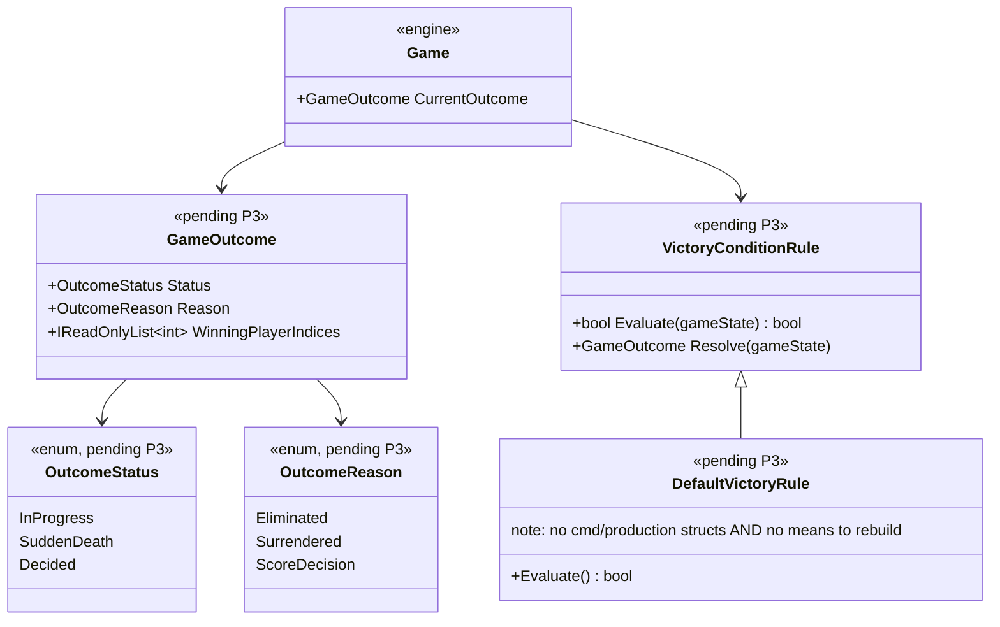

# Deep Dive: Victory & Defeat Conditions (P3)

> Expands phase P3 of [Track P — Playable Baseline](../track-p-playable-baseline.md). Part of
> the [Large-Scale Simulation Roadmap](../README.md).
>
> Audience: human overview of the victory and defeat design. Code references are in the agent-context appendix at the bottom.
>
> The agent-context section at the bottom ([Current code appendix](#appendix-current-code--agent-context)) contains file:line code references. Skip it if reading for design intent.

Purpose: add a first-class match-end result that can be asserted in headless runs. The design covers
outcome state, defeat/win detection, and end-of-match flow.

---

## 2. Design

### 2.1 A `GameOutcome` value (the queryable result)
Introduce a first-class outcome type exposed off `GameLogic`/`IGame`:

```
GameOutcome {
    OutcomeStatus Status;        // InProgress | SuddenDeath | Decided
    Player? WinningPlayer;       // null if team win or no winner yet
    Team? WinningTeam;           // set when a full team wins
    Player? LosingPlayer;        // (per defeated player, populated on each defeat event)
    OutcomeReason Reason;        // Eliminated | Surrendered | ScoreDecision
    int DecidedOnFrame;
}

enum OutcomeStatus { InProgress, SuddenDeath, Decided }
enum OutcomeReason { Eliminated, Surrendered, ScoreDecision }
```

`SuddenDeath` is a transitional status entered when mutual elimination is detected, meaning both
sides lose their last command/production structure in the same check window. The match then
continues under normal rules; the next elimination transitions to `Decided` with
`Reason = Eliminated`. `ScoreDecision` is used when a time limit expires and a winner is chosen by a
configurable score metric. `Surrendered` covers any player, human or AI, issuing
`OrderType.EndGame`.

This is what the [P0 harness](playable-baseline-harness.md) §3.3 outcome assertions read, and what
A2's verification harness and B1's benchmarks later assert against. It is also the termination
signal the headless run loop uses instead of today's ad hoc exit-on-enemy-CC-destruction path in
`TestHarness/Program.cs:232-267`.

### 2.2 Defeat detection
A `VictorySystem`, implemented as a `GameSystem`, runs a coarse-cadence check from the logic tick:

- Defeat rule (Decision): a player is defeated when they have no command/production structures and
  no means to rebuild, meaning no dozer/worker and insufficient resources, matching Generals
  skirmish rules. This is the default but remains configurable/data-driven so experiments can swap
  simpler or stricter conditions. See [open-questions](../open-questions.md).
- Ownership query (Decision): consume the maintained per-`Player` owned-object set/counts provided by
  [P1-5](skirmish-setup.md) ownership tracking. Counts are incremented on create/transfer and
  decremented on `OnDie`/`Destroy`, so checks stay O(1) rather than scanning all objects. This same
  maintained view also feeds AI and the scale tracks. See [open-questions](../open-questions.md).
- Win rule: when all players not allied to player X are defeated, via [P1](skirmish-setup.md)
  relationships/teams, X and allies win. When the winning side is a full team, `WinningTeam` is set
  in addition to or instead of `WinningPlayer`.
- Mutual elimination (Decision): if the last surviving command/production structures of both sides
  are destroyed in the same check window, `Status` becomes `SuddenDeath` rather than `Decided`.
  Play continues under normal rules until the next elimination, which then becomes `Decided` with
  `Reason = Eliminated`. See [open-questions](../open-questions.md).
- Time limit (Decision): an optional configurable frame-count limit. When it expires, `Status`
  becomes `Decided` with `Reason = ScoreDecision` and `WinningPlayer`/`WinningTeam` set to the side
  with the highest value of a configurable score metric such as buildings standing or units produced.
  The score metric is data-driven behind the same configurable-rule seam as the defeat rule. See
  [open-questions](../open-questions.md).

### 2.3 Death → defeat plumbing
Add a death/ownership-change notification so `VictorySystem`, AI, and selection cleanup can react
without polling every object every frame:
- Emit from `GameObject.OnDie(...)`/`Destroy()` (`GameObject.cs`) and from ownership transfer.
- `VictorySystem` decrements the owner's building/unit counts and re-checks only the affected player.
  This also fixes latent gaps the audit flagged, including selection invalidation on death and
  ownership cleanup.

### 2.4 End-of-match flow
On `Status → Decided`, for elimination, surrender, or score decision:
- Stop or relax the sim by pausing logic or switching to an observer state.
- Surface the result through a UI win/lose dialog for interactive play and structured `GameOutcome`
  for headless runs.
- Handle `OrderType.EndGame` in `OrderProcessor`, so an explicit surrender/quit by any player,
  human or AI, also produces `GameOutcome` with `Reason = Surrendered`.
- Allow exit back to the menu for interactive play or clean run-loop termination for headless runs.

On `Status → SuddenDeath`, for mutual elimination, log or announce the state, keep the sim running,
and continue until the next elimination produces `Decided`.

### 2.5 Sudden-death and time-limit implementation notes
- Sudden-death entry: in the `VictorySystem` check, after processing all defeat events for the
  current check window, if every remaining active player was just defeated simultaneously, meaning
  the check window left no active players, set `Status = SuddenDeath` and reverse the individual
  defeat flags so play continues. Alternatively, structure the check so mutual defeat is detected
  before individual defeat is committed.
- Time-limit expiry: an optional `FrameLimit`, in frames rather than wall-clock, configured on the
  match. Check it at the same coarse cadence as defeat. When `Game.MapTime / TickRate >= FrameLimit`,
  compute the configured score metric for each player, select the highest, tie-break = shared victory
  between tied players, and set `Status = Decided`, `Reason = ScoreDecision`.
- Both rules live behind the same configurable/data-driven rule seam as the defeat rule in §2.2.

---

## 3. Integration surface
- New: `GameOutcome` type + `VictorySystem : GameSystem`; a death/ownership-change event from
  `GameObject.OnDie/Destroy`.
- Hook: `GameLogic.Update(...)` coarse-cadence check / `Game.cs:876-959` tick.
- Reads: the maintained per-`Player` owned-object counts from [P1-5](skirmish-setup.md), not an
  all-objects scan, and relationships/teams from [P1](skirmish-setup.md).
- Handle: `OrderType.EndGame` in `OrderProcessor.Process`, currently unhandled.
- Exposes: `GameOutcome` off `GameLogic`/`IGame` for the [P0 harness](playable-baseline-harness.md)
  and the [A5 visualizer](visualization.md).

## 4. Sub-phases

| Phase | Goal | Status |
|---|---|---|
| P3-1. `GameOutcome` + `VictorySystem` scaffold | Add the outcome type (`OutcomeStatus`, `OutcomeReason`, `WinningPlayer`/`WinningTeam`) and a `GameSystem` that ticks a check from the logic loop; exposes `InProgress`. | Not started |
| P3-2. Defeat & win rules | Implement defeat (real Generals rule — no command/production structures + no rebuild — as the default, configurable) and win (all non-allies defeated, via P1 teams); consumes foundational [P1-5](skirmish-setup.md) ownership tracking. | Not started |
| P3-3. Death→defeat event | Emit a death/ownership-change notification from `GameObject.OnDie/Destroy`; `VictorySystem` reacts incrementally. | Not started |
| P3-4. End-of-match flow | Stop sim, surface result, handle `OrderType.EndGame` (surrender by any player — human or AI), allow exit; expose `GameOutcome` for headless. | Not started |
| P3-5. Mutual elimination → sudden death | Detect when all remaining active players are simultaneously eliminated in the same check window; set `Status = SuddenDeath` and continue play until the next elimination decides the match. | Not started |
| P3-6. Time-limit → score decision | Implement the optional frame-count limit; on expiry, select the winner by a configurable score metric (buildings standing, units produced, etc.) and set `Reason = ScoreDecision`. | Not started |

## 5. Sequencing & dependencies
- P3 depends on P1 because teams/relationships decide who wins and loses, and
  [P1-5](skirmish-setup.md) ownership tracking feeds defeat detection.
- P3 unblocks the [P0 harness](playable-baseline-harness.md) P0-4 outcome assertions and is a hard
  prerequisite for P7, which asserts that the match terminates with the expected `GameOutcome`.
- The [P1-5](skirmish-setup.md) ownership tracking P3 consumes is shared with P2 AI target selection
  and is also useful to the scale tracks.

## 6. Resolved design questions
- Ownership tracking approach — Decided: maintained per-`Player` counts/owned-object set from §2.2,
  giving O(1) checks and reused by P2 and the scale tracks. See
  [open-questions](../open-questions.md).
- Exact defeat rule — Decided: the real Generals rule, no command/production structures plus no
  means to rebuild, as the default, exposed as configurable. See
  [open-questions](../open-questions.md).
- Full end-state enumeration — Decided: six distinct end states, all validated by P7. There are
  three `OutcomeReason` values: `Eliminated` for normal defeat or sudden-death resolution,
  `Surrendered` for any player or AI issuing `EndGame`, and `ScoreDecision` for time-limit expiry.
  `SuddenDeath` is the transitional status for mutual simultaneous elimination, where play
  continues until the next elimination resolves to `Eliminated`. Team wins are represented by
  `WinningTeam` rather than a separate reason. See [open-questions](../open-questions.md).

## 6.5 Scenario Matrix

The P0-5b matrix runner validates P3 by sweeping over end-state types and player counts and
checking that every termination path produces the correct `GameOutcome`.

| Axis | Values | Notes |
|---|---|---|
| `endState` | `PlayerEliminated`, `PlayerSurrenders`, `AISurrenders`, `TeamWin`, `MutualElimination`, `ScoreDecision` | All six match end states from the design |
| `playerCount` | 2, 3, 4 | Tests that outcome detection works across match sizes |

Constraints:
- `TeamWin` requires `playerCount ≥ 2` with at least two teams.
- `MutualElimination` requires ≥2 players to lose in the same tick; the scenario scripts
  simultaneous last-structure destruction.
- `ScoreDecision` requires a configured frame-count limit set low in the test scenario so the run
  terminates quickly.

Each cell authors a scenario scripted to reach the target end state, runs it headlessly through
the P0 harness, and asserts:
- `GameOutcome.Status` matches `OutcomeStatus.Decided`, or `SuddenDeath` for `MutualElimination`.
- `GameOutcome.Reason` matches the expected `OutcomeReason` for the end state.
- `GameOutcome.WinningTeam`, or winner list, is correct for the match configuration.
- The run terminates within a bounded frame count with no infinite loop.

This matrix is the primary gate for P7. Once all six end-state cells pass, the full P7 regression
suite can be built on top of this matrix definition.

## 8. Architecture Diagrams

Diagrams for this phase will be elaborated once P3 moves to active implementation. The
placeholder below captures the key types the victory/defeat subsystem introduces.



## 9. Related
- Track overview: [`../track-p-playable-baseline.md`](../track-p-playable-baseline.md)
- Teams it needs: [`skirmish-setup.md`](skirmish-setup.md) (P1)
- Harness that asserts the outcome: [`playable-baseline-harness.md`](playable-baseline-harness.md) (P0)
- Combat/death paths: [`economy-production-combat.md`](economy-production-combat.md) (P6)
- Architecture snapshot: [`../agent/current-state.md`](../agent/current-state.md)

---

## Appendix: Current code — agent context

> Agent context: this section contains file:line code references for agents
> implementing this phase. Human readers: the design intent above does not
> require reading this section.

- No outcome logic. No meaningful matches for `Victory|Defeat|GameOver|EndGame|IsDefeated|WinLose`
  in `src/OpenSage.Game` beyond order plumbing/enum references; there is no win/lose controller.
- `OrderType.EndGame` exists but is unhandled. It is defined in
  `Logic/Orders/OrderType.cs`, but `OrderProcessor.Process(...)`
  (`Logic/Orders/OrderProcessor.cs`) has no `EndGame` handler; the default path logs
  `Unimplemented order type`.
- Ownership tracking is partial. `Player` exposes `SupplyManager`, `BankAccount`, selection sets,
  and `GetEnergy(...)` which iterates `allGameObjects.Objects` to sum owned energy producers
  (`Logic/Player.cs:22,73,92-104,130-135`), but there is no per-player owned-object list or
  building-count field; ownership is derived by scanning all objects.
- Death flow exists, no event hook. `GameObject.IsDestroyed`, `Kill(...)`, `OnDie(...)`,
  `Destroy()` exist (`Logic/Object/GameObject.cs`); `OnDie` iterates death modules and plays a sound;
  `Kill()` routes into death handling. There is no death/destroyed event a defeat system could
  subscribe to.
- Tick hook available. A per-frame victory check can live in `GameLogic.Update(...)`
  (`Logic/GameLogic.cs`) or the main game tick (`Game.cs:876-959`, `Scene3D.LocalLogicTick`).

---
