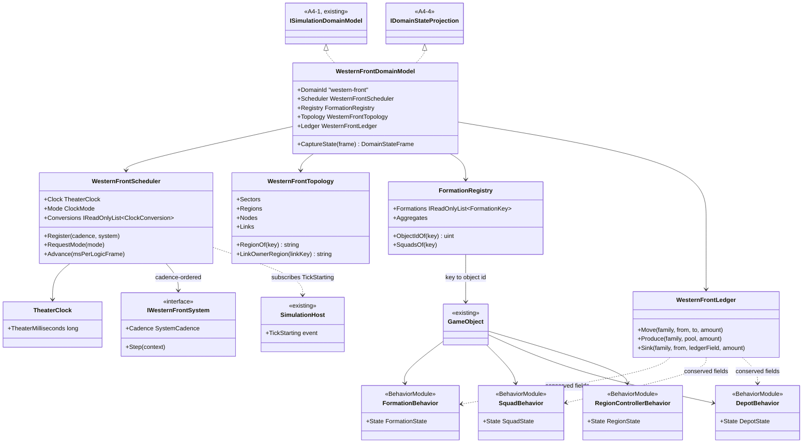
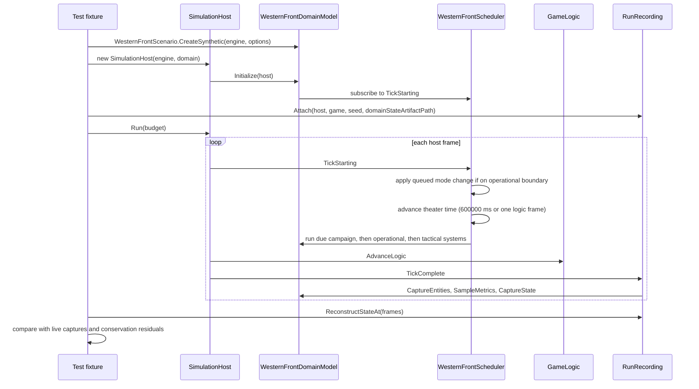

# Deep Dive: W0 Charter Fixture

> Expands phase W0 of [Track W: Western Front Simulation](../track-w-western-front.md).
> Charter: [western-front-scale-simulation.md](western-front-scale-simulation.md). Depends on
> [A4-4 domain state projection](a4-4-domain-state-projection.md).
>
> Audience: human design for the contracts and fixture `WI-W0-01..09` implement. Code references
> are in the agent-context appendix.

Purpose: fix the Western Front state vector, stable keys, layer boundaries, clock semantics, and
conservation rules on a synthetic fixture before any gameplay system exists. W0 adds no combat,
movement, logistics flow, or orders; those are [W1](w1-aggregate-sector.md). W0 proves that
every quantity has an owner and a unit, that three layers serialize and reconstruct, and that the
clock can move between compressed and tactical modes at explicit synchronization points.

---

## 1. Decisions applied

From the [Western Front decision gates](../open-questions.md):

| Gate | W0 consequence |
|---|---|
| 2. Echelons | Persistent formations: army, corps, division, brigade, battalion. Tactical entity: squad (section of about 10). |
| 3. Clocks | Domain-owned multi-rate scheduler over host logic frames: campaign 6 h, operational 10 min, tactical one logic frame. |
| 5. Conservation | Personnel, equipment, and supply are integers conserved exactly. Activation triggers stay an experiment input (W2). |
| 7. Logistics | Commodities: artillery ammunition, small-arms ammunition (SAA), personnel replacements. Links owned by the tail node's region. |
| 8. Terrain | Per-region summarized terrain: trench, wire, and crater levels. |
| 10. Persistence | Recording tiers only; no save/load before W6. |
| 11. Interaction | Headless; no player control. |

## 2. Runtime placement

Per the domain-scope Decision, Western Front state lives on the shared `GameObject`/module
runtime; the domain adds modules and an adapter, not a second engine.

- Project: `src/Panopticon.Simulation.WesternFront/`, namespace `Panopticon.Simulation.WesternFront`.
  Referenced by `Panopticon.Simulation.Tests`. `Panopticon.Simulation` grants it
  `InternalsVisibleTo` because module data overrides `internal CreateModule`.
- Each persistent formation, depot, and region controller is one `GameObject` with a data-only
  behavior module (`FormationBehavior`, `DepotBehavior`, `RegionControllerBehavior`). Each active
  squad is one `GameObject` with `SquadBehavior`.
- Modules hold state and never advance it per logic frame. Domain systems advance state from the
  scheduler, because in compressed mode one host frame spans ten theater minutes.
- Formation identity is a stable string key, not the `GameObject` id. `FormationRegistry` maps
  keys to object ids and owns squad-to-formation mapping.

## 3. Stable keys

Keys are lowercase, `:`-prefixed by kind, ordinal-sortable, and never reused within a run.

| Kind | Format | Example |
|---|---|---|
| Side | `side:<name>` | `side:blue` |
| Formation | `formation:<side>/<path>` | `formation:blue/a1/c1/d1/b2/bn1` |
| Squad | `squad:<formation path>/<n>` | `squad:blue/a1/c1/d1/b2/bn1/07` |
| Sector | `sector:<n>` | `sector:0` |
| Region | `region:<sector>.<n>` | `region:0.2` |
| Cell | `cell:<sector>.<n>/<x>,<y>` | `cell:0.2/3,1` |
| Node | `node:<side>.<name>` | `node:blue.rail` |
| Link | `link:<from node>-><to node>` | `link:blue.rail->blue.dump0` |
| Theater singletons | `theater`, `pool:<side>`, `ledger:<side>` | `ledger:red` |

Formation paths name the full parent chain, so a key alone identifies echelon and parent.

## 4. Layers and state vector

Four layers own disjoint record kinds. Every field declares unit, type, and conservation role (see
[A4-4 §3](a4-4-domain-state-projection.md#3-contracts)). Conserved families: `personnel`, `mg`,
`field_gun`, `heavy_gun`, `artillery_ammo`, `saa`.

### 4.1 Theater layer

| Kind | Field | Unit | Type | Role | Family |
|---|---|---|---|---|---|
| `theater` | `theater_time` | `ms` | Integer | None | |
| | `clock_mode` | `index` | Integer | None | |
| | `precipitation` | `mm/h` | Real | None | |
| | `ground_state` | `index` | Real | None | |
| `pool` | `personnel` | `persons` | Integer | Holding | `personnel` |
| | `artillery_ammo` | `rounds` | Integer | Holding | `artillery_ammo` |
| | `saa` | `rounds` | Integer | Holding | `saa` |
| | `produced_personnel` | `persons` | Integer | Source | `personnel` |
| | `produced_artillery_ammo` | `rounds` | Integer | Source | `artillery_ammo` |
| | `produced_saa` | `rounds` | Integer | Source | `saa` |
| `ledger` | `killed`, `wounded`, `missing` | `persons` | Integer | Sink | `personnel` |
| | `lost_mg` | `guns` | Integer | Sink | `mg` |
| | `lost_field_gun`, `lost_heavy_gun` | `guns` | Integer | Sink | `field_gun`, `heavy_gun` |
| | `consumed_artillery_ammo` | `rounds` | Integer | Sink | `artillery_ammo` |
| | `consumed_saa` | `rounds` | Integer | Sink | `saa` |

`clock_mode`: `0` compressed, `1` tactical. `ground_state`: 0 dry to 1 waterlogged.

### 4.2 Operational layer

| Kind | Field | Unit | Type | Role | Family |
|---|---|---|---|---|---|
| `formation` | `echelon` | `index` | Integer | None | |
| | `fidelity` | `index` | Integer | None | |
| | `personnel` | `persons` | Integer | Holding | `personnel` |
| | `mg` | `guns` | Integer | Holding | `mg` |
| | `field_gun`, `heavy_gun` | `guns` | Integer | Holding | `field_gun`, `heavy_gun` |
| | `artillery_ammo` | `rounds` | Integer | Holding | `artillery_ammo` |
| | `saa` | `rounds` | Integer | Holding | `saa` |
| | `cohesion`, `fatigue`, `morale`, `entrenchment` | `ratio` | Real | None | |
| `depot` | `personnel` | `persons` | Integer | Holding | `personnel` |
| | `artillery_ammo` | `rounds` | Integer | Holding | `artillery_ammo` |
| | `saa` | `rounds` | Integer | Holding | `saa` |
| `link` | `capacity_artillery_ammo`, `capacity_saa` | `rounds/tick` | Integer | None | |
| | `capacity_personnel` | `persons/tick` | Integer | None | |
| | `travel_time` | `s` | Integer | None | |
| | `in_transit_personnel` | `persons` | Integer | Holding | `personnel` |
| | `in_transit_artillery_ammo` | `rounds` | Integer | Holding | `artillery_ammo` |
| | `in_transit_saa` | `rounds` | Integer | Holding | `saa` |
| | `damage` | `ratio` | Real | None | |
| `region` | `trench`, `wire`, `crater` | `index` | Real | None | |

`formation` references: `parent`, `region`. `link` references: `from`, `to`. `depot` references:
`region`. `echelon`: `0` army, `1` corps, `2` division, `3` brigade, `4` battalion. `fidelity`:
`0` aggregate, `1` operational, `2` tactical. Owner layer for `formation` is operational even
while its fidelity is aggregate or tactical: the record persists across transitions.

### 4.3 Aggregate layer

| Kind | Field | Unit | Type | Role | Family |
|---|---|---|---|---|---|
| `aggregate` | `member_count` | `formations` | Integer | None | |
| | `cohesion_mean`, `cohesion_var` | `ratio` | Real | None | |
| | `fatigue_mean`, `morale_mean` | `ratio` | Real | None | |

References: `region`, `members` (space-separated formation keys, ordinal). An aggregate groups
inactive formations in one region and side. Conserved integers stay on the member `formation`
records, so aggregation never reallocates strength; the aggregate owns only statistical state
and the members' movement and combat while inactive.

### 4.4 Tactical layer

| Kind | Field | Unit | Type | Role | Family |
|---|---|---|---|---|---|
| `squad` | `object_id` | `id` | Integer | None | |
| | `personnel` | `persons` | Integer | Holding | `personnel` |
| | `mg` | `guns` | Integer | Holding | `mg` |
| | `saa` | `rounds` | Integer | Holding | `saa` |
| | `suppression` | `ratio` | Real | None | |

References: `formation`, `cell`. A partially promoted battalion keeps the unmaterialized
remainder on its `formation` record; squads hold the rest.

## 5. Topology fixture

Synthetic, in world units, one side per half:

```text
            x ->   r.0 (blue rear)  r.1 (blue front)  r.2 (red front)  r.3 (red rear)
sector:1           region:1.0       region:1.1        region:1.2       region:1.3
sector:0           region:0.0       region:0.1        region:0.2       region:0.3
```

- Regions are 2000 x 2000 world units; cells are 250 x 250 (8 x 8 per region).
- Nodes per side: `rail` (rear region of sector 0) and `dump0`, `dump1` (front region of each
  sector).
- Links per side: `rail->dump0`, `rail->dump1`, `dump0->dump1`, `dump1->dump0`.
- Adjacency: regions share an edge with x or y neighbours; `DescribeTopology` lists sectors,
  regions, nodes, links, and region/link adjacencies. Cells are listed only for regions with a
  tactical activation, keeping the description bounded.
- Ownership: a region is owned by the side of its column (`r.0`/`r.1` blue, `r.2`/`r.3` red).
  A link belongs to its tail node's region. A cell belongs to its region.

## 6. Scenario fixture

`WesternFrontScenario.CreateSynthetic(IGameEngine, WesternFrontScenarioOptions)` builds:

| Side | Formations | Fidelity |
|---|---|---|
| blue | army `a1`, corps `c1`, division `d1`, brigades `b1`, `b2`, battalions `b1/bn1`, `b1/bn2`, `b2/bn1`, `b2/bn2`, artillery brigade `ra1` | operational, except `b2/bn1` tactical |
| blue | reserve division `d2` with two brigades of two battalions | aggregate in `region:0.0` |
| red | mirror of blue under `a1`/`c1`/`d1`, reserve `d2` | operational; reserve aggregate in `region:0.3` |

- Battalion: 800 personnel, 8 MG, 400000 SAA. Artillery brigade: 600 personnel, 24 field guns,
  8 heavy guns, 20000 artillery rounds. Headquarters echelons hold 0 of each; they exist for
  identity and command.
- Tactical promotion in the fixture: `blue/.../b2/bn1` materializes 24 squads (10 personnel,
  1 in 8 squads with 1 MG, 2000 SAA each) into `cell:0.1/7,3`, leaving 560 personnel, 5 MG, and
  352000 SAA on the formation record.
- Pools, depots, and in-transit fields start at fixed values from `WesternFrontScenarioOptions`.
- Every value is synthetic. No value claims historical accuracy.

## 7. Clock and scheduler

`TheaterClock` holds theater time in whole milliseconds. `WesternFrontScheduler` advances it once
per host frame from `SimulationHost.TickStarting`:

| Mode | Theater advance per host frame | Operational tick | Campaign tick |
|---|---|---|---|
| Compressed (no active tactical region) | 600 s | every host frame | every 36 host frames |
| Tactical (one or more active regions) | one logic frame | when theater time crosses a 600 s boundary | when theater time crosses a 21600 s boundary |

Rules:

- Tactical-mode time is `entryMs + round(tacticalFrames * MsPerLogicFrame)`, recomputed from the
  frame count so the float frame interval never accumulates drift.
- Mode changes happen only on an operational boundary. Promotion and demotion requests queue
  until the next boundary.
- Systems register with a cadence (`Campaign`, `Operational`, `Tactical`) and run in registration
  order within a cadence; campaign systems run before operational systems on a shared boundary.
- Each mode change appends a `ClockConversion(hostFrame, theaterTime, fromMode, toMode)` entry and
  a `clock-mode` metric sample, so a recording maps host frames to theater time without
  re-simulation.
- In compressed mode the host still steps `GameLogic` once per frame. No W0 module updates per
  frame, so the step is a no-op for Western Front state.

Cadences come from `WesternFrontClockOptions` (defaults: campaign 21600 s, operational 600 s;
campaign must be a whole multiple of operational). W0 registers only a probe system in tests; W1
adds the gameplay systems.

## 8. Domain adapter

`WesternFrontDomainModel : ISimulationDomainModel, IDomainStateProjection`:

| Member | Mapping |
|---|---|
| `DomainId` | `"western-front"` |
| `Fidelity` | `DomainFidelityPolicy.Identity` (W2 revisits) |
| `Initialize(host)` | subscribe the scheduler to `TickStarting` |
| `CaptureEntities` | formations, depots, region controllers, squads in object-id order; `ScalarA` personnel (depot: artillery rounds), `ScalarB` cohesion (squad: suppression) |
| `CapturePlayerMoneyVector` | empty |
| `TopologyKey` | squad: its `cell:`; formation and depot: its `region:`; region controller: its `region:` |
| `DescribeTopology` | §5 |
| `SampleMetrics` | series `personnel` keyed `side:*`, `stock-<commodity>` keyed `side:*`, `theater-time` keyed `theater`, `clock-mode` keyed `theater`, `conservation-residual` keyed `<family>/side:*` |
| `ResolveInteractionAuthority` | the region controller entity of the interaction's region; for `link:` keys, the tail node's region controller; for `cell:` keys, the containing region's controller |
| `StateSchema` | §4, version 1 |
| `CaptureState(frame)` | one record per theater singleton, pool, ledger, depot, link, region, formation, aggregate, and squad |

## 9. Conservation

`WesternFrontLedger` is the only mutation path for conserved fields. Each operation moves an
integer amount of one family between two holdings, from a source to a holding, or from a holding
to a sink, and rejects negative results. W0 exposes it for tests; W1 systems call it. The A4-4
`DomainConservation.Residuals` check runs per sampled frame in W0 evidence tests and must return
no residuals.

## 10. Evidence (phase milestone)

A fixture run with a shortened operational cadence (10 s, so a tactical interval is 300 host
frames; campaign 60 s) runs 40 compressed frames, queues tactical mode, runs 600 frames, queues
compressed mode, and runs 40 more. It records with `RunRecording` and the domain state artifact.
A test asserts:

- the schema validates and every field has a non-empty unit and a layer;
- reconstructed state at the first frame, a campaign boundary, a tactical frame, and the last frame
  equals the live capture at those frames for
  theater, operational, aggregate, and tactical records;
- the default cadences are covered separately by scheduler unit tests without a host;
- conservation residuals are empty at every sampled frame after scripted ledger transfers
  (depot to formation, formation to squad, squad to `ledger` sink);
- `ClockConversion` entries exist at the two mode changes, both on operational boundaries;
- run-output JSON records `domainId` `western-front` and the domain-state artifact path.

## 11. Sub-items and cards

| Item | Card | Deliverable |
|---|---|---|
| W0-1 | [`WI-W0-01`](../agent/cards/WI-W0-01-scaffold-western-front-project.md) | Project, keys, enums. |
| W0-2 | [`WI-W0-02`](../agent/cards/WI-W0-02-western-front-state-schema.md) | State schema (§4). |
| W0-3 | [`WI-W0-03`](../agent/cards/WI-W0-03-synthetic-topology.md) | Topology (§5). |
| W0-4 | [`WI-W0-04`](../agent/cards/WI-W0-04-theater-clock-scheduler.md) | Clock and scheduler (§7). |
| W0-5 | [`WI-W0-05`](../agent/cards/WI-W0-05-formation-registry-modules.md) | State modules and formation registry (§2). |
| W0-6 | [`WI-W0-06`](../agent/cards/WI-W0-06-synthetic-scenario.md) | Scenario fixture (§6). |
| W0-7 | [`WI-W0-07`](../agent/cards/WI-W0-07-western-front-domain-adapter.md) | Domain adapter (§8). |
| W0-8 | [`WI-W0-08`](../agent/cards/WI-W0-08-conservation-ledger.md) | Ledger (§9). |
| W0-9 | [`WI-W0-09`](../agent/cards/WI-W0-09-charter-fixture-evidence.md) | Evidence test (§10). |

## 12. Architecture diagrams

Grounded in `ISimulationDomainModel`, `SimulationHost` events, the `GameObject`/module runtime,
and the A4-4 contracts. Types without an `existing` or `A4-4` stereotype are new in W0.





## Appendix: Current-state hooks (agent context)

- `src/Panopticon.Simulation/SimulationHost.cs:62-68`: `TickStarting`, raised before order
  dispatch and the logic step.
- `src/Panopticon.Simulation/SimulationHost.cs:92-99`: host construction calls `Initialize`.
- `src/Panopticon.Simulation/Simulation/Transport/TransportGraphDomainModel.cs:51-92`: code-built
  `ObjectDefinition` plus `ModuleDataContainer` pattern for data-only modules.
- `src/Panopticon.Simulation/Simulation/Transport/TransportVehicleUpdate.cs:15-27`: module data with
  `internal override CreateModule`, the reason for `InternalsVisibleTo`.
- `src/Panopticon.Simulation/AssemblyInfo.cs:3-8`: existing `InternalsVisibleTo` list.
- `src/Panopticon.Mathematics/IRandom.cs`: `SageRandom`, the seeded source W1 uses.
- `test/Panopticon.Simulation.Tests/Simulation/SimulationDomainContractTests.cs:71-120`:
  `MockedGameTest` host fixture pattern.
