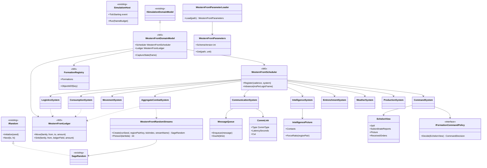
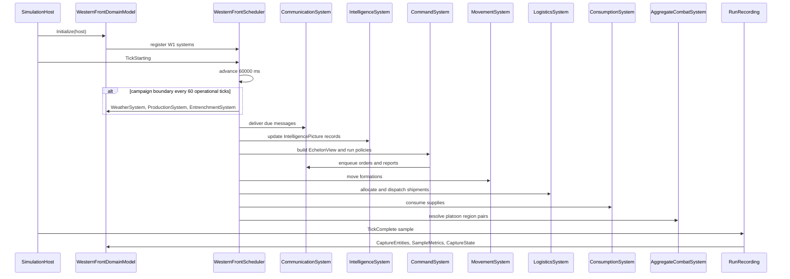

# Deep Dive: W1 Aggregate Sector Simulation

> Expands phase W1 of [Track W: Western Front Simulation](../track-w-western-front.md). Builds on
> [W0](w0-charter-fixture.md); charter: [western-front-scale-simulation.md](western-front-scale-simulation.md).
>
> Audience: human design and agent card source. Cards exist as `WI-W1-01..15`.

Purpose: run several connected sectors with formation movement, supply flow, delayed orders,
echelon-local information, and aggregate combat only. No tactical region activates in W1; the
scheduler stays in compressed mode.

---

## 1. Decisions applied

| Gate | W1 consequence |
|---|---|
| 2. Granularity | Aggregate combat resolves per platoon, the smallest persistent formation. |
| 3. Clocks | Weather, production, and entrenchment growth run at 1 h campaign cadence; everything else runs at 1 min operational cadence. Seven theater days are 10080 compressed host frames. |
| 4. Combat | Stochastic Lanchester: square law for aimed fire, linear law for area and artillery fire, seeded; a mean-field variant runs the same equations through a fixed-point accumulator. |
| 5. Conservation | Every system mutates conserved fields only through `WesternFrontLedger`; per-frame residuals must be empty. |
| 6. Command | Echelon-local information; reactive rule policies use force ratio from `IntelligencePicture`. |
| 7. Logistics | Artillery ammunition, SAA, and replacements flow through capacitated links with travel time; allocation uses largest remainder. |
| 12. Envelopes | Measure only; 64 seeds per experiment arm. |

## 2. Systems

All systems implement `IWesternFrontSystem` and register with the W0 scheduler. Order within one
operational tick is fixed:

| Order | System | Cadence | Reads | Writes |
|---|---|---|---|---|
| 1 | `WeatherSystem` | Campaign | parameters, seeded stream | `theater` weather fields, `region` ground effects |
| 2 | `ProductionSystem` | Campaign | parameters | `pool` via `Produce` |
| 3 | `CommunicationSystem` | Operational | message queue, link disruption | delivers orders and reports due this tick |
| 4 | `IntelligenceSystem` | Operational | contacts, observation assets, reports | per-headquarters `IntelligencePicture` |
| 5 | `CommandSystem` | Operational | `EchelonView` only | new orders and reports into the message queue |
| 6 | `MovementSystem` | Operational | orders, road graph, region capacity | formation region, fatigue |
| 7 | `LogisticsSystem` | Operational | demands, link capacity, stocks | shipments, stocks via ledger |
| 8 | `ConsumptionSystem` | Operational | activity, strength | stocks to `ledger` sinks |
| 9 | `AggregateCombatSystem` | Operational | contested region pairs | casualties, equipment loss, cohesion, morale, displacement |
| 10 | `EntrenchmentSystem` | Campaign | holding formations, region terrain | `entrenchment`, `trench`, `wire` |

Communication runs before command so decisions use the freshest delivered information; combat runs
after logistics and consumption so it sees the stock available this tick.

## 3. Parameters and deterministic streams

`WesternFrontParameters` is one JSON document. Every numeric parameter is represented as
`{ "value": n, "unit": "..." }`. `WesternFrontParameterSchema` declares the expected unit for
each path and the loader rejects missing, extra, non-numeric, or wrong-unit values. Parameters
cover combat coefficients, weights, protection curves, consumption rates, march rates, link
capacities, latency and disruption values, production, weather, entrenchment, morale, and
breakpoints. Every value is synthetic in W1 and W4 sweeps it.

W1 adds `System.IO.Hashing` to central package management. `WesternFrontRandomStreams` derives a
64-bit XxHash over UTF-8 bytes of
`runSeed|regionPairKey|tickIndex|streamName`, then folds it to the `uint` seed accepted by
`SageRandom`. Each draw depends on state, parameters, seed, region pair, tick, and stream name,
not iteration order.

Poisson sampling is exact: Knuth multiplication for `lambda < 10`, Hörmann PTRS for
`lambda >= 10`. The mean-field variant uses a fixed-point `long` accumulator in units of
1e-6 personnel, so remainders are bit-exact across platforms.

## 4. Command and information

### 4.1 Orders and reports

`FormationOrder` carries issuer, recipient, issue time, expected arrival, priority, validity window,
objective (hold region, attack region, move to region, relieve formation, bombard region), permitted
initiative, and the issuer's information snapshot id. `FormationReport` carries sender, recipient,
observation time, own strength estimate, and observed enemy contacts.

### 4.2 Communication network

Each parent-child headquarters pair has one or more `CommLink` entries:

| Type | Base latency | Disruption |
|---|---|---|
| Runner | region distance / runner speed | casualty chance per region crossed under fire |
| Telephone | fixed short delay | line cut probability per tick from artillery in either endpoint region; repair time |
| Wireless | fixed delay plus encoding time | availability flag per headquarters; interception adds to enemy intelligence |

A message uses the fastest available link; a cut or unavailable link falls back to the next.
Each echelon adds a staff processing delay before relaying downward. Delivery, acknowledgement,
expiry, and loss are recorded as events and as `order-latency` and `order-loss` metric series.

### 4.3 Echelon-local information

Each headquarters holds an `IntelligencePicture`: known enemy formations or aggregates with
estimated strength, region, observation time, and confidence. Sources: own-region contact,
observation assets (aircraft, balloons, observation posts) with per-tick detection probability
by weather, subordinate reports, and wireless interception.

`CommandSystem` passes each policy an `EchelonView`: the headquarters' own state, its
subordinates' last reported state, its picture, and its received orders. Policies receive no
reference to `WesternFrontScenario` or full state. W4 verifies the rule with an information-audit
metric.

### 4.4 Policies

`IFormationCommandPolicy` per echelon, selected like A4 AI policies. W1 ships rule-based reactive
references:

- army and corps allocate reserves and artillery by objective priority;
- division and brigade assign battalions and companies to front regions;
- battalion coordinates platoons inside its region;
- platoon holds, advances, withdraws, or requests support from received orders and local view.

Attack decisions use force ratio computed from the headquarters' `IntelligencePicture`, not
scripted attack times. The scenario scripts only the initial offensive intent. Learned policies
stay behind the [A4 seams](a4-pluggable-ai.md).

## 5. Movement

Formations occupy one region. Movement orders follow the road-link graph between regions at an
echelon march rate reduced by `ground_state` and fatigue. Region stacking capacity limits
occupancy per side. Aggregates move as a unit. Movement into an enemy-occupied region is an
attack and resolves through combat, not movement.

## 6. Logistics

A per-tick allocation over the directed link graph:

1. Formations post demand per commodity to their supplying dump (target stock minus current
   stock, bounded by carrying capacity).
2. Dumps post aggregated demand to the railhead; railheads draw from `pool`.
3. Each link ships up to its capacity per commodity, adjusted by `damage`. Allocation among
   competing demands uses priority tiers from orders (attack > hold > reserve), then proportional
   shares with largest-remainder rounding, so allocations are exact integers.
4. Shipments move stock to a `shipment` holding and arrive after `travel_time`.
5. Interdiction (artillery on a link's regions) raises `damage`; engineers repair per tick.

Metrics: `unmet-demand` per commodity and formation, `link-utilization` per link,
`stock-days` per formation.

## 7. Consumption

Per operational tick, per formation: SAA and artillery rounds consumed by activity (quiet, holding
under fire, attacking, bombarding) scaled by personnel or guns; replacements absorbed from the
supplying dump up to establishment strength. Consumption sinks to `ledger` `consumed_*`.

## 8. Aggregate combat

### 8.1 Engagement

A region pair is contested when opposing platoons occupy adjacent regions across the front, or
one side attacks into the other's region. Artillery in range bombards any target region under a
bombard order. Each contested pair resolves once per operational tick at the authority of the
defending region's controller (the W0 authority rule).

### 8.2 Stochastic Lanchester

For a 1 min tick:

- Aimed fire (square law): expected casualties inflicted by side A on B are
  `lambda = alpha * (rifles_A * w_rifle + mg_A * w_mg) * s_A * c_A * (1 - p_B) * dt`, where `s_A`
  is SAA sufficiency (0 to 1), `c_A` cohesion, and `p_B` protection from B's entrenchment and
  region trench level.
- Area fire (linear law): expected casualties from A's artillery on B are
  `lambda = beta * rounds_fired_A * density_B * (1 - q_B) * dt`, where `density_B` is B's personnel
  per region area and `q_B` protection from entrenchment and dugouts. `rounds_fired_A` is limited
  by guns, rate of fire, and stock, and is consumed through the ledger.
- Stochastic variant: casualties are drawn from `Poisson(lambda)`, capped by current strength.
- Mean-field variant: a per-formation fixed-point accumulator adds `lambda * 1_000_000`; integer
  casualties are the whole-person part, and the fractional remainder carries to the next tick.

Casualties split into killed, wounded, and missing by parameter fractions and sink through the
ledger. MG and gun losses are drawn per casualty with parameter probabilities. Crater level rises
with rounds fired into a region; wire falls with rounds fired at wire targets.

### 8.3 Morale and outcome

Cohesion falls with the tick's casualty fraction and fatigue and recovers while in reserve. Morale
moves slowly at campaign cadence. Below the breakpoint a platoon withdraws one region toward its
rear; an attacker takes a region when defenders withdraw or are destroyed. Outcomes are recorded
as `front-line` metric samples per sector.

## 9. Schema additions

W1 raises the W0 schema to version 2 so command and logistics state reconstructs:

| Kind | Layer | Key | Content |
|---|---|---|---|
| `message` | operational | `message:<seq>` | order or report fields, due time, status (pending, delivered, acknowledged, expired, lost) |
| `commlink` | operational | `commlink:<from>-><to>/<type>` | latency, cut flag, repair remaining |
| `contact` | operational | `contact:<hq>/<target>` | estimated strength, region, observation time, confidence |
| `shipment` | operational | `shipment:<seq>` | link, commodity, amount (Holding), arrival time |

Shipments replace the W0 `in_transit_*` link fields, which become derived metrics. Delivered and
expired messages drop from state after one campaign tick; their history remains in the recorded
deltas.

## 10. Scenario

The W0 fixture extends with a scripted initial blue offensive intent in `sector:0`. Reactive
policies choose bombardment timing, attack commitment, reserves, and withdrawal from force ratio,
stock state, and morale. Red holds with its reserve aggregate. The run lasts seven theater days:
10080 compressed host frames at 60 s per frame. It stops early if a side's front line collapses.

## 11. Evidence (phase milestone)

- Conservation residuals are empty at every frame for all families.
- Order delivery, acknowledgement, and loss metrics are present per echelon pair.
- Front, formation, command, contact, and logistics state reconstructs from the domain-state
  artifact at any frame.
- Two runs with one seed produce identical state frames under both combat variants.
- An A2 experiment over 64 seeds reports distributions of casualties, ground taken, order latency,
  and unmet demand per variant.

Failures of the same-seed assertion follow the repository determinism-test rule: preserve the
artifacts and report before fixing.

## 12. Sub-items and cards

| Item | Cards | Deliverable |
|---|---|---|
| W1-1 | [`WI-W1-01`](../agent/cards/WI-W1-01-parameters-loader.md), [`WI-W1-02`](../agent/cards/WI-W1-02-schema-v2.md), [`WI-W1-03`](../agent/cards/WI-W1-03-seeded-streams-poisson.md) | Parameters, schema v2, deterministic streams, Poisson. |
| W1-2 | [`WI-W1-04`](../agent/cards/WI-W1-04-message-queue-commlinks.md) | Message queue, comm links, `CommunicationSystem`. |
| W1-3 | [`WI-W1-05`](../agent/cards/WI-W1-05-intelligence-echelon-view.md), [`WI-W1-06`](../agent/cards/WI-W1-06-command-policies.md) | Intelligence pictures, `EchelonView`, reactive rule policies. |
| W1-4 | [`WI-W1-07`](../agent/cards/WI-W1-07-movement-system.md) | Movement over the road graph with stacking. |
| W1-5 | [`WI-W1-08`](../agent/cards/WI-W1-08-logistics-allocation.md), [`WI-W1-09`](../agent/cards/WI-W1-09-shipments-interdiction-consumption.md) | Logistics allocation, shipments, interdiction, consumption. |
| W1-6 | [`WI-W1-10`](../agent/cards/WI-W1-10-aggregate-combat-stochastic.md), [`WI-W1-11`](../agent/cards/WI-W1-11-aggregate-combat-mean-field.md), [`WI-W1-12`](../agent/cards/WI-W1-12-morale-terrain-outcomes.md), [`WI-W1-13`](../agent/cards/WI-W1-13-campaign-systems.md) | Combat variants, morale, terrain effects, campaign systems. |
| W1-7 | [`WI-W1-14`](../agent/cards/WI-W1-14-scenario-evidence-tests.md), [`WI-W1-15`](../agent/cards/WI-W1-15-a2-experiment-report.md) | Offensive scenario, evidence tests, 64-seed A2 report. |

## 13. Architecture diagrams

Grounded in W0 planned type names and current engine seams.

## Appendix: Current-state hooks (agent context)

- `src/Panopticon.Simulation/Simulation/ISimulationDomainModel.cs:15-63`: domain seam W1 extends
  through the W0 adapter.
- `src/Panopticon.Simulation/SimulationHost.cs:68`: `TickStarting`, the W0 scheduler hook W1
  systems run under.
- `src/Panopticon.Simulation/SimulationHost.cs:92-99`: host construction calls
  `DomainModel.Initialize`.
- `src/Panopticon.Simulation/SimulationHost.cs:118-147`: `Run` drives a fixed host-frame loop and
  calls `RunStarting`/`RunComplete`.
- `src/Panopticon.Mathematics/IRandom.cs:6-33`: `IRandom` contract.
- `src/Panopticon.Mathematics/IRandom.cs:74-135`: `SageRandom` seed and draw implementation.
- `src/Panopticon.Simulation/Recording/RunRecording.cs:15-62`: `WorldStateSampler` samples after
  `TickComplete`.
- `src/Panopticon.Simulation/Recording/RunRecording.cs:70-125`: `SnapshotDeltaRecorder`, the
  state-artifact reconstruction pattern.
- `src/Panopticon.Simulation/Recording/RunRecording.cs:356-431`: `RunRecording.Attach` and
  `Complete`, where domain state and run output are wired.
- `src/Panopticon.Simulation/RunOutput.cs:62-100`: additive run-output fields and JSON helpers.
- `src/Panopticon.Simulation/Logic/AI/Hierarchy/SquadHierarchy.cs:17-75`: existing A4-3 grouping,
  explicitly not a Western Front tactical entity.
- `Directory.Packages.props:3-32`: central package versions, where `System.IO.Hashing` is added.
