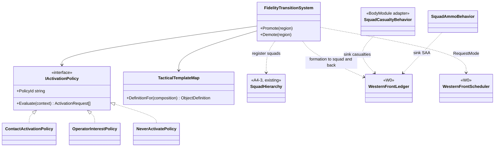
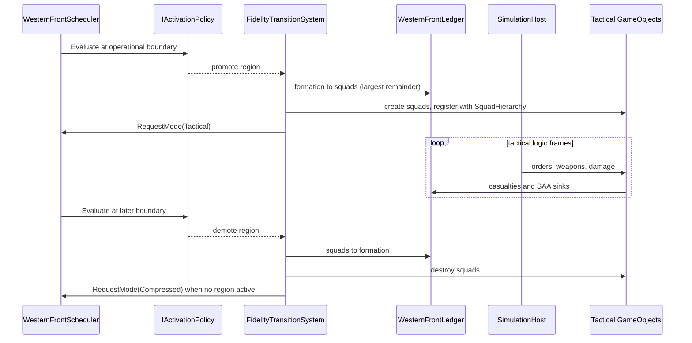

# Deep Dive: W2 Fidelity Promotion and Reconciliation

> Expands phase W2 of [Track W: Western Front Simulation](../track-w-western-front.md). Builds on
> [W1](w1-aggregate-sector.md); relates to [B7 variable fidelity](b7-variable-fidelity.md).
>
> Audience: human design. Cards are written after W1 lands, from this document.

Purpose: promote one contact region from aggregate/operational state into detailed tactical
entities, run a bounded engagement on the Track P runtime, and demote it back, with exact integer
conservation and a recorded explanation of every transition.

---

## 1. Decisions applied

| Gate | W2 consequence |
|---|---|
| 2. Granularity | Tactical entity: one `GameObject` per squad (about 10 personnel). |
| 3. Clocks | Any active region switches the scheduler to tactical mode at the next operational boundary. |
| 5. Triggers | Activation policy is an experiment input behind `IActivationPolicy`; conservation is exact for integers. |
| 8. Terrain | Tactical terrain effects fold into region `trench`, `wire`, `crater` levels on demotion. |
| 12. Envelopes | W2 sets the first approximation-error envelope from its all-detailed reference. |

## 2. Relationship to B7

W2 is the first formation-level instance of B7's group-aggregation technique (B7-4). It does not
wait for B7: the promotion and reconciliation contracts live in the Western Front domain, and B7-4
generalizes them later. W2 obeys B7's shared-state rule: activation inputs come from simulation
state or the scripted operator list, never from a camera.

## 3. Activation

```csharp
public interface IActivationPolicy
{
    string PolicyId { get; }

    IReadOnlyList<ActivationRequest> Evaluate(ActivationContext context);
}
```

- `ActivationContext`: contested region pairs, operator-interest regions, current active regions,
  and ticks since each region's last transition.
- `ActivationRequest`: region key, direction (promote or demote), reason, and the input values
  that triggered it.
- References: `NeverActivatePolicy`, `ContactActivationPolicy` (promote contested pairs with an
  attack order), `OperatorInterestPolicy` (scripted region list and times).
- Hysteresis: a minimum dwell of `N` operational ticks between transitions of one region, a
  policy parameter.
- A cap on concurrent active regions bounds cost; excess requests are recorded as deferred.

## 4. Promotion

At an operational boundary, for each promoted region:

1. Select the formations in the region and its contested neighbour.
2. Choose the materialized share per formation: companies whose footprint intersects the active
   cells. The remainder stays on the `formation` record.
3. Split personnel, MG, and SAA into squads with the largest-remainder method; the ledger moves
   each amount from formation to squad.
4. Create one squad `GameObject` per squad from `TacticalTemplateMap`: formation composition to
   Track P object definitions. W2 uses Generals infantry definitions as placeholders; Western
   Front content arrives later through Track D.
5. Place squads in the region's cells from the formation's posture (front trench, support, reserve
   lines), derived from region `trench` level.
6. Register squads with the A4-3 `SquadHierarchy` so commander and soldier policies issue engine
   `Order`s through `SimulationHost.InjectOrders`.
7. Record a `transition` record and event with policy id, reason, inputs, and per-formation
   amounts moved.

## 5. Tactical engagement

- Squad strength maps to object health: `health = personnel * hp_per_person`. `SquadCasualtyBehavior`
  converts health loss into whole-person casualties with a carried remainder, sinks them through
  the ledger, and destroys the object at zero personnel.
- `SquadAmmoBehavior` decrements squad SAA per weapon shot and blocks firing at zero.
- Artillery stays operational: artillery formations assigned to the region fire scripted area
  damage through the existing weapon and damage path, consuming rounds through the ledger.
- Formation objectives translate to squad orders only at this boundary: move, attack-move,
  hold. Higher orders never mutate tactical state directly.
- The engagement is bounded by the policy (for example two operational ticks, 20 theater minutes,
  36000 logic frames).

## 6. Demotion and reconciliation

At the demotion boundary:

1. Each surviving squad's personnel, MG, and SAA move back to its formation through the ledger.
2. Casualties already sunk during the engagement stay in `ledger`; nothing is recomputed.
3. Cohesion and morale update from the engagement's casualty fraction with the W1 equations.
4. Region ownership changes if the defender's squads were destroyed or withdrew from all front
   cells.
5. Crater and wire counts from weapon impacts fold into region terrain levels.
6. Squad objects are destroyed; a `transition` record captures the reconciliation amounts.

Identity: formation keys never change. Squad keys are unique within a run and are not reused by a
later promotion of the same formation.

## 7. Reference comparison

The approximation question is how far aggregate resolution drifts from detailed resolution for
the same engagement.

- Reference: the engagement runs fully tactical from its first tick with the same initial state.
- Candidate: the engagement runs aggregate-only under the W1 combat model.
- Mixed: promotion mid-engagement under each activation policy.
- An A2 experiment over at least 32 seeds per arm compares casualty, ground, and ammunition
  distributions. The measured differences become the declared W2 envelope (Gate 12); later phases
  report against it.

## 8. Evidence (phase milestone)

- Formation keys and holdings survive promote, engage, demote with empty conservation residuals
  at every frame.
- No personnel, equipment, supply, or orders are duplicated or lost across the transition.
- Every transition has a `transition` record with reason and inputs.
- The reference comparison report exists and states the envelope.

## 9. Sub-items

| Item | Deliverable |
|---|---|
| W2-1 | `IActivationPolicy`, references, hysteresis, concurrency cap. |
| W2-2 | `TacticalTemplateMap` and squad placement. |
| W2-3 | Promotion with largest-remainder split and transition records. |
| W2-4 | Squad casualty and ammunition behaviors. |
| W2-5 | Formation objective to squad orders through A4-3. |
| W2-6 | Demotion and reconciliation, terrain fold-in. |
| W2-7 | Reference comparison experiment and envelope report. |

## 10. Architecture diagrams

Conceptual until W2 cards are written.




