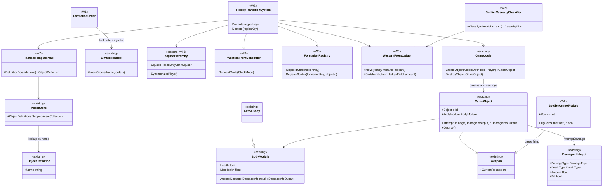
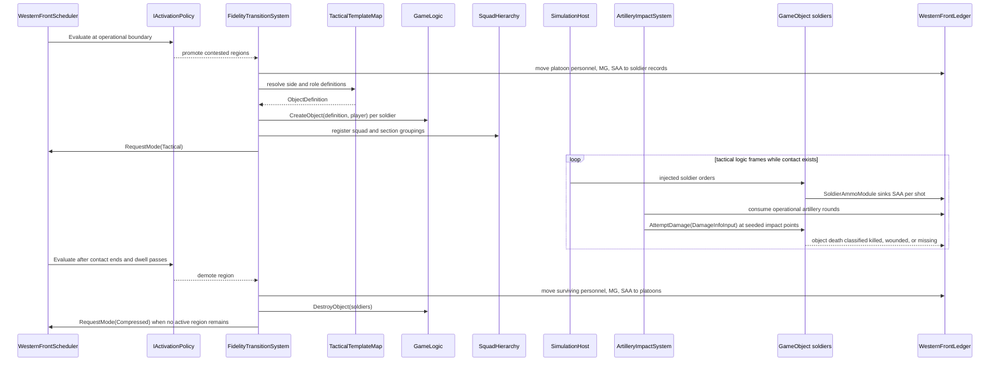

# Deep Dive: W2 Fidelity Promotion and Reconciliation

> Expands phase W2 of [Track W: Western Front Simulation](../track-w-western-front.md). Builds on
> [W1](w1-aggregate-sector.md); relates to [B7 variable fidelity](b7-variable-fidelity.md).
>
> Audience: human + agent design for W2 promotion, all-tactical reference runs, and task cards.

Purpose: promote contacted Western Front regions from operational state into soldier-level
`GameObject`s, run tactical contact on the Track P runtime, reconcile back to platoon records, and
measure aggregate error against a whole-sector all-tactical reference.

---

## 1. Decisions applied

| Gate | W2 consequence |
|---|---|
| 2. Granularity | Persistent formation floor: platoon. Tactical entity: one soldier `GameObject` with stock object-definition health. Squads and sections are A4-3 `SquadHierarchy` groupings, not objects. |
| 3. Clocks | Operational cadence is 1 minute. Tactical mode advances one logic frame. Compressed mode advances 60 seconds per host frame. Mode changes occur on operational boundaries. |
| 5. Triggers | Default activation is `ContactActivationPolicy`: every contested region is tactical, no concurrency cap, no fixed engagement bound. Demotion occurs after contact ends and dwell passes. |
| 8. Terrain | Tactical terrain effects fold into region `trench`, `wire`, and `crater` summaries on demotion. |
| 12. Envelopes | Whole-sector all-tactical is the reference and the primary product. Mixed and aggregate runs report error against it. |

W2 uses placeholder Generals object definitions: blue soldiers use `AmericaInfantryRanger`, red
soldiers use `ChinaInfantryRedguard`. Western Front content arrives later through Track D.

## 2. Relationship to W0, W1, A4-3, and B7

W2 consumes W0 state, keys, scheduler, registry, topology, and ledger. It consumes W1 command,
logistics, movement, aggregate combat, seeded streams, and the seven-day sector scenario. W2 is the
first formation-level instance of B7-4 group aggregation, but it does not wait for B7. The Western
Front domain owns the concrete promotion records and reconciliation ledger now; B7 later extracts
the reusable contract.

A4-3 supplies `SquadHierarchy` and the hierarchical order path. W2 registers promoted soldiers as
ordinary player-owned `GameObject`s, groups them into squads and sections with hierarchy metadata,
and injects leaf orders through `SimulationHost.InjectOrders`.

## 3. Activation

```csharp
public interface IActivationPolicy
{
    string PolicyId { get; }

    IReadOnlyList<ActivationRequest> Evaluate(ActivationContext context);
}
```

- `ActivationContext`: contested regions, active tactical regions, current operational tick,
  ticks since last transition, operator-interest regions, and scheduler mode.
- `ActivationRequest`: region key, direction, reason, dwell state, and serialized input values.
- References: `NeverActivatePolicy`, `ContactActivationPolicy`, `OperatorInterestPolicy`,
  `AllTacticalActivationPolicy`.
- Default: `ContactActivationPolicy` promotes every contested region and demotes only after
  contact ends and dwell passes.
- Hysteresis: minimum dwell is 3 operational ticks, therefore 3 minutes.
- Concurrency: no cap in the default policy. A later experiment may add a cap, but W2 records no
  deferred requests by default.

The policy evaluates only at operational boundaries. Promotion, demotion, and scheduler mode
changes are applied in one boundary transaction and recorded.

## 4. Promotion

At an operational boundary, for each promoted region:

1. Select platoons whose footprint intersects the active region or its contested neighbour.
2. Choose the materialized share per platoon. A platoon may be partially promoted; its
   unmaterialized remainder stays on the `formation` record.
3. Split personnel, MG, and SAA from the platoon ledger onto soldier records. Personnel and MG are
   exact integers. SAA uses largest-remainder distribution so every round is assigned exactly once.
4. Create one soldier `GameObject` per materialized person from `TacticalTemplateMap`:
   `AmericaInfantryRanger` for blue, `ChinaInfantryRedguard` for red.
5. Keep stock `ObjectDefinition` health. W2 does not scale health by personnel.
6. Assign MG teams by giving preserved MG carriers an MG weapon set or planned module flag. MG
   count is conserved by the promotion ledger.
7. Place soldiers from platoon posture and region terrain: front trench, support trench, reserve
   line, shell hole, or open advance. Trench level constrains which placement bands exist.
8. Register squads and sections as A4-3 `SquadHierarchy` groupings. Group identity is metadata
   over soldiers, not a separate `GameObject`.
9. Record a `FidelityTransitionRecord` with policy id, reason, inputs, object ids, and all ledger
   amounts moved.

## 5. Tactical engagement

- Casualty event: a soldier casualty is the soldier object's death. A `SoldierCasualtyClassifier`
  subscribes to object death or lifecycle events and classifies the death as killed, wounded, or
  missing from parameter fractions on the seeded stream.
- No tactical wounded-state model exists in W2. Wounded soldiers leave the tactical population at
  death and are counted in the ledger sink.
- SAA: `SoldierAmmoModule` owns per-soldier rounds, decrements on each shot, and blocks firing at
  zero. Promotion moves platoon SAA to soldiers; demotion returns unused SAA.
- MG: MG teams are soldiers carrying an MG weapon set. Their soldiers die normally; the MG ledger
  is reconciled from surviving MG carriers and recorded losses.
- Artillery: artillery formations stay operational and strategically controlled. A bombard order
  against an active tactical area consumes rounds from the operational ledger and applies shell
  impacts directly via `DamageInfoInput`/`GameObject.AttemptDamage` to objects in the impact area.
  Impact points are drawn from the order's target area on the seeded stream.
- Orders: formation objectives translate into soldier and squad orders only at the tactical
  boundary. Higher-level orders remain domain data.

There is no fixed tactical engagement bound. Contact drives the default lifecycle: tactical mode
continues while contact exists, then the policy demotes after 3 operational ticks of dwell.

## 6. Demotion and reconciliation

At the demotion boundary:

1. Destroy or detach promoted soldier objects after final state capture.
2. Move surviving personnel, MG, and SAA from soldier records back to each platoon through the
   ledger.
3. Keep killed, wounded, missing, consumed SAA, consumed artillery rounds, and lost MG in ledger
   sinks.
4. Update cohesion and morale from W1 equations using the recorded casualty fraction.
5. Resolve region ownership from surviving front-cell occupation and W1 withdrawal rules.
6. Fold tactical terrain effects into region `trench`, `wire`, and `crater` levels.
7. Record reconciliation in `FidelityTransitionRecord`.

Formation keys never change. Soldier object ids are transient and are not reused as stable
formation identity.

## 7. Reference and error measurement

The all-tactical run is the reference and the primary product. W2 therefore has three run families:

- Reference: whole sector all tactical from frame zero with `AllTacticalActivationPolicy`.
- Mixed: default `ContactActivationPolicy`, tactical only in contested regions.
- Aggregate: W1 aggregate combat only.

An A2 experiment runs 64 seeds per arm and reports distributions for casualties, ground, SAA,
artillery rounds, dwell time, and terrain summaries. Aggregate and mixed runs are measured against
the whole-sector all-tactical reference. W2 declares the first aggregate-vs-tactical error report;
it does not set a permanent acceptance threshold.

## 8. Evidence

- Every promoted soldier maps to one platoon and one ledger allocation.
- Personnel, MG, SAA, and artillery ammunition residuals are empty at every transition boundary.
- Object deaths produce killed, wounded, or missing ledger sinks with no fractional remainder.
- `SoldierAmmoModule` blocks firing at zero rounds.
- Strategic artillery applies tactical damage through the engine damage path and records shell
  impact points.
- Squads and sections are A4-3 hierarchy groupings over soldiers.
- Whole-sector all-tactical and aggregate/mixed comparison reports exist for 64 seeds per arm.

## 9. Sub-items and cards

| Item | Card | Deliverable | Acceptance criteria |
|---|---|---|---|
| W2-1 | [`WI-W2-01`](../agent/cards/WI-W2-01-activation-policy-hysteresis.md) | Activation policy interface, references, and dwell. | Contact regions promote, inactive regions demote after 3 operational ticks, and every transition records policy inputs. |
| W2-2 | [`WI-W2-02`](../agent/cards/WI-W2-02-transition-records-schema.md) | Transition records and schema additions. | Promotion and demotion reconstruct from domain state artifacts without input re-simulation. |
| W2-3 | [`WI-W2-03`](../agent/cards/WI-W2-03-tactical-template-map.md) | Tactical template map. | Blue resolves to `AmericaInfantryRanger`, red resolves to `ChinaInfantryRedguard`, with validation for missing definitions. |
| W2-4 | [`WI-W2-04`](../agent/cards/WI-W2-04-soldier-placement.md) | Soldier placement from posture and trench level. | Placement is deterministic per seed and keeps soldiers inside their active cells and posture bands. |
| W2-5 | [`WI-W2-05`](../agent/cards/WI-W2-05-promotion-ledger-split.md) | Platoon-to-soldier ledger split. | Personnel, MG, and SAA split exactly; SAA uses largest remainder. |
| W2-6 | [`WI-W2-06`](../agent/cards/WI-W2-06-soldier-casualty-classification.md) | Soldier death classification. | Every soldier death creates exactly one killed, wounded, or missing ledger sink from seeded fractions. |
| W2-7 | [`WI-W2-07`](../agent/cards/WI-W2-07-soldier-ammo-module.md) | Per-soldier SAA module. | Shots decrement SAA and zero rounds blocks firing. |
| W2-8 | [`WI-W2-08`](../agent/cards/WI-W2-08-mg-teams.md) | MG team preservation. | MG carriers are assigned deterministically and MG counts reconcile after deaths and demotion. |
| W2-9 | [`WI-W2-09`](../agent/cards/WI-W2-09-artillery-impacts-active-areas.md) | Strategic artillery into active tactical areas. | Bombard orders consume operational rounds and apply `DamageInfoInput` at seeded impact points. |
| W2-10 | [`WI-W2-10`](../agent/cards/WI-W2-10-formation-objectives-to-soldier-orders.md) | Formation objectives to soldier/squad orders through A4-3. | Orders are injected through `SimulationHost.InjectOrders`; higher orders do not mutate tactical state directly. |
| W2-11 | [`WI-W2-11`](../agent/cards/WI-W2-11-demotion-reconciliation-terrain.md) | Demotion, reconciliation, and terrain fold-in. | Soldier survivors, ammo, MG, and terrain summaries fold back with empty residuals. |
| W2-12 | [`WI-W2-12`](../agent/cards/WI-W2-12-mode-switching-scheduler.md) | Mode switching with the W0 scheduler. | Tactical mode enters and exits only on operational boundaries and records conversions. |
| W2-13 | [`WI-W2-13`](../agent/cards/WI-W2-13-all-tactical-reference-run.md) | Whole-sector all-tactical reference run. | Reference scenario materializes the sector tactically from frame zero and records it as the primary product. |
| W2-14 | [`WI-W2-14`](../agent/cards/WI-W2-14-error-report-64-seeds.md) | Aggregate-vs-tactical A2 report. | A2 runs 64 seeds per arm and reports declared error distributions against all-tactical reference. |

## 10. Architecture diagrams

Grounded in current engine types plus planned W0/W1 types. Types marked `existing` are verified in
the current source. Types marked `W0`, `W1`, or `W2` are planned or owned by the named phase.

### 10.1 Promotion and tactical runtime types



### 10.2 Contact activation, promotion, artillery, and demotion



## Appendix: Current-state hooks

- `src/Panopticon.Simulation/Logic/GameLogic.cs:77-90`: `GameLogic.CreateObject(ObjectDefinition, Player)`
  creates runtime `GameObject`s and assigns object ids.
- `src/Panopticon.Simulation/Logic/GameLogic.cs:200-215`: `DestroyObject` removes ownership,
  raises lifecycle cleanup, and emits `ObjectDestroyed`.
- `src/Panopticon.Simulation/IGame.cs:149-153`: `ObjectDestroyed` is the public destruction event.
- `src/Panopticon.Simulation/Logic/Object/GameObject.cs:272-279`: `GameObject.AttemptDamage` delegates
  to the body module.
- `src/Panopticon.Simulation/Logic/Object/GameObject.cs:1341-1354`: `Kill` applies body max health as
  unresistable damage and forces death.
- `src/Panopticon.Simulation/Logic/Object/GameObject.cs:1352-1398`: `OnDie` runs death modules,
  ownership cleanup, lifecycle event, and die sound.
- `src/Panopticon.Simulation/Logic/Object/GameObject.cs:1420-1423`: `Destroy` removes the object through
  `GameLogic`.
- `src/Panopticon.Simulation/Logic/Object/Body/BodyModule.cs:11-31`: body modules own damage and healing
  entry points.
- `src/Panopticon.Simulation/Logic/Object/Body/ActiveBody.cs:48-49`: stock health is initialized from
  `ActiveBodyModuleData`.
- `src/Panopticon.Simulation/Logic/Object/Body/ActiveBody.cs:58-85`: active bodies adjust incoming
  damage through armor and reject damage to dead objects.
- `src/Panopticon.Simulation/Logic/Object/Body/ActiveBody.cs:356-362`: active bodies call
  `GameObject.OnDie` when health crosses zero.
- `src/Panopticon.Simulation/Logic/Object/Damage/DamageInfo.cs:38-130`: `DamageInfoInput` carries
  source, type, death type, amount, shockwave, and `Kill`.
- `src/Panopticon.Simulation/Logic/Object/Weapon/Weapon.cs:29-35`: weapons expose `CurrentRounds`.
- `src/Panopticon.Simulation/Logic/Object/Weapon/Weapon.cs:105-112`: clip state and reload helpers.
- `src/Panopticon.Simulation/Logic/Object/Weapon/WeaponStates/FiringWeaponState.cs:21-29`: firing
  decrements current clip rounds.
- `src/Panopticon.Simulation/Logic/Object/Weapon/WeaponStates/WeaponStateMachine.cs:35-63`: the weapon
  state machine owns firing, between-shot, and reload transitions.
- `src/Panopticon.Simulation/SimulationHost.cs:107-117`: `SimulationHost.InjectOrders` schedules
  orders for the normal game injection path.
- `src/Panopticon.Simulation/SimulationHost.cs:165-180`: due injected orders dispatch before the frame's
  logic step.
- `src/Panopticon.Simulation/Logic/AI/Hierarchy/SquadHierarchy.cs:17-45`: `SquadHierarchy` owns squad
  membership and synchronizes against player-owned objects.
- `src/Panopticon.Simulation/Logic/AI/Hierarchy/SquadHierarchy.cs:140-204`: hierarchy cleanup,
  assignment, and commander promotion operate on live `GameObject`s.
- `src/Panopticon.Simulation/Logic/AI/Hierarchy/HierarchicalAIDecisionPolicy.cs:39-68`: A4-3 turns
  squad goals into leaf `Order`s.
