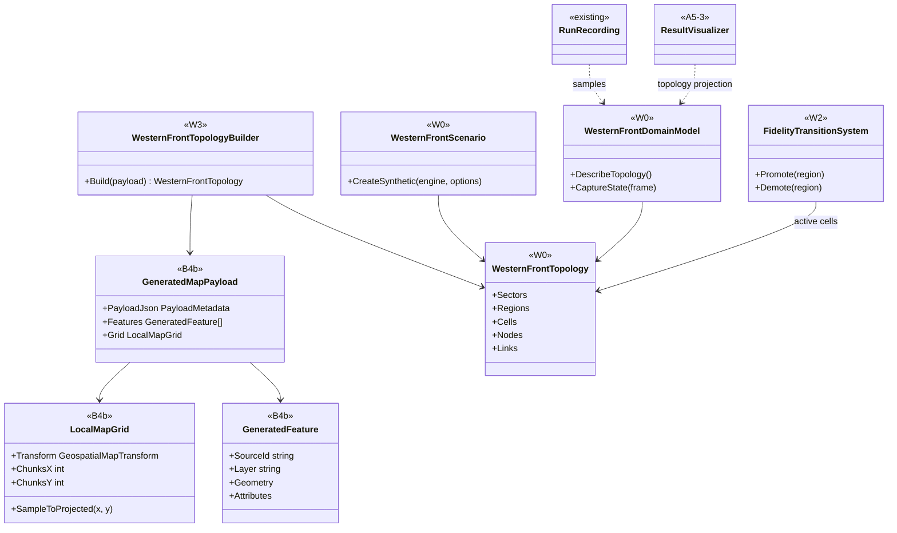
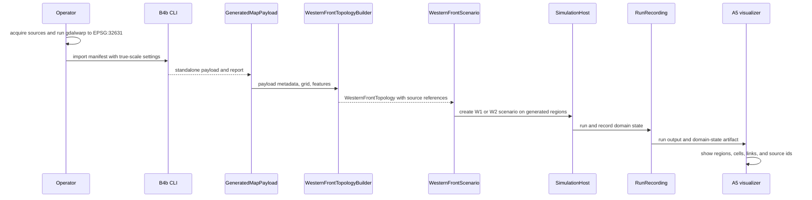

# Deep Dive: W3 Geospatial Sector

> Expands phase W3 of [Track W: Western Front Simulation](../track-w-western-front.md).
> Builds on [W2](w2-fidelity-promotion.md) and [B4b](b4b-geospatial-map-generation.md).
>
> Audience: human + agent design for `WI-W3-01..10`.

Purpose: run the W1 aggregate sector and W2 fidelity-transition evidence on one real Somme sector
generated by the B4b standalone payload. W3 proves that Western Front topology can be derived from
geospatial source features while the simulation still uses stable W keys, one shared map transform,
and the A4 domain projection.

---

## 1. Decisions applied

| Decision | W3 application |
|---|---|
| Extent | Lat 49.90-50.17 N, lon 2.52-2.80 E, about 30 km north-south by 20 km east-west. |
| Projection | UTM 31N, EPSG:32631. |
| Scale | True scale, `metersPerGameUnit` 0.3048. B4b lattice spacing is 3.048 m. |
| Chunk count | About 78 x 52 chunks after chunk rounding. |
| DEM | IGN RGE ALTI 1 m, reprojected by the operator from Lambert-93 to UTM 31N with `gdalwarp`. Vertical datum metadata is `NGF-IGN69` only. |
| DEM size | About 600M samples, about 2.4 GB float32. Fits a 64 GB operator machine. |
| Vectors | Modern OSM-derived roads, rail, rivers, villages, and woods, plus operator-digitized 1916 front lines. |
| Topology | `WesternFrontTopologyBuilder` derives sectors, regions, cells, nodes, and links from the B4b payload. |
| Grid | Region grid is 1000 m, each region has 8 x 8 cells of 125 m. |
| Evidence | Repeat W1 and W2 evidence on the generated sector. |

## 2. Input package

W3 consumes the B4b standalone payload until H3 exists. The payload is the boundary, not the
operator's raw data.

Required payload metadata:

- `GeospatialMapTransform` with EPSG:32631, `metersPerGameUnit` 0.3048, and `verticalDatum`
  `NGF-IGN69`;
- `LocalMapGrid` chunk layout and projected bounds;
- generated terrain chunks, material chunks, masks, and generated features;
- generated features with stable `SourceId`, geometry kind, source layer, source attributes, and
  payload-local coordinates;
- report entries for control points, source hashes, sample spacing, no-data handling, and
  chunk-count summary.

Operator-local acquisition and reprojection steps stay in investigation cards. No IGN data, OSM
extract, trench-line vector, generated payload, or reprojected raster is committed.

## 3. Topology derivation

`WesternFrontTopologyBuilder` reads `GeneratedMapPayload` and produces the W0/W1 topology model.

Rules:

1. The selected extent becomes one sector group. Front-line polylines split it into blue rear,
   contested/front, and red rear bands.
2. A regular 1000 m projected grid creates `region:` keys. Grid cells that intersect the playable
   extent are retained.
3. Each region creates 8 x 8 `cell:` keys. Cell edges are 125 m, or 410.104987 game units at true
   scale.
4. Roads, rail, rivers, villages, and woods remain attached as source features. Roads and rail
   become movement and logistics candidates.
5. Depot nodes are seeded from rail and road junctions near rear-area features. W3 uses synthetic
   supply quantities and synthetic formations.
6. Transport links follow road and rail feature lines. Each link records the feature `SourceId`
   and tail-region ownership, matching W0 and W1.
7. Every region, cell, node, and link records its source feature keys or the grid derivation record
   that created it.

The builder is deterministic for one payload. Source features are sorted by `SourceId`, then
geometry order, then coordinate order.

## 4. Scenario and evidence

W3 does not add a historical order of battle. It places the W1/W2 synthetic forces on real
geography:

- initial blue and red fronts are aligned to the digitized 1916 front lines;
- rear depots attach to rail and road features in each side's rear bands;
- W1 aggregate systems use generated movement and logistics links;
- W2 promotes at least one contested region pair and runs the all-tactical reference on the same
  generated cells.

Evidence:

- B4b control-point tolerances still pass for the payload W3 consumes;
- all topology keys map to generated source features or explicit grid derivation records;
- W1 conservation, reconstruction, fixed-seed, and aggregate metrics pass on the generated sector;
- W2 promotion, engagement, demotion, transition records, and reference comparison pass on the
  generated sector;
- generated region and link source keys are visible through A4 topology and A5 rendering.

## 5. Sub-items and cards

| Item | Card | Deliverable | Acceptance criteria |
|---|---|---|---|
| W3-1 | [`WI-W3-01`](../agent/cards/WI-W3-01-operator-geospatial-inputs.md) | Operator-local input manifest and reprojection notes. | Manifest template names required sources, CRS, scale, vertical datum, and non-committed output paths. |
| W3-2 | [`WI-W3-02`](../agent/cards/WI-W3-02-somme-payload-validation.md) | Payload validation contract. | Payload metadata rejects wrong CRS, scale, datum, bounds, or missing feature layers. |
| W3-3 | [`WI-W3-03`](../agent/cards/WI-W3-03-topology-builder-contract.md) | `WesternFrontTopologyBuilder` contract. | Sectors, regions, cells, nodes, and links derive from payload values with stable source references. |
| W3-4 | [`WI-W3-04`](../agent/cards/WI-W3-04-region-cell-grid.md) | 1000 m region grid and 8 x 8 cell grid. | Cell and region keys cover the projected extent with expected sizes in meters and game units. |
| W3-5 | [`WI-W3-05-vector-feature-to-topology.md`](../agent/cards/WI-W3-05-vector-feature-to-topology.md) | Road, rail, river, settlement, woods, and front-line feature mapping. | Every generated link or annotation carries source feature ids. |
| W3-6 | [`WI-W3-06-synthetic-forces-on-geography.md`](../agent/cards/WI-W3-06-synthetic-forces-on-geography.md) | W1 synthetic forces placed on real regions. | Scenario starts with valid depots, fronts, and movement/logistics links. |
| W3-7 | [`WI-W3-07-run-w1-evidence-on-sector.md`](../agent/cards/WI-W3-07-run-w1-evidence-on-sector.md) | W1 evidence on generated sector. | Conservation, reconstruction, fixed-seed, and metrics pass on the payload-backed topology. |
| W3-8 | [`WI-W3-08-run-w2-evidence-on-sector.md`](../agent/cards/WI-W3-08-run-w2-evidence-on-sector.md) | W2 evidence on generated sector. | Promote, all-tactical reference, demote, and transition records pass. |
| W3-9 | [`WI-W3-09-a5-geospatial-rendering.md`](../agent/cards/WI-W3-09-a5-geospatial-rendering.md) | A5 overview rendering for generated topology. | A5 shows regions, cells, front line, nodes, links, and source ids. |
| W3-10 | [`WI-W3-10-geospatial-sector-report.md`](../agent/cards/WI-W3-10-geospatial-sector-report.md) | W3 evidence report. | Report records control-point status, topology counts, W1/W2 evidence, and operator-local provenance. |

## 6. Architecture diagrams

## Appendix: Current-state hooks (agent context)

- `src/Panopticon.Simulation/Simulation/ISimulationDomainModel.cs:15-63`: the A4 seam for domain
  identity, entity capture, metrics, topology authority, and interaction authority.
- `src/Panopticon.Simulation/SimulationHost.cs:47-73`: headless host and tick events used by the W0
  scheduler.
- `src/Panopticon.Simulation/SimulationHost.cs:107-108`: scheduled order injection entry point.
- `src/Panopticon.Simulation/SimulationHost.cs:153-178`: frame step raises `TickStarting`, advances
  logic, and dispatches due orders.
- `src/Panopticon.Simulation/Recording/RunRecording.cs:15-58`: `WorldStateSampler` and
  `FrameSampled` source for recorded state.
- `src/Panopticon.Simulation/Recording/RunRecording.cs:356-358`: `RunRecording` owns the shared
  sampler.
- `src/Panopticon.Simulation/RunOutput.cs:62-63`: run-output JSON root consumed by A5.
- `src/Panopticon.Simulation/RunOutput.cs:205-253`: run-output recorder samples domain metrics from
  the active domain model.
- `src/Panopticon.Simulation/Logic/AI/Hierarchy/SquadHierarchy.cs:17-18`: existing hierarchy object
  W2 uses for tactical grouping.
- `src/Panopticon.Simulation/Data/Map/MapFile.cs:184-185`: legacy map creation used by B4b dev
  preview.
- `src/Panopticon.Simulation/Terrain/HeightMap.cs:9-11`: current resident heightmap and ten game
  unit sample spacing.
