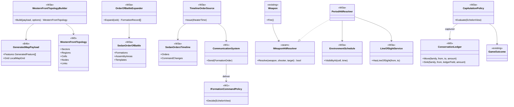
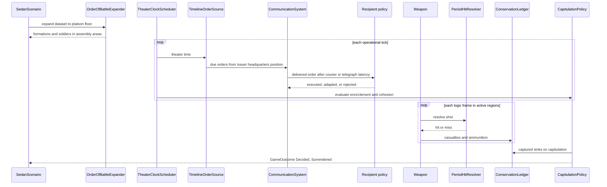

# Deep Dive: W3a Sedan 1870

> Expands phase W3a of [Track W: Western Front Simulation](../track-w-western-front.md).
> Builds on [W2](w2-fidelity-promotion.md) and [B4b](b4b-geospatial-map-generation.md). Precedes
> [W3b](w3b-somme-sector.md).
>
> Audience: human + agent design for `WI-W3a-01..31`.

Purpose: simulate the Battle of Sedan (Franco-Prussian War, 31 August to 2 September 1870) as the
first geospatial battle of Track W. It is a large-scale proof of concept before the Somme: about
320,000 soldiers, each one `GameObject`, on real terrain, driven by a historical order of battle
and a historical orders timeline, with the outcome left to emerge. W3a also owns the generic
geospatial topology builder that [W3b](w3b-somme-sector.md) reuses.

---

## 1. Decisions applied

| Decision | W3a application |
|---|---|
| Placement | W3a is the first geospatial battle. The former W3 Somme sector becomes W3b and depends on W3a. |
| Representation | All-tactical reference, one `GameObject` per soldier, plus W2 aggregate and mixed-fidelity comparison arms. |
| Forces | Historical order of battle to battalion, battery, and squadron, with provenance per entry. Lower echelons expand from period organization templates to the platoon floor. |
| Command | Historical orders timeline, delivered by mounted courier or field telegraph with simulated latency. Recipient policies execute, adapt, or reject on arrival. Outcome emerges. |
| Content | Period weapons and unit kinds as domain-shipped definitions. Generals models are visual placeholders. |
| Time span | 31 August 00:00 to 2 September 12:00 local mean time, 60 h. |
| Acceptance | Measure only. Historical figures are a reference, never a threshold. |
| Extent | Lat 49.58-49.82 N, lon 4.72-5.20 E, about 27 km north-south by 35 km east-west. Includes Mézières, Donchery, Carignan, Mouzon, and a Belgian strip north of Fleigneux. |
| Projection and scale | UTM 31N, EPSG:32631, `metersPerGameUnit` 0.3048, B4b lattice spacing 3.048 m. About 89 x 69 chunks. |
| DEM | IGN RGE ALTI 1 m for France and the Wallonia 1 m DTM for the Belgian strip, both reprojected and mosaicked by the operator with `gdalwarp`. About 924M samples, about 3.7 GB float32. |
| Vertical datum | `NGF-IGN69`. The operator shifts Belgian heights from Ostend (TAW) by a constant offset, recorded in the manifest. |
| Vectors | Modern OSM-derived roads, rivers, woods, and villages. Operator-digitized 1870 features from public-domain staff maps: rail as of 1870, bridges, pontoon crossings, the Sedan fortress, inundations, and the 1870 border. |
| Grid | 1000 m regions of 8 x 8 cells of 125 m, as in W3b. |
| Artillery | Tactical: each gun is a crew-served direct-fire `GameObject` with line of sight. Differs from W2, where artillery stays operational. |
| Fire resolution | Seeded per-shot hit probability from a range table behind a new weapon hit-resolution seam. Shells burst with a lethal radius. |
| Save/load | None. W6 owns snapshots. The scale probe gates the reference run's wall-clock budget. |

## 2. Relationship to W1, W2, and W3b

- W1 supplies formations, headquarters, `FormationOrder`, `CommLink`, `CommandSystem`, movement,
  logistics, aggregate combat, and morale. W3a adds comm types, order kinds, and 1870 parameters.
- W2 supplies activation policies, promotion, soldier placement, casualty classification,
  `SoldierAmmoModule`, demotion, and the reference/mixed/aggregate run families. W3a widens the
  tactical layer with period weapons, artillery, cavalry, line of sight, and surrender.
- W3b reuses the W3a topology builder, grid, feature mapping, and A5 geospatial rendering, and
  adds only Somme inputs, validation, and front-line bands.

## 3. Input package

W3a consumes the B4b standalone payload until H3 exists. The payload is the boundary, not the
operator's raw data. This contract applies to W3b unchanged.

Required payload metadata:

- `GeospatialMapTransform` with EPSG code, `metersPerGameUnit`, and `verticalDatum`;
- `LocalMapGrid` chunk layout and projected bounds;
- generated terrain chunks, material chunks, masks, and generated features;
- generated features with stable `SourceId`, geometry kind, source layer, source attributes, and
  payload-local coordinates;
- report entries for control points, source hashes, sample spacing, no-data handling, and
  chunk-count summary.

Operator-local acquisition, digitizing, and reprojection steps stay in investigation cards. No IGN,
NGI, or OSM extract, digitized vector, generated payload, or reprojected raster is committed.

## 4. Topology derivation

`WesternFrontTopologyBuilder` reads `GeneratedMapPayload` and produces the W0/W1 topology model.
The builder is generic; per-scenario options select layers and band rules.

Rules:

1. The selected extent becomes one sector group. An optional band layer splits it into bands:
   W3b uses 1916 front-line polylines; W3a uses none and starts with one band per side's initial
   assembly areas.
2. A regular 1000 m projected grid creates `region:` keys. Grid cells that intersect the playable
   extent are retained.
3. Each region creates 8 x 8 `cell:` keys. Cell edges are 125 m, or 410.104987 game units at true
   scale.
4. Roads, rail, rivers, villages, and woods remain attached as source features. Roads and rail
   become movement and logistics candidates.
5. Depot nodes are seeded from rail and road junctions near rear-area features, or from dataset
   supply points when a scenario supplies them.
6. Transport links follow road and rail feature lines. Each link records the feature `SourceId`
   and tail-region ownership, matching W0 and W1.
7. Every region, cell, node, and link records its source feature keys or the grid derivation record
   that created it.

The builder is deterministic for one payload. Source features are sorted by `SourceId`, then
geometry order, then coordinate order.

W3a feature layers:

| Layer | Topology effect |
|---|---|
| `bridge` | River-crossing link with capacity; initial state from the scenario dataset. |
| `pontoon` | River-crossing link added at its dataset time, for example the Donchery and Bazeilles crossings. |
| `fortress` | Sedan fortress node: refuge region set, fortress gun holdings, cover class. |
| `inundation` | Cells impassable or slowed by parameter. |
| `village`, `woods` | Cell cover class for fire resolution and line of sight. |
| `border` | Cells north of the 1870 border are neutral territory (see §7.6). |

## 5. Forces and order of battle

### 5.1 Sources

The dataset derives from public-domain primary sources only:

- Moltke, The Franco-German War of 1870-71 (Forbes translation, 1893), Orders of Battle appendix;
- Clarke's translation of the Prussian General Staff history, The Franco-German War 1870-71, with
  its map volume;
- Hooper, The Campaign of Sedan (1887), for dispositions and times.

Modern secondary summaries serve only as cross-checks and are cited as such. Every entry carries a
`source` field (work, page or section) and a `confidence` of `stated`, `derived`, or `estimated`.

### 5.2 Scale

| Side | Formations | Guns | Personnel |
|---|---|---|---|
| German: Third Army (V, XI, I Bavarian, II Bavarian corps, Württemberg Division, 4th Cavalry Division) and Army of the Meuse (Guard, IV, XII Saxon corps, cavalry) | 222 battalions, 186 squadrons | 774 | about 200,000 |
| French: Army of Châlons (I, V, VII, XII corps, reserve cavalry, army reserve artillery), Sedan garrison | 202 battalions, 80 squadrons | 564 including about 70 mitrailleuses, plus fortress pieces | about 120,000 |

### 5.3 Dataset and expansion

`SedanOrderOfBattle` is committed JSON under the domain project:

- one entry per formation from army down to battalion, battery, and squadron: stable key
  `formation:<side>/<path>`, echelon, kind, commander, parent, nominal strength, estimated field
  strength on 31 August, weapon set, source, confidence;
- initial assembly area per division or brigade as a lat/lon polygon with source;
- organization templates per side and kind: Prussian battalion of 4 companies of 3 Züge; French
  battalion of 6 companies of 2 sections; chasseur and Jäger battalions; cavalry regiment of 4 to 5
  squadrons; battery of 6 guns with crews, limbers, caissons, and horse teams.

`OrderOfBattleExpander` expands battalions, squadrons, and batteries through the templates to the
platoon floor (Zug, section, cavalry troop, gun section). Generated keys append template paths, so
keys are stable across runs. French field strengths start below nominal to reflect Beaumont
losses and straggling; the dataset records both values.

The schema is generic. W6 evaluates it for 1916 (`WI-W6-02`).

## 6. Period content

Definitions ship as INI files in the domain project, loaded into an `AssetStore` scope above
Generals. Period values with units and provenance live in parameters JSON (W1 format); INI holds
engine-facing fields derived from them.

| Kind | Placeholder model | Notes |
|---|---|---|
| French line, chasseur, Zouave, Turco, and Marine infantry | `ChinaInfantryRedguard` | Chassepot. |
| German line, Jäger, and Guard infantry | `AmericaInfantryRanger` | Dreyse. |
| Cavalry trooper (cuirassier, dragoon, hussar, uhlan, lancer, chasseur d'Afrique) | Generals mounted or fast infantry placeholder | Sabre, lance, or carbine by kind; carries one `horse` holding. |
| Field gun and mitrailleuse | Generals towed or light vehicle placeholder | Crewed; see §7.4. |
| Limber and caisson | Generals supply-truck placeholder | Hold `artillery_ammo`; drawn by `horse` holdings. |
| Headquarters | Generals command placeholder | Issues and receives orders; courier origin. |

Initial weapon values, to be verified with sources in `WI-W3a-13`:

| Weapon | Effective range | Maximum or sighted range | Rate of fire | Carried load |
|---|---|---|---|---|
| Chassepot Mle 1866 | 1,200 m (3,937 u) | 1,600 m (5,249 u) | about 10 rounds/min sustained | about 90 rounds |
| Dreyse needle gun | 400 m (1,312 u) | 600 m (1,969 u) | about 6 rounds/min | about 70 rounds |
| Krupp 4-pdr C/64 | direct-fire table | 3,500 m (11,483 u) | 6-8 rounds/min | limber plus caisson |
| Prussian 6-pdr | direct-fire table | about 3,500 m, approximate | 6-8 rounds/min | limber plus caisson |
| La Hitte 4-pdr and 12-pdr | direct-fire table | about 3,000 m (9,843 u) | about 2 rounds/min | limber plus caisson |
| Reffye mitrailleuse | 1,800 m (5,906 u) | 3,400 m | about 100 rounds/min | 25-round plates |

Ranges are one to two orders of magnitude beyond Generals weapons, and `VisionRange` must match.
Target acquisition cost grows with range, so the scale probe measures it explicitly.

## 7. Tactical combat

### 7.1 Fire resolution

Stock Generals direct-fire weapons always hit. W3a adds a weapon hit-resolution seam
(`IWeaponHitResolver`, see [seams](../seams.md)) consulted in the `Weapon` fire path before
`WeaponTarget.DoDamage`. The resolver is null by default, so RTS behavior is unchanged.

`PeriodHitResolver` is used when a weapon template names a hit table:

- probability from range band, target posture (standing, kneeling, prone), target cell cover class
  (open, village, woods, fortress), visibility multiplier (§8.3), and fire mode (aimed or volley);
- one draw per shot on the W1 seeded stream keyed `runSeed|cellKey|frameIndex|fire`, consumed in
  ascending shooter object id order;
- a miss spends the round and applies no damage.

### 7.2 Shells and fuzes

- Percussion shell: impact point is the aim point plus seeded dispersion growing with range; damage
  applies within a lethal radius through `DamageInfoInput`.
- Shrapnel and case: burst at the fuze range; case shot is a short-range cone.
- La Hitte time fuzes allow only two preset shell burst ranges. A shell fired at another range
  bursts at the nearer preset or acts as percussion, per the parameter table.

### 7.3 Line of sight

Direct fire and detection need line of sight over generated terrain heights plus feature
occluders: woods and villages block beyond a cover-dependent depth. Checks run against the B4b
height lattice at cell resolution first, then sample resolution for pairs that pass. Visibility
range is capped by the environment schedule (§8.3).

### 7.4 Artillery

A battery is 6 gun objects, each with a crew of soldier objects, a limber, and a caisson.

- A gun fires only when crewed at or above a parameter minimum and unlimbered.
- Limbering and unlimbering take parameter time; guns move only limbered with horse teams.
- Rounds move from caisson to limber to gun through the ledger; ammunition columns resupply
  caissons through W1 logistics links.
- All fire is direct. Indirect fire is out of scope.
- An uncrewed gun left in enemy-held cells changes owner as a `field_gun` holding transfer, not a
  sink. The same applies to mitrailleuses, limbers, and caissons.

### 7.5 Cavalry

A trooper is one soldier object carrying one `horse` holding. Horse loss dismounts the trooper,
who continues with reduced speed and carbine only. Charges use a melee weapon with a shock bonus
parameter against unformed or disordered targets. Horse casualties are drawn per hit by parameter
fraction.

### 7.6 Casualty classes, families, and neutral territory

- Classes: killed, wounded, and missing (W2), plus `captured` (by captor side) and `interned`.
- Families: `personnel`, `horse`, `field_gun`, `mitrailleuse`, `artillery_ammo`, `saa`. `mg` and
  `heavy_gun` stay in the schema at zero. Fortress pieces are `field_gun` holdings on the fortress
  node. The W0 schema version increases for the new families and sinks.
- Neutral territory: German movement into border cells is forbidden. French soldiers, horses, and
  guns entering them move to the `interned` sink.

## 8. Command, orders, and environment

### 8.1 Communication

| Type | Base latency | Disruption | Availability |
|---|---|---|---|
| Mounted courier | path length on links / courier speed (road or cross-country) plus staff delay | loss chance per region crossed with enemy presence | all headquarters |
| Field telegraph | fixed short delay | cut when either endpoint region is enemy-held | German royal and army headquarters on dataset lines |
| Runner | W1 rule | W1 rule | battalion and below |

Telephone and wireless are disabled by the 1870 parameter set.

### 8.2 Orders timeline

`SedanOrdersTimeline` is committed JSON beside the order of battle. Entries:

- order: id, reported time, issuer key, recipient key, W1 objective or a new kind (`retire-on`,
  `cross-at`, `assemble`), target (region, feature `SourceId`, or lat/lon), method, source,
  confidence;
- command change: effective time, formation key, new commander, source. MacMahon to Ducrot and
  Ducrot to Wimpffen on 1 September are command-change entries, not emergent wounding.

Rules:

- An order is issued at its reported time from the issuer headquarters' simulated position and
  travels through §8.1 links. Arrival time is simulated.
- On arrival the recipient policy classifies the order `executed`, `adapted` (nearest valid
  equivalent objective), or `rejected` (with reason) from its `EchelonView`.
- Echelons without dataset orders use W1 reactive policies.
- Capitulation and ceasefire orders are excluded; §9 decides them.

Metrics: `order-latency` and `order-loss` (W1), `order-applicability` by class, and
`order-arrival-offset` (simulated minus historical arrival, where the source states one).

### 8.3 Clock and environment

- Time basis: Sedan local mean time, UTC+00:19:48. Dataset times record the reported time and the
  source's basis note.
- Clock cadences and compression follow W0.
- Environment schedule sets light and visibility per operational tick:

| Date | Sunrise | Sunset | Moon |
|---|---|---|---|
| 31 Aug 1870 | 05:17 | 18:43 | waxing crescent, 27%, sets 21:15 |
| 1 Sep 1870 | 05:18 | 18:40 | waxing crescent, 38%, sets 21:45 |
| 2 Sep 1870 | 05:20 | 18:38 | waxing crescent, 49%, sets 22:22 |

Times are local mean time, computed from standard ephemeris for 49.70 N, 4.95 E.

- Weather: dense Meuse valley fog on 1 September until about 07:00, applied to cells below a
  parameter elevation; clear the rest of 1 September; rain on 2 September. Rain on the night of
  30-31 August slows cross-country movement by a parameter mud factor on 31 August.
- Night reduces detection range and march speed by parameter.

## 9. Surrender and capitulation

- Encirclement: a formation is encircled when no path through regions not held by the enemy
  connects it to an exit. Exits are the western extent edge toward Mézières and neutral territory.
- Local surrender: a platoon that is encircled, below a cohesion threshold, and within a parameter
  distance of enemy soldiers surrenders. Its soldiers move to `captured` and its equipment
  transfers to the captor.
- Army capitulation: the French army policy capitulates when the encircled fraction of army
  personnel, army cohesion, and breakout feasibility cross parameter thresholds. After a
  negotiation delay, every French formation in the encirclement moves to `captured`, and the P3
  `GameOutcome` becomes `Decided` with `OutcomeReason.Surrendered`.
- A run reaching 2 September 12:00 without capitulation ends `InProgress` with its final state.
  No score decision applies.

The historical white flag (1 September about 16:30) and signing (2 September late morning) are
reference points only.

## 10. Scale and run families

| Quantity | Estimate |
|---|---|
| Soldier objects, all-tactical | about 320,000 |
| Guns, limbers, caissons | about 1,340 guns plus about 2,700 limbers and caissons |
| Platoon-floor formations | about 6,400 |
| Regions and cells | about 945 regions, about 60,000 cells |
| Logic frames | 60 h at 30 Hz, about 6.48M |
| Operational ticks | 3,600 |

Wall-clock is unknown until measured: 50 ms per frame is about 90 h; 200 ms is about 15 days. The
run is single-process; W5 sharding comes later.

All arms record in the [A1-6](a1-6-operational-recording.md) `Operational` mode: operational
records every operational tick (3,600), engine checkpoints at frame zero and every theater hour
(61), and state hashes per boundary. Tactical frames are reconstructed on demand. Estimated bundle
size per reference seed is about 25-45 GB ([A1-6 §7](a1-6-operational-recording.md#7-size-and-latency));
`WI-W3a-01` measures per-object persisted bytes and checkpoint size to confirm it.

Run families (W2):

| Arm | Activation | Seeds |
|---|---|---|
| Reference | `AllTacticalActivationPolicy` from frame zero | 4 |
| Mixed | `ContactActivationPolicy` | 64 |
| Aggregate | W1 aggregate combat only | 64 |

`WI-W3a-01` probes spawning 320,000 soldier objects with long-range acquisition and reports
per-frame cost and peak memory. If the projected reference run exceeds 14 days of wall-clock per
seed, the card stops and escalates to the operator. Options then include pulling the W6 domain
snapshot forward or reducing reference seeds; modelled detail is not reduced by default.

## 11. Evidence

Milestone evidence, all measured:

- every family conserves exactly, including `horse`, `mitrailleuse`, `captured`, and `interned`;
- recording reconstructs each layer at selected frames, including tactical frames reconstructed
  from checkpoints with every operational hash in the interval matching;
- a fixed seed reproduces its run within one run identity;
- order metrics from §8.2;
- aggregate and mixed error distributions against the reference;
- a divergence table against the historical reference below.

| Reference | Historical figure |
|---|---|
| German casualties, 1 September | about 9,000 to 9,900 killed, wounded, and missing |
| French killed and wounded, 1 September | about 17,000 to 18,000 |
| French captured during the battle | 21,000 |
| French captured at capitulation | 83,000 |
| French interned in Belgium | about 3,000 |
| Guns captured | 419 field pieces plus 139 fortress guns |
| Bazeilles in German hands | 1 September, late morning |
| Ring closed near Illy | 1 September, about 12:00 |
| Bois de la Garenne taken | 1 September, about 14:30 |
| White flag | 1 September, about 16:30 |
| Capitulation signed | 2 September, late morning |

## 12. Sub-items and cards

| Item | Card | Deliverable | Acceptance criteria |
|---|---|---|---|
| W3a-1 | [`WI-W3a-01`](../agent/cards/WI-W3a-01-scale-probe.md) | Scale probe report. | Per-frame cost and peak memory at 320,000 soldier objects with long-range acquisition; projected reference wall-clock. |
| W3a-2 | [`WI-W3a-02`](../agent/cards/WI-W3a-02-operator-geospatial-inputs.md) | Operator-local input manifest. | Manifest names DEM, vector, and digitized 1870 sources, CRS, datum offset, and non-committed paths. |
| W3a-3 | [`WI-W3a-03`](../agent/cards/WI-W3a-03-sedan-payload-validation.md) | Payload validation. | Rejects wrong CRS, scale, datum, bounds, or missing W3a layers. |
| W3a-4 | [`WI-W3a-04`](../agent/cards/WI-W3a-04-topology-builder-contract.md) | `WesternFrontTopologyBuilder` contract. | Topology derives from payload values with stable source references. |
| W3a-5 | [`WI-W3a-05`](../agent/cards/WI-W3a-05-region-cell-grid.md) | Region and cell grid. | 1000 m regions and 125 m cells cover the extent without duplicates. |
| W3a-6 | [`WI-W3a-06`](../agent/cards/WI-W3a-06-vector-feature-to-topology.md) | Feature-to-topology mapping. | Every link and annotation carries source ids; W3a layers apply their §4 effects. |
| W3a-7 | [`WI-W3a-07`](../agent/cards/WI-W3a-07-neutral-territory.md) | Neutral territory. | German entry is blocked; French entry moves holdings to `interned`. |
| W3a-8 | [`WI-W3a-08`](../agent/cards/WI-W3a-08-order-of-battle-schema.md) | Order-of-battle schema. | Schema validates keys, echelons, parents, strengths, templates, and provenance. |
| W3a-9 | [`WI-W3a-09`](../agent/cards/WI-W3a-09-french-order-of-battle.md) | French order-of-battle dataset. | Every French battalion, battery, and squadron has a source; totals match §5.2 within stated confidence. |
| W3a-10 | [`WI-W3a-10`](../agent/cards/WI-W3a-10-german-order-of-battle.md) | German order-of-battle dataset. | Every German battalion, battery, and squadron has a source; totals match §5.2 within stated confidence. |
| W3a-11 | [`WI-W3a-11`](../agent/cards/WI-W3a-11-organization-template-expansion.md) | Template expansion. | Expansion to the platoon floor is deterministic with stable keys. |
| W3a-12 | [`WI-W3a-12`](../agent/cards/WI-W3a-12-period-ledger-families.md) | Schema version with new families and sinks. | `horse`, `mitrailleuse`, `captured`, `interned` conserve exactly. |
| W3a-13 | [`WI-W3a-13`](../agent/cards/WI-W3a-13-period-weapon-parameters.md) | Period weapon parameters. | Every value has unit and source; §6 values are verified or corrected. |
| W3a-14 | [`WI-W3a-14`](../agent/cards/WI-W3a-14-period-content-definitions.md) | Period INI definitions. | Objects and weapons load in a scope above Generals with placeholder models. |
| W3a-15 | [`WI-W3a-15`](../agent/cards/WI-W3a-15-weapon-hit-resolution.md) | Hit-resolution seam and `PeriodHitResolver`. | Null resolver keeps RTS behavior identical; period hits follow the table per seed. |
| W3a-16 | [`WI-W3a-16`](../agent/cards/WI-W3a-16-shells-and-fuzes.md) | Shell burst and fuze model. | Percussion, shrapnel, case, and La Hitte preset behavior match §7.2. |
| W3a-17 | [`WI-W3a-17`](../agent/cards/WI-W3a-17-line-of-sight.md) | Terrain and feature line of sight. | Fire and detection require line of sight; occluders apply by cover depth. |
| W3a-18 | [`WI-W3a-18`](../agent/cards/WI-W3a-18-environment-schedule.md) | Light and weather schedule. | Schedule values match §8.3 and modify detection, fire, and movement. |
| W3a-19 | [`WI-W3a-19`](../agent/cards/WI-W3a-19-tactical-artillery.md) | Tactical batteries. | Crew minimum, limbering, ammunition flow, and capture transfer follow §7.4. |
| W3a-20 | [`WI-W3a-20`](../agent/cards/WI-W3a-20-cavalry-troopers.md) | Cavalry troopers. | Horse holdings, dismounting, and charges follow §7.5. |
| W3a-21 | [`WI-W3a-21`](../agent/cards/WI-W3a-21-courier-and-telegraph-links.md) | Courier and telegraph comm types. | Latency and disruption follow §8.1; telephone and wireless are disabled. |
| W3a-22 | [`WI-W3a-22`](../agent/cards/WI-W3a-22-orders-timeline-dataset.md) | Orders timeline schema and dataset. | Every order and command change has a source and resolvable keys. |
| W3a-23 | [`WI-W3a-23`](../agent/cards/WI-W3a-23-order-applicability.md) | Timeline issue and applicability. | Orders issue from simulated headquarters; applicability and arrival-offset metrics record. |
| W3a-24 | [`WI-W3a-24`](../agent/cards/WI-W3a-24-local-surrender.md) | Encirclement and local surrender. | Surrendered soldiers move to `captured`; equipment transfers. |
| W3a-25 | [`WI-W3a-25`](../agent/cards/WI-W3a-25-army-capitulation.md) | Army capitulation policy. | Capitulation sets `Decided`/`Surrendered`; window end without it records `InProgress`. |
| W3a-26 | [`WI-W3a-26`](../agent/cards/WI-W3a-26-sedan-scenario-assembly.md) | Sedan scenario assembly. | 31 August 00:00 state places every formation in its assembly area with valid links. |
| W3a-27 | [`WI-W3a-27`](../agent/cards/WI-W3a-27-a5-geospatial-rendering.md) | A5 geospatial rendering. | A5 shows regions, cells, features, nodes, links, and source ids. |
| W3a-28 | [`WI-W3a-28`](../agent/cards/WI-W3a-28-all-tactical-reference-run.md) | All-tactical reference run. | Reference seeds complete the 60 h window in `Operational` mode; sampled reconstructions verify. |
| W3a-29 | [`WI-W3a-29`](../agent/cards/WI-W3a-29-aggregate-and-mixed-runs.md) | Aggregate and mixed arms. | 64 seeds per arm with error distributions against the reference. |
| W3a-30 | [`WI-W3a-30`](../agent/cards/WI-W3a-30-sedan-evidence-report.md) | Sedan evidence report. | Report records §11 evidence, the divergence table, and provenance. |
| W3a-31 | [`WI-W3a-31`](../agent/cards/WI-W3a-31-operational-recording-adapter.md) | Operational recording adapter. | Western Front `IReconstructableDomain`, `rollup` record kind; a reconstructed tactical interval matches a `Full` recording of the same seed. |

## 13. Architecture diagrams

## Appendix: Current-state hooks (agent context)

- `src/Panopticon.Simulation/Logic/Object/Weapon/Weapon.cs:157`: `Weapon.Fire`, where the hit
  resolver is consulted.
- `src/Panopticon.Simulation/Logic/Object/Weapon/WeaponTarget.cs:36-50`: `DoDamage` applies
  `DamageInfoInput` to the target object.
- `src/Panopticon.Simulation/Logic/Object/Weapon/WeaponTemplate.cs:277-282`: `ScatterRadius`,
  `ScatterRadiusVsInfantry`, and `AttackRange`.
- `src/Panopticon.Simulation/Logic/Object/ObjectDefinition.cs:506-511`: `VisionRange` and
  `ShroudClearingRange`.
- `src/Panopticon.Simulation/Logic/Object/GameObject.cs:272`: `AttemptDamage`.
- `src/Panopticon.Simulation/Logic/PartitionCellManager.cs:10` and
  `src/Panopticon.Simulation/GameData.cs:793`: partition cells and `PartitionCellSize`, which bound
  long-range target scans.
- `src/Panopticon.Simulation/Logic/GameOutcome.cs:5-20`: `OutcomeStatus`, `OutcomeReason`, and
  `GameOutcome`.
- `src/Panopticon.Simulation/SageGame.cs:21-25`: Generals logic runs at 30 frames per second.
- W0-W2 hooks: see the [W2 appendix](w2-fidelity-promotion.md#appendix-current-state-hooks).
