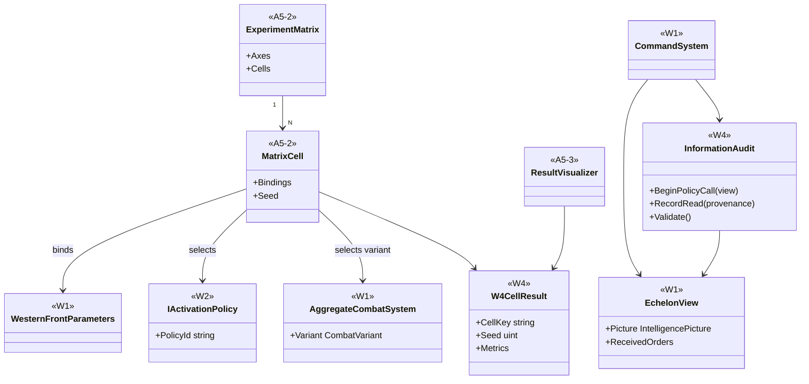
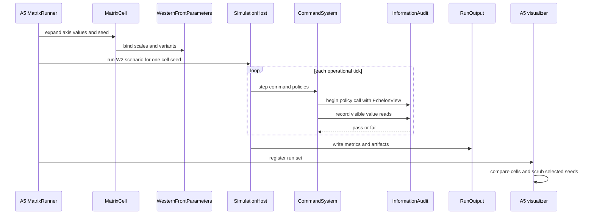

# Deep Dive: W4 Command and Logistics Experiment

> Expands phase W4 of [Track W: Western Front Simulation](../track-w-western-front.md).
> Builds on [W2](w2-fidelity-promotion.md), [A5](a5-visualization.md), and [B1](../track-b-scale.md).
>
> Audience: human + agent design for `WI-W4-01..06`.

Purpose: turn the W1 and W2 command, logistics, activation, and combat parameters into a full A5-2
experiment matrix. W4 measures distributions, sensitivity, cost, and information-boundary
correctness. It does not tune the model to historical outcomes.

---

## 1. Decisions applied

| Decision | W4 application |
|---|---|
| Matrix size | Full 216 cells: 4 x 3 x 3 x 3 x 2. |
| Seeds | 64 seeds per cell. |
| Sweep runner | A5-2 experiment matrix dispatches cells and records results. |
| Activation axis | `never`, `contact`, `operator-interest`; `contact` remains the default. |
| Combat axis | Stochastic and mean-field variants. |
| Information rule | Policy calls read only their `EchelonView`; the audit fails omniscient access. |

## 2. Experiment matrix

| Axis | Values |
|---|---|
| Order latency scale | 0.5, 1, 2, 4 |
| Reconnaissance detection probability scale | 0.25, 0.5, 1 |
| Link capacity scale | 0.5, 1, 2 |
| Activation policy | `never`, `contact`, `operator-interest` |
| Combat variant | `stochastic`, `mean-field` |

Each cell runs 64 seeds. The scenario source is the W2 synthetic fixture unless W3b evidence is
available, in which case the generated sector becomes an additional named scenario arm rather than
changing the base 216-cell matrix.

## 3. Outputs and analysis

Every cell emits:

- outcome status, ground taken, and front-line movement;
- killed, wounded, missing, equipment loss, and ammunition consumption;
- stock-outs, unmet demand, link utilization, and stock-days;
- order delivery, acknowledgement, expiry, loss, and latency by echelon pair;
- activation counts, dwell time, tactical-frame counts, and transition reasons;
- run cost, memory, and artifact sizes;
- per-seed state and metric artifacts for A5-3 replay.

The report computes median and bootstrap confidence intervals per cell. Sensitivity ranking uses
the matrix axis values and the recorded distributions, not a separate model.

## 4. Information audit

W4 adds an audit stream around policy execution:

1. `CommandSystem` creates an `EchelonView` with an audit token.
2. Policy-visible values carry provenance: own formation, subordinate report, received order,
   observation, interception, or derived-from-visible.
3. The audit records every value read by a policy.
4. A read from global state, future information, enemy internal state, or an unreceived subordinate
   state fails the cell.

Compile-time isolation remains the main guard. The audit is a runtime proof that reference
policies and future policy implementations obey the same rule.

## 5. Sub-items and cards

| Item | Card | Deliverable | Acceptance criteria |
|---|---|---|---|
| W4-1 | [`WI-W4-01`](../agent/cards/WI-W4-01-matrix-axis-contract.md) | Declarative W4 matrix axes and constraints. | A5-2 expands exactly 216 cells with 64 seeds per cell. |
| W4-2 | [`WI-W4-02`](../agent/cards/WI-W4-02-parameter-binding.md) | Bind axes to `WesternFrontParameters`, activation policy, and combat variant. | Each axis changes only the intended parameters and records its values in run output. |
| W4-3 | [`WI-W4-03`](../agent/cards/WI-W4-03-information-audit.md) | Policy information audit. | A test policy that reads outside `EchelonView` fails the run with provenance detail. |
| W4-4 | [`WI-W4-04`](../agent/cards/WI-W4-04-cell-result-schema.md) | W4 result schema. | Outcome, casualties, supply, command latency, activation, cost, and artifacts are keyed by cell and seed. |
| W4-5 | [`WI-W4-05`](../agent/cards/WI-W4-05-sensitivity-report.md) | Distribution and sensitivity report. | Report includes confidence intervals and a sensitivity ranking for every axis. |
| W4-6 | [`WI-W4-06`](../agent/cards/WI-W4-06-a5-comparison-workspace.md) | A5 comparison workspace for W4. | A5 opens a W4 run set, filters cells, and scrubs selected seed artifacts. |

## 6. Architecture diagrams

## Appendix: Current-state hooks (agent context)

- `src/Panopticon.Simulation/Simulation/ISimulationDomainModel.cs:15-63`: the A4 seam for domain
  identity, entity capture, metrics, topology authority, and interaction authority.
- `src/Panopticon.Simulation/SimulationHost.cs:47-73`: headless host and tick events used by the W0
  scheduler.
- `src/Panopticon.Simulation/SimulationHost.cs:107-108`: scheduled order injection entry point.
- `src/Panopticon.Simulation/SimulationHost.cs:153-178`: frame step raises `TickStarting`, advances
  logic, and dispatches due orders.
- `src/Panopticon.Simulation/Recording/RunRecording.cs:15-58`: `WorldStateSampler` and
  `FrameSampled` source for recorded state.
- `src/Panopticon.Simulation/Recording/RunRecording.cs:356-358`: `RunRecording` owns the shared
  sampler.
- `src/Panopticon.Simulation/RunOutput.cs:62-63`: run-output JSON root consumed by A5.
- `src/Panopticon.Simulation/RunOutput.cs:205-253`: run-output recorder samples domain metrics from
  the active domain model.
- `src/Panopticon.Simulation/Logic/AI/Hierarchy/SquadHierarchy.cs:17-18`: existing hierarchy object
  W2 uses for tactical grouping.
- `src/Panopticon.Simulation/Data/Map/MapFile.cs:184-185`: legacy map creation used by B4b dev
  preview.
- `src/Panopticon.Simulation/Terrain/HeightMap.cs:9-11`: current resident heightmap and ten game
  unit sample spacing.
