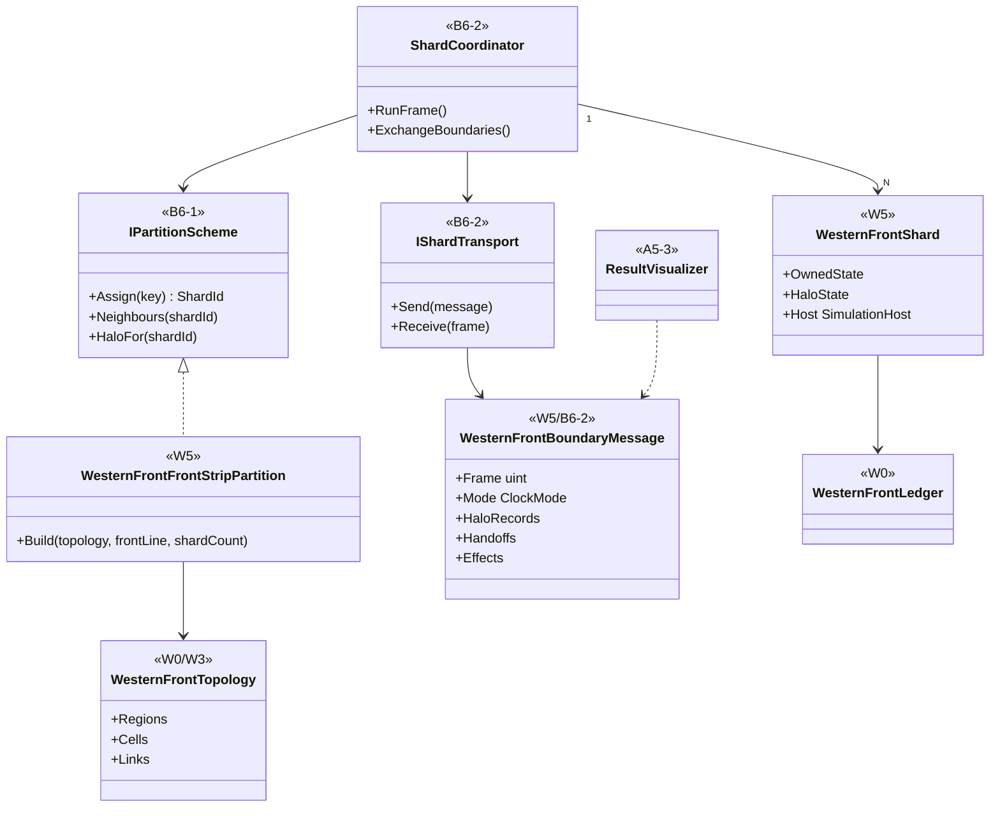
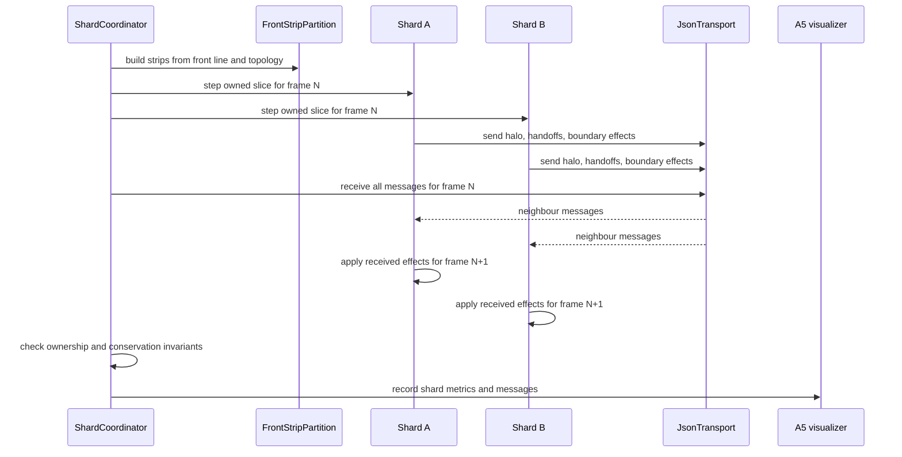

# Deep Dive: W5 Distributed Regional Simulation

> Expands phase W5 of [Track W: Western Front Simulation](../track-w-western-front.md).
> Builds on [W2](w2-fidelity-promotion.md) and [B6](b6-distributed-simulation.md).
>
> Audience: human + agent design for `WI-W5-01..08`.

Purpose: apply B6 to the Western Front domain before the RTS/Bepu slice. The W5 goal is memory and
capacity for all-tactical runs, not speed. Correctness is ownership, conservation, exactly-once
boundary effects, and bounded comparison drift against the single-process reference.

---

## 1. Decisions applied

| Decision | W5 application |
|---|---|
| First B6 domain | Western Front aggregate/tactical domain through A4, not RTS/Bepu. |
| Bepu dependency | W5 does not wait for F4a. The RTS slice still waits for F4a. |
| Partition scheme | Strips perpendicular to the front. Each shard owns both sides of its frontage. |
| Contested pairs | Contested region pairs never cross shards. Only lateral neighbours interact. |
| Sync | Lockstep barrier per operational tick in compressed mode and per logic frame in tactical mode. |
| Handoff cadence | Every host frame. In compressed mode, that is one operational tick. |
| Messages | JSON for in-process B6-2; compact binary later for B6-6. |
| Goal framing | Memory and capacity proof for all-tactical runs. |

## 2. Partition model

`WesternFrontFrontStripPartition` implements the B6 `IPartitionScheme` for W topology:

- input: `WesternFrontTopology`, front-line polyline, region adjacency, and requested shard count;
- output: contiguous frontage strips perpendicular to the front;
- invariant: each strip includes blue and red regions facing each other, so a contested pair is
  always owned by one shard;
- neighbour set: only left and right lateral strips;
- halo: lateral neighbour regions, boundary links, pending cross-strip messages, and formations
  within one handoff frame of the boundary.

The scheme partitions region ownership, not source data. The B4b payload and W3 topology remain
shared read-only inputs.

## 3. Shard execution

Each shard owns a `SimulationHost` with a Western Front domain slice:

- owned regions, cells, nodes, links, formations, aggregates, tactical soldiers, and messages;
- read-only halo state for lateral neighbours;
- a shard-local ledger plus a coordinator conservation check over all shards;
- boundary inbox and outbox exchanged through an in-process JSON transport.

Compressed mode advances one operational tick per host frame. Tactical mode advances one logic
frame per host frame. The coordinator runs a barrier after each frame and applies boundary
messages before the next frame begins.

## 4. Boundary messages and handoff

JSON `WesternFrontBoundaryMessage` values carry:

- source shard, target shard, host frame, theater time, and mode;
- halo snapshots for lateral boundary regions, links, and formations;
- handoff events for formations or tactical soldiers crossing a lateral boundary;
- cross-strip logistics shipments and command messages;
- acknowledgements and invariant summaries.

Authority rules:

- contested combat pair: owning frontage strip, never boundary;
- lateral logistics or command message: sender shard emits once, receiver applies once;
- formation handoff: source owns through frame N, target adopts at N+1, source drops after ack;
- conserved holdings move through ledger events included in the handoff.

## 5. Evidence

W5 compares sharded and single-process runs by distributions and invariants, not byte identity.

Required evidence:

- each region, formation, tactical soldier, shipment, and message has exactly one owner;
- aggregate conservation residuals are empty across shard-local ledgers;
- no contested pair crosses a shard boundary;
- every cross-boundary effect has one send, one apply, and one acknowledgement;
- handoff latency and halo age metrics are bounded by one host frame;
- A5 comparison localizes any drift beyond the W2 envelope.

## 6. Sub-items and cards

| Item | Card | Deliverable | Acceptance criteria |
|---|---|---|---|
| W5-1 | [`WI-W5-01`](../agent/cards/WI-W5-01-front-strip-partition.md) | Front-strip partition design and tests. | No contested pair crosses shards for synthetic and W3 topologies. |
| W5-2 | [`WI-W5-02`](../agent/cards/WI-W5-02-shard-slice-state.md) | Western Front shard slice state. | Owned and halo records are separated and keyed by stable W keys. |
| W5-3 | [`WI-W5-03`](../agent/cards/WI-W5-03-inprocess-json-transport.md) | In-process JSON boundary transport. | Messages round-trip deterministically and preserve frame ordering. |
| W5-4 | [`WI-W5-04`](../agent/cards/WI-W5-04-lockstep-coordinator.md) | Lockstep coordinator. | Barriers occur per operational tick in compressed mode and per logic frame in tactical mode. |
| W5-5 | [`WI-W5-05`](../agent/cards/WI-W5-05-cross-boundary-handoff.md) | Formation and soldier handoff. | Ownership is exactly one through handoff and conserved holdings move through ledger events. |
| W5-6 | [`WI-W5-06`](../agent/cards/WI-W5-06-boundary-effects.md) | Logistics, command, and halo effects. | Each boundary effect has one send, one apply, one ack, and metrics. |
| W5-7 | [`WI-W5-07`](../agent/cards/WI-W5-07-sharded-vs-reference-evidence.md) | Sharded versus reference evidence. | Invariants pass and outcome distributions compare within the W2 envelope. |
| W5-8 | [`WI-W5-08`](../agent/cards/WI-W5-08-a5-shard-visualization.md) | A5 shard visualization. | A5 displays strip ownership, halo age, handoffs, and boundary messages over time. |

## 7. Architecture diagrams

## Appendix: Current-state hooks (agent context)

- `src/Panopticon.Simulation/Simulation/ISimulationDomainModel.cs:15-63`: the A4 seam for domain
  identity, entity capture, metrics, topology authority, and interaction authority.
- `src/Panopticon.Simulation/SimulationHost.cs:47-73`: headless host and tick events used by the W0
  scheduler.
- `src/Panopticon.Simulation/SimulationHost.cs:107-108`: scheduled order injection entry point.
- `src/Panopticon.Simulation/SimulationHost.cs:153-178`: frame step raises `TickStarting`, advances
  logic, and dispatches due orders.
- `src/Panopticon.Simulation/Recording/RunRecording.cs:15-58`: `WorldStateSampler` and
  `FrameSampled` source for recorded state.
- `src/Panopticon.Simulation/Recording/RunRecording.cs:356-358`: `RunRecording` owns the shared
  sampler.
- `src/Panopticon.Simulation/RunOutput.cs:62-63`: run-output JSON root consumed by A5.
- `src/Panopticon.Simulation/RunOutput.cs:205-253`: run-output recorder samples domain metrics from
  the active domain model.
- `src/Panopticon.Simulation/Logic/AI/Hierarchy/SquadHierarchy.cs:17-18`: existing hierarchy object
  W2 uses for tactical grouping.
- `src/Panopticon.Simulation/Data/Map/MapFile.cs:184-185`: legacy map creation used by B4b dev
  preview.
- `src/Panopticon.Simulation/Terrain/HeightMap.cs:9-11`: current resident heightmap and ten game
  unit sample spacing.

- `src/Panopticon.Simulation/IGameEngine.cs:14-41`: engine services a shard can own through the
  host seam.
- `src/Panopticon.Simulation/Network/NetworkMessageBuffer.cs:10-48`: frame-ordered network buffer
  pattern reused by later B6-6 transport.
- `src/Panopticon.Simulation/Network/NetworkMessageBuffer.cs:75-78`: queued frame orders process
  through the real `OrderProcessor`.
