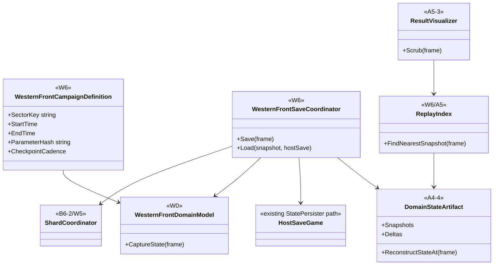
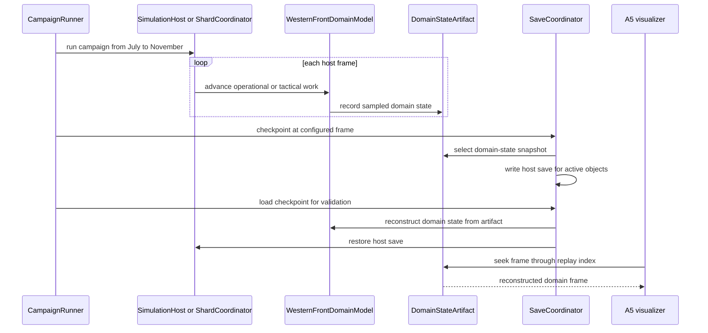

# Deep Dive: W6 Long-Run Campaign

> Expands phase W6 of [Track W: Western Front Simulation](../track-w-western-front.md).
> Builds on [W3](w3-geospatial-sector.md), [W4](w4-command-logistics-experiment.md),
> [W5](w5-distributed-regional-simulation.md), and [A5](a5-visualization.md).
>
> Audience: human + agent design for `WI-W6-01..08`.

Purpose: run a parameterized July-November 1916 campaign on the W3 sector with one-minute
operational ticks, bounded artifacts, reconstructable replay, and save/load that combines a
domain-state artifact snapshot with a host save. W6 is still synthetic unless its investigation
card accepts an operator-supplied historical OOB format.

---

## 1. Decisions applied

| Decision | W6 application |
|---|---|
| Dates | July-November 1916. |
| Duration | About 140 days, about 201600 one-minute operational ticks. |
| Reference product | All-tactical remains primary where capacity permits; aggregate remains for rear and quiet sectors. |
| Save/load | Domain-state artifact snapshot plus host save. |
| `StatePersister` | Host objects only. Domain state is not forced through `StatePersister`. |
| Historical OOB | Deferred to W6 execution as an investigation and decision card. |
| Replay | A5 replayer provides timeline scrubbing over recorded domain-state artifacts. |

## 2. Campaign model

W6 defines a campaign file that binds:

- W3 geospatial sector payload and topology;
- W4 parameter set or matrix-selected parameter cell;
- W5 shard layout when running sharded;
- campaign start and end time;
- planned offensive intent and reserve policy;
- optional historical OOB source, if the investigation accepts one;
- snapshot cadence, replay index cadence, and save checkpoints.

The default campaign uses synthetic formations down to platoon keys and one soldier `GameObject`
per active tactical soldier. Historical names and counts are optional metadata until the W6 OOB
decision is made.

## 3. Persistence and replay

Save/load uses two artifacts:

1. Domain-state artifact snapshot at a selected frame, with schema version, topology key, campaign
   key, and parameter hash.
2. Host save for active host objects, tactical soldiers, pending engine orders, and ordinary game
   services.

Load checks that the host save and domain snapshot agree on frame, theater time, schema, active
regions, and object-key mapping. `StatePersister` handles host objects only. The Western Front
domain reconstructs its state from the domain-state artifact.

A5 replay scrubbing reads indexed domain-state records. It does not rerun the simulation to answer
historical frame queries.

## 4. Long-run evidence

Evidence is collected at run-set level:

- memory, artifact size, and index size as a function of campaign day;
- wall-clock time per operational tick and tactical frame;
- save time, load time, and reconstruction latency;
- replay scrub latency at early, middle, and late campaign frames;
- conservation residuals and ownership invariants across save/load;
- provenance for source data, parameters, seed derivation, and OOB source if present;
- declared approximation error of every active fidelity policy against the W2 envelope and the
  all-tactical reference when available.

## 5. Sub-items and cards

| Item | Card | Deliverable | Acceptance criteria |
|---|---|---|---|
| W6-1 | [`WI-W6-01`](../agent/cards/WI-W6-01-campaign-file.md) | Versioned campaign file. | Campaign binds sector, parameters, shard layout, dates, seed, and checkpoint cadence. |
| W6-2 | [`WI-W6-02`](../agent/cards/WI-W6-02-historical-oob-investigation.md) | Historical OOB format investigation. | Decision records accepted source format or keeps synthetic OOB. |
| W6-3 | [`WI-W6-03`](../agent/cards/WI-W6-03-long-run-clock-plan.md) | 201600-tick run plan. | One-minute operational ticks and one-hour campaign ticks cover July-November without drift. |
| W6-4 | [`WI-W6-04`](../agent/cards/WI-W6-04-domain-snapshot-save-load.md) | Domain snapshot plus host save/load. | Load validates frame, theater time, active regions, schema, and object-key mapping. |
| W6-5 | [`WI-W6-05`](../agent/cards/WI-W6-05-replay-indexing.md) | A5 replay index for long artifacts. | Scrub latency remains bounded at early, middle, and late frames. |
| W6-6 | [`WI-W6-06`](../agent/cards/WI-W6-06-long-run-metrics.md) | Memory, artifact, and wall-clock metrics. | Report covers tick cost, memory, artifact size, save/load time, and reconstruction latency. |
| W6-7 | [`WI-W6-07`](../agent/cards/WI-W6-07-approximation-error-report.md) | Fidelity approximation report. | Every active fidelity policy declares error against W2 envelope or all-tactical reference. |
| W6-8 | [`WI-W6-08`](../agent/cards/WI-W6-08-campaign-evidence-report.md) | W6 final evidence report. | Long-run report includes provenance, conservation, replay, save/load, and scaling results. |

## 6. Architecture diagrams

## Appendix: Current-state hooks (agent context)

- `src/Panopticon.Simulation/Simulation/ISimulationDomainModel.cs:15-63`: the A4 seam for domain
  identity, entity capture, metrics, topology authority, and interaction authority.
- `src/Panopticon.Simulation/SimulationHost.cs:47-73`: headless host and tick events used by the W0
  scheduler.
- `src/Panopticon.Simulation/SimulationHost.cs:107-108`: scheduled order injection entry point.
- `src/Panopticon.Simulation/SimulationHost.cs:153-178`: frame step raises `TickStarting`, advances
  logic, and dispatches due orders.
- `src/Panopticon.Simulation/Recording/RunRecording.cs:15-58`: `WorldStateSampler` and
  `FrameSampled` source for recorded state.
- `src/Panopticon.Simulation/Recording/RunRecording.cs:356-358`: `RunRecording` owns the shared
  sampler.
- `src/Panopticon.Simulation/RunOutput.cs:62-63`: run-output JSON root consumed by A5.
- `src/Panopticon.Simulation/RunOutput.cs:205-253`: run-output recorder samples domain metrics from
  the active domain model.
- `src/Panopticon.Simulation/Logic/AI/Hierarchy/SquadHierarchy.cs:17-18`: existing hierarchy object
  W2 uses for tactical grouping.
- `src/Panopticon.Simulation/Data/Map/MapFile.cs:184-185`: legacy map creation used by B4b dev
  preview.
- `src/Panopticon.Simulation/Terrain/HeightMap.cs:9-11`: current resident heightmap and ten game
  unit sample spacing.
